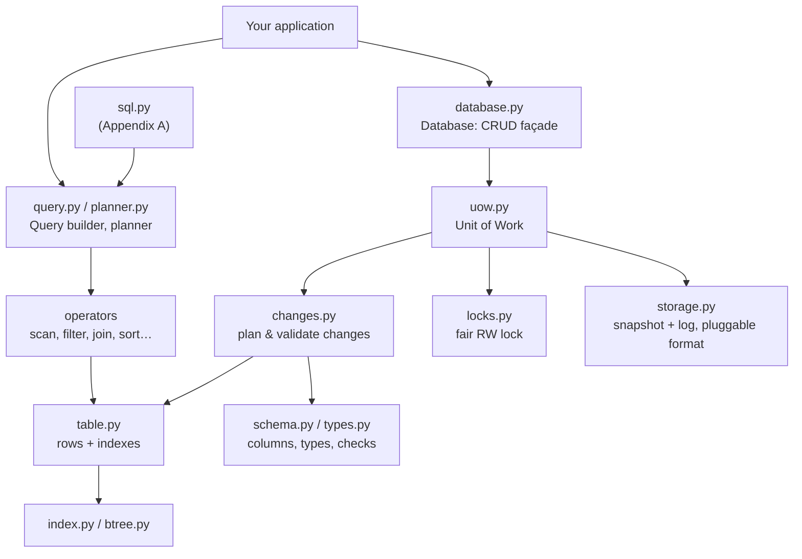

[🏠 Contents](index.md)

# Chapter 1 — What a Relational Database Is

> *"Future users of large data banks must be protected from having to know how the data is organized in the machine."*
> — E. F. Codd, 1970

This book builds a small but real relational database, **minidb**, in pure Python 3.14 using only the standard library. By the last chapter it will have typed columns, constraints, indexes, foreign keys, composable query operators, transactions built on the *Unit of Work* pattern, a fair readers–writer lock, crash-safe persistence and a cost-based query planner. Appendix A adds a small SQL front end on top.

We build it the way real systems grow. We write the simplest thing that could work, run into its limits, then rewrite it. Several subsystems are rewritten twice. That is intentional: the *reasons* for each rewrite are most of what there is to learn.

## 1.1 The relational model in one page

In 1970 Edgar F. Codd proposed storing data as **relations** ([Codd 1970](references.md#codd1970)). Before that, programs navigated pointers between records. The idea was simple and radical: describe *what* data you want, not *how* to walk to it.


The vocabulary, with the everyday SQL words in brackets:

| Term | Everyday name | Meaning |
|---|---|---|
| **Relation** | table | A named set of tuples that share a heading. |
| **Attribute** | column | A name paired with a domain. |
| **Domain** | type | The set of legal values for an attribute (e.g. "integers 0–150"). |
| **Tuple** | row | One value per attribute. |
| **Heading** | schema | The set of attributes. |
| **Key** | primary key / unique | A set of attributes whose values identify exactly one tuple. |
| **Foreign key** | reference | Attributes whose values must match a key in another relation. |

Two properties of the pure model surprise programmers:

1. **A relation is a *set*.** Its tuples have no order and no duplicates. SQL relaxes this (tables are *bags*, and `ORDER BY` exists), and so will we. But we will keep the idea that order is something you *ask for*, never something you can rely on.
2. **Tuples are values, not objects.** A tuple has no identity beyond its contents; you find it by its key. Internally we *will* give every row a hidden `rowid`, as SQLite does ([SQLite rowid tables](references.md#sqlite-rowid)), because it makes the machinery simpler. The user-visible identity is still the primary key.

### Relational algebra

Codd also defined a small algebra of operators that take relations and return relations. Every query is a composition of them:

| Operator | Symbol | SQL | Meaning |
|---|---|---|---|
| Selection | σ | `WHERE` | Keep the tuples satisfying a predicate. |
| Projection | π | `SELECT a, b` | Keep some attributes. |
| Join | ⋈ | `JOIN … ON` | Combine tuples from two relations that match. |
| Union, difference | ∪, − | `UNION`, `EXCEPT` | Set operations. |
| Rename | ρ | `AS` | Rename attributes or relations. |

Because each operator returns a relation, they **compose**. "Names of users older than 40" is π<sub>name</sub>(σ<sub>age>40</sub>(users)). That composability is the backbone of [Chapter 7](07-query-primitives.md), and the freedom to *reorder* those compositions is the whole of [Chapter 14](14-query-planning.md).

### Integrity

A database is more than storage. It **refuses bad data**. Codd's model comes with integrity rules: entity integrity (keys are never NULL), referential integrity (foreign keys point at something real) and domain integrity (values belong to their type). Chapters [3](03-types-and-normalization.md) to [6](06-referential-integrity.md) implement all three.

### Transactions and ACID

Finally, changes happen in **transactions** with four guarantees, named ACID by Härder and Reuter ([Härder & Reuter 1983](references.md#harder1983)):

- **Atomicity** — all of a transaction's changes happen, or none do.
- **Consistency** — every committed state satisfies all constraints.
- **Isolation** — concurrent transactions don't see each other's half-finished work.
- **Durability** — once committed, changes survive a crash.

Atomicity and consistency arrive with the Unit of Work ([Chapters 8](08-unit-of-work-i.md)–[9](09-unit-of-work-ii.md)). Isolation needs locks and validation ([Chapters 10](10-concurrency-i.md)–[12](12-isolation.md)). Durability needs a log on disk ([Chapter 13](13-persistence.md)).

## 1.2 A database in 30 lines

Before any architecture, let's see how far a list of dicts gets us. This toy is not part of minidb; we write it once to feel the problems.

```python
# chapter_01.py
def select(relation, predicate):
    return [t for t in relation if predicate(t)]

def project(relation, *attributes):
    seen, out = set(), []
    for t in relation:
        row = {a: t[a] for a in attributes}
        key = tuple(row.items())
        if key not in seen:          # relations are sets: drop duplicates
            seen.add(key)
            out.append(row)
    return out

def join(left, right, on):
    return [l | r for l in left for r in right if on(l, r)]

users = [
    {"id": 1, "name": "Ada", "age": 36},
    {"id": 2, "name": "Alan", "age": 41},
    {"id": 3, "name": "Grace", "age": None},
]
orders = [
    {"order_id": 10, "user_id": 1, "total": 25},
    {"order_id": 11, "user_id": 2, "total": 40},
    {"order_id": 12, "user_id": 1, "total": 15},
]
```

It works:

```python
>> > from examples.chapter_01 import *
>> > project(select(users, lambda u: u["age"] is not None and u["age"] > 40), "name")
[{'name': 'Alan'}]
>> > for row in join(users, orders, lambda u, o: u["id"] == o["user_id"]):
   ...
print(row["name"], row["total"])
Ada
25
Ada
15
Alan
40
```

The output order follows the nested loops (all of Ada's orders come first), not the order of `orders`. That is one more reason never to rely on row order you didn't ask for.

…and it is wrong in at least eight ways. Each one is a chapter:

| Problem with the toy | Where we fix it |
|---|---|
| Nothing stops `{"id": "one", "age": -5}` | [Ch. 3](03-types-and-normalization.md) types, [Ch. 4](04-constraints.md) constraints |
| Two users can share `id` 1 | [Ch. 5](05-keys-and-indexes.md) keys |
| Finding user 1 scans the whole list | [Ch. 5](05-keys-and-indexes.md) indexes |
| An order can point at user 99, who doesn't exist | [Ch. 6](06-referential-integrity.md) foreign keys |
| `join` compares every pair: O(n·m) | [Ch. 7](07-query-primitives.md), [Ch. 14](14-query-planning.md) |
| A failed batch of changes leaves half of them applied | [Ch. 8](08-unit-of-work-i.md)–[9](09-unit-of-work-ii.md) Unit of Work |
| Two threads appending at once corrupt the list | [Ch. 10](10-concurrency-i.md)–[12](12-isolation.md) concurrency |
| Everything vanishes when the process exits | [Ch. 13](13-persistence.md) persistence |

Notice also the `u["age"] is not None` guard in the first query. Without it, `None > 40` raises `TypeError`. Missing values (SQL's `NULL`) will need careful, consistent rules. We meet them in [Chapter 4](04-constraints.md#42-three-valued-logic).

## 1.3 The architecture we are heading for

Here is minidb as it will look by the end of the book. Each box is a module; arrows mean "calls".



> **Rendering diagrams.** Diagrams written as `mermaid` blocks render on GitHub, GitLab, in VS Code's Markdown preview and in most modern Markdown tools. Static pictures are SVG files in `images/`.

## 1.4 How to read the code in this book

All code targets **Python 3.14** and uses only the standard library. It also runs on 3.13. The package lives in a directory called `minidb/`. Every snippet that belongs to the package starts with a comment saying **where it goes**:

| First line of the snippet | Meaning |
|---|---|
| `# minidb/table.py` | This is the *whole* file. Create it or overwrite it. |
| `# minidb/table.py (replace Table.insert)` | Replace just that method, or a top-level function or class. |
| `# minidb/table.py (add to Table)` | Add these methods to the class. |
| `# minidb/table.py (append)` | Add this code at the end of the file. |
| `# minidb/table.py (imports)` | Add these imports at the top of the file. |

Snippets that start with `>>>` are interactive sessions you can type into a Python shell started in the project directory. Snippets with no header are illustrations, not part of the package.

Every listing in this book was assembled into a package, chapter by chapter, and every `>>>` session was run against it. [Appendix C](appendix-c-complete-code.md) has the complete final code in one place.

Set up a project:

```text
minidb-project/
├── toy.py
└── minidb/
    └── __init__.py      (empty for now)
```

## 1.5 Further reading

- Codd's original paper ([Codd 1970](references.md#codd1970)) is short and readable. Section 1 alone explains why the relational model won.
- *Architecture of a Database System* ([Hellerstein, Stonebraker & Hamilton 2007](references.md#hellerstein2007)) is a free tour of how real systems are organized. Skim it now and reread it at the end of the book.
- For a full textbook treatment, see [Ramakrishnan & Gehrke](references.md#ramakrishnan2003) or [Silberschatz, Korth & Sudarshan](references.md#silberschatz2019).

## Questions and exercises

1. **Sets vs bags.** `project` removes duplicates. Give a query where keeping duplicates changes the *meaning* of the answer, not just its length. (Hint: think of `SUM`.)
2. Why does the toy `join` merge dicts with `l | r`? What goes wrong if both relations have an attribute called `id`? Propose a fix. ([Chapter 7](07-query-primitives.md) has ours.)
3. Write `union(r, s)` and `difference(r, s)` for the toy. What must be true of `r` and `s` for them to make sense? (Codd calls this *union compatibility*.)
4. The toy uses Python lambdas as predicates. List one advantage and one disadvantage of that choice. Keep your answer; we revisit it in [Chapter 14](14-query-planning.md).
5. Which ACID property does each of these violate?
   a) A power cut after a bank transfer was confirmed loses the transfer.
   b) A report shows money that has left one account but not yet arrived in the other.
   c) An order is saved with `quantity = -3`.
6. *(Research)* Read the first two pages of [Codd 1970](references.md#codd1970). What are the three kinds of "data dependence" he wants to remove?

---

[🏠 Contents](index.md) · [Next: Chapter 2 — Tables and CRUD →](02-tables-and-crud.md)
