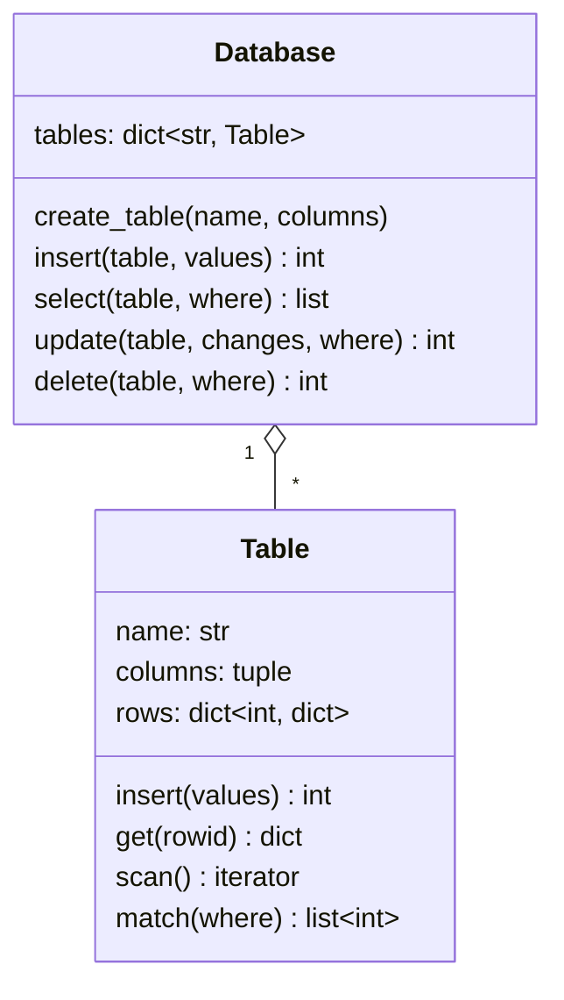
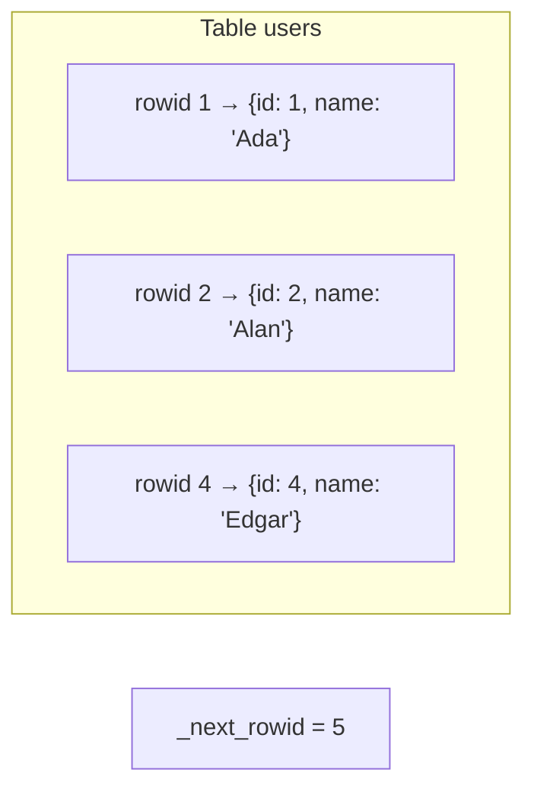

[🏠 Contents](index.md) · [← Previous: Chapter 1 — What a Relational Database Is](01-relational-model.md)

# Chapter 2 — Tables and CRUD, Version 1

In this chapter we create the first real piece of minidb: a `Table` that stores rows and a `Database` that holds tables and exposes the four **CRUD** operations: **C**reate, **R**ead, **U**pdate, **D**elete. Everything is deliberately naive. Columns have names but no types, and nothing is validated. What we get right here is the *shape* of the API and three small decisions that later chapters depend on:

1. Every row gets a hidden, never-reused **rowid**.
2. Rows are **values**: we hand out copies and never mutate a stored row in place.
3. Writes **decide first, then modify**.



## 2.1 Errors first

A database spends much of its time saying *no*, so we start with the exceptions. Every error minidb raises deliberately derives from `DatabaseError`. That way an application can catch "anything the database rejected" without also catching its own bugs.

```python
# minidb/errors.py
"""Exceptions raised by minidb."""


class DatabaseError(Exception):
    """Base class for every error minidb raises on purpose."""


class SchemaError(DatabaseError):
    """A table or column does not exist, or a definition is invalid."""
```

## 2.2 Rows and rowids

How should a table store its rows? A list is the obvious choice, but deleting from the middle shifts every later row, so positions are useless as identifiers. Instead each row gets a **rowid**: an integer from a counter that only goes up. Rows live in a `dict[int, dict]`.



Rowid 3 is missing because its row was deleted. The counter never hands out 3 again. If rowids were reused, an old reference to rowid 3 could silently point at a different row. Later, the Unit of Work ([Chapter 9](09-unit-of-work-ii.md)) and the log ([Chapter 13](13-persistence.md)) both keep rowids around for a while, so this rule matters.

> **Rowid vs primary key.** The rowid is *our* implementation detail. Users identify rows by their primary key ([Chapter 5](05-keys-and-indexes.md)). SQLite does exactly this: every ordinary table has a hidden 64-bit `rowid` ([SQLite rowid tables](references.md#sqlite-rowid)).

## 2.3 The `Table` class

```python
# minidb/table.py
"""In-memory storage for one table."""
from collections.abc import Callable, Iterator, Mapping
from types import MappingProxyType

from minidb.errors import SchemaError

type Row = dict[str, object]
type Predicate = Callable[[Mapping[str, object]], bool]


class Table:
    """Rows stored by a hidden, never-reused integer rowid."""

    def __init__(self, name: str, columns: list[str]):
        if len(set(columns)) != len(columns):
            raise SchemaError(f"duplicate column names in {name!r}")
        self.name = name
        self.columns = tuple(columns)
        self.rows: dict[int, Row] = {}
        self._next_rowid = 1

    def __len__(self) -> int:
        return len(self.rows)

    # -- create ---------------------------------------------------------
    def insert(self, values: Row) -> int:
        self._check_columns(values)
        row = {c: values.get(c) for c in self.columns}   # missing -> None
        rowid = self._next_rowid
        self._next_rowid += 1
        self.rows[rowid] = row
        return rowid

    # -- read -----------------------------------------------------------
    def get(self, rowid: int) -> Row | None:
        row = self.rows.get(rowid)
        return dict(row) if row is not None else None

    def scan(self) -> Iterator[tuple[int, Row]]:
        for rowid, row in self.rows.items():
            yield rowid, dict(row)

    def match(self, where: Predicate | None = None) -> list[int]:
        """Rowids of the rows satisfying `where` (all rows if None)."""
        if where is None:
            return list(self.rows)
        return [rid for rid, row in self.rows.items()
                if where(MappingProxyType(row))]

    def select(self, where: Predicate | None = None) -> list[Row]:
        return [dict(self.rows[rid]) for rid in self.match(where)]

    # -- update ---------------------------------------------------------
    def update(self, changes: Row, where: Predicate | None = None) -> int:
        self._check_columns(changes)
        targets = self.match(where)              # 1. decide
        for rowid in targets:                    # 2. modify
            self.rows[rowid] = self.rows[rowid] | changes
        return len(targets)

    # -- delete ---------------------------------------------------------
    def delete(self, where: Predicate | None = None) -> int:
        targets = self.match(where)
        for rowid in targets:
            del self.rows[rowid]
        return len(targets)

    # -- helpers --------------------------------------------------------
    def _check_columns(self, values: Row) -> None:
        unknown = set(values) - set(self.columns)
        if unknown:
            raise SchemaError(
                f"{self.name}: unknown column(s) {', '.join(sorted(unknown))}")
```

A few details deserve a closer look.

### Copies out, never references

`get`, `scan` and `select` return `dict(row)`, a shallow **copy**. If we returned the stored dict, this would happen:

```python
row = table.get(1)        # imagine this returned the stored dict
row["name"] = "Mallory"   # ...the table just changed, bypassing every check
```

From [Chapter 3](03-types-and-normalization.md) onward every check lives in `insert` and `update`. A leaked reference would be a back door around all of them. A shallow copy is enough because our column values will be immutable (ints, strings, `Decimal`, dates). The type system in [Chapter 3](03-types-and-normalization.md) guarantees that.

### Predicates see a read-only view

`match` passes each row to the predicate wrapped in `types.MappingProxyType`. The proxy is a read-only *view* of the dict, not a copy, so it costs almost nothing:

```python
>>> from types import MappingProxyType
>>> view = MappingProxyType({"age": 36})
>>> view["age"]
36
>>> view["age"] = 99
Traceback (most recent call last):
  ...
TypeError: 'mappingproxy' object does not support item assignment
```

### Updates replace the row

`update` builds a new dict with `old | changes` instead of calling `old.update(changes)`. Stored rows are therefore never mutated, only replaced. That lets us treat a row as an immutable *value*: anyone holding the old dict holds a consistent snapshot of the old version. In [Chapter 8](08-unit-of-work-i.md) we keep "before" and "after" versions of rows to undo changes, and this rule makes that free.

### Decide first, then modify

`update` and `delete` first collect the matching rowids and only then change anything. There are two reasons.

First, Python forbids changing a dict's size while iterating over it:

```python
>>> d = {1: "a", 2: "b"}
>>> for k in d:
...     del d[k]
Traceback (most recent call last):
  ...
RuntimeError: dictionary changed size during iteration
```

Second, and more interesting, is the **Halloween problem**. IBM's System R team found it on Halloween 1976. A query meant to give every employee earning under \$25,000 a 10% raise kept running until *everyone* earned at least \$25,000. The update walked an index on salary, so each raised row moved *ahead* of the scan and was found and raised again. Separating "which rows?" from "change them" makes every statement see the table as it was when the statement started. Real databases solve the same problem in the same way, sometimes at considerable cost.

## 2.4 The `Database` façade

Applications talk to a `Database`, which looks up tables by name and forwards CRUD calls. It's thin now; later it will be where cross-table rules (foreign keys), transactions and locking live.

```python
# minidb/database.py
"""The public entry point: a collection of tables with CRUD operations."""
from minidb.errors import SchemaError
from minidb.table import Predicate, Row, Table


class Database:
    def __init__(self):
        self.tables: dict[str, Table] = {}

    # -- schema -----------------------------------------------------------
    def create_table(self, name: str, columns: list[str]) -> Table:
        if name in self.tables:
            raise SchemaError(f"table {name!r} already exists")
        table = self.tables[name] = Table(name, columns)
        return table

    def drop_table(self, name: str) -> None:
        self.table(name)                      # raises if missing
        del self.tables[name]

    def table(self, name: str) -> Table:
        try:
            return self.tables[name]
        except KeyError:
            raise SchemaError(f"no such table: {name!r}") from None

    # -- CRUD -------------------------------------------------------------
    def insert(self, table: str, values: Row) -> int:
        return self.table(table).insert(values)

    def get(self, table: str, rowid: int) -> Row | None:
        return self.table(table).get(rowid)

    def select(self, table: str, where: Predicate | None = None) -> list[Row]:
        return self.table(table).select(where)

    def update(self, table: str, changes: Row,
               where: Predicate | None = None) -> int:
        return self.table(table).update(changes, where)

    def delete(self, table: str, where: Predicate | None = None) -> int:
        return self.table(table).delete(where)
```

The `from None` in `table()` hides the internal `KeyError` from the traceback. The user asked for a table, not a dict key.

Finally, make the package export its main class:

```python
# minidb/__init__.py
"""minidb: a small relational database, built in the book."""
from minidb.database import Database
from minidb.errors import DatabaseError, SchemaError

__all__ = ["Database", "DatabaseError", "SchemaError"]
```

## 2.5 Taking it for a spin

```python
>>> from minidb import Database
>>> db = Database()
>>> _ = db.create_table("users", ["id", "name", "age"])
>>> db.insert("users", {"id": 1, "name": "Ada", "age": 36})
1
>>> db.insert("users", {"id": 2, "name": "Alan", "age": 41})
2
>>> db.insert("users", {"id": 3, "name": "Grace"})      # age missing -> None
3
>>> db.select("users", where=lambda r: r["age"] is not None and r["age"] > 40)
[{'id': 2, 'name': 'Alan', 'age': 41}]
>>> db.update("users", {"age": 37}, where=lambda r: r["name"] == "Ada")
1
>>> db.delete("users", where=lambda r: r["age"] is None)
1
>>> db.insert("users", {"id": 4, "name": "Edgar"})      # rowid 3 is never reused
4
>>> db.select("users")
[{'id': 1, 'name': 'Ada', 'age': 37}, {'id': 2, 'name': 'Alan', 'age': 41}, {'id': 4, 'name': 'Edgar', 'age': None}]
>>> db.insert("users", {"nmae": "typo"})
Traceback (most recent call last):
  ...
minidb.errors.SchemaError: users: unknown column(s) nmae
```

And the copy semantics:

```python
>>> row = db.get("users", 1)
>>> row["name"] = "Mallory"
>>> db.get("users", 1)["name"]
'Ada'
```

## 2.6 What we have, and what's missing

We have a CRUD API whose shape will survive to the end of the book. But we can still insert `{"id": "one", "age": -5}`, two users can share `id` 1, and every lookup scans the whole table. The next chapter starts on the first of these: giving columns **types**.

## Questions and exercises

1. Why must rowids never be reused? Describe a concrete bug that reuse would cause in a system that keeps rowids in a log.
2. `Table.update` replaces stored rows instead of mutating them. Write a test that would fail if it mutated them. (Hint: keep a reference to a row dict you obtained *inside* the table, e.g. via `table.rows[1]`, before the update.)
3. Change `update` so `changes` may be a callable that receives the old row and returns a dict, so that `db.update("users", lambda r: {"age": r["age"] + 1})` works. Where must the callable be invoked to keep the "decide, then modify" rule?
4. Add `count(table, where=None)` to `Database` without building a list of rows.
5. **The Halloween problem.** Write a version of `update` that modifies rows *while* iterating over a copy of `self.rows.items()`. Does it suffer from the Halloween problem? Why not? Now imagine the iteration followed a structure kept sorted by the updated column. What would happen?
6. `scan()` is a generator. What happens if the caller inserts into the same table while consuming it? Try it. Should `scan` take a snapshot of `self.rows` first? What does that cost?
7. *(Design)* Our predicates are opaque Python callables. Name one thing a database could do if predicates were *data* (e.g. `("age", ">", 40)`) instead. ([Chapter 14](14-query-planning.md) does exactly this.)

---

[🏠 Contents](index.md) · [Next: Chapter 3 — Types and Normalization →](03-types-and-normalization.md)
