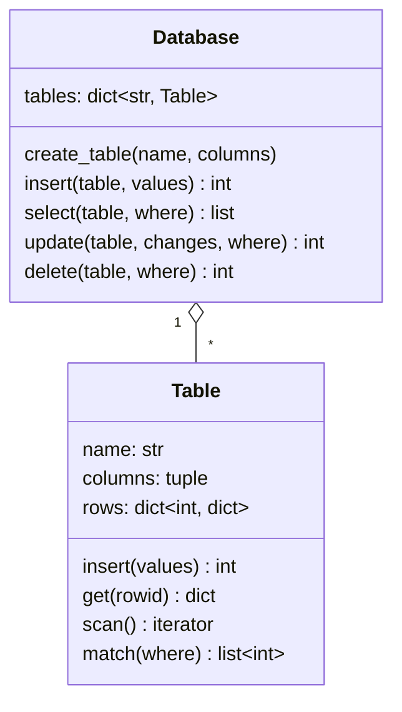
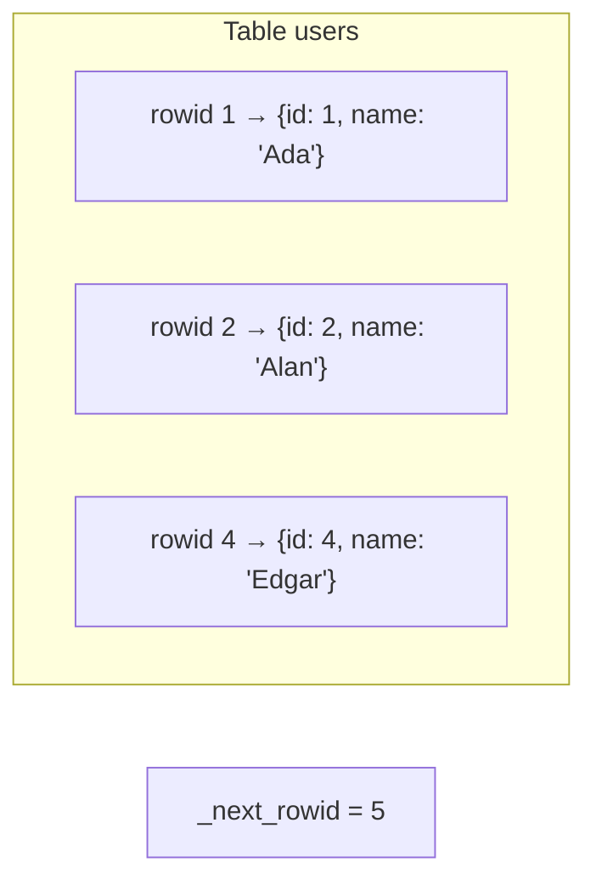

[🏠 Contents](index.md) · [← Previous: Chapter 1 — What a Relational Database Is](01-relational-model.md)

# Chapter 2 — Tables and CRUD, Version 1

In this chapter we create the first real piece of minidb: a `Table` that stores rows and a `Database` that holds tables and exposes the four **CRUD** operations: **C**reate, **R**ead, **U**pdate, **D**elete. Everything is deliberately naive. Columns have names but no types, and nothing is validated. What we get right here is the *shape* of the API and three small decisions that later chapters depend on:

1. Every row gets a hidden, never-reused **rowid**.
2. Rows are **values**: we hand out copies and never mutate a stored row in place.
3. Writes **decide first, then modify**.



## 2.1 Errors first

A database spends much of its time saying *no*, so we start with the exceptions. Every error minidb raises deliberately derives from `DatabaseError`. That way an application can catch "anything the database rejected" without also catching its own bugs.

```python
# src/minidb/errors.py
"""Define the exceptions that minidb raises on purpose."""


class DatabaseError(Exception):
    """Signal any error that minidb raises deliberately.

    Catching it catches everything the database rejected, but none of the
    application's own bugs.
    """


class SchemaError(DatabaseError):
    """Signal that a table or column doesn't exist, or a definition is invalid."""
```

## 2.2 Rows and rowids

How should a table store its rows? A list is the obvious choice, but deleting from the middle shifts every later row, so positions are useless as identifiers. Instead each row gets a **rowid**: an integer from a counter that only goes up. Rows live in a `dict[int, dict]`.



Rowid 3 is missing because its row was deleted. The counter never hands out 3 again. If rowids were reused, an old reference to rowid 3 could silently point at a different row. Later, the Unit of Work ([Chapter 9](09-unit-of-work-ii.md)) and the log ([Chapter 13](13-persistence.md)) both keep rowids around for a while, so this rule matters.

> **Rowid vs primary key.** The rowid is *our* implementation detail. Users identify rows by their primary key ([Chapter 5](05-keys-and-indexes.md)). SQLite does exactly this: every ordinary table has a hidden 64-bit `rowid` ([SQLite rowid tables](references.md#sqlite-rowid)).

## 2.3 The `Table` class

What is a row? For now, a dict from column names to anything. We give that a name in a module of its own, because nearly every other module will need it:

```python
# src/minidb/values.py
"""Name the types of the values that tables hold."""

type Row = dict[str, object]
```

```python
# src/minidb/table.py
"""Store the rows of one table in memory.

Rows live in a dict keyed by a hidden *rowid*: an integer from a counter that
only goes up, so a rowid is never reused, even after its row is deleted.
"""

from types import MappingProxyType
from typing import TYPE_CHECKING

from minidb.errors import SchemaError

if TYPE_CHECKING:
    from collections.abc import Callable
    from collections.abc import Iterator
    from collections.abc import Mapping
    from collections.abc import Sequence

    from minidb.values import Row

type Predicate = Callable[[Mapping[str, object]], object]
type Where = Predicate | None


class Table:
    """Hold the rows of one table, keyed by a hidden, never-reused rowid.

    Rows are *values*: the table hands out copies, and replaces stored rows
    instead of mutating them, so no caller can change a row behind its back.

    >>> users = Table("users", ["id", "name"])
    >>> users.insert({"id": 1, "name": "Ada"})
    1
    >>> users.select(lambda row: row["id"] == 1)
    [{'id': 1, 'name': 'Ada'}]

    :param name: the table's name.
    :param columns: the column names, in order.
    :raises SchemaError: if a column name appears twice.
    """

    def __init__(self, name: str, columns: Sequence[str]) -> None:
        if len(set(columns)) != len(columns):
            raise SchemaError(f"duplicate column names in {name!r}")
        self.name = name
        self.columns = tuple(columns)
        self.rows: dict[int, Row] = {}
        self._next_rowid = 1

    def __len__(self) -> int:
        return len(self.rows)

    # -- create ---------------------------------------------------------
    def insert(self, values: Mapping[str, object]) -> int:
        """Add a row and return its rowid.

        Columns missing from ``values`` are stored as ``None``.

        :param values: the new row's values, by column name.
        :return: the rowid of the new row.
        :raises SchemaError: if ``values`` names an unknown column.
        """
        self._check_columns(values)
        row = {c: values.get(c) for c in self.columns}
        rowid = self._next_rowid
        self._next_rowid += 1
        self.rows[rowid] = row
        return rowid

    # -- read -----------------------------------------------------------
    def get(self, rowid: int) -> Row | None:
        """Return a copy of the row with ``rowid``.

        :param rowid: the row to fetch.
        :return: a copy of the row, or ``None`` if there is no such row.
        """
        row = self.rows.get(rowid)
        return dict(row) if row is not None else None

    def scan(self) -> Iterator[tuple[int, Row]]:
        """Yield every ``(rowid, row)`` pair, each row a fresh copy.

        :return: an iterator over the table, in insertion order.
        """
        for rowid, row in self.rows.items():
            yield rowid, dict(row)

    def match(self, where: Where = None) -> list[int]:
        """Return the rowids of the rows that satisfy ``where``.

        The predicate sees each row through a read-only view, so it can't
        change the stored row.

        :param where: decides which rows match; ``None`` (the default)
            matches every row.
        :return: the matching rowids.
        """
        if where is None:
            return list(self.rows)
        return [rid for rid, row in self.rows.items() if where(MappingProxyType(row))]

    def select(self, where: Where = None) -> list[Row]:
        """Return copies of the rows that satisfy ``where``.

        :param where: decides which rows match; ``None`` (the default)
            matches every row.
        :return: the matching rows.
        """
        return [dict(self.rows[rid]) for rid in self.match(where)]

    # -- update ---------------------------------------------------------
    def update(self, changes: Mapping[str, object], where: Where = None) -> int:
        """Set the columns in ``changes`` on every row that satisfies ``where``.

        The matching rows are decided before any of them changes.

        :param changes: the new values, by column name.
        :param where: decides which rows change; ``None`` (the default)
            changes every row.
        :return: the number of rows changed.
        :raises SchemaError: if ``changes`` names an unknown column.
        """
        self._check_columns(changes)
        targets = self.match(where)  # 1. decide
        for rowid in targets:  # 2. modify
            self.rows[rowid] = self.rows[rowid] | dict(changes)
        return len(targets)

    # -- delete ---------------------------------------------------------
    def delete(self, where: Where = None) -> int:
        """Remove every row that satisfies ``where``.

        :param where: decides which rows go; ``None`` (the default) removes
            every row.
        :return: the number of rows removed.
        """
        targets = self.match(where)
        for rowid in targets:
            del self.rows[rowid]
        return len(targets)

    # -- helpers --------------------------------------------------------
    def _check_columns(self, values: Mapping[str, object]) -> None:
        unknown = set(values) - set(self.columns)
        if unknown:
            raise SchemaError(f"{self.name}: unknown column(s) {', '.join(sorted(unknown))}")
```

A few details deserve a closer look.

### Imports for the type checker

Some names, such as `Callable`, `Mapping` and `Row`, appear only in annotations. They're imported inside `if TYPE_CHECKING:`, a block the type checker reads and the interpreter skips. Python 3.14 evaluates annotations lazily (PEP 649), so annotations can mention those names freely, and at run time the module imports only what it actually uses. This keeps import cycles away, which matters later when modules start referring to each other's types. Ruff's `TC` rules enforce the split.

`type Predicate = …` is a *type alias* (Python 3.12+ syntax). Its value is also evaluated lazily, only if someone asks for it. A predicate may return anything: only its truth value is used. That leaves room for predicates that answer `None` for "unknown", which [Chapter 4](04-constraints.md) needs.

### Copies out, never references

`get`, `scan` and `select` return `dict(row)`, a shallow **copy**. If we returned the stored dict, this would happen:

```python
row = table.get(1)        # imagine this returned the stored dict
row["name"] = "Mallory"   # ...the table just changed, bypassing every check
```

From [Chapter 3](03-types-and-normalization.md) onward every check lives in `insert` and `update`. A leaked reference would be a back door around all of them. A shallow copy is enough because our column values will be immutable (ints, strings, `Decimal`, dates). The type system in [Chapter 3](03-types-and-normalization.md) guarantees that.

### Predicates see a read-only view

`match` passes each row to the predicate wrapped in `types.MappingProxyType`. The proxy is a read-only *view* of the dict, not a copy, so it costs almost nothing:

```python
>>> from types import MappingProxyType
>>> view = MappingProxyType({"age": 36})
>>> view["age"]
36
>>> view["age"] = 99
Traceback (most recent call last):
  ...
TypeError: 'mappingproxy' object does not support item assignment
```

### Updates replace the row

`update` builds a new dict with `old | changes` instead of calling `old.update(changes)`. Stored rows are therefore never mutated, only replaced. That lets us treat a row as an immutable *value*: anyone holding the old dict holds a consistent snapshot of the old version. In [Chapter 8](08-unit-of-work-i.md) we keep "before" and "after" versions of rows to undo changes, and this rule makes that free.

### Decide first, then modify

`update` and `delete` first collect the matching rowids and only then change anything. There are two reasons.

First, Python forbids changing a dict's size while iterating over it:

```python
>>> d = {1: "a", 2: "b"}
>>> for k in d:
...     del d[k]
Traceback (most recent call last):
  ...
RuntimeError: dictionary changed size during iteration
```

Second, and more interesting, is the **Halloween problem**. IBM's System R team found it on Halloween 1976. A query meant to give every employee earning under \$25,000 a 10% raise kept running until *everyone* earned at least \$25,000. The update walked an index on salary, so each raised row moved *ahead* of the scan and was found and raised again. Separating "which rows?" from "change them" makes every statement see the table as it was when the statement started. Real databases solve the same problem in the same way, sometimes at considerable cost.

## 2.4 The `Database` façade

Applications talk to a `Database`, which looks up tables by name and forwards CRUD calls. It's thin now; later it will be where cross-table rules (foreign keys), transactions and locking live.

```python
# src/minidb/database.py
"""Provide the public entry point: a collection of tables with CRUD operations."""

from typing import TYPE_CHECKING

from minidb.errors import SchemaError
from minidb.table import Table

if TYPE_CHECKING:
    from collections.abc import Mapping
    from collections.abc import Sequence

    from minidb.table import Where
    from minidb.values import Row


class Database:
    """Hold tables by name, and run CRUD operations on them."""

    def __init__(self) -> None:
        self.tables: dict[str, Table] = {}

    # -- schema -----------------------------------------------------------
    def create_table(self, name: str, columns: Sequence[str]) -> Table:
        """Create an empty table and return it.

        >>> db = Database()
        >>> db.create_table("users", ["id", "name"]).columns
        ('id', 'name')

        :param name: the new table's name.
        :param columns: its column names, in order.
        :return: the new table.
        :raises SchemaError: if the table already exists, or a column name
            appears twice.
        """
        if name in self.tables:
            raise SchemaError(f"table {name!r} already exists")
        table = self.tables[name] = Table(name, columns)
        return table

    def drop_table(self, name: str) -> None:
        """Delete a table and all its rows.

        :param name: the table to delete.
        :raises SchemaError: if there is no such table.
        """
        self.table(name)  # raises if missing
        del self.tables[name]

    def table(self, name: str) -> Table:
        """Return the table called ``name``.

        :param name: the table's name.
        :return: the table.
        :raises SchemaError: if there is no such table.
        """
        try:
            return self.tables[name]
        except KeyError:
            raise SchemaError(f"no such table: {name!r}") from None

    # -- CRUD -------------------------------------------------------------
    def insert(self, table: str, values: Mapping[str, object]) -> int:
        """Insert a row into ``table``; see :meth:`Table.insert`.

        :param table: the table's name.
        :param values: the new row's values, by column name.
        :return: the rowid of the new row.
        """
        return self.table(table).insert(values)

    def get(self, table: str, rowid: int) -> Row | None:
        """Return a copy of one row; see :meth:`Table.get`.

        :param table: the table's name.
        :param rowid: the row to fetch.
        :return: the row, or ``None`` if there is no such row.
        """
        return self.table(table).get(rowid)

    def select(self, table: str, where: Where = None) -> list[Row]:
        """Return the rows of ``table`` that satisfy ``where``.

        :param table: the table's name.
        :param where: decides which rows match; ``None`` matches all.
        :return: copies of the matching rows.
        """
        return self.table(table).select(where)

    def update(self, table: str, changes: Mapping[str, object], where: Where = None) -> int:
        """Update the rows of ``table`` that satisfy ``where``.

        :param table: the table's name.
        :param changes: the new values, by column name.
        :param where: decides which rows change; ``None`` changes all.
        :return: the number of rows changed.
        """
        return self.table(table).update(changes, where)

    def delete(self, table: str, where: Where = None) -> int:
        """Delete the rows of ``table`` that satisfy ``where``.

        :param table: the table's name.
        :param where: decides which rows go; ``None`` deletes all.
        :return: the number of rows deleted.
        """
        return self.table(table).delete(where)
```

The `from None` in `table()` hides the internal `KeyError` from the traceback. The user asked for a table, not a dict key.

Finally, make the package export its main class:

```python
# src/minidb/__init__.py
"""Build a small relational database, one chapter at a time."""

from minidb.database import Database
from minidb.errors import DatabaseError
from minidb.errors import SchemaError

__all__ = ["Database", "DatabaseError", "SchemaError"]
```

## 2.5 Taking it for a spin

```python
>>> from minidb import Database
>>> db = Database()
>>> _ = db.create_table("users", ["id", "name", "age"])
>>> db.insert("users", {"id": 1, "name": "Ada", "age": 36})
1
>>> db.insert("users", {"id": 2, "name": "Alan", "age": 41})
2
>>> db.insert("users", {"id": 3, "name": "Grace"})      # age missing -> None
3
>>> db.select("users", where=lambda r: r["age"] is not None and r["age"] > 40)
[{'id': 2, 'name': 'Alan', 'age': 41}]
>>> db.update("users", {"age": 37}, where=lambda r: r["name"] == "Ada")
1
>>> db.delete("users", where=lambda r: r["age"] is None)
1
>>> db.insert("users", {"id": 4, "name": "Edgar"})      # rowid 3 is never reused
4
>>> db.select("users")
[{'id': 1, 'name': 'Ada', 'age': 37}, {'id': 2, 'name': 'Alan', 'age': 41}, {'id': 4, 'name': 'Edgar', 'age': None}]
>>> db.insert("users", {"nmae": "typo"})
Traceback (most recent call last):
  ...
minidb.errors.SchemaError: users: unknown column(s) nmae
```

And the copy semantics:

```python
>>> row = db.get("users", 1)
>>> row["name"] = "Mallory"
>>> db.get("users", 1)["name"]
'Ada'
```

## 2.6 What we have, and what's missing

We have a CRUD API whose shape will survive to the end of the book. But we can still insert `{"id": "one", "age": -5}`, two users can share `id` 1, and every lookup scans the whole table. The next chapter starts on the first of these: giving columns **types**.

## Questions and exercises

1. Why must rowids never be reused? Describe a concrete bug that reuse would cause in a system that keeps rowids in a log.
2. `Table.update` replaces stored rows instead of mutating them. Write a test that would fail if it mutated them. (Hint: keep a reference to a row dict you obtained *inside* the table, e.g. via `table.rows[1]`, before the update.)
3. Change `update` so `changes` may be a callable that receives the old row and returns a dict, so that `db.update("users", lambda r: {"age": r["age"] + 1})` works. Where must the callable be invoked to keep the "decide, then modify" rule?
4. Add `count(table, where=None)` to `Database` without building a list of rows.
5. **The Halloween problem.** Write a version of `update` that modifies rows *while* iterating over a copy of `self.rows.items()`. Does it suffer from the Halloween problem? Why not? Now imagine the iteration followed a structure kept sorted by the updated column. What would happen?
6. `scan()` is a generator. What happens if the caller inserts into the same table while consuming it? Try it. Should `scan` take a snapshot of `self.rows` first? What does that cost?
7. *(Design)* Our predicates are opaque Python callables. Name one thing a database could do if predicates were *data* (e.g. `("age", ">", 40)`) instead. ([Chapter 14](14-query-planning.md) does exactly this.)

*Answers: [Appendix D, Chapter 2](appendix-d-answers.md#chapter-2--tables-and-crud).*

---

[🏠 Contents](index.md) · [Next: Chapter 3 — Types and Normalization →](03-types-and-normalization.md)
