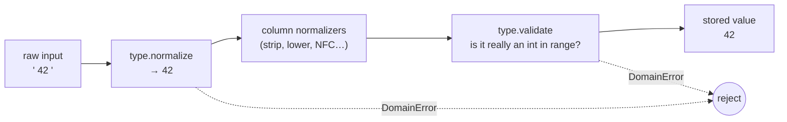

[🏠 Contents](index.md) · [← Previous: Chapter 2 — Tables and CRUD](02-tables-and-crud.md)

# Chapter 3 — Types and Normalization

Our tables accept anything. In this chapter columns get **types**, and with them a pipeline that every incoming value passes through:



There are two distinct jobs here, and keeping them apart is the main design idea of this chapter:

- **Normalization** turns an *acceptable* input into the one **canonical** form we store: `" 42 "` → `42`, `"2026-11-18"` → `date(2026, 11, 18)`, `0.1` → `Decimal('0.10')`.
- **Validation** checks that a value *is* in canonical form and inside its domain, e.g. an `int` between 0 and 150.

Why canonical forms? Equality. If `"Ada@Example.org"` and `"ada@example.org"` are both stored, a uniqueness check ([Chapter 5](05-keys-and-indexes.md)) will happily accept both, and a lookup for one will miss the other. Every later subsystem (indexes, joins, the query planner) compares values with `==` and hashes them, so all of them rely on values having one representation.

## 3.1 Domain errors

A value outside its type's domain is the first of several *constraint violations*. They share a base class, so callers can catch "the data was rejected" separately from "the schema is wrong":

```python
# src/minidb/errors.py (append)
class ConstraintError(DatabaseError):
    """Signal that data was rejected because it breaks a rule of the schema."""


class DomainError(ConstraintError):
    """Signal that a value doesn't belong to its column's type (domain)."""
```

From now on, column values have a type of their own. A small module names the Python types a column can hold, so every other module can refer to them:

```python
# src/minidb/values.py (replace Row)
type Value = bool | int | float | str | Decimal | dt.date | dt.datetime
type Row = dict[str, Value | None]
```

```python
# src/minidb/values.py (imports)
import datetime as dt
from decimal import Decimal
```

## 3.2 The `Type` base class

A type is an object, not just a Python class, because types have parameters: `Integer(min=0, max=150)`, `Text(max_length=80)`, `Numeric(10, 2)`. We use frozen dataclasses for the concrete types. That gives them a readable `repr`, value equality (`Integer(0, 10) == Integer(0, 10)`) and hashability, all of which we'll use in [Chapter 13](13-persistence.md) to fingerprint schemas.

`Type` is **generic** in the Python type it produces, written with the 3.12+ syntax `class Type[T: Value]`. `Integer` is a `Type[int]`, `Date` a `Type[dt.date]`. The type checker therefore knows that `Integer().normalize(x)` returns an `int | None`. Notice that `T` appears only in *return* types (`normalize`, `coerce`), never as a parameter. Python infers the variance of new-style type parameters from how they're used, so `Type` is **covariant**: an `Integer` is acceptable wherever a `Type[Value]` is expected, which is what a column needs. Range checks therefore live in `validate(value: object)` after an `isinstance` test, rather than in a method taking a `T`, which would make `Type` invariant.

Errors are built by `error()` and raised by the caller (`raise self.error(value)`). A helper that raised by itself would hide the `raise` from linters, which would then complain that `coerce` may fall off its end without returning.

Normalization is lenient about *input*. Validation is strict about *output*: it checks the **exact** Python type. That strictness matters because of a Python quirk. `bool` is a subclass of `int`, and `datetime` is a subclass of `date`, so `isinstance(True, int)` is `True`. Without exact checks, `True` would be a perfectly good age.

```python
# src/minidb/types.py
"""Define column types: how each one normalizes and validates its values."""

import datetime as dt
import math
import re
from dataclasses import dataclass
from decimal import ROUND_HALF_EVEN
from decimal import Decimal
from decimal import InvalidOperation
from typing import ClassVar
from typing import override

from minidb.errors import DomainError
from minidb.values import Value

_INT_RE = re.compile(r"[+-]?\d+")
_TRUE = frozenset({"true", "t", "yes", "y", "on", "1"})
_FALSE = frozenset({"false", "f", "no", "n", "off", "0"})


class Type[T: Value]:
    """Describe a column type: how to normalize its values, and which are valid.

    :meth:`normalize` turns an acceptable input into the one canonical value
    that is stored; :meth:`validate` checks that a value already is canonical
    and inside the type's domain. NULL (``None``) passes through both
    untouched: whether a column may hold NULL is a constraint, not a type.

    Subclasses set :attr:`exact_types`, override :meth:`coerce`, and extend
    :meth:`validate` with rules such as ranges and lengths.
    """

    exact_types: ClassVar[tuple[type, ...]] = ()

    def normalize(self, value: object) -> T | None:
        """Convert ``value`` to this type's canonical form.

        :param value: any input; ``None`` is returned unchanged.
        :return: the canonical value, or ``None``.
        :raises DomainError: if ``value`` can't be converted.
        """
        return None if value is None else self.coerce(value)

    def coerce(self, value: object) -> T:
        """Convert a non-NULL ``value``; subclasses override this.

        :param value: the input, never ``None``.
        :return: the canonical value.
        :raises DomainError: always, in the base class.
        """
        raise self.error(value)

    def validate(self, value: object) -> None:
        """Check that ``value`` is canonical and inside the domain.

        The check is on the *exact* Python type: ``bool`` is a subclass of
        ``int``, but ``True`` is not a valid integer.

        :param value: the value to check; ``None`` always passes.
        :raises DomainError: if the value is not valid.
        """
        if value is not None and type(value) not in self.exact_types:
            raise self.error(value)

    def error(self, value: object, reason: str = "") -> DomainError:
        """Build the error that rejects ``value``.

        :param value: the rejected value.
        :param reason: why it was rejected; empty by default.
        :return: an exception for the caller to raise.
        """
        return DomainError(f"{value!r} is not a valid {self!r}" + (f": {reason}" if reason else ""))


def _integral(value: object) -> int | None:
    """Return ``value`` as an int if it is a whole float or Decimal, or a numeric string."""
    match value:
        case float() if value.is_integer():
            return int(value)
        case Decimal() if value.is_finite() and value == value.to_integral_value():
            return int(value)
        case str() if _INT_RE.fullmatch(value.strip()):
            return int(value.strip())
        case _:
            return None


@dataclass(frozen=True)
class Integer(Type[int]):
    """Hold whole numbers, optionally between ``min`` and ``max``.

    >>> Integer(min=0).normalize(" 42 ")
    42

    :param min: the smallest valid value; ``None`` (the default) for no limit.
    :param max: the largest valid value; ``None`` (the default) for no limit.
    """

    min: int | None = None
    max: int | None = None
    exact_types: ClassVar[tuple[type, ...]] = (int,)

    @override
    def coerce(self, value: object) -> int:
        if isinstance(value, bool):
            raise self.error(value, "booleans are not integers")
        if isinstance(value, int):
            return value
        number = _integral(value)
        if number is None:
            raise self.error(value)
        return number

    @override
    def validate(self, value: object) -> None:
        super().validate(value)
        if isinstance(value, int):
            if self.min is not None and value < self.min:
                raise self.error(value, f"below minimum {self.min}")
            if self.max is not None and value > self.max:
                raise self.error(value, f"above maximum {self.max}")


@dataclass(frozen=True)
class Real(Type[float]):
    """Hold finite floating-point numbers; NaN and infinities are rejected.

    >>> Real().normalize("2.5")
    2.5
    """

    exact_types: ClassVar[tuple[type, ...]] = (float,)

    @override
    def coerce(self, value: object) -> float:
        if isinstance(value, bool):
            raise self.error(value, "booleans are not numbers")
        if isinstance(value, int | float | Decimal):
            return float(value)
        if isinstance(value, str):
            try:
                return float(value.strip())
            except ValueError:
                raise self.error(value) from None
        raise self.error(value)

    @override
    def validate(self, value: object) -> None:
        super().validate(value)
        if isinstance(value, float) and not math.isfinite(value):
            raise self.error(value, "NaN and infinities are not allowed")


@dataclass(frozen=True)
class Text(Type[str]):
    """Hold strings, optionally no longer than ``max_length`` characters.

    >>> Text().normalize(42)
    Traceback (most recent call last):
      ...
    minidb.errors.DomainError: 42 is not a valid Text(max_length=None): no implicit conversion to text

    :param max_length: the longest valid string; ``None`` (the default) for no limit.
    """

    max_length: int | None = None
    exact_types: ClassVar[tuple[type, ...]] = (str,)

    @override
    def coerce(self, value: object) -> str:
        if not isinstance(value, str):
            raise self.error(value, "no implicit conversion to text")
        return value

    @override
    def validate(self, value: object) -> None:
        super().validate(value)
        if isinstance(value, str) and self.max_length is not None and len(value) > self.max_length:
            raise self.error(value, f"longer than {self.max_length} characters")


@dataclass(frozen=True)
class Boolean(Type[bool]):
    """Hold ``True`` or ``False``, accepting 0/1 and words such as "yes" and "off".

    >>> Boolean().normalize("Yes"), Boolean().normalize(0)
    (True, False)
    """

    exact_types: ClassVar[tuple[type, ...]] = (bool,)

    @override
    def coerce(self, value: object) -> bool:
        if isinstance(value, bool):
            return value
        if value in (0, 1):
            return value == 1
        word = value.strip().lower() if isinstance(value, str) else None
        if word in _TRUE or word in _FALSE:
            return word in _TRUE
        raise self.error(value)


def _to_decimal(value: object) -> Decimal | None:
    """Return ``value`` as a Decimal, or ``None`` if it isn't a number."""
    if isinstance(value, float):
        return Decimal(repr(value))  # 0.1 -> Decimal('0.1'), not its binary value
    if isinstance(value, int | Decimal) and not isinstance(value, bool):
        return Decimal(value)
    if isinstance(value, str):
        try:
            return Decimal(value.strip())
        except InvalidOperation:
            return None
    return None


@dataclass(frozen=True)
class Numeric(Type[Decimal]):
    """Hold exact decimals with ``precision`` digits, ``scale`` of them after the point.

    Values are rounded to ``scale`` places with banker's rounding.

    >>> Numeric(6, 2).normalize(0.1)
    Decimal('0.10')

    :param precision: the total number of digits; 18 by default.
    :param scale: the digits after the decimal point; 2 by default.
    :raises ValueError: unless ``0 <= scale <= precision``.
    """

    precision: int = 18
    scale: int = 2
    exact_types: ClassVar[tuple[type, ...]] = (Decimal,)

    def __post_init__(self) -> None:
        if not 0 <= self.scale <= self.precision:
            raise ValueError("need 0 <= scale <= precision")

    @override
    def coerce(self, value: object) -> Decimal:
        number = _to_decimal(value)
        if number is None:
            raise self.error(value)
        if not number.is_finite():
            raise self.error(value, "NaN and infinities are not allowed")
        return number.quantize(Decimal(1).scaleb(-self.scale), ROUND_HALF_EVEN)

    @override
    def validate(self, value: object) -> None:
        super().validate(value)
        if not isinstance(value, Decimal):
            return
        if value.as_tuple().exponent != -self.scale:
            raise self.error(value, f"expected exactly {self.scale} decimal places")
        if max(value.adjusted() + 1, 0) > self.precision - self.scale:
            raise self.error(value, f"too many digits for NUMERIC({self.precision}, {self.scale})")


@dataclass(frozen=True)
class Date(Type[dt.date]):
    """Hold calendar dates, accepting ISO strings such as ``"2026-11-18"``.

    >>> Date().normalize("2026-11-18")
    datetime.date(2026, 11, 18)
    """

    exact_types: ClassVar[tuple[type, ...]] = (dt.date,)

    @override
    def coerce(self, value: object) -> dt.date:
        if isinstance(value, dt.datetime):
            raise self.error(value, "use .date() to drop the time explicitly")
        if isinstance(value, dt.date):
            return value
        if isinstance(value, str):
            try:
                return dt.date.fromisoformat(value.strip())
            except ValueError:
                raise self.error(value) from None
        raise self.error(value)


@dataclass(frozen=True)
class Timestamp(Type[dt.datetime]):
    """Hold points in time: all timezone-aware (stored in UTC), or all naive.

    Python refuses to compare aware and naive datetimes, so a column must
    pick one kind.

    >>> Timestamp().normalize("2026-11-18T10:00:00+01:00")
    datetime.datetime(2026, 11, 18, 9, 0, tzinfo=datetime.timezone.utc)

    :param with_timezone: whether values must be aware; ``True`` by default.
    """

    with_timezone: bool = True
    exact_types: ClassVar[tuple[type, ...]] = (dt.datetime,)

    @override
    def coerce(self, value: object) -> dt.datetime:
        stamp = self._parse(value)
        aware = stamp.utcoffset() is not None
        if self.with_timezone and not aware:
            raise self.error(value, "a timezone is required")
        if not self.with_timezone and aware:
            raise self.error(value, "timezone not allowed")
        return stamp.astimezone(dt.UTC) if aware else stamp

    def _parse(self, value: object) -> dt.datetime:
        if isinstance(value, dt.datetime):
            return value
        if isinstance(value, str):
            try:
                return dt.datetime.fromisoformat(value.strip())
            except ValueError:
                raise self.error(value) from None
        raise self.error(value)

    @override
    def validate(self, value: object) -> None:
        super().validate(value)
        if isinstance(value, dt.datetime) and self.with_timezone and value.utcoffset() != dt.timedelta(0):
            raise self.error(value, "must be stored in UTC")
```

Some design decisions worth discussing:

**No implicit conversion to text.** `Text().normalize(42)` is an error, not `"42"`. Implicit conversions are convenient until two of them meet: is `"10" < "9"`? For strings, yes. SQLite takes the opposite approach with *type affinity*, converting values to the column's preferred type where possible ([SQLite datatypes](references.md#sqlite-types)). Both approaches are defensible. Be strict at the boundary and you never have to wonder.

**Floats into `Numeric` go through `repr`.** `Decimal(0.1)` is `Decimal('0.1000000000000000055511151231257827021181583404541015625')`, the exact binary value of the float. `Decimal(repr(0.1))` is `Decimal('0.1')`, which is what the user meant. Then we `quantize` to the column's scale with *banker's rounding* (`ROUND_HALF_EVEN`), the rounding mode that doesn't bias sums upward.

**NaN is banned from `Real`.** `float('nan') != float('nan')`. A value that is not equal to itself breaks uniqueness, joins and sorting. PostgreSQL makes the opposite choice and defines NaN as equal to itself and greater than every other number. Either way, *some* rule is needed. We take the simplest.

**Timestamps are either all aware or all naive.** Python refuses to compare naive and aware datetimes (`TypeError`). So a column has to pick one. Aware values are normalized to UTC, so equal instants are `==` and sort correctly.

**`None` is not a type error.** Whether a column may be NULL is a *constraint*, decided per column, not per type. It's the subject of [Chapter 4](04-constraints.md).

Let's try the types:

```python
>>> from minidb.types import *
>>> Integer(min=0, max=150).normalize(" 42 ")
42
>>> Integer().normalize(True)
Traceback (most recent call last):
  ...
minidb.errors.DomainError: True is not a valid Integer(min=None, max=None): booleans are not integers
>>> Integer(min=0, max=150).validate(200)
Traceback (most recent call last):
  ...
minidb.errors.DomainError: 200 is not a valid Integer(min=0, max=150): above maximum 150
>>> Numeric(6, 2).normalize(0.1)
Decimal('0.10')
>>> Numeric(6, 2).normalize("2.675")         # half-even: 2.675 -> 2.68
Decimal('2.68')
>>> Numeric(4, 2).normalize("123.4")
Decimal('123.40')
>>> Numeric(4, 2).validate(Numeric(4, 2).normalize("123.4"))
Traceback (most recent call last):
  ...
minidb.errors.DomainError: Decimal('123.40') is not a valid Numeric(precision=4, scale=2): too many digits for NUMERIC(4, 2)
>>> Boolean().normalize("Yes")
True
>>> Date().normalize("2026-11-18")
datetime.date(2026, 11, 18)
>>> Timestamp().normalize("2026-11-18T10:00:00+01:00")
datetime.datetime(2026, 11, 18, 9, 0, tzinfo=datetime.timezone.utc)
>>> Text(max_length=3).validate("abcd")
Traceback (most recent call last):
  ...
minidb.errors.DomainError: 'abcd' is not a valid Text(max_length=3): longer than 3 characters
```

Notice that `normalize("123.4")` *succeeded* for `Numeric(4, 2)` and `validate` caught the overflow. Normalization only converts; every domain rule lives in validation. That is why the pipeline always runs validation last.

## 3.3 Column normalizers

Types normalize *representation*. Applications often want *semantic* normalization on top: trimming whitespace, lower-casing e-mail addresses, collapsing runs of spaces. These are plain functions from a `Value` to a `Value`. Each one leaves values it doesn't understand unchanged, so its type is the same for every column:

```python
# src/minidb/normalizers.py
"""Provide small value normalizers for ``Column(normalizers=...)``.

Every normalizer must be idempotent, ``f(f(x)) == f(x)``: rows are
re-normalized whenever they are updated, so a normalizer that isn't would
change data nobody touched. Normalizers leave non-text values alone, so any
of them can be put on any column.
"""

import unicodedata
from typing import TYPE_CHECKING

if TYPE_CHECKING:
    from minidb.values import Value


def strip(value: Value) -> Value:
    """Remove leading and trailing whitespace from text.

    >>> strip("  Ada ")
    'Ada'

    :param value: the value to normalize.
    :return: the stripped text, or ``value`` unchanged if it isn't text.
    """
    return value.strip() if isinstance(value, str) else value


def lower(value: Value) -> Value:
    """Lower-case text.

    >>> lower("Ada@Example.ORG")
    'ada@example.org'

    :param value: the value to normalize.
    :return: the lower-cased text, or ``value`` unchanged if it isn't text.
    """
    return value.lower() if isinstance(value, str) else value


def upper(value: Value) -> Value:
    """Upper-case text.

    :param value: the value to normalize.
    :return: the upper-cased text, or ``value`` unchanged if it isn't text.
    """
    return value.upper() if isinstance(value, str) else value


def collapse_spaces(value: Value) -> Value:
    """Trim text and replace each run of whitespace with a single space.

    >>> collapse_spaces("  Ada   Lovelace ")
    'Ada Lovelace'

    :param value: the value to normalize.
    :return: the collapsed text, or ``value`` unchanged if it isn't text.
    """
    return " ".join(value.split()) if isinstance(value, str) else value


def nfc(value: Value) -> Value:
    """Convert text to Unicode normalization form NFC.

    Visually identical strings can be different sequences of code points;
    NFC picks one canonical sequence for each.

    >>> nfc("café") == "café"
    True

    :param value: the value to normalize.
    :return: the NFC form of the text, or ``value`` unchanged if it isn't text.
    """
    return unicodedata.normalize("NFC", value) if isinstance(value, str) else value
```

`nfc` needs explaining. The character "é" can be written as one code point (U+00E9) or as "e" followed by a combining acute accent (U+0065 U+0301). They look identical and are *different strings*:

```python
>>> from minidb.normalizers import nfc
>>> composed, decomposed = "café", "café"
>>> composed == decomposed
False
>>> nfc(composed) == nfc(decomposed)
True
```

Text pasted from a macOS file name is often decomposed; text typed on most keyboards is composed. Without NFC, a unique index on names would accept both "café"s. The Unicode standard defines these normalization forms in [UAX #15](references.md#uax15).

> **Careful with `lower`.** Lower-casing is fine for e-mail *domains* but technically wrong for the part before the `@`, which the standard allows to be case-sensitive. For caseless matching of natural-language text, `str.casefold()` is more correct than `lower()` (`"Straße".casefold() == "strasse"`). Normalization is a *policy*, which is why it's per column and opt-in.

## 3.4 Columns and table schemas

A `Column` combines a name, a type and a tuple of normalizers. A `TableSchema` is a named tuple of columns. It owns the pipeline that turns a dict of user values into a stored row.

```python
# src/minidb/schema.py
"""Declare tables: their columns, and the pipeline that prepares rows."""

from dataclasses import dataclass
from dataclasses import field
from typing import TYPE_CHECKING

from minidb.errors import DomainError
from minidb.errors import SchemaError

if TYPE_CHECKING:
    from collections.abc import Callable
    from collections.abc import Mapping

    from minidb.types import Type
    from minidb.values import Row
    from minidb.values import Value

type Normalizer = Callable[[Value], Value]


@dataclass(frozen=True)
class Column:
    """Declare a column: its name, its type and how to normalize its values.

    >>> from minidb.normalizers import strip
    >>> from minidb.types import Integer
    >>> Column("age", Integer(), normalizers=(strip,)).prepare(" 42 ")
    42

    :param name: the column's name.
    :param type: the column's type.
    :param normalizers: functions applied to every non-NULL value after the
        type has normalized it; none by default.
    """

    name: str
    type: Type[Value]
    normalizers: tuple[Normalizer, ...] = ()

    def prepare(self, value: object) -> Value | None:
        """Normalize, then validate one value for this column.

        :param value: the input value, or ``None``.
        :return: the value to store.
        :raises DomainError: if the value doesn't belong to the column's type.
        """
        prepared = self.type.normalize(value)
        if prepared is not None:
            for fn in self.normalizers:
                prepared = fn(prepared)
        self.type.validate(prepared)
        return prepared


@dataclass(frozen=True)
class TableSchema:
    """Declare a table: a name and an ordered tuple of columns.

    >>> from minidb.types import Text
    >>> schema = TableSchema("users", (Column("name", Text()),))
    >>> schema.prepare_row({"name": "Ada"})
    {'name': 'Ada'}

    :param name: the table's name.
    :param columns: its columns, in order.
    :raises SchemaError: if two columns share a name.
    """

    name: str
    columns: tuple[Column, ...]
    by_name: Mapping[str, Column] = field(init=False, repr=False, compare=False)

    def __post_init__(self) -> None:
        names = [c.name for c in self.columns]
        if len(set(names)) != len(names):
            raise SchemaError(f"duplicate column names in {self.name!r}")
        object.__setattr__(self, "by_name", {c.name: c for c in self.columns})

    @property
    def column_names(self) -> tuple[str, ...]:
        """Return the column names, in order."""
        return tuple(c.name for c in self.columns)

    def column(self, name: str) -> Column:
        """Return the column called ``name``.

        :param name: the column's name.
        :return: the column.
        :raises SchemaError: if there is no such column.
        """
        try:
            return self.by_name[name]
        except KeyError:
            raise SchemaError(f"{self.name}: no such column {name!r}") from None

    def prepare_row(self, values: Mapping[str, object], base: Row | None = None) -> Row:
        """Return a complete, normalized and validated row.

        Neither argument is modified.

        :param values: the user's input, by column name.
        :param base: the existing row, for an update; ``None`` (the default)
            for an insert, where missing columns become ``None``.
        :return: the row to store.
        :raises SchemaError: if ``values`` names an unknown column.
        :raises DomainError: if a value doesn't belong to its column's type.
        """
        for name in values:
            self.column(name)  # unknown column?
        row: Row = dict(base) if base is not None else dict.fromkeys(self.column_names)
        for name, value in values.items():
            try:
                row[name] = self.by_name[name].prepare(value)
            except DomainError as e:
                raise DomainError(f"{self.name}.{name}: {e}") from None
        return row
```

`TableSchema` is frozen, but it computes `by_name` in `__post_init__`. A frozen dataclass forbids `self.x = …`, so we go through `object.__setattr__`. That's the standard idiom, and the only place we ever do it.

## 3.5 Tables with schemas

`Table` now takes a `TableSchema` instead of a list of names, and runs every insert and update through `prepare_row`. `_check_columns` is gone, because the schema does that job now. Here is the whole file:

```python
# src/minidb/table.py
"""Store the rows of one table in memory.

Rows live in a dict keyed by a hidden *rowid*: an integer from a counter that
only goes up, so a rowid is never reused, even after its row is deleted.
Every insert and update goes through the table's schema.
"""

from types import MappingProxyType
from typing import TYPE_CHECKING

if TYPE_CHECKING:
    from collections.abc import Callable
    from collections.abc import Iterator
    from collections.abc import Mapping

    from minidb.schema import TableSchema
    from minidb.values import Row
    from minidb.values import Value

type Predicate = Callable[[Mapping[str, Value | None]], object]
type Where = Predicate | None


class Table:
    """Hold the rows of one table, keyed by a hidden, never-reused rowid.

    Rows are *values*: the table hands out copies, and replaces stored rows
    instead of mutating them, so no caller can change a row behind its back.

    >>> from minidb.schema import Column, TableSchema
    >>> from minidb.types import Integer
    >>> numbers = Table(TableSchema("numbers", (Column("n", Integer()),)))
    >>> numbers.insert({"n": "7"})
    1
    >>> numbers.get(1)
    {'n': 7}

    :param schema: the table's declaration.
    """

    def __init__(self, schema: TableSchema) -> None:
        self.schema = schema
        self.name = schema.name
        self.columns = schema.column_names
        self.rows: dict[int, Row] = {}
        self._next_rowid = 1

    def __len__(self) -> int:
        return len(self.rows)

    # -- create ---------------------------------------------------------
    def insert(self, values: Mapping[str, object]) -> int:
        """Prepare a row through the schema, store it, and return its rowid.

        :param values: the new row's values, by column name; missing
            columns are stored as ``None``.
        :return: the rowid of the new row.
        :raises SchemaError: if ``values`` names an unknown column.
        :raises DomainError: if a value doesn't belong to its column's type.
        """
        row = self.schema.prepare_row(values)
        rowid = self._next_rowid
        self._next_rowid += 1
        self.rows[rowid] = row
        return rowid

    # -- read -----------------------------------------------------------
    def get(self, rowid: int) -> Row | None:
        """Return a copy of the row with ``rowid``.

        :param rowid: the row to fetch.
        :return: a copy of the row, or ``None`` if there is no such row.
        """
        row = self.rows.get(rowid)
        return dict(row) if row is not None else None

    def scan(self) -> Iterator[tuple[int, Row]]:
        """Yield every ``(rowid, row)`` pair, each row a fresh copy.

        :return: an iterator over the table, in insertion order.
        """
        for rowid, row in self.rows.items():
            yield rowid, dict(row)

    def match(self, where: Where = None) -> list[int]:
        """Return the rowids of the rows that satisfy ``where``.

        The predicate sees each row through a read-only view.

        :param where: decides which rows match; ``None`` (the default)
            matches every row.
        :return: the matching rowids.
        """
        if where is None:
            return list(self.rows)
        return [rid for rid, row in self.rows.items() if where(MappingProxyType(row))]

    def select(self, where: Where = None) -> list[Row]:
        """Return copies of the rows that satisfy ``where``.

        :param where: decides which rows match; ``None`` (the default)
            matches every row.
        :return: the matching rows.
        """
        return [dict(self.rows[rid]) for rid in self.match(where)]

    # -- update ---------------------------------------------------------
    def update(self, changes: Mapping[str, object], where: Where = None) -> int:
        """Set the columns in ``changes`` on every row that satisfies ``where``.

        Every new row is prepared before any is stored, so a value that fails
        validation leaves the whole table unchanged.

        :param changes: the new values, by column name.
        :param where: decides which rows change; ``None`` (the default)
            changes every row.
        :return: the number of rows changed.
        :raises SchemaError: if ``changes`` names an unknown column.
        :raises DomainError: if a value doesn't belong to its column's type.
        """
        targets = self.match(where)  # 1. decide
        new_rows = {rid: self.schema.prepare_row(changes, base=self.rows[rid]) for rid in targets}  # 2. validate
        self.rows.update(new_rows)  # 3. modify
        return len(targets)

    # -- delete ---------------------------------------------------------
    def delete(self, where: Where = None) -> int:
        """Remove every row that satisfies ``where``.

        :param where: decides which rows go; ``None`` (the default) removes
            every row.
        :return: the number of rows removed.
        """
        targets = self.match(where)
        for rowid in targets:
            del self.rows[rowid]
        return len(targets)
```


The update now has *three* phases. If preparing the 500th row fails, rows 1–499 have not been touched: the statement is atomic. Keep this "validate everything, then write everything" shape in mind. It grows into the Unit of Work in [Chapter 8](08-unit-of-work-i.md).

`Database.create_table` now takes `Column` objects. `Column` is only used in an annotation, so it is imported in the `if TYPE_CHECKING:` block, while `TableSchema` is needed at run time:

```python
# src/minidb/database.py (replace Database.create_table)
    def create_table(self, name: str, columns: Sequence[Column]) -> Table:
        """Create an empty table and return it.

        >>> from minidb.schema import Column
        >>> from minidb.types import Text
        >>> db = Database()
        >>> db.create_table("users", [Column("name", Text())]).columns
        ('name',)

        :param name: the new table's name.
        :param columns: its columns, in order.
        :return: the new table.
        :raises SchemaError: if the table already exists, or two columns
            share a name.
        """
        if name in self.tables:
            raise SchemaError(f"table {name!r} already exists")
        table = self.tables[name] = Table(TableSchema(name, tuple(columns)))
        return table
```

```python
# src/minidb/database.py (imports)
from minidb.schema import TableSchema
```

```python
# src/minidb/database.py (typing imports)
from minidb.schema import Column
```

And the package exports the new names:

```python
# src/minidb/__init__.py
"""Build a small relational database, one chapter at a time."""

from minidb import normalizers
from minidb.database import Database
from minidb.errors import ConstraintError
from minidb.errors import DatabaseError
from minidb.errors import DomainError
from minidb.errors import SchemaError
from minidb.schema import Column
from minidb.schema import TableSchema
from minidb.types import Boolean
from minidb.types import Date
from minidb.types import Integer
from minidb.types import Numeric
from minidb.types import Real
from minidb.types import Text
from minidb.types import Timestamp

__all__ = [
    "Boolean",
    "Column",
    "ConstraintError",
    "Database",
    "DatabaseError",
    "Date",
    "DomainError",
    "Integer",
    "Numeric",
    "Real",
    "SchemaError",
    "TableSchema",
    "Text",
    "Timestamp",
    "normalizers",
]
```

## 3.6 Trying it out

```python
>>> from minidb import *
>>> from minidb.normalizers import strip, lower, nfc, collapse_spaces
>>> db = Database()
>>> _ = db.create_table("users", [
...     Column("id", Integer(min=1)),
...     Column("email", Text(max_length=254), normalizers=(strip, lower)),
...     Column("name", Text(), normalizers=(nfc, collapse_spaces)),
...     Column("age", Integer(min=0, max=150)),
...     Column("balance", Numeric(10, 2)),
... ])
>>> db.insert("users", {"id": "1", "email": "  Ada@Example.ORG ",
...                     "name": " Ada   Lovelace", "age": 36.0, "balance": "12.5"})
1
>>> db.get("users", 1)
{'id': 1, 'email': 'ada@example.org', 'name': 'Ada Lovelace', 'age': 36, 'balance': Decimal('12.50')}
>>> db.insert("users", {"id": 2, "age": -1})
Traceback (most recent call last):
  ...
minidb.errors.DomainError: users.age: -1 is not a valid Integer(min=0, max=150): below minimum 0
>>> db.update("users", {"age": "thirty"})
Traceback (most recent call last):
  ...
minidb.errors.DomainError: users.age: 'thirty' is not a valid Integer(min=0, max=150)
>>> db.get("users", 1)["age"]          # the failed update changed nothing
36
```

## 3.7 Normalization, the *other* meaning

Database people use "normalization" for a second, unrelated idea: **schema normalization**, Codd's normal forms ([Codd 1972](references.md#codd1972); a friendly guide is [Kent 1983](references.md#kent1983)). It's about structuring *tables* so that every fact is stored once. For example, a customer's address belongs in the `customers` table, not repeated in every row of `orders`. A database engine can't do schema normalization for you. It's a design activity. What the engine *can* do is make the normalized design pleasant to use, with keys ([Chapter 5](05-keys-and-indexes.md)), foreign keys ([Chapter 6](06-referential-integrity.md)) and fast joins ([Chapters 7](07-query-primitives.md) and [14](14-query-planning.md)). Exercise 7 below invites you to try it by hand.

## Questions and exercises

1. Why does `validate` check `type(value) in exact_types` rather than `isinstance`? Give two values that would sneak through with `isinstance`.
2. Our normalizers must be idempotent. Write a normalizer that *isn't* (e.g. one that appends a suffix) and show the bug it causes when a row is updated twice.
3. Add a `Choice(*allowed)` type for enumerations, e.g. `Choice("draft", "sent", "paid")`. Should `"DRAFT"` be accepted? Where would you put that decision: in the type, or in a normalizer?
4. Add a `Json` type whose canonical form is an immutable structure (tuples instead of lists, `MappingProxyType` or sorted tuples of pairs instead of dicts). Why must it be immutable? (Recall [§2.3](02-tables-and-crud.md#copies-out-never-references).)
5. `Numeric.validate` rejects values with too many digits. What happens to `Numeric(4, 2).normalize("99.995")`? Is the error message helpful? Improve it.
6. PostgreSQL treats NaN as equal to itself and larger than any number. Implement a `Real(allow_nan=True)` option with those semantics. Where else in the system would this choice leak? (Think of sorting in [Chapter 7](07-query-primitives.md).)
7. *(Schema design)* This table stores orders: `(order_id, customer_name, customer_address, product, product_price, quantity)`. Which facts are repeated? Split it into normalized tables and name the keys of each.

*Answers: [Appendix D, Chapter 3](appendix-d-answers.md#chapter-3--types-and-normalization).*

---

[🏠 Contents](index.md) · [Next: Chapter 4 — Constraints →](04-constraints.md)
