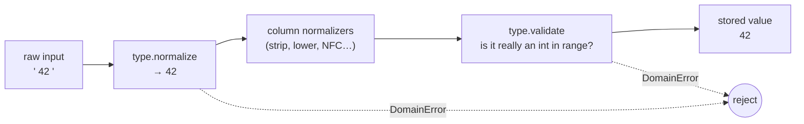

[🏠 Contents](index.md) · [← Previous: Chapter 2 — Tables and CRUD](02-tables-and-crud.md)

# Chapter 3 — Types and Normalization

Our tables accept anything. In this chapter columns get **types**, and with them a pipeline that every incoming value passes through:



There are two distinct jobs here, and keeping them apart is the main design idea of this chapter:

- **Normalization** turns an *acceptable* input into the one **canonical** form we store: `" 42 "` → `42`, `"2026-11-18"` → `date(2026, 11, 18)`, `0.1` → `Decimal('0.10')`.
- **Validation** checks that a value *is* in canonical form and inside its domain, e.g. an `int` between 0 and 150.

Why canonical forms? Equality. If `"Ada@Example.org"` and `"ada@example.org"` are both stored, a uniqueness check ([Chapter 5](05-keys-and-indexes.md)) will happily accept both, and a lookup for one will miss the other. Every later subsystem (indexes, joins, the query planner) compares values with `==` and hashes them, so all of them rely on values having one representation.

## 3.1 Domain errors

A value outside its type's domain is the first of several *constraint violations*. They share a base class, so callers can catch "the data was rejected" separately from "the schema is wrong":

```python
# minidb/errors.py (append)
class ConstraintError(DatabaseError):
    """Data was rejected because it violates a rule of the schema."""


class DomainError(ConstraintError):
    """A value does not belong to its column's type (domain)."""
```

## 3.2 The `Type` base class

A type is an object, not just a Python class, because types have parameters: `Integer(min=0, max=150)`, `Text(max_length=80)`, `Numeric(10, 2)`. We use frozen dataclasses for the concrete types. That gives them a readable `repr`, value equality (`Integer(0, 10) == Integer(0, 10)`) and hashability, all of which we'll use in [Chapter 13](13-persistence.md) to fingerprint schemas.

Normalization is lenient about *input*. Validation is strict about *output*: it checks the **exact** Python type. That strictness matters because of a Python quirk. `bool` is a subclass of `int`, and `datetime` is a subclass of `date`, so `isinstance(True, int)` is `True`. Without exact checks, `True` would be a perfectly good age.

```python
# minidb/types.py
"""Column types. Each type knows how to normalize and validate its values."""
import datetime as dt
import math
import re
from dataclasses import dataclass
from decimal import Decimal, InvalidOperation, ROUND_HALF_EVEN

from minidb.errors import DomainError

_INT_RE = re.compile(r"[+-]?\d+")


class Type:
    """Base class for column types.

    normalize(): turn an acceptable input into the canonical stored form.
    validate():  check that a value already is in canonical form.
    NULL (None) passes through both untouched; NOT NULL is a constraint,
    not a type (see Chapter 4).
    """
    exact_types: tuple[type, ...] = (object,)

    def normalize(self, value):
        if value is None:
            return None
        return self.coerce(value)

    def coerce(self, value):
        """Override: convert `value` or call self.reject(value)."""
        return value

    def validate(self, value) -> None:
        if value is None:
            return
        if object not in self.exact_types and type(value) not in self.exact_types:
            self.reject(value)
        self.check(value)

    def check(self, value) -> None:
        """Override: extra domain rules such as ranges and lengths."""

    def reject(self, value, reason: str = ""):
        raise DomainError(f"{value!r} is not a valid {self!r}"
                          + (f": {reason}" if reason else ""))


@dataclass(frozen=True)
class Integer(Type):
    min: int | None = None
    max: int | None = None
    exact_types = (int,)

    def coerce(self, value):
        match value:
            case bool():
                self.reject(value, "booleans are not integers")
            case int():
                return value
            case float() if value.is_integer():
                return int(value)
            case Decimal() if value.is_finite() and value == value.to_integral_value():
                return int(value)
            case str() if _INT_RE.fullmatch(value.strip()):
                return int(value.strip())
        self.reject(value)

    def check(self, value):
        if self.min is not None and value < self.min:
            self.reject(value, f"below minimum {self.min}")
        if self.max is not None and value > self.max:
            self.reject(value, f"above maximum {self.max}")


@dataclass(frozen=True)
class Real(Type):
    exact_types = (float,)

    def coerce(self, value):
        match value:
            case bool():
                self.reject(value, "booleans are not numbers")
            case int() | float() | Decimal():
                result = float(value)
            case str():
                try:
                    result = float(value.strip())
                except ValueError:
                    self.reject(value)
            case _:
                self.reject(value)
        return result

    def check(self, value):
        if not math.isfinite(value):
            self.reject(value, "NaN and infinities are not allowed")


@dataclass(frozen=True)
class Text(Type):
    max_length: int | None = None
    exact_types = (str,)

    def coerce(self, value):
        if not isinstance(value, str):
            self.reject(value, "no implicit conversion to text")
        return value

    def check(self, value):
        if self.max_length is not None and len(value) > self.max_length:
            self.reject(value, f"longer than {self.max_length} characters")


_TRUE = {"true", "t", "yes", "y", "on", "1"}
_FALSE = {"false", "f", "no", "n", "off", "0"}


@dataclass(frozen=True)
class Boolean(Type):
    exact_types = (bool,)

    def coerce(self, value):
        match value:
            case bool():
                return value
            case 0 | 1:
                return bool(value)
            case str() if value.strip().lower() in _TRUE:
                return True
            case str() if value.strip().lower() in _FALSE:
                return False
        self.reject(value)


@dataclass(frozen=True)
class Numeric(Type):
    """Exact decimal with `precision` total digits, `scale` after the point."""
    precision: int = 18
    scale: int = 2
    exact_types = (Decimal,)

    def __post_init__(self):
        if not 0 <= self.scale <= self.precision:
            raise ValueError("need 0 <= scale <= precision")

    def coerce(self, value):
        match value:
            case bool():
                self.reject(value)
            case float():
                value = Decimal(repr(value))     # 0.1 -> Decimal('0.1')
            case int() | Decimal():
                value = Decimal(value)
            case str():
                try:
                    value = Decimal(value.strip())
                except InvalidOperation:
                    self.reject(value)
            case _:
                self.reject(value)
        if not value.is_finite():
            self.reject(value, "NaN and infinities are not allowed")
        return value.quantize(Decimal(1).scaleb(-self.scale), ROUND_HALF_EVEN)

    def check(self, value):
        if value.as_tuple().exponent != -self.scale:
            self.reject(value, f"expected exactly {self.scale} decimal places")
        digits_before_point = max(value.adjusted() + 1, 0)
        if digits_before_point > self.precision - self.scale:
            self.reject(value, f"too many digits for NUMERIC({self.precision}, {self.scale})")


@dataclass(frozen=True)
class Date(Type):
    exact_types = (dt.date,)

    def coerce(self, value):
        match value:
            case dt.datetime():
                self.reject(value, "use .date() to drop the time explicitly")
            case dt.date():
                return value
            case str():
                try:
                    return dt.date.fromisoformat(value.strip())
                except ValueError:
                    self.reject(value)
        self.reject(value)


@dataclass(frozen=True)
class Timestamp(Type):
    """A datetime. With with_timezone=True, values must be aware and are
    stored in UTC; otherwise they must be naive."""
    with_timezone: bool = True
    exact_types = (dt.datetime,)

    def coerce(self, value):
        if isinstance(value, str):
            try:
                value = dt.datetime.fromisoformat(value.strip())
            except ValueError:
                self.reject(value)
        if not isinstance(value, dt.datetime):
            self.reject(value)
        aware = value.tzinfo is not None and value.utcoffset() is not None
        if self.with_timezone:
            if not aware:
                self.reject(value, "a timezone is required")
            return value.astimezone(dt.UTC)
        if aware:
            self.reject(value, "timezone not allowed")
        return value

    def check(self, value):
        if self.with_timezone and value.utcoffset() != dt.timedelta(0):
            self.reject(value, "must be stored in UTC")
```

Some design decisions worth discussing:

**No implicit conversion to text.** `Text().normalize(42)` is an error, not `"42"`. Implicit conversions are convenient until two of them meet: is `"10" < "9"`? For strings, yes. SQLite takes the opposite approach with *type affinity*, converting values to the column's preferred type where possible ([SQLite datatypes](references.md#sqlite-types)). Both approaches are defensible. Be strict at the boundary and you never have to wonder.

**Floats into `Numeric` go through `repr`.** `Decimal(0.1)` is `Decimal('0.1000000000000000055511151231257827021181583404541015625')`, the exact binary value of the float. `Decimal(repr(0.1))` is `Decimal('0.1')`, which is what the user meant. Then we `quantize` to the column's scale with *banker's rounding* (`ROUND_HALF_EVEN`), the rounding mode that doesn't bias sums upward.

**NaN is banned from `Real`.** `float('nan') != float('nan')`. A value that is not equal to itself breaks uniqueness, joins and sorting. PostgreSQL makes the opposite choice and defines NaN as equal to itself and greater than every other number. Either way, *some* rule is needed. We take the simplest.

**Timestamps are either all aware or all naive.** Python refuses to compare naive and aware datetimes (`TypeError`). So a column has to pick one. Aware values are normalized to UTC, so equal instants are `==` and sort correctly.

**`None` is not a type error.** Whether a column may be NULL is a *constraint*, decided per column, not per type. It's the subject of [Chapter 4](04-constraints.md).

Let's try the types:

```python
>>> from minidb.types import *
>>> Integer(min=0, max=150).normalize(" 42 ")
42
>>> Integer().normalize(True)
Traceback (most recent call last):
  ...
minidb.errors.DomainError: True is not a valid Integer(min=None, max=None): booleans are not integers
>>> Integer(min=0, max=150).validate(200)
Traceback (most recent call last):
  ...
minidb.errors.DomainError: 200 is not a valid Integer(min=0, max=150): above maximum 150
>>> Numeric(6, 2).normalize(0.1)
Decimal('0.10')
>>> Numeric(6, 2).normalize("2.675")         # half-even: 2.675 -> 2.68
Decimal('2.68')
>>> Numeric(4, 2).normalize("123.4")
Decimal('123.40')
>>> Numeric(4, 2).validate(Numeric(4, 2).normalize("123.4"))
Traceback (most recent call last):
  ...
minidb.errors.DomainError: Decimal('123.40') is not a valid Numeric(precision=4, scale=2): too many digits for NUMERIC(4, 2)
>>> Boolean().normalize("Yes")
True
>>> Date().normalize("2026-11-18")
datetime.date(2026, 11, 18)
>>> Timestamp().normalize("2026-11-18T10:00:00+01:00")
datetime.datetime(2026, 11, 18, 9, 0, tzinfo=datetime.timezone.utc)
>>> Text(max_length=3).validate("abcd")
Traceback (most recent call last):
  ...
minidb.errors.DomainError: 'abcd' is not a valid Text(max_length=3): longer than 3 characters
```

Notice that `normalize("123.4")` *succeeded* for `Numeric(4, 2)` and `validate` caught the overflow. Normalization only converts; every domain rule lives in validation. That is why the pipeline always runs validation last.

## 3.3 Column normalizers

Types normalize *representation*. Applications often want *semantic* normalization on top: trimming whitespace, lower-casing e-mail addresses, collapsing runs of spaces. These are plain functions that take a value and return a value:

```python
# minidb/normalizers.py
"""Small value normalizers for Column(normalizers=...).

Every normalizer must be idempotent: f(f(x)) == f(x). Rows are re-normalized
whenever they are updated, so a non-idempotent normalizer would change data
that nobody touched.
"""
import unicodedata


def strip(s: str) -> str:
    return s.strip()


def lower(s: str) -> str:
    return s.lower()


def upper(s: str) -> str:
    return s.upper()


def collapse_spaces(s: str) -> str:
    """'  Ada   Lovelace ' -> 'Ada Lovelace'"""
    return " ".join(s.split())


def nfc(s: str) -> str:
    """Unicode NFC: one canonical byte sequence for visually equal text."""
    return unicodedata.normalize("NFC", s)
```

`nfc` needs explaining. The character "é" can be written as one code point (U+00E9) or as "e" followed by a combining acute accent (U+0065 U+0301). They look identical and are *different strings*:

```python
>>> from minidb.normalizers import nfc
>>> composed, decomposed = "café", "café"
>>> composed == decomposed
False
>>> nfc(composed) == nfc(decomposed)
True
```

Text pasted from a macOS file name is often decomposed; text typed on most keyboards is composed. Without NFC, a unique index on names would accept both "café"s. The Unicode standard defines these normalization forms in [UAX #15](references.md#uax15).

> **Careful with `lower`.** Lower-casing is fine for e-mail *domains* but technically wrong for the part before the `@`, which the standard allows to be case-sensitive. For caseless matching of natural-language text, `str.casefold()` is more correct than `lower()` (`"Straße".casefold() == "strasse"`). Normalization is a *policy*, which is why it's per column and opt-in.

## 3.4 Columns and table schemas

A `Column` combines a name, a type and a tuple of normalizers. A `TableSchema` is a named tuple of columns. It owns the pipeline that turns a dict of user values into a stored row.

```python
# minidb/schema.py
"""Declarative table definitions."""
from collections.abc import Callable, Mapping
from dataclasses import dataclass, field

from minidb.errors import DomainError, SchemaError
from minidb.types import Type

type Row = dict[str, object]


@dataclass(frozen=True)
class Column:
    name: str
    type: Type
    normalizers: tuple[Callable[[object], object], ...] = ()

    def prepare(self, value):
        """Normalize, then validate one value. Raises DomainError."""
        value = self.type.normalize(value)
        if value is not None:
            for fn in self.normalizers:
                value = fn(value)
        self.type.validate(value)
        return value


@dataclass(frozen=True)
class TableSchema:
    name: str
    columns: tuple[Column, ...]
    by_name: Mapping[str, Column] = field(init=False, repr=False, compare=False)

    def __post_init__(self):
        object.__setattr__(self, "columns", tuple(self.columns))
        names = [c.name for c in self.columns]
        if len(set(names)) != len(names):
            raise SchemaError(f"duplicate column names in {self.name!r}")
        object.__setattr__(self, "by_name", {c.name: c for c in self.columns})

    @property
    def column_names(self) -> tuple[str, ...]:
        return tuple(c.name for c in self.columns)

    def column(self, name: str) -> Column:
        try:
            return self.by_name[name]
        except KeyError:
            raise SchemaError(f"{self.name}: no such column {name!r}") from None

    def prepare_row(self, values: Mapping[str, object],
                    base: Row | None = None) -> Row:
        """Return a complete, normalized, validated row.

        `values` are the user's input; `base` is the existing row for an
        update (None for an insert). Neither argument is modified.
        """
        for name in values:
            self.column(name)                       # unknown column?
        row = dict(base) if base is not None else dict.fromkeys(self.column_names)
        for name, value in values.items():
            try:
                row[name] = self.by_name[name].prepare(value)
            except DomainError as e:
                raise DomainError(f"{self.name}.{name}: {e}") from None
        return row
```

`TableSchema` is frozen, but it computes `by_name` in `__post_init__`. A frozen dataclass forbids `self.x = …`, so we go through `object.__setattr__`. That's the standard idiom, and the only place we ever do it.

## 3.5 Tables with schemas

`Table` now takes a `TableSchema` instead of a list of names and runs every insert and update through `prepare_row`. Replace the constructor and the two writers, and delete `_check_columns`. The schema does that job now.

```python
# minidb/table.py (replace Table.__init__)
    def __init__(self, schema: TableSchema):
        self.schema = schema
        self.name = schema.name
        self.columns = schema.column_names
        self.rows: dict[int, Row] = {}
        self._next_rowid = 1
```

```python
# minidb/table.py (replace Table.insert)
    def insert(self, values: Row) -> int:
        row = self.schema.prepare_row(values)
        rowid = self._next_rowid
        self._next_rowid += 1
        self.rows[rowid] = row
        return rowid
```

```python
# minidb/table.py (replace Table.update)
    def update(self, changes: Row, where: Predicate | None = None) -> int:
        targets = self.match(where)                                  # 1. decide
        new_rows = {rid: self.schema.prepare_row(changes, base=self.rows[rid])
                    for rid in targets}                              # 2. validate all
        self.rows.update(new_rows)                                   # 3. modify
        return len(targets)
```

```python
# minidb/table.py (replace Table._check_columns)
    # _check_columns is gone: TableSchema.prepare_row rejects unknown columns.
```

```python
# minidb/table.py (imports)
from minidb.schema import TableSchema
```

The update now has *three* phases. If preparing the 500th row fails, rows 1–499 have not been touched: the statement is atomic. Keep this "validate everything, then write everything" shape in mind. It grows into the Unit of Work in [Chapter 8](08-unit-of-work-i.md).

`Database.create_table` now takes `Column` objects:

```python
# minidb/database.py (replace Database.create_table)
    def create_table(self, name: str, columns: list[Column]) -> Table:
        if name in self.tables:
            raise SchemaError(f"table {name!r} already exists")
        table = self.tables[name] = Table(TableSchema(name, tuple(columns)))
        return table
```

```python
# minidb/database.py (imports)
from minidb.schema import Column, TableSchema
```

And the package exports the new names:

```python
# minidb/__init__.py
"""minidb: a small relational database, built in the book."""
from minidb.database import Database
from minidb.errors import ConstraintError, DatabaseError, DomainError, SchemaError
from minidb.schema import Column, TableSchema
from minidb.types import Boolean, Date, Integer, Numeric, Real, Text, Timestamp
from minidb import normalizers

__all__ = [
    "Database", "DatabaseError", "SchemaError", "ConstraintError", "DomainError",
    "Column", "TableSchema",
    "Integer", "Real", "Text", "Boolean", "Numeric", "Date", "Timestamp",
    "normalizers",
]
```

## 3.6 Trying it out

```python
>>> from minidb import *
>>> from minidb.normalizers import strip, lower, nfc, collapse_spaces
>>> db = Database()
>>> _ = db.create_table("users", [
...     Column("id", Integer(min=1)),
...     Column("email", Text(max_length=254), normalizers=(strip, lower)),
...     Column("name", Text(), normalizers=(nfc, collapse_spaces)),
...     Column("age", Integer(min=0, max=150)),
...     Column("balance", Numeric(10, 2)),
... ])
>>> db.insert("users", {"id": "1", "email": "  Ada@Example.ORG ",
...                     "name": " Ada   Lovelace", "age": 36.0, "balance": "12.5"})
1
>>> db.get("users", 1)
{'id': 1, 'email': 'ada@example.org', 'name': 'Ada Lovelace', 'age': 36, 'balance': Decimal('12.50')}
>>> db.insert("users", {"id": 2, "age": -1})
Traceback (most recent call last):
  ...
minidb.errors.DomainError: users.age: -1 is not a valid Integer(min=0, max=150): below minimum 0
>>> db.update("users", {"age": "thirty"})
Traceback (most recent call last):
  ...
minidb.errors.DomainError: users.age: 'thirty' is not a valid Integer(min=0, max=150)
>>> db.get("users", 1)["age"]          # the failed update changed nothing
36
```

## 3.7 Normalization, the *other* meaning

Database people use "normalization" for a second, unrelated idea: **schema normalization**, Codd's normal forms ([Codd 1972](references.md#codd1972); a friendly guide is [Kent 1983](references.md#kent1983)). It's about structuring *tables* so that every fact is stored once. For example, a customer's address belongs in the `customers` table, not repeated in every row of `orders`. A database engine can't do schema normalization for you. It's a design activity. What the engine *can* do is make the normalized design pleasant to use, with keys ([Chapter 5](05-keys-and-indexes.md)), foreign keys ([Chapter 6](06-referential-integrity.md)) and fast joins ([Chapters 7](07-query-primitives.md) and [14](14-query-planning.md)). Exercise 7 below invites you to try it by hand.

## Questions and exercises

1. Why does `validate` check `type(value) in exact_types` rather than `isinstance`? Give two values that would sneak through with `isinstance`.
2. Our normalizers must be idempotent. Write a normalizer that *isn't* (e.g. one that appends a suffix) and show the bug it causes when a row is updated twice.
3. Add a `Choice(*allowed)` type for enumerations, e.g. `Choice("draft", "sent", "paid")`. Should `"DRAFT"` be accepted? Where would you put that decision: in the type, or in a normalizer?
4. Add a `Json` type whose canonical form is an immutable structure (tuples instead of lists, `MappingProxyType` or sorted tuples of pairs instead of dicts). Why must it be immutable? (Recall [§2.3](02-tables-and-crud.md#copies-out-never-references).)
5. `Numeric.check` rejects values with too many digits. What happens to `Numeric(4, 2).normalize("99.995")`? Is the error message helpful? Improve it.
6. PostgreSQL treats NaN as equal to itself and larger than any number. Implement a `Real(allow_nan=True)` option with those semantics. Where else in the system would this choice leak? (Think of sorting in [Chapter 7](07-query-primitives.md).)
7. *(Schema design)* This table stores orders: `(order_id, customer_name, customer_address, product, product_price, quantity)`. Which facts are repeated? Split it into normalized tables and name the keys of each.

---

[🏠 Contents](index.md) · [Next: Chapter 4 — Constraints →](04-constraints.md)
