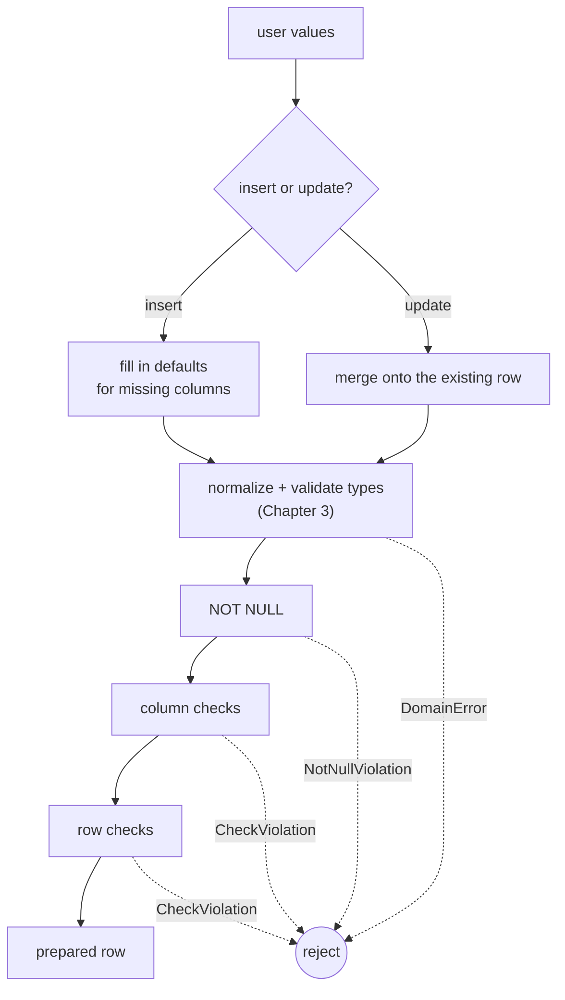

[🏠 Contents](index.md) · [← Previous: Chapter 3 — Types and Normalization](03-types-and-normalization.md)

# Chapter 4 — Constraints I: NULL, Defaults and Checks

A type says which values a column *can* hold. A **constraint** says which values the data *may* hold, given what it means. "Age is an integer" is a type; "age is required" and "a discount never exceeds the price" are constraints. This chapter adds the three constraints that need only a single row to check:

| Constraint | SQL | Scope |
|---|---|---|
| Not null | `age INTEGER NOT NULL` | one column |
| Default | `qty INTEGER DEFAULT 1` | one column (fills in, rather than rejects) |
| Check | `CHECK (price > 0)`, `CHECK (discount <= price)` | one column, or one whole row |

Constraints that need *other* rows (uniqueness, keys) or *other tables* (foreign keys) come in [Chapters 5](05-keys-and-indexes.md) and [6](06-referential-integrity.md). They need indexes to be efficient.

## 4.1 The constraint pipeline

By the end of this chapter, `TableSchema.prepare_row` runs every insert and update through a fixed sequence of stages. **Order matters**: defaults must be filled in before NOT NULL is checked, and values must be normalized before any check compares them.



Two new errors join the hierarchy:

```python
# minidb/errors.py (append)
class NotNullViolation(ConstraintError):
    """A NOT NULL column received NULL."""


class CheckViolation(ConstraintError):
    """A CHECK constraint evaluated to false."""
```

## 4.2 Three-valued logic

Before writing checks we must decide what a check means when data is **missing**. SQL's answer is **three-valued logic**: a comparison involving `NULL` is neither true nor false but **UNKNOWN**. `NULL = NULL` is UNKNOWN, and so is `NULL > 5`. The connectives extend naturally:

| `a` | `b` | `a AND b` | `a OR b` | `NOT a` |
|---|---|---|---|---|
| TRUE | UNKNOWN | UNKNOWN | TRUE | FALSE |
| FALSE | UNKNOWN | FALSE | UNKNOWN | TRUE |
| UNKNOWN | UNKNOWN | UNKNOWN | UNKNOWN | UNKNOWN |

And the rule that matters here: **a CHECK constraint passes unless it is FALSE.** UNKNOWN passes. So `CHECK (age >= 18)` accepts a row whose age is NULL. If you want to reject NULL, that's what NOT NULL is for. Keeping the two concerns separate is deliberate in SQL, and we copy it.

(`WHERE` is the opposite: it keeps a row only if the predicate is TRUE. Asymmetries like this make NULL notoriously confusing. Codd himself later proposed *two* kinds of NULL; most people think one is already enough.)

Python has no UNKNOWN. We represent it with `None`:

- **Column checks** are skipped when the value is NULL. That's the SQL behaviour for a check on a single column, and it spares every check from starting with `x is None or …`.
- **Row checks** receive the whole row, and may return `True`, `False` or `None` (UNKNOWN). Only `False` rejects. A row check that compares nullable columns should return `None` when an operand is missing. Otherwise Python raises `TypeError` on `None <= 5`, which we treat as a bug in the check rather than a violation.

In [Chapter 14](14-query-planning.md) we build real expression objects that implement three-valued logic for you.

## 4.3 Columns with constraints

`Column` grows three fields. `default` may be a plain value or a zero-argument callable (for things like "now"). A new `Check` class names a row-level rule, so error messages can say *which* rule failed.

```python
# minidb/schema.py (replace Column)
_NO_DEFAULT = object()


@dataclass(frozen=True)
class Column:
    name: str
    type: Type
    normalizers: tuple[Callable[[object], object], ...] = ()
    nullable: bool = True
    default: object = None          # a value, or a zero-argument callable
    check: Callable[[object], bool | None] | None = None

    def make_default(self):
        return self.default() if callable(self.default) else self.default

    def prepare(self, value):
        """Normalize, then validate one value. Raises DomainError."""
        value = self.type.normalize(value)
        if value is not None:
            for fn in self.normalizers:
                value = fn(value)
        self.type.validate(value)
        return value


@dataclass(frozen=True)
class Check:
    """A named row-level CHECK. `predicate(row)` returns True, False or None."""
    name: str
    predicate: Callable[[Mapping[str, object]], bool | None]
```

`TableSchema` gets a `checks` field and a rewritten `prepare_row` that runs the stages in order:

```python
# minidb/schema.py (replace TableSchema)
@dataclass(frozen=True)
class TableSchema:
    name: str
    columns: tuple[Column, ...]
    checks: tuple[Check, ...] = ()
    by_name: Mapping[str, Column] = field(init=False, repr=False, compare=False)

    def __post_init__(self):
        object.__setattr__(self, "columns", tuple(self.columns))
        object.__setattr__(self, "checks", tuple(self.checks))
        names = [c.name for c in self.columns]
        if len(set(names)) != len(names):
            raise SchemaError(f"duplicate column names in {self.name!r}")
        object.__setattr__(self, "by_name", {c.name: c for c in self.columns})

    @property
    def column_names(self) -> tuple[str, ...]:
        return tuple(c.name for c in self.columns)

    def column(self, name: str) -> Column:
        try:
            return self.by_name[name]
        except KeyError:
            raise SchemaError(f"{self.name}: no such column {name!r}") from None

    def prepare_row(self, values: Mapping[str, object],
                    base: Row | None = None) -> Row:
        """Run the constraint pipeline; return a complete, valid row.

        `values` are the user's input; `base` is the existing row for an
        update (None for an insert). Neither argument is modified.
        """
        for name in values:
            self.column(name)                                # unknown column?
        if base is None:                                     # insert
            row = {c.name: values[c.name] if c.name in values else c.make_default()
                   for c in self.columns}
            touched = self.column_names
        else:                                                # update
            row = dict(base) | dict(values)
            touched = tuple(values)
        for name in touched:
            try:
                row[name] = self.by_name[name].prepare(row[name])
            except DomainError as e:
                raise DomainError(f"{self.name}.{name}: {e}") from None
        self._check_not_null(row)
        self._check_columns(row)
        self._check_rows(row)
        return row

    # -- stages ---------------------------------------------------------------
    def _check_not_null(self, row: Row) -> None:
        for c in self.columns:
            if not c.nullable and row[c.name] is None:
                raise NotNullViolation(f"{self.name}.{c.name} may not be NULL")

    def _check_columns(self, row: Row) -> None:
        for c in self.columns:
            value = row[c.name]
            if c.check is not None and value is not None and c.check(value) is False:
                raise CheckViolation(f"{self.name}.{c.name}: check failed for {value!r}")

    def _check_rows(self, row: Row) -> None:
        view = MappingProxyType(row)
        for check in self.checks:
            if check.predicate(view) is False:
                raise CheckViolation(f"{self.name}: check {check.name!r} failed")
```

```python
# minidb/schema.py (imports)
from types import MappingProxyType
from minidb.errors import CheckViolation, NotNullViolation
```

Some points to notice:

- **Defaults apply only to columns that are *missing* on insert.** An explicit `None` means "store NULL", and NOT NULL may then reject it. That's exactly SQL's behaviour: `INSERT INTO t (qty) VALUES (NULL)` does not use the default.
- **Defaults go through the pipeline too.** A default of `"1"` for an `Integer` column is normalized to `1`, and a default that violates a check is caught the first time it's used. (Exercise 2 asks you to catch it earlier.)
- **On update, only touched columns are re-normalized**, but **all checks run on the whole new row.** A row check like `discount <= price` must be re-evaluated when *either* column changes, and checking everything is simpler than tracking dependencies.
- **`is False`, not `not …`.** `None` (UNKNOWN) must pass, so we can't use plain truthiness.

`create_table` passes the new `checks` argument through:

```python
# minidb/database.py (replace Database.create_table)
    def create_table(self, name: str, columns: list[Column],
                     checks: list[Check] = ()) -> Table:
        if name in self.tables:
            raise SchemaError(f"table {name!r} already exists")
        schema = TableSchema(name, tuple(columns), tuple(checks))
        table = self.tables[name] = Table(schema)
        return table
```

```python
# minidb/database.py (imports)
from minidb.schema import Check
```

```python
# minidb/__init__.py
"""minidb: a small relational database, built in the book."""
from minidb.database import Database
from minidb.errors import (CheckViolation, ConstraintError, DatabaseError,
                           DomainError, NotNullViolation, SchemaError)
from minidb.schema import Check, Column, TableSchema
from minidb.types import Boolean, Date, Integer, Numeric, Real, Text, Timestamp
from minidb import normalizers

__all__ = [
    "Database", "DatabaseError", "SchemaError", "ConstraintError", "DomainError",
    "NotNullViolation", "CheckViolation",
    "Column", "Check", "TableSchema",
    "Integer", "Real", "Text", "Boolean", "Numeric", "Date", "Timestamp",
    "normalizers",
]
```

## 4.4 Trying it out

```python
>>> from minidb import *
>>> from decimal import Decimal
>>> db = Database()
>>> _ = db.create_table("products", [
...     Column("sku", Text(), nullable=False),
...     Column("price", Numeric(8, 2), nullable=False, check=lambda p: p > 0),
...     Column("discount", Numeric(8, 2)),
...     Column("qty", Integer(min=0), nullable=False, default=0),
... ], checks=[
...     Check("discount_le_price",
...           lambda r: None if r["discount"] is None else r["discount"] <= r["price"]),
... ])
>>> db.insert("products", {"sku": "A-1", "price": "9.99"})
1
>>> db.get("products", 1)
{'sku': 'A-1', 'price': Decimal('9.99'), 'discount': None, 'qty': 0}
>>> db.insert("products", {"sku": "A-2", "price": 0})
Traceback (most recent call last):
  ...
minidb.errors.CheckViolation: products.price: check failed for Decimal('0.00')
>>> db.insert("products", {"sku": "A-3", "price": 5, "qty": None})
Traceback (most recent call last):
  ...
minidb.errors.NotNullViolation: products.qty may not be NULL
>>> db.update("products", {"discount": 20})
Traceback (most recent call last):
  ...
minidb.errors.CheckViolation: products: check 'discount_le_price' failed
>>> db.update("products", {"discount": "1.50"})
1
>>> db.update("products", {"price": 1})       # now the *price* change violates the row check
Traceback (most recent call last):
  ...
minidb.errors.CheckViolation: products: check 'discount_le_price' failed
```

The last example shows why every row check runs on every update: the statement didn't mention `discount`, but it broke the rule anyway.

## 4.5 What constraints are *for*

It's tempting to see constraints as input validation that happens to live in the database. They are more than that. A constraint is a **promise about all data, forever**. Application code checks the inputs that pass through *that code*. A constraint also covers the batch import someone writes next year, the admin fixing a row by hand, and the bug in the new microservice. That's why ACID's **C** (consistency) is defined in terms of constraints: a transaction must move the database from one state where all constraints hold to another ([Härder & Reuter 1983](references.md#harder1983)).

It's also why constraints must be checked **centrally and unavoidably**. In minidb the only way to write a row is through `prepare_row`. Keep that invariant in mind; [Chapter 8](08-unit-of-work-i.md) introduces a second write path, and we'll have to make sure it doesn't skip the pipeline.

## Questions and exercises

1. Evaluate under SQL's three-valued logic: `NULL OR TRUE`, `NULL AND FALSE`, `NOT (NULL = NULL)`. Which of these would let a `CHECK` pass?
2. A column's default can violate its own check: `Column("qty", Integer(), default=-1, check=lambda q: q >= 0)`. Make `create_table` reject this at definition time. Can you do the same for callable defaults? Why or why not?
3. Write a decorator `unknown_if_null(*cols)` that wraps a row predicate so it returns `None` when any of the named columns is NULL. Rewrite the `discount_le_price` check with it.
4. Our row checks run on every update. Design (don't implement) a scheme where each `Check` declares the columns it reads, so only affected checks run. What could go wrong if a declaration is incomplete?
5. Should `Column.check` receive the *normalized* or the *raw* value? Find a check that gives a different answer in each case.
6. SQL supports `DEFAULT CURRENT_TIMESTAMP`. Add it with a callable default. If a single `INSERT` statement inserts 1000 rows, should they all get the same timestamp? What does your implementation do? (PostgreSQL's `now()` returns the *transaction's* start time. Why might that be preferable?)
7. *(Design)* Some databases let you mark constraints `NOT VALID` or disable them temporarily for bulk loads. What would minidb have to do when such a constraint is re-enabled?

---

[🏠 Contents](index.md) · [Next: Chapter 5 — Keys and Indexes →](05-keys-and-indexes.md)
