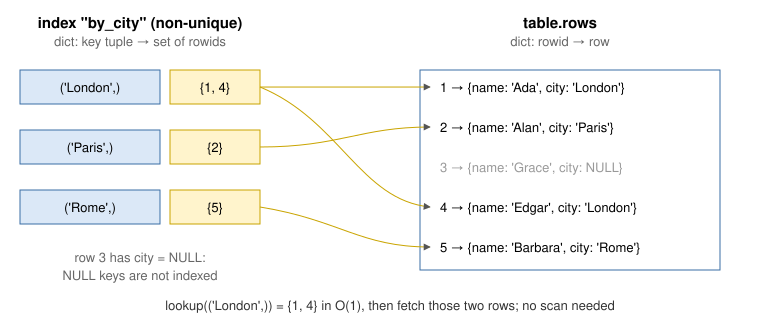
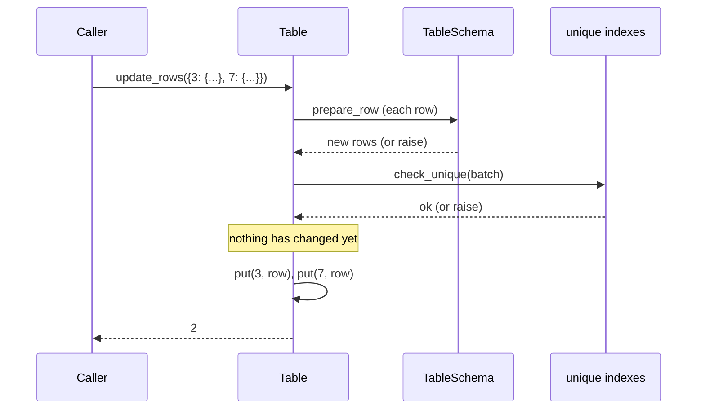

[🏠 Contents](index.md) · [← Previous: Chapter 4 — Constraints](04-constraints.md)

# Chapter 5 — Keys and Indexes

Every constraint so far could be checked by looking at a single row. **Uniqueness** is different: to know that no other user has e-mail `ada@example.org`, you have to know about *all* the other users. Scanning the whole table on every insert makes loading *n* rows cost O(n²). We need a structure that answers "which rows have this value?" without a scan: an **index**.

This chapter builds hash indexes, uses them to enforce **primary keys** and **unique constraints**, and lets `select` use them for fast equality lookups. In doing so we rewrite `Table` around two primitive operations, `put` and `remove`. Every later chapter builds on those two.

## 5.1 Keys

A **candidate key** is a minimal set of columns whose values identify a row. A table can have several: a user is identified by `id` and also by `email`. One of them is chosen as the **primary key**; the others are declared `UNIQUE`. The differences are small but real:

| | Primary key | Unique |
|---|---|---|
| How many per table | at most one | any number |
| NULL allowed | never (entity integrity) | yes, and NULLs don't collide |
| Default target of foreign keys | yes ([Chapter 6](06-referential-integrity.md)) | must be named explicitly |

The last row of the NULL rule deserves a sentence. In SQL, `NULL = NULL` is UNKNOWN ([§4.2](04-constraints.md#42-three-valued-logic)), so two NULLs are not "equal". A `UNIQUE` column may therefore contain any number of NULLs. PostgreSQL 15 added `NULLS NOT DISTINCT` for the other behaviour. We follow the standard: **a key containing NULL is never indexed and never conflicts.**

Keys may be **composite**. An enrolment is identified by `(student_id, course_id)`, so each column may repeat, but the pair may not. Our keys are therefore always tuples, even when they have a single column.

## 5.2 A hash index



A hash index is a dict from a key tuple to the **set of rowids** having that key. For a unique index the set has at most one element, but using sets everywhere keeps the code uniform.

```python
# src/minidb/index.py
"""Define indexes: secondary structures that map column values to rowids."""

from typing import TYPE_CHECKING
from typing import ClassVar
from typing import Protocol

if TYPE_CHECKING:
    from collections.abc import Iterable
    from collections.abc import Mapping

    from minidb.values import Value

type Key = tuple[Value | None, ...]


class Index(Protocol):
    """Describe what every kind of index offers.

    An index maps the *key* of a row, the tuple of its values in the
    indexed columns, to the set of rowids having that key. Rows whose key
    contains NULL are not indexed, because NULL never equals anything.
    """

    kind: ClassVar[str]
    name: str
    columns: tuple[str, ...]
    unique: bool

    def key_of(self, row: Mapping[str, Value | None]) -> Key | None:
        """Return the row's key, or ``None`` if any of its values is NULL."""
        ...

    def add(self, rowid: int, row: Mapping[str, Value | None]) -> None:
        """Record that ``rowid`` holds ``row``."""
        ...

    def remove(self, rowid: int, row: Mapping[str, Value | None]) -> None:
        """Forget that ``rowid`` holds ``row``."""
        ...

    def lookup(self, key: Key) -> set[int]:
        """Return the rowids whose key equals ``key``, as a new set."""
        ...

    def distinct_keys(self) -> int:
        """Return the number of different keys in the index."""
        ...


class KeyedIndex:
    """Provide the attributes and the :meth:`key_of` that all indexes share.

    :param name: the index's name.
    :param columns: the indexed columns, in key order.
    :param unique: whether two rows may share a key; ``False`` by default.
    """

    def __init__(self, name: str, columns: Iterable[str], *, unique: bool = False) -> None:
        self.name = name
        self.columns = tuple(columns)
        self.unique = unique

    def key_of(self, row: Mapping[str, Value | None]) -> Key | None:
        """Return the row's values in the indexed columns, or ``None`` if one is NULL.

        >>> KeyedIndex("i", ["a", "b"]).key_of({"a": 1, "b": None, "c": 3}) is None
        True

        :param row: a row with (at least) the indexed columns.
        :return: the key tuple, or ``None``.
        """
        key = tuple(row[c] for c in self.columns)
        return None if any(v is None for v in key) else key


class HashIndex(KeyedIndex):
    """Answer equality lookups in O(1) with a dict from key to rowids.

    >>> index = HashIndex("by_city", ["city"])
    >>> index.add(1, {"city": "London"})
    >>> index.add(4, {"city": "London"})
    >>> index.lookup(("London",))
    {1, 4}

    :param name: the index's name.
    :param columns: the indexed columns, in key order.
    :param unique: whether two rows may share a key; ``False`` by default.
    """

    kind: ClassVar[str] = "hash"

    def __init__(self, name: str, columns: Iterable[str], *, unique: bool = False) -> None:
        super().__init__(name, columns, unique=unique)
        self._entries: dict[Key, set[int]] = {}

    def add(self, rowid: int, row: Mapping[str, Value | None]) -> None:
        """Record that ``rowid`` holds ``row``.

        :param rowid: the row's rowid.
        :param row: the row's values.
        """
        key = self.key_of(row)
        if key is not None:
            self._entries.setdefault(key, set()).add(rowid)

    def remove(self, rowid: int, row: Mapping[str, Value | None]) -> None:
        """Forget that ``rowid`` holds ``row``, dropping keys left with no rows.

        :param rowid: the row's rowid.
        :param row: the values the row had when it was added.
        """
        key = self.key_of(row)
        ids = self._entries.get(key) if key is not None else None
        if key is not None and ids is not None:
            ids.discard(rowid)
            if not ids:
                del self._entries[key]  # don't keep empty buckets around

    def lookup(self, key: Key) -> set[int]:
        """Return the rowids whose key equals ``key``.

        :param key: the key to look up.
        :return: a new set, which the caller may modify.
        """
        return set(self._entries.get(tuple(key), ()))

    def distinct_keys(self) -> int:
        """Return the number of different keys in the index."""
        return len(self._entries)

    def __repr__(self) -> str:
        u = "unique " if self.unique else ""
        return f"<{u}{self.kind} index {self.name} on {self.columns}>"
```

The module separates **what an index is** from **how one works**. `Index` is a `typing.Protocol`: a description of the attributes and methods any index must have. A class satisfies it simply by having them, without inheriting from it. `Table` stores its indexes as `dict[str, Index]` and never mentions `HashIndex` except when creating one. [Chapters 14](14-query-planning.md) and [15](15-b-trees.md) add sorted and B-tree indexes, and the table won't care. The *behaviour* that all indexes share, their attributes and `key_of`, lives in a small base class, `KeyedIndex`. Protocols describe interfaces; base classes share code.

`unique` is keyword-only (note the `*` in the signature). A bare `True` in a call like `HashIndex("i", ["a"], True)` says nothing to the reader, so boolean flags are always passed by name.

Python's `dict` *is* a hash table, so all the hard work (hashing, collision handling, resizing) is done for us. The essential property is that our values hash consistently with `==`. That's why [Chapter 3](03-types-and-normalization.md) insisted on canonical forms: `Decimal('1.0')` and `Decimal('1.00')` are equal *and* hash equal, but `'Café'` in two Unicode forms is neither.

`lookup` returns a *copy* of the set, for the same reason `Table.get` returns copies of rows. Callers will often modify the table while holding a lookup result.

## 5.3 Declaring keys in the schema

`TableSchema` gains `primary_key` and `unique`. Primary-key columns are made `NOT NULL` automatically, so that rule is enforced by the pipeline we already have. Here is the whole class again. Only the fields and `__post_init__` changed; the pipeline methods are as in [Chapter 4](04-constraints.md).

```python
# src/minidb/schema.py (replace TableSchema)
@dataclass(frozen=True)
class TableSchema:
    """Declare a table, its keys, and the constraint pipeline for its rows.

    Primary-key columns are made NOT NULL automatically.

    >>> from minidb.types import Integer
    >>> schema = TableSchema("t", (Column("id", Integer()),), primary_key=("id",))
    >>> schema.column("id").nullable
    False

    :param name: the table's name.
    :param columns: its columns, in order.
    :param checks: its row-level CHECK constraints; none by default.
    :param primary_key: the primary-key columns; ``()`` (the default) for none.
    :param unique: the column tuples of its UNIQUE constraints; none by default.
    :raises SchemaError: if two columns share a name, or a key names an
        unknown column.
    """

    name: str
    columns: tuple[Column, ...]
    checks: tuple[Check, ...] = ()
    primary_key: tuple[str, ...] = ()
    unique: tuple[tuple[str, ...], ...] = ()
    by_name: Mapping[str, Column] = field(init=False, repr=False, compare=False)

    def __post_init__(self) -> None:
        names = [c.name for c in self.columns]
        if len(set(names)) != len(names):
            raise SchemaError(f"duplicate column names in {self.name!r}")
        for key in (self.primary_key, *self.unique):
            if missing := set(key) - set(names):
                raise SchemaError(f"{self.name}: key uses unknown column(s) {sorted(missing)}")
        # entity integrity: primary-key columns are implicitly NOT NULL
        pk = set(self.primary_key)
        columns = tuple(replace(c, nullable=False) if c.name in pk else c for c in self.columns)
        object.__setattr__(self, "columns", columns)
        object.__setattr__(self, "by_name", {c.name: c for c in columns})

    @property
    def column_names(self) -> tuple[str, ...]:
        """Return the column names, in order."""
        return tuple(c.name for c in self.columns)

    def column(self, name: str) -> Column:
        """Return the column called ``name``.

        :param name: the column's name.
        :return: the column.
        :raises SchemaError: if there is no such column.
        """
        try:
            return self.by_name[name]
        except KeyError:
            raise SchemaError(f"{self.name}: no such column {name!r}") from None

    def prepare_row(self, values: Mapping[str, object], base: Row | None = None) -> Row:
        """Run the constraint pipeline and return a complete, valid row.

        The stages run in a fixed order: defaults (for inserts), types,
        NOT NULL, column checks, row checks. Neither argument is modified.

        :param values: the user's input, by column name.
        :param base: the existing row, for an update; ``None`` (the default)
            for an insert.
        :return: the row to store.
        :raises SchemaError: if ``values`` names an unknown column.
        :raises DomainError: if a value doesn't belong to its column's type.
        :raises NotNullError: if a NOT NULL column would hold NULL.
        :raises CheckError: if a CHECK constraint is false.
        """
        for name in values:
            self.column(name)  # unknown column?
        row: Row = dict(base) if base is not None else {}
        for name, value in self._pending(values, base).items():
            try:
                row[name] = self.by_name[name].prepare(value)
            except DomainError as e:
                raise DomainError(f"{self.name}.{name}: {e}") from None
        self._check_not_null(row)
        self._check_columns(row)
        self._check_rows(row)
        return row

    # -- stages ---------------------------------------------------------------
    def _pending(self, values: Mapping[str, object], base: Row | None) -> dict[str, object]:
        """Return the raw values that still need preparing, by column.

        An insert prepares every column, using defaults for missing ones; an
        update prepares only the columns it changes.
        """
        if base is not None:
            return dict(values)
        return {c.name: values[c.name] if c.name in values else c.make_default() for c in self.columns}

    def _check_not_null(self, row: Row) -> None:
        for c in self.columns:
            if not c.nullable and row[c.name] is None:
                raise NotNullError(f"{self.name}.{c.name} may not be NULL")

    def _check_columns(self, row: Row) -> None:
        for c in self.columns:
            value = row[c.name]
            if c.check is not None and value is not None and c.check(value) is False:
                raise CheckError(f"{self.name}.{c.name}: check failed for {value!r}")

    def _check_rows(self, row: Row) -> None:
        view = MappingProxyType(row)
        for check in self.checks:
            if check.predicate(view) is False:
                raise CheckError(f"{self.name}: check {check.name!r} failed")


def as_key(columns: str | Iterable[str]) -> tuple[str, ...]:
    """Turn one column name or several into a tuple of names.

    >>> as_key("id"), as_key(["a", "b"])
    (('id',), ('a', 'b'))

    :param columns: a column name, or an iterable of them.
    :return: the names as a tuple.
    """
    return (columns,) if isinstance(columns, str) else tuple(columns)
```

```python
# src/minidb/schema.py (imports)
from dataclasses import replace
```

```python
# src/minidb/schema.py (typing imports)
from collections.abc import Iterable
```

And a new error:

```python
# src/minidb/errors.py (append)
class UniqueError(ConstraintError):
    """Signal that a PRIMARY KEY or UNIQUE constraint would be violated."""
```

## 5.4 `Table`, rewritten around `put` and `remove`

Indexes change how a table must write rows. Every write has to keep the rows *and every index* in agreement, and if any check fails, *nothing* may change. We restructure `Table` into two layers:

- **Primitives**: `put(rowid, row)` and `remove(rowid)` store or delete a row and update all indexes. They don't validate anything. They're the only methods that touch `self.rows`.
- **Operations**: `insert`, `update_rows` and `delete_rows` validate *everything first* (pipeline, then uniqueness for the whole batch), and only then call the primitives.



The rewrite touches nearly every method, so here's the whole file:

```python
# src/minidb/table.py
"""Store the rows of one table in memory, together with its indexes.

Writes are split in two layers. The primitives :meth:`Table.put` and
:meth:`Table.remove` store and delete rows and keep every index in step, but
check nothing. The operations (:meth:`Table.insert`, :meth:`Table.update_rows`,
:meth:`Table.delete_rows`) validate everything first, then call the primitives.
"""

from types import MappingProxyType
from typing import TYPE_CHECKING

from minidb.errors import SchemaError
from minidb.errors import UniqueError
from minidb.index import HashIndex

if TYPE_CHECKING:
    from collections.abc import Callable
    from collections.abc import Iterable
    from collections.abc import Iterator
    from collections.abc import Mapping

    from minidb.index import Index
    from minidb.index import Key
    from minidb.schema import TableSchema
    from minidb.values import Row
    from minidb.values import Value

type Predicate = Callable[[Mapping[str, Value | None]], object]
type Where = Predicate | Mapping[str, object] | None


class Table:
    """Hold the rows of one table, keyed by rowid, and keep its indexes in step.

    A primary key and each UNIQUE constraint of the schema get a unique hash
    index automatically.

    >>> from minidb.schema import Column, TableSchema
    >>> from minidb.types import Integer
    >>> t = Table(TableSchema("t", (Column("id", Integer()),), primary_key=("id",)))
    >>> t.insert({"id": 1})
    1
    >>> t.insert({"id": 1})
    Traceback (most recent call last):
      ...
    minidb.errors.UniqueError: t: duplicate key (id=1) violates 'pk'

    :param schema: the table's declaration.
    """

    def __init__(self, schema: TableSchema) -> None:
        self.schema = schema
        self.name = schema.name
        self.columns = schema.column_names
        self.rows: dict[int, Row] = {}
        self.indexes: dict[str, Index] = {}
        self._next_rowid = 1
        if schema.primary_key:
            self.create_index("pk", schema.primary_key, unique=True)
        for cols in schema.unique:
            self.create_index("unique_" + "_".join(cols), cols, unique=True)

    def __len__(self) -> int:
        return len(self.rows)

    # -- indexes ------------------------------------------------------------
    def create_index(self, name: str, columns: Iterable[str], *, unique: bool = False) -> Index:
        """Create an index over the existing rows, and maintain it from now on.

        :param name: the index's name.
        :param columns: the indexed columns, in key order.
        :param unique: whether to refuse duplicate keys; ``False`` by default.
        :return: the new index.
        :raises SchemaError: if the name is taken or a column is unknown.
        :raises UniqueError: if ``unique`` and existing rows share a key.
        """
        if name in self.indexes:
            raise SchemaError(f"{self.name}: index {name!r} already exists")
        columns = tuple(columns)
        for c in columns:
            self.schema.column(c)
        index = HashIndex(name, columns, unique=unique)
        for rowid, row in self.rows.items():  # build from existing rows
            key = index.key_of(row)
            if unique and key is not None and index.lookup(key):
                raise UniqueError(f"{self.name}: cannot create unique index {name!r}: duplicate key {key}")
            index.add(rowid, row)
        self.indexes[name] = index
        return index

    def index_on(self, columns: Iterable[str]) -> Index | None:
        """Return an index on exactly these columns, in any order.

        :param columns: the columns the index must cover.
        :return: such an index, or ``None`` if there is none.
        """
        wanted = set(columns)
        return next((i for i in self.indexes.values() if set(i.columns) == wanted), None)

    # -- primitives: no validation -------------------------------------------
    def put(self, rowid: int, row: Row) -> None:
        """Store ``row`` at ``rowid``, replacing any old row, and update every index.

        :param rowid: where to store the row.
        :param row: the row, already validated.
        """
        old = self.rows.get(rowid)
        for index in self.indexes.values():
            if old is not None:
                index.remove(rowid, old)
            index.add(rowid, row)
        self.rows[rowid] = row

    def remove(self, rowid: int) -> None:
        """Delete the row at ``rowid`` and its index entries.

        :param rowid: the row to delete.
        :raises KeyError: if there is no such row.
        """
        old = self.rows.pop(rowid)
        for index in self.indexes.values():
            index.remove(rowid, old)

    def new_rowid(self) -> int:
        """Hand out the next rowid; rowids are never reused.

        :return: a rowid no row has ever had.
        """
        rowid = self._next_rowid
        self._next_rowid += 1
        return rowid

    # -- checks ---------------------------------------------------------------
    def check_unique(self, batch: list[tuple[int | None, Row]]) -> None:
        """Check that applying ``batch`` would leave every unique key unique.

        Rows in the batch are compared with each other, and with every row
        *outside* the batch, so swapping two keys in one batch is allowed.

        :param batch: pairs of a rowid (``None`` for a new row) and the row
            it will hold.
        :raises UniqueError: if two rows would share a unique key.
        """
        changing = {rid for rid, _ in batch if rid is not None}
        for index in self.indexes.values():
            if index.unique:
                self._check_unique_index(index, batch, changing)

    def _check_unique_index(self, index: Index, batch: list[tuple[int | None, Row]], changing: set[int]) -> None:
        seen: set[Key] = set()
        for _, row in batch:
            key = index.key_of(row)
            if key is None:
                continue
            if key in seen or index.lookup(key) - changing:
                shown = ", ".join(f"{c}={v!r}" for c, v in zip(index.columns, key, strict=True))
                raise UniqueError(f"{self.name}: duplicate key ({shown}) violates {index.name!r}")
            seen.add(key)

    # -- read -----------------------------------------------------------------
    def get(self, rowid: int) -> Row | None:
        """Return a copy of the row with ``rowid``, or ``None`` if there is none.

        :param rowid: the row to fetch.
        :return: a copy of the row, or ``None``.
        """
        row = self.rows.get(rowid)
        return dict(row) if row is not None else None

    def scan(self) -> Iterator[tuple[int, Row]]:
        """Yield every ``(rowid, row)`` pair, each row a fresh copy.

        :return: an iterator over the table, in insertion order.
        """
        for rowid, row in self.rows.items():
            yield rowid, dict(row)

    def match(self, where: Where = None) -> list[int]:
        """Return the rowids of the rows matching ``where``.

        :param where: ``None`` (the default) for every row; a predicate,
            which sees each row through a read-only view; or a dict of
            ``column: value`` equalities, which can use an index.
        :return: the matching rowids.
        :raises SchemaError: if a dict names an unknown column.
        :raises DomainError: if a dict value doesn't fit its column's type.
        """
        if where is None:
            return list(self.rows)
        if callable(where):
            return [rid for rid, row in self.rows.items() if where(MappingProxyType(row))]
        return self._match_equal(where)

    def _match_equal(self, equal: Mapping[str, object]) -> list[int]:
        """Find rows by equalities, through the index covering most of the columns.

        Values are prepared like stored values first, so they match however
        the user wrote them; a NULL value matches nothing.
        """
        wanted = {c: self.schema.column(c).prepare(v) for c, v in equal.items()}
        best = max(
            (i for i in self.indexes.values() if set(i.columns) <= set(wanted)),
            key=lambda i: len(i.columns),
            default=None,
        )
        if best is not None:
            candidates: Iterable[int] = best.lookup(tuple(wanted[c] for c in best.columns))
        else:
            candidates = self.rows.keys()
        return [rid for rid in candidates if all(self.rows[rid][c] == v and v is not None for c, v in wanted.items())]

    def select(self, where: Where = None) -> list[Row]:
        """Return copies of the rows matching ``where``; see :meth:`match`.

        :param where: which rows to return; ``None`` (the default) for all.
        :return: the matching rows.
        """
        return [dict(self.rows[rid]) for rid in self.match(where)]

    # -- write operations: validate everything, then apply ----------------------
    def insert(self, values: Mapping[str, object]) -> int:
        """Validate a new row, store it, and return its rowid.

        :param values: the new row's values, by column name.
        :return: the new rowid.
        :raises ConstraintError: if the row breaks a constraint.
        """
        row = self.schema.prepare_row(values)
        self.check_unique([(None, row)])
        rowid = self.new_rowid()
        self.put(rowid, row)
        return rowid

    def update_rows(self, changes: Mapping[int, Mapping[str, object]]) -> int:
        """Apply per-row changes atomically: all of them, or none.

        :param changes: ``{rowid: {column: value}}``.
        :return: the number of rows changed.
        :raises ConstraintError: if any new row breaks a constraint.
        """
        new_rows = {rid: self.schema.prepare_row(ch, base=self.rows[rid]) for rid, ch in changes.items()}
        self.check_unique(list(new_rows.items()))
        for rid, row in new_rows.items():
            self.put(rid, row)
        return len(new_rows)

    def delete_rows(self, rowids: Iterable[int]) -> int:
        """Delete the given rows.

        :param rowids: the rows to delete.
        :return: the number of rows deleted.
        :raises KeyError: if a rowid doesn't exist.
        """
        targets = list(rowids)
        for rid in targets:
            self.remove(rid)
        return len(targets)

    def update(self, changes: Mapping[str, object], where: Where = None) -> int:
        """Apply the same ``changes`` to every row matching ``where``.

        :param changes: the new values, by column name.
        :param where: which rows change; ``None`` (the default) for all.
        :return: the number of rows changed.
        :raises ConstraintError: if any new row breaks a constraint.
        """
        return self.update_rows(dict.fromkeys(self.match(where), changes))

    def delete(self, where: Where = None) -> int:
        """Delete every row matching ``where``.

        :param where: which rows go; ``None`` (the default) for all.
        :return: the number of rows deleted.
        """
        return self.delete_rows(self.match(where))
```

The interesting parts:

**`check_unique` takes a whole batch.** Suppose two products swap codes: A gets `"X"` and B gets `"Y"`, which A had. Checked one row at a time, the first change would collide with the row that is about to change. Checking the batch as a unit, and ignoring rows that are part of the batch, lets the swap through. SQL calls this *statement-level* constraint checking. Note that a batch also catches duplicates *within* itself (`key in seen`).

**`match` accepts a dict.** `{"email": "ada@example.org"}` is *data*, not an opaque lambda, so the table can see that an index answers it. It normalizes the values first, so `{"email": " ADA@example.org"}` finds Ada if the column lower-cases and strips. Then it picks the index covering the most requested columns and filters the candidates by any remaining equalities. This is our first, tiny **query optimization**. [Chapter 14](14-query-planning.md) generalizes it.

**`v is not None` in the filter.** `{"age": None}` matches *nothing*, because `age = NULL` is UNKNOWN. To find NULLs you'll want an explicit `IS NULL` (via a predicate for now, and properly in [Chapter 14](14-query-planning.md)).

**`put` handles both insert and update.** If an old row exists, its index entries are removed first. Keeping only two primitives means only two places can get index maintenance wrong.

## 5.5 Database changes

`create_table` takes the new schema options as keyword arguments, and a new `create_index` is passed through:

```python
# src/minidb/database.py (replace Database.create_table)
    def create_table(
        self,
        name: str,
        columns: Sequence[Column],
        *,
        primary_key: str | Sequence[str] = (),
        unique: Sequence[str | Sequence[str]] = (),
        checks: Sequence[Check] = (),
    ) -> Table:
        """Create an empty table and return it.

        >>> from minidb.schema import Column
        >>> from minidb.types import Integer
        >>> db = Database()
        >>> sorted(db.create_table("t", [Column("id", Integer())], primary_key="id").indexes)
        ['pk']

        :param name: the new table's name.
        :param columns: its columns, in order.
        :param primary_key: the primary-key column or columns; none by default.
        :param unique: the columns of each UNIQUE constraint; none by default.
        :param checks: its row-level CHECK constraints; none by default.
        :return: the new table.
        :raises SchemaError: if the table already exists, or the definition
            is invalid.
        """
        if name in self.tables:
            raise SchemaError(f"table {name!r} already exists")
        schema = TableSchema(name, tuple(columns), tuple(checks), as_key(primary_key), tuple(as_key(u) for u in unique))
        table = self.tables[name] = Table(schema)
        return table

    def create_index(self, table: str, name: str, columns: Sequence[str], *, unique: bool = False) -> None:
        """Create an index on ``table``; see :meth:`Table.create_index`.

        :param table: the table's name.
        :param name: the index's name.
        :param columns: the indexed columns, in key order.
        :param unique: whether to refuse duplicate keys; ``False`` by default.
        """
        self.table(table).create_index(name, columns, unique=unique)
```

```python
# src/minidb/database.py (replace Database.select)
    def select(self, table: str, where: Where = None) -> list[Row]:
        """Return the rows of ``table`` matching ``where``; see :meth:`Table.match`.

        :param table: the table's name.
        :param where: a predicate, a dict of equalities, or ``None`` for all rows.
        :return: copies of the matching rows.
        """
        return self.table(table).select(where)
```

```python
# src/minidb/database.py (replace Database.update)
    def update(self, table: str, changes: Mapping[str, object], where: Where = None) -> int:
        """Update the rows of ``table`` matching ``where``.

        :param table: the table's name.
        :param changes: the new values, by column name.
        :param where: a predicate, a dict of equalities, or ``None`` for all rows.
        :return: the number of rows changed.
        """
        return self.table(table).update(changes, where)
```

```python
# src/minidb/database.py (replace Database.delete)
    def delete(self, table: str, where: Where = None) -> int:
        """Delete the rows of ``table`` matching ``where``.

        :param table: the table's name.
        :param where: a predicate, a dict of equalities, or ``None`` for all rows.
        :return: the number of rows deleted.
        """
        return self.table(table).delete(where)
```

```python
# src/minidb/database.py (imports)
from minidb.schema import as_key
```

```python
# src/minidb/__init__.py (replace __all__)
__all__ = [
    "Boolean",
    "Check",
    "CheckError",
    "Column",
    "ConstraintError",
    "Database",
    "DatabaseError",
    "Date",
    "DomainError",
    "Integer",
    "NotNullError",
    "Numeric",
    "Real",
    "SchemaError",
    "TableSchema",
    "Text",
    "Timestamp",
    "UniqueError",
    "normalizers",
]
```

```python
# src/minidb/__init__.py (imports)
from minidb.errors import UniqueError
```

## 5.6 Trying it out

```python
>>> from minidb import *
>>> from minidb.normalizers import strip, lower
>>> db = Database()
>>> _ = db.create_table("users", [
...     Column("id", Integer()),
...     Column("email", Text(), normalizers=(strip, lower)),
...     Column("city", Text()),
... ], primary_key="id", unique=["email"])
>>> db.insert("users", {"id": 1, "email": "ada@example.org", "city": "London"})
1
>>> db.insert("users", {"id": 2, "email": " ADA@example.org"})
Traceback (most recent call last):
  ...
minidb.errors.UniqueError: users: duplicate key (email='ada@example.org') violates 'unique_email'
>>> db.insert("users", {"email": "x@example.org"})
Traceback (most recent call last):
  ...
minidb.errors.NotNullError: users.id may not be NULL
>>> db.insert("users", {"id": 2, "email": None})       # NULLs never collide...
2
>>> db.insert("users", {"id": 3, "email": None})       # ...not even with each other
3
>>> db.select("users", {"email": "  Ada@Example.org"})
[{'id': 1, 'email': 'ada@example.org', 'city': 'London'}]
```

The two failed inserts didn't use up rowids: every check runs *before* `new_rowid()`, so the next successful inserts got rowids 2 and 3.

Swapping keys in one batch works; doing it in two steps doesn't:

```python
>>> users = db.table("users")
>>> users.update_rows({2: {"id": 3}, 3: {"id": 2}})      # swap ids of two rows
2
>>> [(r["id"]) for r in db.select("users")]
[1, 3, 2]
>>> db.update("users", {"id": 1}, where={"id": 3})       # one at a time collides
Traceback (most recent call last):
  ...
minidb.errors.UniqueError: users: duplicate key (id=1) violates 'pk'
```

Composite keys and a secondary (non-unique) index:

```python
>>> _ = db.create_table("enrolments", [
...     Column("student_id", Integer()), Column("course_id", Integer()),
...     Column("grade", Text()),
... ], primary_key=("student_id", "course_id"))
>>> for s, c in [(1, 10), (1, 11), (2, 10)]:
...     _ = db.insert("enrolments", {"student_id": s, "course_id": c})
>>> db.insert("enrolments", {"student_id": 1, "course_id": 10})
Traceback (most recent call last):
  ...
minidb.errors.UniqueError: enrolments: duplicate key (student_id=1, course_id=10) violates 'pk'
>>> db.create_index("enrolments", "by_course", ["course_id"])
>>> len(db.select("enrolments", {"course_id": 10}))
2
```

## 5.7 How much faster?

Here is a lookup in 100,000 rows, by scan and by index, as a small program in `examples/`. Run it with `PYTHONPATH=src python3.14 -m examples.index_speed`:

```python
# examples/index_speed.py
"""Compare a lookup by scan with a lookup through the primary-key index."""

import timeit

from minidb import Column
from minidb import Database
from minidb import Integer
from minidb import Text


def main() -> None:
    """Fill a table with 100,000 rows and time both kinds of lookup."""
    db = Database()
    db.create_table("t", [Column("id", Integer()), Column("name", Text())], primary_key="id")
    for i in range(100_000):
        db.insert("t", {"id": i, "name": f"n{i}"})
    scan = timeit.timeit(lambda: db.select("t", lambda r: r["id"] == 77_777), number=20) / 20
    index = timeit.timeit(lambda: db.select("t", {"id": 77_777}), number=20) / 20
    print(f"scan:  {scan * 1e3:8.3f} ms")
    print(f"index: {index * 1e3:8.3f} ms   ({scan / index:,.0f}x faster)")


if __name__ == "__main__":
    main()
```

On the machine used to write this book, it printed:

```text
scan:     9.546 ms
index:    0.005 ms   (1,784x faster)
```

The ratio grows linearly with table size. That is the whole case for indexes. The case *against* them is that every index slows down every write (`put` updates all of them) and costs memory. Exercise 6 measures that.

## 5.8 What hash indexes can't do

A hash index answers exactly one question: *which rows have this key?* It can't answer "ages between 30 and 40", "names starting with 'A'", or "the 10 newest orders". Those need an **ordered** index. We'll build a simple sorted one in [Chapter 14](14-query-planning.md) and a proper B-tree in [Chapter 15](15-b-trees.md). Both will satisfy the `Index` protocol from §5.2, and add one more method, `range`.

## Questions and exercises

1. Why does `HashIndex.lookup` return a copy of the set? Construct a bug that would happen if it returned the internal set. (Hint: `delete_rows(index.lookup(key))`.)
2. Our unique index ignores keys containing NULL. For a composite unique key `(a, b)`, is `(1, NULL)` allowed twice? What does the SQL standard say? What does PostgreSQL's `NULLS NOT DISTINCT` change?
3. `check_unique` builds a `changing` set and subtracts it from each lookup. Construct a batch where *forgetting* the subtraction wrongly rejects a valid update.
4. `Table.insert` takes a single row. Add `insert_many(rows)` that is atomic, so either all rows go in or none, and uses a single `check_unique` call.
5. Make `create_index` atomic: if building a unique index fails half way, nothing should be registered. Is the current code already atomic? Why?
6. **Measure the cost of indexes.** Time 100,000 inserts into a table with 0, 1, 3 and 6 indexes. Plot (or tabulate) the results. Is the cost per index constant?
7. `_match_equal` picks the index covering the *most* requested columns. Give an example where that's the wrong choice. What information would let it choose better? (Keep the answer for [Chapter 14](14-query-planning.md).)
8. *(Research)* SQLite and MySQL/InnoDB store a table *inside* its primary-key index (a *clustered* index). PostgreSQL keeps rows in a separate heap. What does each choice make cheaper? See [Petrov 2019](references.md#petrov2019), chapter 1.

*Answers: [Appendix D, Chapter 5](appendix-d-answers.md#chapter-5--keys-and-indexes).*

---

[🏠 Contents](index.md) · [Next: Chapter 6 — Referential Integrity →](06-referential-integrity.md)
