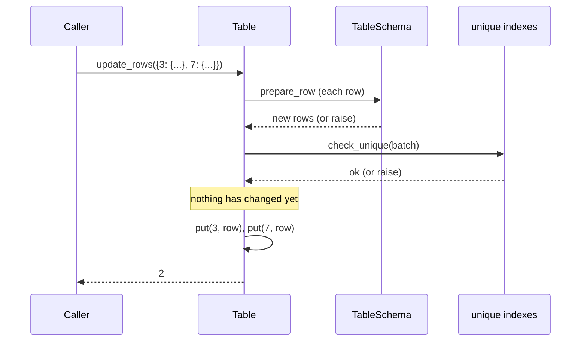

[🏠 Contents](index.md) · [← Previous: Chapter 4 — Constraints](04-constraints.md)

# Chapter 5 — Keys and Indexes

Every constraint so far could be checked by looking at a single row. **Uniqueness** is different: to know that no other user has e-mail `ada@example.org`, you have to know about *all* the other users. Scanning the whole table on every insert makes loading *n* rows cost O(n²). We need a structure that answers "which rows have this value?" without a scan: an **index**.

This chapter builds hash indexes, uses them to enforce **primary keys** and **unique constraints**, and lets `select` use them for fast equality lookups. In doing so we rewrite `Table` around two primitive operations, `put` and `remove`. Every later chapter builds on those two.

## 5.1 Keys

A **candidate key** is a minimal set of columns whose values identify a row. A table can have several: a user is identified by `id` and also by `email`. One of them is chosen as the **primary key**; the others are declared `UNIQUE`. The differences are small but real:

| | Primary key | Unique |
|---|---|---|
| How many per table | at most one | any number |
| NULL allowed | never (entity integrity) | yes, and NULLs don't collide |
| Default target of foreign keys | yes ([Chapter 6](06-referential-integrity.md)) | must be named explicitly |

The last row of the NULL rule deserves a sentence. In SQL, `NULL = NULL` is UNKNOWN ([§4.2](04-constraints.md#42-three-valued-logic)), so two NULLs are not "equal". A `UNIQUE` column may therefore contain any number of NULLs. PostgreSQL 15 added `NULLS NOT DISTINCT` for the other behaviour. We follow the standard: **a key containing NULL is never indexed and never conflicts.**

Keys may be **composite**. An enrolment is identified by `(student_id, course_id)`, so each column may repeat, but the pair may not. Our keys are therefore always tuples, even when they have a single column.

## 5.2 A hash index


A hash index is a dict from a key tuple to the **set of rowids** having that key. For a unique index the set has at most one element, but using sets everywhere keeps the code uniform.

```python
# minidb/index.py
"""Secondary structures mapping column values to rowids."""
from collections.abc import Iterable, Mapping

type Key = tuple


class HashIndex:
    """Equality index: key tuple -> set of rowids. NULL keys are not indexed."""
    kind = "hash"

    def __init__(self, name: str, columns: Iterable[str], unique: bool = False):
        self.name = name
        self.columns = tuple(columns)
        self.unique = unique
        self._entries: dict[Key, set[int]] = {}

    def key_of(self, row: Mapping[str, object]) -> Key | None:
        key = tuple(row[c] for c in self.columns)
        return None if any(v is None for v in key) else key

    def add(self, rowid: int, row: Mapping[str, object]) -> None:
        key = self.key_of(row)
        if key is not None:
            self._entries.setdefault(key, set()).add(rowid)

    def remove(self, rowid: int, row: Mapping[str, object]) -> None:
        key = self.key_of(row)
        if key is None:
            return
        ids = self._entries.get(key)
        if ids is not None:
            ids.discard(rowid)
            if not ids:
                del self._entries[key]       # don't keep empty buckets around

    def lookup(self, key: Key) -> set[int]:
        return set(self._entries.get(tuple(key), ()))

    def distinct_keys(self) -> int:
        return len(self._entries)

    def __repr__(self):
        u = "unique " if self.unique else ""
        return f"<{u}{self.kind} index {self.name} on {self.columns}>"
```

Python's `dict` *is* a hash table, so all the hard work (hashing, collision handling, resizing) is done for us. The essential property is that our values hash consistently with `==`. That's why [Chapter 3](03-types-and-normalization.md) insisted on canonical forms: `Decimal('1.0')` and `Decimal('1.00')` are equal *and* hash equal, but `'Café'` in two Unicode forms is neither.

`lookup` returns a *copy* of the set, for the same reason `Table.get` returns copies of rows. Callers will often modify the table while holding a lookup result.

## 5.3 Declaring keys in the schema

`TableSchema` gains `primary_key` and `unique`. Primary-key columns are made `NOT NULL` automatically, so that rule is enforced by the pipeline we already have. Here is the whole class again. Only the fields and `__post_init__` changed; the pipeline methods are as in [Chapter 4](04-constraints.md).

```python
# minidb/schema.py (replace TableSchema)
@dataclass(frozen=True)
class TableSchema:
    name: str
    columns: tuple[Column, ...]
    checks: tuple[Check, ...] = ()
    primary_key: tuple[str, ...] = ()                       # new
    unique: tuple[tuple[str, ...], ...] = ()                # new
    by_name: Mapping[str, Column] = field(init=False, repr=False, compare=False)

    def __post_init__(self):
        pk = _as_key(self.primary_key)
        unique = tuple(_as_key(u) for u in self.unique)
        names = [c.name for c in self.columns]
        if len(set(names)) != len(names):
            raise SchemaError(f"duplicate column names in {self.name!r}")
        for key in (pk, *unique):
            missing = set(key) - set(names)
            if missing:
                raise SchemaError(f"{self.name}: key uses unknown column(s) {sorted(missing)}")
        # entity integrity: primary-key columns are implicitly NOT NULL
        columns = tuple(replace(c, nullable=False) if c.name in pk else c
                        for c in self.columns)
        object.__setattr__(self, "columns", columns)
        object.__setattr__(self, "checks", tuple(self.checks))
        object.__setattr__(self, "primary_key", pk)
        object.__setattr__(self, "unique", unique)
        object.__setattr__(self, "by_name", {c.name: c for c in columns})

    @property
    def column_names(self) -> tuple[str, ...]:
        return tuple(c.name for c in self.columns)

    def column(self, name: str) -> Column:
        try:
            return self.by_name[name]
        except KeyError:
            raise SchemaError(f"{self.name}: no such column {name!r}") from None

    def prepare_row(self, values: Mapping[str, object],
                    base: Row | None = None) -> Row:
        """Run the constraint pipeline; return a complete, valid row.

        `values` are the user's input; `base` is the existing row for an
        update (None for an insert). Neither argument is modified.
        """
        for name in values:
            self.column(name)                                # unknown column?
        if base is None:                                     # insert
            row = {c.name: values[c.name] if c.name in values else c.make_default()
                   for c in self.columns}
            touched = self.column_names
        else:                                                # update
            row = dict(base) | dict(values)
            touched = tuple(values)
        for name in touched:
            try:
                row[name] = self.by_name[name].prepare(row[name])
            except DomainError as e:
                raise DomainError(f"{self.name}.{name}: {e}") from None
        self._check_not_null(row)
        self._check_columns(row)
        self._check_rows(row)
        return row

    # -- stages ---------------------------------------------------------------
    def _check_not_null(self, row: Row) -> None:
        for c in self.columns:
            if not c.nullable and row[c.name] is None:
                raise NotNullViolation(f"{self.name}.{c.name} may not be NULL")

    def _check_columns(self, row: Row) -> None:
        for c in self.columns:
            value = row[c.name]
            if c.check is not None and value is not None and c.check(value) is False:
                raise CheckViolation(f"{self.name}.{c.name}: check failed for {value!r}")

    def _check_rows(self, row: Row) -> None:
        view = MappingProxyType(row)
        for check in self.checks:
            if check.predicate(view) is False:
                raise CheckViolation(f"{self.name}: check {check.name!r} failed")


def _as_key(columns: str | Iterable[str]) -> tuple[str, ...]:
    """'id' -> ('id',);  ['a', 'b'] -> ('a', 'b')"""
    return (columns,) if isinstance(columns, str) else tuple(columns)
```

```python
# minidb/schema.py (imports)
from collections.abc import Iterable
from dataclasses import replace
```

And a new error:

```python
# minidb/errors.py (append)
class UniqueViolation(ConstraintError):
    """A PRIMARY KEY or UNIQUE constraint would be violated."""
```

## 5.4 `Table`, rewritten around `put` and `remove`

Indexes change how a table must write rows. Every write has to keep the rows *and every index* in agreement, and if any check fails, *nothing* may change. We restructure `Table` into two layers:

- **Primitives**: `put(rowid, row)` and `remove(rowid)` store or delete a row and update all indexes. They don't validate anything. They're the only methods that touch `self.rows`.
- **Operations**: `insert`, `update_rows` and `delete_rows` validate *everything first* (pipeline, then uniqueness for the whole batch), and only then call the primitives.



The rewrite touches nearly every method, so here's the whole file:

```python
# minidb/table.py
"""In-memory storage for one table: rows by rowid, plus indexes."""
from collections.abc import Callable, Iterable, Iterator, Mapping
from types import MappingProxyType

from minidb.errors import SchemaError, UniqueViolation
from minidb.index import HashIndex
from minidb.schema import TableSchema

type Row = dict[str, object]
type Predicate = Callable[[Mapping[str, object]], bool]
type Where = Predicate | Mapping[str, object] | None


class Table:
    def __init__(self, schema: TableSchema):
        self.schema = schema
        self.name = schema.name
        self.columns = schema.column_names
        self.rows: dict[int, Row] = {}
        self.indexes: dict[str, HashIndex] = {}
        self._next_rowid = 1
        if schema.primary_key:
            self.create_index("pk", schema.primary_key, unique=True)
        for cols in schema.unique:
            self.create_index("unique_" + "_".join(cols), cols, unique=True)

    def __len__(self) -> int:
        return len(self.rows)

    # -- indexes ------------------------------------------------------------
    def create_index(self, name: str, columns: Iterable[str],
                     unique: bool = False) -> HashIndex:
        if name in self.indexes:
            raise SchemaError(f"{self.name}: index {name!r} already exists")
        for c in columns:
            self.schema.column(c)
        index = HashIndex(name, columns, unique)
        for rowid, row in self.rows.items():                # build from existing rows
            if unique and (key := index.key_of(row)) and index.lookup(key):
                raise UniqueViolation(
                    f"{self.name}: cannot create unique index {name!r}: "
                    f"duplicate key {key}")
            index.add(rowid, row)
        self.indexes[name] = index
        return index

    def index_on(self, columns: Iterable[str]) -> HashIndex | None:
        """An index on exactly these columns (in any order), if one exists."""
        wanted = set(columns)
        return next((i for i in self.indexes.values() if set(i.columns) == wanted), None)

    # -- primitives: no validation -------------------------------------------
    def put(self, rowid: int, row: Row) -> None:
        old = self.rows.get(rowid)
        for index in self.indexes.values():
            if old is not None:
                index.remove(rowid, old)
            index.add(rowid, row)
        self.rows[rowid] = row

    def remove(self, rowid: int) -> None:
        old = self.rows.pop(rowid)
        for index in self.indexes.values():
            index.remove(rowid, old)

    def new_rowid(self) -> int:
        rowid = self._next_rowid
        self._next_rowid += 1
        return rowid

    # -- checks ---------------------------------------------------------------
    def check_unique(self, batch: list[tuple[int | None, Row]]) -> None:
        """Raise UniqueViolation if applying `batch` would duplicate a key.

        `batch` pairs each rowid (None for a new row) with the row it will
        hold. Rows in the batch are compared with each other and with every
        row *outside* the batch, so swapping two keys in one batch is fine.
        """
        changing = {rid for rid, _ in batch if rid is not None}
        for index in self.indexes.values():
            if not index.unique:
                continue
            seen: set[tuple] = set()
            for _, row in batch:
                key = index.key_of(row)
                if key is None:
                    continue
                if key in seen or index.lookup(key) - changing:
                    shown = ", ".join(f"{c}={v!r}" for c, v in zip(index.columns, key))
                    raise UniqueViolation(f"{self.name}: duplicate key ({shown}) "
                                          f"violates {index.name!r}")
                seen.add(key)

    # -- read -----------------------------------------------------------------
    def get(self, rowid: int) -> Row | None:
        row = self.rows.get(rowid)
        return dict(row) if row is not None else None

    def scan(self) -> Iterator[tuple[int, Row]]:
        for rowid, row in self.rows.items():
            yield rowid, dict(row)

    def match(self, where: Where = None) -> list[int]:
        """Rowids of rows matching `where`.

        `where` is None (all rows), a predicate, or a dict of column=value
        equalities, which can use an index.
        """
        if where is None:
            return list(self.rows)
        if callable(where):
            return [rid for rid, row in self.rows.items()
                    if where(MappingProxyType(row))]
        return self._match_equal(where)

    def _match_equal(self, equal: Mapping[str, object]) -> list[int]:
        for c in equal:
            self.schema.column(c)
        wanted = {c: self.schema.column(c).prepare(v) for c, v in equal.items()}
        # the index covering the most of the requested columns, if any
        best = max((i for i in self.indexes.values() if set(i.columns) <= set(wanted)),
                   key=lambda i: len(i.columns), default=None)
        if best is not None:
            candidates = best.lookup(tuple(wanted[c] for c in best.columns))
        else:
            candidates = self.rows.keys()
        return [rid for rid in candidates
                if all(self.rows[rid][c] == v and v is not None for c, v in wanted.items())]

    def select(self, where: Where = None) -> list[Row]:
        return [dict(self.rows[rid]) for rid in self.match(where)]

    # -- write operations: validate everything, then apply ----------------------
    def insert(self, values: Row) -> int:
        row = self.schema.prepare_row(values)
        self.check_unique([(None, row)])
        rowid = self.new_rowid()
        self.put(rowid, row)
        return rowid

    def update_rows(self, changes: Mapping[int, Row]) -> int:
        """Apply per-row changes {rowid: {column: value}} atomically."""
        new_rows = {rid: self.schema.prepare_row(ch, base=self.rows[rid])
                    for rid, ch in changes.items()}
        self.check_unique(list(new_rows.items()))
        for rid, row in new_rows.items():
            self.put(rid, row)
        return len(new_rows)

    def delete_rows(self, rowids: Iterable[int]) -> int:
        rowids = list(rowids)
        for rid in rowids:
            self.remove(rid)
        return len(rowids)

    def update(self, changes: Row, where: Where = None) -> int:
        return self.update_rows({rid: changes for rid in self.match(where)})

    def delete(self, where: Where = None) -> int:
        return self.delete_rows(self.match(where))
```

The interesting parts:

**`check_unique` takes a whole batch.** Suppose two products swap codes: A gets `"X"` and B gets `"Y"`, which A had. Checked one row at a time, the first change would collide with the row that is about to change. Checking the batch as a unit, and ignoring rows that are part of the batch, lets the swap through. SQL calls this *statement-level* constraint checking. Note that a batch also catches duplicates *within* itself (`key in seen`).

**`match` accepts a dict.** `{"email": "ada@example.org"}` is *data*, not an opaque lambda, so the table can see that an index answers it. It normalizes the values first, so `{"email": " ADA@example.org"}` finds Ada if the column lower-cases and strips. Then it picks the index covering the most requested columns and filters the candidates by any remaining equalities. This is our first, tiny **query optimization**. [Chapter 14](14-query-planning.md) generalizes it.

**`v is not None` in the filter.** `{"age": None}` matches *nothing*, because `age = NULL` is UNKNOWN. To find NULLs you'll want an explicit `IS NULL` (via a predicate for now, and properly in [Chapter 14](14-query-planning.md)).

**`put` handles both insert and update.** If an old row exists, its index entries are removed first. Keeping only two primitives means only two places can get index maintenance wrong.

## 5.5 Database changes

`create_table` takes the new schema options as keyword arguments, and a new `create_index` is passed through:

```python
# minidb/database.py (replace Database.create_table)
    def create_table(self, name: str, columns: list[Column], *,
                     primary_key: str | tuple[str, ...] = (),
                     unique: tuple[str | tuple[str, ...], ...] = (),
                     checks: list[Check] = ()) -> Table:
        if name in self.tables:
            raise SchemaError(f"table {name!r} already exists")
        schema = TableSchema(name, tuple(columns), tuple(checks),
                             primary_key, tuple(unique))
        table = self.tables[name] = Table(schema)
        return table

    def create_index(self, table: str, name: str, columns: list[str],
                     unique: bool = False) -> None:
        self.table(table).create_index(name, columns, unique)
```

```python
# minidb/database.py (replace Database.select)
    def select(self, table: str, where: Where = None) -> list[Row]:
        return self.table(table).select(where)
```

```python
# minidb/database.py (replace Database.update)
    def update(self, table: str, changes: Row, where: Where = None) -> int:
        return self.table(table).update(changes, where)
```

```python
# minidb/database.py (replace Database.delete)
    def delete(self, table: str, where: Where = None) -> int:
        return self.table(table).delete(where)
```

```python
# minidb/database.py (imports)
from minidb.table import Where
```

```python
# minidb/__init__.py (append)
from minidb.errors import UniqueViolation
__all__.append("UniqueViolation")
```

## 5.6 Trying it out

```python
>>> from minidb import *
>>> from minidb.normalizers import strip, lower
>>> db = Database()
>>> _ = db.create_table("users", [
...     Column("id", Integer()),
...     Column("email", Text(), normalizers=(strip, lower)),
...     Column("city", Text()),
... ], primary_key="id", unique=["email"])
>>> db.insert("users", {"id": 1, "email": "ada@example.org", "city": "London"})
1
>>> db.insert("users", {"id": 2, "email": " ADA@example.org"})
Traceback (most recent call last):
  ...
minidb.errors.UniqueViolation: users: duplicate key (email='ada@example.org') violates 'unique_email'
>>> db.insert("users", {"email": "x@example.org"})
Traceback (most recent call last):
  ...
minidb.errors.NotNullViolation: users.id may not be NULL
>>> db.insert("users", {"id": 2, "email": None})       # NULLs never collide...
2
>>> db.insert("users", {"id": 3, "email": None})       # ...not even with each other
3
>>> db.select("users", {"email": "  Ada@Example.org"})
[{'id': 1, 'email': 'ada@example.org', 'city': 'London'}]
```

The two failed inserts didn't use up rowids: every check runs *before* `new_rowid()`, so the next successful inserts got rowids 2 and 3.

Swapping keys in one batch works; doing it in two steps doesn't:

```python
>>> users = db.table("users")
>>> users.update_rows({2: {"id": 3}, 3: {"id": 2}})      # swap ids of two rows
2
>>> [(r["id"]) for r in db.select("users")]
[1, 3, 2]
>>> db.update("users", {"id": 1}, where={"id": 3})       # one at a time collides
Traceback (most recent call last):
  ...
minidb.errors.UniqueViolation: users: duplicate key (id=1) violates 'pk'
```

Composite keys and a secondary (non-unique) index:

```python
>>> _ = db.create_table("enrolments", [
...     Column("student_id", Integer()), Column("course_id", Integer()),
...     Column("grade", Text()),
... ], primary_key=("student_id", "course_id"))
>>> for s, c in [(1, 10), (1, 11), (2, 10)]:
...     _ = db.insert("enrolments", {"student_id": s, "course_id": c})
>>> db.insert("enrolments", {"student_id": 1, "course_id": 10})
Traceback (most recent call last):
  ...
minidb.errors.UniqueViolation: enrolments: duplicate key (student_id=1, course_id=10) violates 'pk'
>>> db.create_index("enrolments", "by_course", ["course_id"])
>>> len(db.select("enrolments", {"course_id": 10}))
2
```

## 5.7 How much faster?

Here is a lookup in 100,000 rows, by scan and by index:

```python
# run
import timeit
from minidb import Database, Column, Integer, Text

db = Database()
db.create_table("t", [Column("id", Integer()), Column("name", Text())], primary_key="id")
for i in range(100_000):
    db.insert("t", {"id": i, "name": f"n{i}"})

scan = timeit.timeit(lambda: db.select("t", lambda r: r["id"] == 77_777), number=20) / 20
index = timeit.timeit(lambda: db.select("t", {"id": 77_777}), number=20) / 20
print(f"scan:  {scan * 1e3:8.3f} ms")
print(f"index: {index * 1e3:8.3f} ms   ({scan / index:,.0f}x faster)")
```

On the machine used to write this book, it printed:

```text
scan:     8.939 ms
index:    0.006 ms   (1,444x faster)
```

The ratio grows linearly with table size. That is the whole case for indexes. The case *against* them is that every index slows down every write (`put` updates all of them) and costs memory. Exercise 6 measures that.

## 5.8 What hash indexes can't do

A hash index answers exactly one question: *which rows have this key?* It can't answer "ages between 30 and 40", "names starting with 'A'", or "the 10 newest orders". Those need an **ordered** index. We'll build a simple sorted one in [Chapter 14](14-query-planning.md) and a proper B-tree in [Chapter 15](15-b-trees.md). The interface we chose here (`add`, `remove`, `lookup`, `key_of`) is the one those will implement.

## Questions and exercises

1. Why does `HashIndex.lookup` return a copy of the set? Construct a bug that would happen if it returned the internal set. (Hint: `delete_rows(index.lookup(key))`.)
2. Our unique index ignores keys containing NULL. For a composite unique key `(a, b)`, is `(1, NULL)` allowed twice? What does the SQL standard say? What does PostgreSQL's `NULLS NOT DISTINCT` change?
3. `check_unique` builds a `changing` set and subtracts it from each lookup. Construct a batch where *forgetting* the subtraction wrongly rejects a valid update.
4. `Table.insert` takes a single row. Add `insert_many(rows)` that is atomic, so either all rows go in or none, and uses a single `check_unique` call.
5. Make `create_index` atomic: if building a unique index fails half way, nothing should be registered. Is the current code already atomic? Why?
6. **Measure the cost of indexes.** Time 100,000 inserts into a table with 0, 1, 3 and 6 indexes. Plot (or tabulate) the results. Is the cost per index constant?
7. `_match_equal` picks the index covering the *most* requested columns. Give an example where that's the wrong choice. What information would let it choose better? (Keep the answer for [Chapter 14](14-query-planning.md).)
8. *(Research)* SQLite and MySQL/InnoDB store a table *inside* its primary-key index (a *clustered* index). PostgreSQL keeps rows in a separate heap. What does each choice make cheaper? See [Petrov 2019](references.md#petrov2019), chapter 1.

---

[🏠 Contents](index.md) · [Next: Chapter 6 — Referential Integrity →](06-referential-integrity.md)
