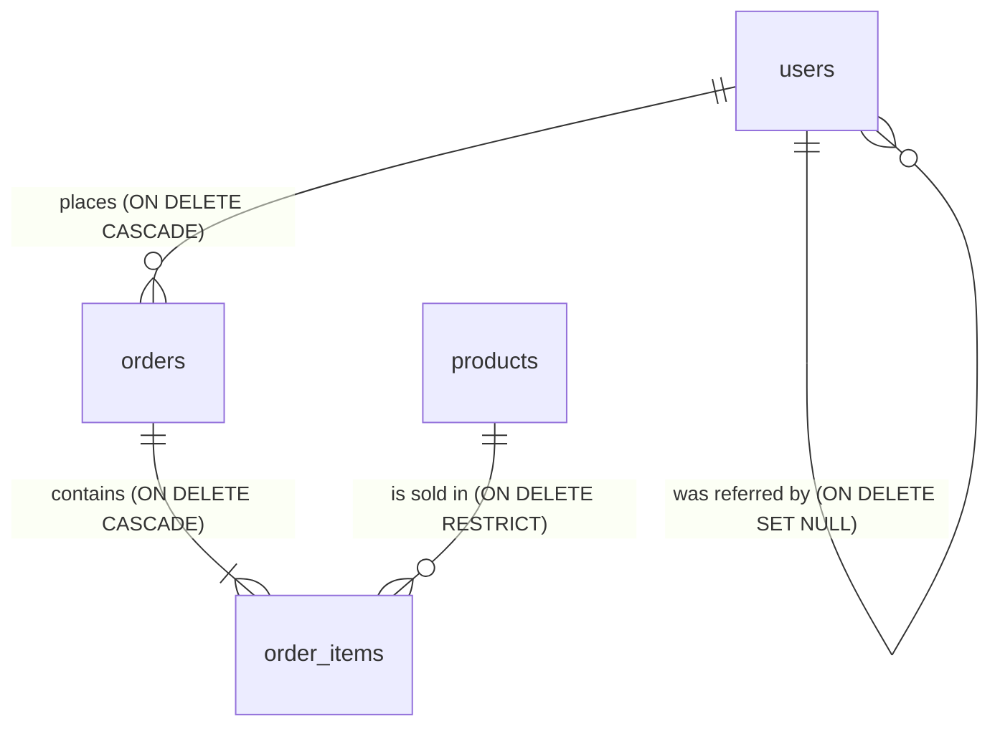

[🏠 Contents](index.md) · [← Previous: Chapter 5 — Keys and Indexes](05-keys-and-indexes.md)

# Chapter 6 — Referential Integrity

Normalized data is spread over many tables ([§3.7](03-types-and-normalization.md#37-normalization-the-other-meaning)). An order doesn't repeat its customer's name and address; it stores the customer's key. That only works if the key **points at something real**. A **foreign key** is the constraint that says so:

> Every non-NULL value of `orders.user_id` must equal the `id` of some row in `users`.

That one sentence implies checks in *both* directions:

- **Child side.** Inserting or updating an order must find its user.
- **Parent side.** Deleting a user, or changing a user's `id`, must not leave orders pointing at nothing.

On the parent side SQL gives you a choice of what happens, the **referential action**:

| `ON DELETE …` | Effect when a referenced parent row is deleted |
|---|---|
| `RESTRICT` (our default) | Refuse the delete. |
| `CASCADE` | Delete the referencing children too, recursively. |
| `SET NULL` | Set the children's foreign-key columns to NULL. |

Here is the schema we'll use in this chapter:



Deleting a user deletes their orders, and the orders' items. Deleting a product that was ever sold is refused. Deleting a user who referred others clears `referred_by` on those users.

## 6.1 Where foreign keys live

Every constraint so far belonged to one table, and lived in its `TableSchema`. A foreign key belongs to *two* tables, and checking it requires both. We therefore keep foreign keys in the `Database`, which is the only object that knows all the tables. Real systems do the same: they store constraints in a system catalog (in PostgreSQL, `pg_constraint`), which references both tables.

```python
# minidb/schema.py (append)
ON_DELETE_ACTIONS = ("restrict", "cascade", "set null")


@dataclass(frozen=True)
class ForeignKey:
    """`table.columns` must match `ref_table.ref_columns` (a key) or be NULL."""
    columns: tuple[str, ...]
    ref_table: str
    ref_columns: tuple[str, ...] = ()     # empty: the referenced primary key
    on_delete: str = "restrict"
    table: str = ""                       # the child table; set by create_table

    def __post_init__(self):
        object.__setattr__(self, "columns", _as_key(self.columns))
        object.__setattr__(self, "ref_columns", _as_key(self.ref_columns))
        if self.on_delete not in ON_DELETE_ACTIONS:
            raise SchemaError(f"on_delete must be one of {ON_DELETE_ACTIONS}")

    @property
    def name(self) -> str:
        return f"fk_{self.table}_{'_'.join(self.columns)}"

    def parent_key(self, child_row) -> dict[str, object] | None:
        """{ref_column: value} for the parent this child points at, or None."""
        values = [child_row[c] for c in self.columns]
        if any(v is None for v in values):
            return None                   # NULL references nothing (MATCH SIMPLE)
        return dict(zip(self.ref_columns, values))

    def child_key(self, parent_row) -> dict[str, object]:
        """{column: value} that children of `parent_row` have."""
        return {c: parent_row[r] for c, r in zip(self.columns, self.ref_columns)}
```

```python
# minidb/errors.py (append)
class ForeignKeyViolation(ConstraintError):
    """A reference points at a missing row, or a delete would orphan rows."""
```

The NULL rule again follows the standard's default (`MATCH SIMPLE`): if *any* foreign-key column is NULL, the row references nothing and isn't checked. That's how "an order may exist without a user" is expressed: make `user_id` nullable.

## 6.2 Checking in both directions needs indexes

Both directions are lookups:

- **Child → parent.** "Does a user with `id = 7` exist?" is a lookup in the parent's key index. A foreign key may only reference columns covered by a `PRIMARY KEY` or `UNIQUE` constraint, so that index always exists, and we verify this when the foreign key is declared.
- **Parent → children.** "Which orders have `user_id = 7`?" needs an index on the *child's* foreign-key columns. Without one, every user delete scans all orders. SQL doesn't create this index automatically, and forgetting it is a classic performance bug. We create it automatically.

A small helper on `Table` performs a lookup by a `{column: value}` dict, whatever the column order of the index:

```python
# minidb/table.py (add to Table)
    def lookup(self, key: Mapping[str, object]) -> set[int]:
        """Rowids whose columns equal `key`, using an index on exactly those columns."""
        index = self.index_on(key)
        if index is None:
            raise SchemaError(f"{self.name}: no index on {sorted(key)}")
        return index.lookup(tuple(key[c] for c in index.columns))
```

## 6.3 The database orchestrates

`Database` now does more than forward calls. Each write runs the table's own checks (pipeline, uniqueness) *and* the cross-table checks, all before anything is written. Here is the whole file:

```python
# minidb/database.py
"""The public entry point: tables, cross-table constraints and CRUD."""
from collections.abc import Iterable
from dataclasses import replace

from minidb.errors import ForeignKeyViolation, SchemaError
from minidb.schema import Check, Column, ForeignKey, TableSchema
from minidb.table import Row, Table, Where


class Database:
    def __init__(self):
        self.tables: dict[str, Table] = {}
        self.foreign_keys: list[ForeignKey] = []

    # -- schema -----------------------------------------------------------------
    def create_table(self, name: str, columns: list[Column], *,
                     primary_key: str | tuple[str, ...] = (),
                     unique: tuple[str | tuple[str, ...], ...] = (),
                     checks: list[Check] = (),
                     foreign_keys: list[ForeignKey] = ()) -> Table:
        if name in self.tables:
            raise SchemaError(f"table {name!r} already exists")
        schema = TableSchema(name, tuple(columns), tuple(checks),
                             primary_key, tuple(unique))
        table = self.tables[name] = Table(schema)
        try:
            for fk in foreign_keys:
                self._add_foreign_key(replace(fk, table=name))
        except Exception:
            del self.tables[name]                         # all or nothing
            self.foreign_keys = [f for f in self.foreign_keys if f.table != name]
            raise
        return table

    def _add_foreign_key(self, fk: ForeignKey) -> None:
        child, parent = self.table(fk.table), self.table(fk.ref_table)
        if not fk.ref_columns:
            if not parent.schema.primary_key:
                raise SchemaError(f"{parent.name} has no primary key to reference")
            fk = replace(fk, ref_columns=parent.schema.primary_key)
        if len(fk.columns) != len(fk.ref_columns):
            raise SchemaError(f"{fk.name}: column count mismatch")
        for c, r in zip(fk.columns, fk.ref_columns):
            if type(child.schema.column(c).type) is not type(parent.schema.column(r).type):
                raise SchemaError(f"{fk.name}: {c} and {parent.name}.{r} differ in type")
        target = parent.index_on(fk.ref_columns)
        if target is None or not target.unique:
            raise SchemaError(f"{fk.name}: {parent.name}{fk.ref_columns} is not a key")
        if child.index_on(fk.columns) is None:            # for parent -> child lookups
            child.create_index(fk.name, fk.columns)
        self._check_parents_exist(child, child.rows.values(), [fk])
        self.foreign_keys.append(fk)

    def drop_table(self, name: str) -> None:
        self.table(name)
        if any(fk.ref_table == name and fk.table != name for fk in self.foreign_keys):
            raise SchemaError(f"{name!r} is referenced by a foreign key")
        self.foreign_keys = [fk for fk in self.foreign_keys if fk.table != name]
        del self.tables[name]

    def table(self, name: str) -> Table:
        try:
            return self.tables[name]
        except KeyError:
            raise SchemaError(f"no such table: {name!r}") from None

    def create_index(self, table: str, name: str, columns: list[str],
                     unique: bool = False) -> None:
        self.table(table).create_index(name, columns, unique)

    # -- reads ------------------------------------------------------------------
    def get(self, table: str, rowid: int) -> Row | None:
        return self.table(table).get(rowid)

    def select(self, table: str, where: Where = None) -> list[Row]:
        return self.table(table).select(where)

    # -- writes: check everything, then apply ---------------------------------------
    def insert(self, table: str, values: Row) -> int:
        t = self.table(table)
        row = t.schema.prepare_row(values)
        t.check_unique([(None, row)])
        self._check_parents_exist(t, [row])
        rowid = t.new_rowid()
        t.put(rowid, row)
        return rowid

    def update(self, table: str, changes: Row, where: Where = None) -> int:
        t = self.table(table)
        old = {rid: t.rows[rid] for rid in t.match(where)}
        new = {rid: t.schema.prepare_row(changes, base=row) for rid, row in old.items()}
        t.check_unique(list(new.items()))
        self._check_parents_exist(t, new.values())
        self._check_no_orphans(t, old, new)
        for rid, row in new.items():
            t.put(rid, row)
        return len(new)

    def delete(self, table: str, where: Where = None) -> int:
        t = self.table(table)
        deleted, nulled = self._plan_delete(t, t.match(where))
        for (name, rid) in deleted:
            self.tables[name].remove(rid)
        for (name, rid), row in nulled.items():
            self.tables[name].put(rid, row)
        return sum(1 for name, _ in deleted if name == table)

    # -- referential integrity ----------------------------------------------------
    def _references_from(self, table: str) -> list[ForeignKey]:
        return [fk for fk in self.foreign_keys if fk.table == table]

    def _references_to(self, table: str) -> list[ForeignKey]:
        return [fk for fk in self.foreign_keys if fk.ref_table == table]

    def _check_parents_exist(self, child: Table, rows: Iterable[Row],
                             fks: list[ForeignKey] | None = None) -> None:
        """Child side: every non-NULL reference must find its parent."""
        for fk in fks if fks is not None else self._references_from(child.name):
            parent = self.tables[fk.ref_table]
            for row in rows:
                key = fk.parent_key(row)
                if key is not None and not parent.lookup(key):
                    raise ForeignKeyViolation(
                        f"{fk.name}: no {parent.name} row with {key}")

    def _children(self, fk: ForeignKey, parent_row: Row) -> set[int]:
        return self.tables[fk.table].lookup(fk.child_key(parent_row))

    def _check_no_orphans(self, parent: Table, old: dict[int, Row],
                          new: dict[int, Row]) -> None:
        """Parent side of an update: a referenced key may not change."""
        for fk in self._references_to(parent.name):
            for rid, before in old.items():
                if fk.child_key(before) != fk.child_key(new[rid]) and \
                        self._children(fk, before):
                    raise ForeignKeyViolation(
                        f"{fk.name}: cannot change {parent.name} key "
                        f"{fk.child_key(before)}, it is still referenced")

    def _plan_delete(self, table: Table, rowids: Iterable[int]):
        """Work out everything a delete implies, without changing anything.

        Returns (deleted, nulled): {(table, rowid): row} to remove, and
        {(table, rowid): new_row} for ON DELETE SET NULL.
        """
        # 1. follow ON DELETE CASCADE transitively
        deleted: dict[tuple[str, int], Row] = {}
        stack = [(table.name, rid) for rid in rowids]
        while stack:
            name, rid = stack.pop()
            if (name, rid) in deleted:
                continue                          # cycles and diamonds
            row = deleted[(name, rid)] = self.tables[name].rows[rid]
            for fk in self._references_to(name):
                if fk.on_delete == "cascade":
                    stack.extend((fk.table, c) for c in self._children(fk, row))
        # 2. every *surviving* child must now be restricted or nulled
        nulled: dict[tuple[str, int], Row] = {}
        for (name, rid), row in deleted.items():
            for fk in self._references_to(name):
                child = self.tables[fk.table]
                survivors = [c for c in self._children(fk, row)
                             if (child.name, c) not in deleted]
                if not survivors:
                    continue
                if fk.on_delete == "restrict":
                    raise ForeignKeyViolation(
                        f"{fk.name}: {name} row {fk.child_key(row)} is still "
                        f"referenced by {len(survivors)} {child.name} row(s)")
                if fk.on_delete == "set null":
                    for c in survivors:
                        base = nulled.get((child.name, c), child.rows[c])
                        nulled[(child.name, c)] = child.schema.prepare_row(
                            dict.fromkeys(fk.columns), base=base)
        return deleted, nulled
```

The design decisions behind it:

**`_plan_delete` is a pure function of the current state.** It computes the complete consequences of a delete without changing anything. Only `delete` applies the plan, and only if planning raised nothing. A cascade three tables deep that hits a `RESTRICT` at the bottom therefore leaves the database untouched. Without the split, we'd have deleted the top two levels before discovering the problem.

**Two passes, not one.** Pass 1 finds every row the cascade deletes. Only then does pass 2 ask which children *survive*. Consider an employee table where `manager_id` references `id` with `RESTRICT`, and a single statement deleting a manager *and* all their reports. Checked row by row, deleting the manager would be refused because its reports still exist. Checked after the cascade is known, the reports are being deleted too, and the statement is fine.

**`SET NULL` goes through the pipeline.** Nulling a foreign key is an update, so it must respect NOT NULL and checks. `prepare_row` enforces that. If `orders.user_id` is NOT NULL, `ON DELETE SET NULL` makes the delete fail, which is correct.

**Updates may not change a referenced key.** That's SQL's `ON UPDATE RESTRICT`. `ON UPDATE CASCADE` is Exercise 3. It's also why surrogate keys (meaningless integers) are popular: they never need to change.

**`_add_foreign_key` validates existing data.** Adding a foreign key to a table that already has orphans fails, the same as creating a unique index over duplicates ([§5.4](05-keys-and-indexes.md#54-table-rewritten-around-put-and-remove)).

Export the new names:

```python
# minidb/__init__.py (append)
from minidb.errors import ForeignKeyViolation
from minidb.schema import ForeignKey
__all__ += ["ForeignKey", "ForeignKeyViolation"]
```

## 6.4 Trying it out

```python
>>> from minidb import *
>>> db = Database()
>>> _ = db.create_table("users", [
...     Column("id", Integer()), Column("name", Text()), Column("referred_by", Integer()),
... ], primary_key="id",
...    foreign_keys=[ForeignKey("referred_by", "users", on_delete="set null")])
>>> _ = db.create_table("products", [Column("sku", Text()), Column("price", Numeric(8, 2))],
...                     primary_key="sku")
>>> _ = db.create_table("orders", [Column("id", Integer()), Column("user_id", Integer())],
...     primary_key="id", foreign_keys=[ForeignKey("user_id", "users", on_delete="cascade")])
>>> _ = db.create_table("order_items", [
...     Column("order_id", Integer()), Column("sku", Text()), Column("qty", Integer(min=1)),
... ], primary_key=("order_id", "sku"), foreign_keys=[
...     ForeignKey("order_id", "orders", on_delete="cascade"),
...     ForeignKey("sku", "products"),                     # restrict
... ])
>>> _ = db.insert("users", {"id": 1, "name": "Ada"})
>>> _ = db.insert("users", {"id": 2, "name": "Alan", "referred_by": 1})
>>> _ = db.insert("products", {"sku": "TEA", "price": "3.50"})
>>> _ = db.insert("orders", {"id": 100, "user_id": 1})
>>> _ = db.insert("order_items", {"order_id": 100, "sku": "TEA", "qty": 2})
>>> db.insert("orders", {"id": 101, "user_id": 99})
Traceback (most recent call last):
  ...
minidb.errors.ForeignKeyViolation: fk_orders_user_id: no users row with {'id': 99}
>>> db.delete("products", {"sku": "TEA"})
Traceback (most recent call last):
  ...
minidb.errors.ForeignKeyViolation: fk_order_items_sku: products row {'sku': 'TEA'} is still referenced by 1 order_items row(s)
>>> db.update("users", {"id": 10}, where={"id": 1})
Traceback (most recent call last):
  ...
minidb.errors.ForeignKeyViolation: fk_users_referred_by: cannot change users key {'referred_by': 1}, it is still referenced
```

The last error message shows the key as `{'referred_by': 1}`: the child-side column names, not `{'id': 1}`. That's because it's what `child_key` returns. Exercise 6 asks you to improve the message.

Now the cascade. Deleting Ada deletes her order and its item, and clears Alan's `referred_by`:

```python
>>> db.delete("users", {"id": 1})
1
>>> db.select("orders"), db.select("order_items")
([], [])
>>> db.select("users")
[{'id': 2, 'name': 'Alan', 'referred_by': None}]
```

And atomicity across tables. If any part of a cascade is refused, nothing happens:

```python
>>> _ = db.insert("orders", {"id": 200, "user_id": 2})
>>> _ = db.insert("order_items", {"order_id": 200, "sku": "TEA", "qty": 1})
>>> db.delete("products", {"sku": "TEA"})      # restricted by order 200's item
Traceback (most recent call last):
  ...
minidb.errors.ForeignKeyViolation: fk_order_items_sku: products row {'sku': 'TEA'} is still referenced by 1 order_items row(s)
>>> len(db.select("orders")), len(db.select("order_items"))
(1, 1)
```

## 6.5 The limits of statement-at-a-time

Each `Database` method is now atomic on its own: it either does everything its statement implies or nothing. Applications rarely want *one* statement, though. "Create an order and its three items" is four inserts. If the third fails, the first two stay. Worse, some valid sequences can't be expressed at all. Two rows that reference each other (each employee row names the other as a "buddy") can't be inserted one at a time: whichever goes first points at nothing.

Both problems have the same solution: group statements into a **transaction** and check constraints over the *transaction*, not each statement. That's the Unit of Work, starting in [Chapter 8](08-unit-of-work-i.md). First, [Chapter 7](07-query-primitives.md) gives us a real way to *read*: joins, sorting and aggregation.

## Questions and exercises

1. Why must a foreign key reference a *key* (a unique set of columns)? What would "the parent" mean if it didn't?
2. Our cascade uses an explicit stack, not recursion. Why? (Hint: a self-referential `parent_id` chain 5,000 levels deep.)
3. Implement `on_update="cascade"` so that changing `users.id` rewrites `orders.user_id`. Plan it in the style of `_plan_delete`. What happens when the cascaded update itself changes a key that something else references?
4. Insert a row that references *itself* (an employee who is their own manager). Does it work? Why not? Fix `insert` so a row can satisfy its own foreign key.
5. `_check_no_orphans` refuses to change a referenced key even when the update *also* changes all the children in the same statement. Can that happen in a single `update` call in minidb? Can it in SQL?
6. The error message for a key change shows child-side column names. Improve it to show the parent's key.
7. SQL distinguishes `RESTRICT` from `NO ACTION`: both refuse, but `NO ACTION` checks at the *end of the statement* (or transaction, if deferred), which lets later actions fix the problem. Which of the two does our two-pass `_plan_delete` actually implement?
8. *(Performance)* What does `delete("users")` (no `where`) cost with and without the automatic child index from §6.2? Measure it with 10,000 users and 100,000 orders.

---

[🏠 Contents](index.md) · [Next: Chapter 7 — Query Primitives →](07-query-primitives.md)
