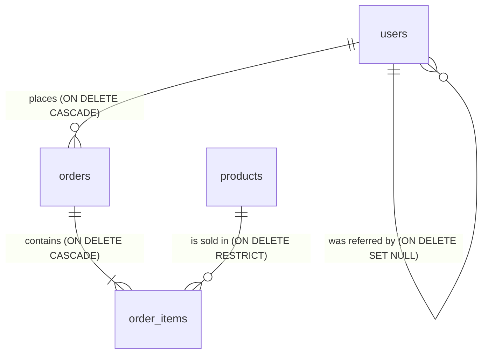

[🏠 Contents](index.md) · [← Previous: Chapter 5 — Keys and Indexes](05-keys-and-indexes.md)

# Chapter 6 — Referential Integrity

Normalized data is spread over many tables ([§3.7](03-types-and-normalization.md#37-normalization-the-other-meaning)). An order doesn't repeat its customer's name and address; it stores the customer's key. That only works if the key **points at something real**. A **foreign key** is the constraint that says so:

> Every non-NULL value of `orders.user_id` must equal the `id` of some row in `users`.

That one sentence implies checks in *both* directions:

- **Child side.** Inserting or updating an order must find its user.
- **Parent side.** Deleting a user, or changing a user's `id`, must not leave orders pointing at nothing.

On the parent side SQL gives you a choice of what happens, the **referential action**:

| `ON DELETE …` | Effect when a referenced parent row is deleted |
|---|---|
| `RESTRICT` (our default) | Refuse the delete. |
| `CASCADE` | Delete the referencing children too, recursively. |
| `SET NULL` | Set the children's foreign-key columns to NULL. |

Here is the schema we'll use in this chapter:



Deleting a user deletes their orders, and the orders' items. Deleting a product that was ever sold is refused. Deleting a user who referred others clears `referred_by` on those users.

## 6.1 Where foreign keys live

Every constraint so far belonged to one table, and lived in its `TableSchema`. A foreign key belongs to *two* tables, and checking it requires both. We therefore keep foreign keys in the `Database`, which is the only object that knows all the tables. Real systems do the same: they store constraints in a system catalog (in PostgreSQL, `pg_constraint`), which references both tables.

```python
# src/minidb/schema.py (append)
type OnDelete = Literal["restrict", "cascade", "set null"]
ON_DELETE_ACTIONS: tuple[OnDelete, ...] = ("restrict", "cascade", "set null")


@dataclass(frozen=True)
class ForeignKey:
    """Declare that ``table.columns`` must match ``ref_table.ref_columns``, or be NULL.

    >>> fk = ForeignKey(("user_id",), "users", ("id",), table="orders")
    >>> fk.name, fk.parent_key({"user_id": 7}), fk.child_key({"id": 7})
    ('fk_orders_user_id', {'id': 7}, {'user_id': 7})

    :param columns: the referencing columns of the child table; a single
        name is also accepted.
    :param ref_table: the referenced (parent) table.
    :param ref_columns: the referenced columns, which must form a key;
        ``()`` (the default) means the parent's primary key.
    :param on_delete: what deleting a referenced row does: ``"restrict"``
        (the default) refuses, ``"cascade"`` deletes the children too, and
        ``"set null"`` sets their foreign-key columns to NULL.
    :param table: the child table; :meth:`Database.create_table` fills it in.
    :raises SchemaError: if ``on_delete`` is not one of the three actions.
    """

    columns: tuple[str, ...]
    ref_table: str
    ref_columns: tuple[str, ...] = ()
    on_delete: OnDelete = "restrict"
    table: str = ""

    def __post_init__(self) -> None:
        object.__setattr__(self, "columns", as_key(self.columns))
        object.__setattr__(self, "ref_columns", as_key(self.ref_columns))
        if self.on_delete not in ON_DELETE_ACTIONS:
            raise SchemaError(f"on_delete must be one of {ON_DELETE_ACTIONS}")

    @property
    def name(self) -> str:
        """Return the constraint's name, derived from the child table and columns."""
        return f"fk_{self.table}_{'_'.join(self.columns)}"

    def parent_key(self, child_row: Mapping[str, Value | None]) -> dict[str, Value | None] | None:
        """Return ``{ref_column: value}`` for the parent ``child_row`` points at.

        :param child_row: a row of the child table.
        :return: the parent's key, or ``None`` if any referencing value is
            NULL: such a row references nothing (SQL's ``MATCH SIMPLE``).
        """
        values = [child_row[c] for c in self.columns]
        if any(v is None for v in values):
            return None
        return dict(zip(self.ref_columns, values, strict=True))

    def child_key(self, parent_row: Mapping[str, Value | None]) -> dict[str, Value | None]:
        """Return ``{column: value}`` that the children of ``parent_row`` have.

        :param parent_row: a row of the parent table.
        :return: the key to look up in the child table.
        """
        return {c: parent_row[r] for c, r in zip(self.columns, self.ref_columns, strict=True)}
```

```python
# src/minidb/schema.py (imports)
from typing import Literal
```

```python
# src/minidb/errors.py (append)
class ForeignKeyError(ConstraintError):
    """Signal a reference to a missing row, or a delete that would orphan rows."""
```

`on_delete` is typed with `Literal`: the type checker accepts only the three action names, so a typo such as `"cascde"` is caught before the program runs. The run-time check in `__post_init__` catches the same mistake in code that isn't type-checked.

The NULL rule again follows the standard's default (`MATCH SIMPLE`): if *any* foreign-key column is NULL, the row references nothing and isn't checked. That's how "an order may exist without a user" is expressed: make `user_id` nullable.

## 6.2 Checking in both directions needs indexes

Both directions are lookups:

- **Child → parent.** "Does a user with `id = 7` exist?" is a lookup in the parent's key index. A foreign key may only reference columns covered by a `PRIMARY KEY` or `UNIQUE` constraint, so that index always exists, and we verify this when the foreign key is declared.
- **Parent → children.** "Which orders have `user_id = 7`?" needs an index on the *child's* foreign-key columns. Without one, every user delete scans all orders. SQL doesn't create this index automatically, and forgetting it is a classic performance bug. We create it automatically.

A small helper on `Table` performs a lookup by a `{column: value}` dict, whatever the column order of the index:

```python
# src/minidb/table.py (add to Table)
    def lookup(self, key: Mapping[str, Value | None]) -> set[int]:
        """Return the rowids whose columns equal ``key``, through an index.

        :param key: ``{column: value}``; the order of the columns doesn't matter.
        :return: the matching rowids, as a new set.
        :raises SchemaError: if no index covers exactly these columns.
        """
        index = self.index_on(key)
        if index is None:
            raise SchemaError(f"{self.name}: no index on {sorted(key)}")
        return index.lookup(tuple(key[c] for c in index.columns))
```

## 6.3 The database orchestrates

`Database` now does more than forward calls. Each write runs the table's own checks (pipeline, uniqueness) *and* the cross-table checks, all before anything is written. Here is the whole file:

```python
# src/minidb/database.py
"""Provide the public entry point: tables, cross-table constraints and CRUD."""

from dataclasses import replace
from typing import TYPE_CHECKING

from minidb.errors import DatabaseError
from minidb.errors import ForeignKeyError
from minidb.errors import SchemaError
from minidb.schema import TableSchema
from minidb.schema import as_key
from minidb.table import Table

if TYPE_CHECKING:
    from collections.abc import Iterable
    from collections.abc import Mapping
    from collections.abc import Sequence

    from minidb.schema import Check
    from minidb.schema import Column
    from minidb.schema import ForeignKey
    from minidb.table import Where
    from minidb.values import Row

type RowRef = tuple[str, int]  # (table name, rowid)


class Database:
    """Hold tables and the foreign keys between them, and run CRUD on them.

    Each write runs the table's own checks *and* the cross-table checks
    before anything is written, so every statement is atomic.
    """

    def __init__(self) -> None:
        self.tables: dict[str, Table] = {}
        self.foreign_keys: list[ForeignKey] = []

    # -- schema -----------------------------------------------------------------
    def create_table(
        self,
        name: str,
        columns: Sequence[Column],
        *,
        primary_key: str | Sequence[str] = (),
        unique: Sequence[str | Sequence[str]] = (),
        checks: Sequence[Check] = (),
        foreign_keys: Sequence[ForeignKey] = (),
    ) -> Table:
        """Create an empty table and return it.

        Creating the table and its foreign keys is all or nothing.

        >>> from minidb.schema import Column, ForeignKey
        >>> from minidb.types import Integer
        >>> db = Database()
        >>> _ = db.create_table("users", [Column("id", Integer())], primary_key="id")
        >>> orders = db.create_table(
        ...     "orders", [Column("user_id", Integer())], foreign_keys=[ForeignKey("user_id", "users")]
        ... )
        >>> sorted(orders.indexes)
        ['fk_orders_user_id']

        :param name: the new table's name.
        :param columns: its columns, in order.
        :param primary_key: the primary-key column or columns; none by default.
        :param unique: the columns of each UNIQUE constraint; none by default.
        :param checks: its row-level CHECK constraints; none by default.
        :param foreign_keys: its references to other tables (or to itself);
            none by default.
        :return: the new table.
        :raises SchemaError: if the table already exists, or the definition
            is invalid.
        """
        if name in self.tables:
            raise SchemaError(f"table {name!r} already exists")
        schema = TableSchema(name, tuple(columns), tuple(checks), as_key(primary_key), tuple(as_key(u) for u in unique))
        table = self.tables[name] = Table(schema)
        try:
            for fk in foreign_keys:
                self._add_foreign_key(replace(fk, table=name))
        except DatabaseError:
            self._forget_table(name)  # all or nothing
            raise
        return table

    def _forget_table(self, name: str) -> None:
        del self.tables[name]
        self.foreign_keys = [f for f in self.foreign_keys if f.table != name]

    def _add_foreign_key(self, fk: ForeignKey) -> None:
        """Validate ``fk`` against both tables and the existing data, then register it."""
        child, parent = self.table(fk.table), self.table(fk.ref_table)
        if not fk.ref_columns:
            if not parent.schema.primary_key:
                raise SchemaError(f"{parent.name} has no primary key to reference")
            fk = replace(fk, ref_columns=parent.schema.primary_key)
        self._check_fk_columns(fk, child, parent)
        if child.index_on(fk.columns) is None:  # for parent -> child lookups
            child.create_index(fk.name, fk.columns)
        self._check_parents_exist(child, child.rows.values(), [fk])
        self.foreign_keys.append(fk)

    @staticmethod
    def _check_fk_columns(fk: ForeignKey, child: Table, parent: Table) -> None:
        """Check that ``fk`` pairs columns of the same types and targets a key."""
        if len(fk.columns) != len(fk.ref_columns):
            raise SchemaError(f"{fk.name}: column count mismatch")
        for c, r in zip(fk.columns, fk.ref_columns, strict=True):
            if type(child.schema.column(c).type) is not type(parent.schema.column(r).type):
                raise SchemaError(f"{fk.name}: {c} and {parent.name}.{r} differ in type")
        target = parent.index_on(fk.ref_columns)
        if target is None or not target.unique:
            raise SchemaError(f"{fk.name}: {parent.name}{fk.ref_columns} is not a key")

    def drop_table(self, name: str) -> None:
        """Delete a table that no other table references.

        :param name: the table to delete.
        :raises SchemaError: if there is no such table, or another table
            references it.
        """
        self.table(name)
        if any(fk.ref_table == name and fk.table != name for fk in self.foreign_keys):
            raise SchemaError(f"{name!r} is referenced by a foreign key")
        self._forget_table(name)

    def table(self, name: str) -> Table:
        """Return the table called ``name``.

        :param name: the table's name.
        :return: the table.
        :raises SchemaError: if there is no such table.
        """
        try:
            return self.tables[name]
        except KeyError:
            raise SchemaError(f"no such table: {name!r}") from None

    def create_index(self, table: str, name: str, columns: Sequence[str], *, unique: bool = False) -> None:
        """Create an index on ``table``; see :meth:`Table.create_index`.

        :param table: the table's name.
        :param name: the index's name.
        :param columns: the indexed columns, in key order.
        :param unique: whether to refuse duplicate keys; ``False`` by default.
        """
        self.table(table).create_index(name, columns, unique=unique)

    # -- reads ------------------------------------------------------------------
    def get(self, table: str, rowid: int) -> Row | None:
        """Return a copy of one row, or ``None``; see :meth:`Table.get`.

        :param table: the table's name.
        :param rowid: the row to fetch.
        :return: the row, or ``None``.
        """
        return self.table(table).get(rowid)

    def select(self, table: str, where: Where = None) -> list[Row]:
        """Return the rows of ``table`` matching ``where``; see :meth:`Table.match`.

        :param table: the table's name.
        :param where: a predicate, a dict of equalities, or ``None`` for all rows.
        :return: copies of the matching rows.
        """
        return self.table(table).select(where)

    # -- writes: check everything, then apply -------------------------------------
    def insert(self, table: str, values: Mapping[str, object]) -> int:
        """Insert a row after checking its own constraints and its references.

        :param table: the table's name.
        :param values: the new row's values, by column name.
        :return: the new rowid.
        :raises ConstraintError: if the row breaks a constraint.
        """
        t = self.table(table)
        row = t.schema.prepare_row(values)
        t.check_unique([(None, row)])
        self._check_parents_exist(t, [row])
        rowid = t.new_rowid()
        t.put(rowid, row)
        return rowid

    def update(self, table: str, changes: Mapping[str, object], where: Where = None) -> int:
        """Update rows, refusing changes that break references in either direction.

        :param table: the table's name.
        :param changes: the new values, by column name.
        :param where: a predicate, a dict of equalities, or ``None`` for all rows.
        :return: the number of rows changed.
        :raises ConstraintError: if a new row breaks a constraint.
        :raises ForeignKeyError: if a changed key is still referenced.
        """
        t = self.table(table)
        old = {rid: t.rows[rid] for rid in t.match(where)}
        new = {rid: t.schema.prepare_row(changes, base=row) for rid, row in old.items()}
        t.check_unique(list(new.items()))
        self._check_parents_exist(t, new.values())
        self._check_no_orphans(t, old, new)
        for rid, row in new.items():
            t.put(rid, row)
        return len(new)

    def delete(self, table: str, where: Where = None) -> int:
        """Delete rows and everything their deletion implies, or nothing at all.

        :param table: the table's name.
        :param where: a predicate, a dict of equalities, or ``None`` for all rows.
        :return: the number of rows deleted from ``table`` itself, not
            counting cascades.
        :raises ForeignKeyError: if a ``restrict`` reference forbids the delete.
        :raises ConstraintError: if a ``set null`` makes a row invalid.
        """
        t = self.table(table)
        deleted, nulled = self._plan_delete(t, t.match(where))
        for name, rid in deleted:
            self.tables[name].remove(rid)
        for (name, rid), row in nulled.items():
            self.tables[name].put(rid, row)
        return sum(1 for name, _ in deleted if name == table)

    # -- referential integrity ------------------------------------------------------
    def _references_from(self, table: str) -> list[ForeignKey]:
        return [fk for fk in self.foreign_keys if fk.table == table]

    def _references_to(self, table: str) -> list[ForeignKey]:
        return [fk for fk in self.foreign_keys if fk.ref_table == table]

    def _check_parents_exist(self, child: Table, rows: Iterable[Row], fks: list[ForeignKey] | None = None) -> None:
        """Check, from the child side, that every non-NULL reference finds its parent."""
        for fk in fks if fks is not None else self._references_from(child.name):
            parent = self.tables[fk.ref_table]
            for row in rows:
                key = fk.parent_key(row)
                if key is not None and not parent.lookup(key):
                    raise ForeignKeyError(f"{fk.name}: no {parent.name} row with {key}")

    def _children(self, fk: ForeignKey, parent_row: Row) -> set[int]:
        return self.tables[fk.table].lookup(fk.child_key(parent_row))

    def _check_no_orphans(self, parent: Table, old: dict[int, Row], new: dict[int, Row]) -> None:
        """Check, from the parent side of an update, that no referenced key changes."""
        for fk in self._references_to(parent.name):
            for rid, before in old.items():
                if fk.child_key(before) != fk.child_key(new[rid]) and self._children(fk, before):
                    raise ForeignKeyError(
                        f"{fk.name}: cannot change {parent.name} key {fk.child_key(before)}, it is still referenced"
                    )

    def _plan_delete(self, table: Table, rowids: Iterable[int]) -> tuple[dict[RowRef, Row], dict[RowRef, Row]]:
        """Work out everything a delete implies, without changing anything.

        Pass 1 follows ``ON DELETE CASCADE`` transitively; only then does
        pass 2 ask which children *survive*, and restrict or null them.

        :return: ``(deleted, nulled)``: the rows to remove, and the new rows
            for the children that ``ON DELETE SET NULL`` changes.
        """
        deleted = self._cascade(table, rowids)
        nulled: dict[RowRef, Row] = {}
        for (name, _), row in deleted.items():
            for fk in self._references_to(name):
                survivors = [c for c in self._children(fk, row) if (fk.table, c) not in deleted]
                if survivors:
                    self._restrict_or_null(fk, row, survivors, nulled)
        return deleted, nulled

    def _cascade(self, table: Table, rowids: Iterable[int]) -> dict[RowRef, Row]:
        """Collect the rows to delete, following cascades with an explicit stack."""
        deleted: dict[RowRef, Row] = {}
        stack = [(table.name, rid) for rid in rowids]
        while stack:
            ref = stack.pop()
            if ref in deleted:
                continue  # cycles and diamonds
            row = deleted[ref] = self.tables[ref[0]].rows[ref[1]]
            for fk in self._references_to(ref[0]):
                if fk.on_delete == "cascade":
                    stack.extend((fk.table, c) for c in self._children(fk, row))
        return deleted

    def _restrict_or_null(
        self, fk: ForeignKey, parent_row: Row, survivors: list[int], nulled: dict[RowRef, Row]
    ) -> None:
        """Refuse the delete for ``restrict``, or plan the updates for ``set null``."""
        if fk.on_delete == "restrict":
            raise ForeignKeyError(
                f"{fk.name}: {fk.ref_table} row {fk.child_key(parent_row)} is still "
                f"referenced by {len(survivors)} {fk.table} row(s)"
            )
        child = self.tables[fk.table]
        for c in survivors:
            base = nulled.get((fk.table, c), child.rows[c])
            nulled[fk.table, c] = child.schema.prepare_row(dict.fromkeys(fk.columns), base=base)
```

The design decisions behind it:

**`_plan_delete` is a pure function of the current state.** (It delegates to `_cascade` for pass 1 and `_restrict_or_null` for pass 2, which keeps every function small.) It computes the complete consequences of a delete without changing anything. Only `delete` applies the plan, and only if planning raised nothing. A cascade three tables deep that hits a `RESTRICT` at the bottom therefore leaves the database untouched. Without the split, we'd have deleted the top two levels before discovering the problem.

**Two passes, not one.** Pass 1 finds every row the cascade deletes. Only then does pass 2 ask which children *survive*. Consider an employee table where `manager_id` references `id` with `RESTRICT`, and a single statement deleting a manager *and* all their reports. Checked row by row, deleting the manager would be refused because its reports still exist. Checked after the cascade is known, the reports are being deleted too, and the statement is fine.

**`SET NULL` goes through the pipeline.** Nulling a foreign key is an update, so it must respect NOT NULL and checks. `prepare_row` enforces that. If `orders.user_id` is NOT NULL, `ON DELETE SET NULL` makes the delete fail, which is correct.

**Updates may not change a referenced key.** That's SQL's `ON UPDATE RESTRICT`. `ON UPDATE CASCADE` is Exercise 3. It's also why surrogate keys (meaningless integers) are popular: they never need to change.

**`_add_foreign_key` validates existing data.** Adding a foreign key to a table that already has orphans fails, the same as creating a unique index over duplicates ([§5.4](05-keys-and-indexes.md#54-table-rewritten-around-put-and-remove)).

Export the new names:

```python
# src/minidb/__init__.py (replace __all__)
__all__ = [
    "Boolean",
    "Check",
    "CheckError",
    "Column",
    "ConstraintError",
    "Database",
    "DatabaseError",
    "Date",
    "DomainError",
    "ForeignKey",
    "ForeignKeyError",
    "Integer",
    "NotNullError",
    "Numeric",
    "Real",
    "SchemaError",
    "TableSchema",
    "Text",
    "Timestamp",
    "UniqueError",
    "normalizers",
]
```

```python
# src/minidb/__init__.py (imports)
from minidb.errors import ForeignKeyError
from minidb.schema import ForeignKey
```

## 6.4 Trying it out

```python
>>> from minidb import *
>>> db = Database()
>>> _ = db.create_table("users", [
...     Column("id", Integer()), Column("name", Text()), Column("referred_by", Integer()),
... ], primary_key="id",
...    foreign_keys=[ForeignKey("referred_by", "users", on_delete="set null")])
>>> _ = db.create_table("products", [Column("sku", Text()), Column("price", Numeric(8, 2))],
...                     primary_key="sku")
>>> _ = db.create_table("orders", [Column("id", Integer()), Column("user_id", Integer())],
...     primary_key="id", foreign_keys=[ForeignKey("user_id", "users", on_delete="cascade")])
>>> _ = db.create_table("order_items", [
...     Column("order_id", Integer()), Column("sku", Text()), Column("qty", Integer(min=1)),
... ], primary_key=("order_id", "sku"), foreign_keys=[
...     ForeignKey("order_id", "orders", on_delete="cascade"),
...     ForeignKey("sku", "products"),                     # restrict
... ])
>>> _ = db.insert("users", {"id": 1, "name": "Ada"})
>>> _ = db.insert("users", {"id": 2, "name": "Alan", "referred_by": 1})
>>> _ = db.insert("products", {"sku": "TEA", "price": "3.50"})
>>> _ = db.insert("orders", {"id": 100, "user_id": 1})
>>> _ = db.insert("order_items", {"order_id": 100, "sku": "TEA", "qty": 2})
>>> db.insert("orders", {"id": 101, "user_id": 99})
Traceback (most recent call last):
  ...
minidb.errors.ForeignKeyError: fk_orders_user_id: no users row with {'id': 99}
>>> db.delete("products", {"sku": "TEA"})
Traceback (most recent call last):
  ...
minidb.errors.ForeignKeyError: fk_order_items_sku: products row {'sku': 'TEA'} is still referenced by 1 order_items row(s)
>>> db.update("users", {"id": 10}, where={"id": 1})
Traceback (most recent call last):
  ...
minidb.errors.ForeignKeyError: fk_users_referred_by: cannot change users key {'referred_by': 1}, it is still referenced
```

The last error message shows the key as `{'referred_by': 1}`: the child-side column names, not `{'id': 1}`. That's because it's what `child_key` returns. Exercise 6 asks you to improve the message.

Now the cascade. Deleting Ada deletes her order and its item, and clears Alan's `referred_by`:

```python
>>> db.delete("users", {"id": 1})
1
>>> db.select("orders"), db.select("order_items")
([], [])
>>> db.select("users")
[{'id': 2, 'name': 'Alan', 'referred_by': None}]
```

And atomicity across tables. If any part of a cascade is refused, nothing happens:

```python
>>> _ = db.insert("orders", {"id": 200, "user_id": 2})
>>> _ = db.insert("order_items", {"order_id": 200, "sku": "TEA", "qty": 1})
>>> db.delete("products", {"sku": "TEA"})      # restricted by order 200's item
Traceback (most recent call last):
  ...
minidb.errors.ForeignKeyError: fk_order_items_sku: products row {'sku': 'TEA'} is still referenced by 1 order_items row(s)
>>> len(db.select("orders")), len(db.select("order_items"))
(1, 1)
```

## 6.5 The limits of statement-at-a-time

Each `Database` method is now atomic on its own: it either does everything its statement implies or nothing. Applications rarely want *one* statement, though. "Create an order and its three items" is four inserts. If the third fails, the first two stay. Worse, some valid sequences can't be expressed at all. Two rows that reference each other (each employee row names the other as a "buddy") can't be inserted one at a time: whichever goes first points at nothing.

Both problems have the same solution: group statements into a **transaction** and check constraints over the *transaction*, not each statement. That's the Unit of Work, starting in [Chapter 8](08-unit-of-work-i.md). First, [Chapter 7](07-query-primitives.md) gives us a real way to *read*: joins, sorting and aggregation.

## Questions and exercises

1. Why must a foreign key reference a *key* (a unique set of columns)? What would "the parent" mean if it didn't?
2. Our cascade uses an explicit stack, not recursion. Why? (Hint: a self-referential `parent_id` chain 5,000 levels deep.)
3. Implement `on_update="cascade"` so that changing `users.id` rewrites `orders.user_id`. Plan it in the style of `_plan_delete`. What happens when the cascaded update itself changes a key that something else references?
4. Insert a row that references *itself* (an employee who is their own manager). Does it work? Why not? Fix `insert` so a row can satisfy its own foreign key.
5. `_check_no_orphans` refuses to change a referenced key even when the update *also* changes all the children in the same statement. Can that happen in a single `update` call in minidb? Can it in SQL?
6. The error message for a key change shows child-side column names. Improve it to show the parent's key.
7. SQL distinguishes `RESTRICT` from `NO ACTION`: both refuse, but `NO ACTION` checks at the *end of the statement* (or transaction, if deferred), which lets later actions fix the problem. Which of the two does our two-pass `_plan_delete` actually implement?
8. *(Performance)* What does `delete("users")` (no `where`) cost with and without the automatic child index from §6.2? Measure it with 10,000 users and 100,000 orders.

*Answers: [Appendix D, Chapter 6](appendix-d-answers.md#chapter-6--referential-integrity).*

---

[🏠 Contents](index.md) · [Next: Chapter 7 — Query Primitives →](07-query-primitives.md)
