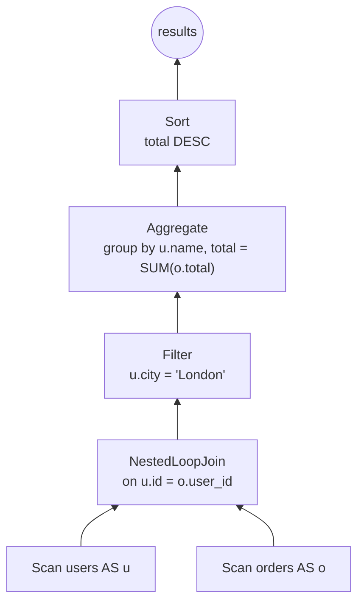

[🏠 Contents](index.md) · [← Previous: Chapter 6 — Referential Integrity](06-referential-integrity.md)

# Chapter 7 — Query Primitives

So far, reading means `select(table, where)`: one table and one filter. Real questions span tables and summarize: *"the total spent by each customer in London, biggest spenders first."* In this chapter we implement Codd's relational algebra ([§1.1](01-relational-model.md#relational-algebra)), plus the sorting, grouping and limiting SQL adds, as small **operators** that plug together like pipes. Then we put a fluent builder on top so queries read naturally:

```python
(db.query("users", "u")
   .join("orders", on=lambda r: r["u.id"] == r["o.user_id"], alias="o")
   .where(lambda r: r["u.city"] == "London")
   .group_by("u.name", total=Sum("o.total"))
   .order_by("-total")
   .all())
```

## 7.1 The iterator model

The standard design for query execution is the **iterator model**, also called the *Volcano* model after the system that popularized it ([Graefe 1994](references.md#graefe1994)). Every operator:

- has zero or more **child operators**,
- produces rows **one at a time** when asked (`next()`),
- gets its own input by asking its children for rows.

A query is a **tree** of operators. Asking the root for rows makes rows flow up from the leaves. In Python, "an object you can ask for the next row" is simply an *iterable*, and generators make each operator a few lines long.



Two properties make this model last:

1. **Composability.** Any operator can sit on top of any other, the same way relational algebra composes.
2. **Pipelining.** Most operators handle one row and pass it on, without storing the whole input. `Limit(10)` on top of a million-row scan reads ten rows and stops. Some operators are **blocking**: `Sort` and `Aggregate` must see all their input before producing anything. Knowing which is which is half of query performance.

## 7.2 Rows with qualified names

When two tables are joined, both may have an `id` column. The toy in [Chapter 1](01-relational-model.md#12-a-database-in-30-lines) lost one of them in `l | r`. Our operators therefore key rows by **qualified names**, `alias.column`, so a joined row has both `u.id` and `o.id`. Typing `r["u.city"]` everywhere would be tedious, though. So rows also accept the *unqualified* name when exactly one column has it, as SQL does:

```python
# minidb/query.py
"""Query operators (the iterator model) and a fluent query builder."""
import itertools
from collections.abc import Callable, Iterator
from typing import Any


class Row(dict):
    """A result row keyed by qualified names ('u.age').

    Unqualified names ('age') also work when they are unambiguous.
    """

    def __missing__(self, key: str):
        if "." not in key:
            found = [k for k in self if k.rpartition(".")[2] == key]
            if len(found) == 1:
                return self[found[0]]
            if found:
                raise KeyError(f"ambiguous column {key!r}: one of {sorted(found)}")
        raise KeyError(key)
```

`dict.__missing__` is called by `dict.__getitem__` when a key isn't found, which makes it a cheap hook for the fallback lookup. (It only affects `row[key]`, not `row.get(key)`, which is a subtlety Exercise 1 explores.)

## 7.3 Operators

Each operator is a class with an `__iter__` generator, a `columns()` method listing the names of the columns it produces, and a short `label` for printing plans.

```python
# minidb/query.py (append)
class Operator:
    """Base class. Subclasses implement __iter__, columns() and label."""
    children: tuple["Operator", ...] = ()

    def __iter__(self) -> Iterator[Row]:
        raise NotImplementedError

    def columns(self) -> list[str]:
        return self.children[0].columns()

    @property
    def label(self) -> str:
        return type(self).__name__

    def explain(self, indent: int = 0) -> str:
        lines = ["  " * indent + self.label]
        lines += [child.explain(indent + 1) for child in self.children]
        return "\n".join(lines)


class Scan(Operator):
    """Leaf: every row of a table, with names qualified by `alias`."""

    def __init__(self, table, alias: str | None = None):
        self.table = table
        self.alias = alias or table.name

    def __iter__(self):
        names = [(c, f"{self.alias}.{c}") for c in self.table.columns]
        for _, row in self.table.scan():
            yield Row({q: row[c] for c, q in names})

    def columns(self):
        return [f"{self.alias}.{c}" for c in self.table.columns]

    @property
    def label(self):
        return f"Scan {self.table.name} AS {self.alias}"


class Filter(Operator):
    """σ: keep rows for which `predicate(row)` is true."""

    def __init__(self, child: Operator, predicate: Callable[[Row], Any]):
        self.children = (child,)
        self.predicate = predicate

    def __iter__(self):
        return (row for row in self.children[0] if self.predicate(row) is True)

    @property
    def label(self):
        return f"Filter {getattr(self.predicate, '__name__', self.predicate)}"


class Project(Operator):
    """π: compute output columns. `outputs` maps a name to a column or a function."""

    def __init__(self, child: Operator, outputs: dict[str, str | Callable[[Row], Any]]):
        self.children = (child,)
        self.outputs = outputs

    def __iter__(self):
        getters = [(name, src if callable(src) else (lambda r, c=src: r[c]))
                   for name, src in self.outputs.items()]
        for row in self.children[0]:
            yield Row({name: get(row) for name, get in getters})

    def columns(self):
        return list(self.outputs)

    @property
    def label(self):
        return f"Project {', '.join(self.outputs)}"


class NestedLoopJoin(Operator):
    """⋈: every pair (l, r) with on(l | r) true. kind='left' keeps unmatched l."""

    def __init__(self, left: Operator, right: Operator,
                 on: Callable[[Row], Any] | None = None, kind: str = "inner"):
        if kind not in ("inner", "left"):
            raise ValueError("kind must be 'inner' or 'left'")
        self.children = (left, right)
        self.on, self.kind = on, kind

    def __iter__(self):
        left, right = self.children
        inner = list(right)                        # materialize once: blocking
        nulls = dict.fromkeys(right.columns())
        for l in left:
            matched = False
            for r in inner:
                row = Row(l | r)
                if self.on is None or self.on(row) is True:
                    matched = True
                    yield row
            if not matched and self.kind == "left":
                yield Row(l | nulls)

    def columns(self):
        return self.children[0].columns() + self.children[1].columns()

    @property
    def label(self):
        return f"NestedLoopJoin ({self.kind})"


class Sort(Operator):
    """Order rows by keys [(column or function, descending)]. NULLs sort first."""

    def __init__(self, child: Operator, keys: list[tuple[str | Callable, bool]]):
        self.children = (child,)
        self.keys = keys

    def __iter__(self):
        rows = list(self.children[0])              # blocking
        for key, descending in reversed(self.keys):
            get = key if callable(key) else (lambda r, c=key: r[c])
            rows.sort(key=lambda r: _nulls_first(get(r)), reverse=descending)
        return iter(rows)

    @property
    def label(self):
        return "Sort " + ", ".join(f"{k}{' DESC' if d else ''}" for k, d in self.keys)


def _nulls_first(value):
    # (False, None) < (True, anything): NULL sorts before every value,
    # and None itself is never compared with a real value.
    return (value is not None, value)


class Limit(Operator):
    def __init__(self, child: Operator, count: int | None, offset: int = 0):
        self.children = (child,)
        self.count, self.offset = count, offset

    def __iter__(self):
        stop = None if self.count is None else self.offset + self.count
        return itertools.islice(self.children[0], self.offset, stop)

    @property
    def label(self):
        return f"Limit {self.count} offset {self.offset}"


class Distinct(Operator):
    def __init__(self, child: Operator):
        self.children = (child,)

    def __iter__(self):
        seen = set()
        for row in self.children[0]:
            key = tuple(row.items())
            if key not in seen:
                seen.add(key)
                yield row
```

A few details are worth slowing down for.

**`Filter` keeps a row only if the predicate returns exactly `True`.** That's `WHERE` semantics in three-valued logic ([§4.2](04-constraints.md#42-three-valued-logic)): FALSE and UNKNOWN (`None`) both drop the row. It's the mirror image of `CHECK`, which drops nothing unless the result is exactly `False`.

**`NestedLoopJoin` materializes its right input.** A child operator might not be safely iterable twice (or might be expensive), so we read it into a list once. The cost is O(|left| × |right|) comparisons. On two tables of 10,000 rows that's 100 million predicate calls. [Chapter 14](14-query-planning.md) adds a hash join that does the common case, an *equi-join*, in O(|left| + |right|).

**`Sort` sorts once per key, last key first.** Python's sort is *stable*: rows that compare equal keep their order. Sorting by the least significant key first and the most significant last produces a correct multi-key sort in which each key can have its own direction. `reverse=True` keeps stability too. The `(value is not None, value)` trick makes NULLs sort before everything without ever comparing `None` with a number. SQLite and SQL Server put NULLs first in ascending order; PostgreSQL and Oracle put them last. The standard lets implementations choose.

**`Limit` is just `islice`.** Because the operators above it are lazy, `islice` stops pulling after `count` rows, and the scan below stops too, unless a blocking operator sits in between.

## 7.4 Aggregation

Aggregation collapses many rows into one per **group**. An aggregate function is a tiny state machine: an initial state, a `step` that folds in one value, and a `finish` that turns the state into the result. Every SQL aggregate except `COUNT(*)` **ignores NULLs**, and `SUM` of no rows is NULL, not 0.

```python
# minidb/query.py (append)
class AggregateFunction:
    """Base for aggregates. `column=None` means 'the whole row' (COUNT(*))."""

    def __init__(self, column: str | None = None):
        self.column = column

    def start(self):
        return None

    def step(self, state, value):
        raise NotImplementedError

    def finish(self, state):
        return state

    def __repr__(self):
        return f"{type(self).__name__.upper()}({self.column or '*'})"


class Count(AggregateFunction):
    def start(self):
        return 0

    def step(self, state, value):
        return state + 1


class Sum(AggregateFunction):
    def step(self, state, value):
        return value if state is None else state + value


class Min(AggregateFunction):
    def step(self, state, value):
        return value if state is None or value < state else state


class Max(AggregateFunction):
    def step(self, state, value):
        return value if state is None or value > state else state


class Avg(AggregateFunction):
    def start(self):
        return (0, 0)

    def step(self, state, value):
        return (state[0] + value, state[1] + 1)

    def finish(self, state):
        total, n = state
        return None if n == 0 else total / n


class Aggregate(Operator):
    """γ: group rows by `group_by` columns and compute `aggregates` per group."""

    def __init__(self, child: Operator, group_by: list[str],
                 aggregates: dict[str, AggregateFunction]):
        self.children = (child,)
        self.group_by, self.aggregates = list(group_by), aggregates

    def __iter__(self):
        funcs = list(self.aggregates.values())
        groups: dict[tuple, list] = {}                      # hash aggregation
        for row in self.children[0]:                        # blocking
            key = tuple(row[c] for c in self.group_by)
            states = groups.get(key)
            if states is None:
                states = groups[key] = [f.start() for f in funcs]
            for i, f in enumerate(funcs):
                value = row if f.column is None else row[f.column]
                if value is not None:                       # aggregates skip NULLs
                    states[i] = f.step(states[i], value)
        if not groups and not self.group_by:                # aggregate of no rows
            groups[()] = [f.start() for f in funcs]         # still yields one row
        for key, states in groups.items():
            out = Row(zip(self.group_by, key))
            out.update((name, f.finish(s))
                       for (name, f), s in zip(self.aggregates.items(), states))
            yield out

    def columns(self):
        return self.group_by + list(self.aggregates)

    @property
    def label(self):
        aggs = ", ".join(f"{n}={f!r}" for n, f in self.aggregates.items())
        return f"Aggregate by {self.group_by or '()'}: {aggs}"
```

This is **hash aggregation**: one dict entry per group. The alternative, *sort aggregation*, sorts by the group key and emits a group each time the key changes. It uses less memory, and its output comes out sorted. Real planners choose between the two.

Note the special case at the end: `SELECT COUNT(*) FROM empty_table` returns one row containing 0, but `SELECT city, COUNT(*) FROM empty_table GROUP BY city` returns no rows. With no `GROUP BY`, the whole input is one group, even if it's empty.

## 7.5 A query builder

Wiring operators by hand works, but it's verbose. A **builder** collects the parts of a query, then assembles the operator tree in the order SQL defines: `FROM`/`JOIN` → `WHERE` → `GROUP BY` → `HAVING` → `ORDER BY` → `SELECT` → `DISTINCT` → `LIMIT`. (SQL is written `SELECT … FROM … WHERE`, but *evaluated* starting from `FROM`. That's why you can't use a `SELECT` alias in `WHERE`.)

Each builder method returns a **new** `Query`, leaving the original unchanged. That makes partial queries safe to reuse:

```python
adults = db.query("users").where(lambda r: r["age"] >= 18)
londoners = adults.where(lambda r: r["city"] == "London")   # adults is unchanged
```

```python
# minidb/query.py (append)
class Query:
    """Immutable, fluent query builder. Each method returns a new Query."""

    def __init__(self, db, table: str, alias: str | None = None):
        self._db = db
        self._from = (table, alias)
        self._joins: tuple = ()
        self._where: tuple = ()
        self._group: tuple | None = None
        self._aggregates: dict = {}
        self._having: tuple = ()
        self._order: tuple = ()
        self._select: dict | None = None
        self._distinct = False
        self._limit: tuple | None = None

    def _with(self, **changes) -> "Query":
        q = object.__new__(Query)
        q.__dict__ = self.__dict__ | {"_" + k: v for k, v in changes.items()}
        return q

    # -- building -------------------------------------------------------------------
    def join(self, table: str, on: Callable[[Row], Any], alias: str | None = None,
             kind: str = "inner") -> "Query":
        return self._with(joins=self._joins + ((table, alias, on, kind),))

    def where(self, predicate: Callable[[Row], Any]) -> "Query":
        return self._with(where=self._where + (predicate,))

    def group_by(self, *columns: str, **aggregates: AggregateFunction) -> "Query":
        return self._with(group=columns, aggregates=aggregates)

    def having(self, predicate: Callable[[Row], Any]) -> "Query":
        return self._with(having=self._having + (predicate,))

    def order_by(self, *keys: str | Callable) -> "Query":
        """'name' ascending, '-name' descending, or a function of the row."""
        parsed = tuple((k[1:], True) if isinstance(k, str) and k.startswith("-")
                       else (k, False) for k in keys)
        return self._with(order=self._order + parsed)

    def select(self, *columns: str, **computed: str | Callable[[Row], Any]) -> "Query":
        """select('u.name', total='o.total', double=lambda r: 2 * r['x'])"""
        outputs = {c.rpartition(".")[2]: c for c in columns}
        if len(outputs) != len(columns):
            raise ValueError("duplicate output names; use keyword aliases")
        return self._with(select=outputs | computed)

    def distinct(self) -> "Query":
        return self._with(distinct=True)

    def limit(self, count: int | None, offset: int = 0) -> "Query":
        return self._with(limit=(count, offset))

    # -- planning -------------------------------------------------------------------
    def plan(self) -> Operator:
        table, alias = self._from
        op: Operator = Scan(self._db.table(table), alias)
        for jtable, jalias, on, kind in self._joins:
            op = NestedLoopJoin(op, Scan(self._db.table(jtable), jalias), on, kind)
        for predicate in self._where:
            op = Filter(op, predicate)
        if self._group is not None:
            op = Aggregate(op, list(self._group), self._aggregates)
        for predicate in self._having:
            op = Filter(op, predicate)
        if self._order:
            op = Sort(op, list(self._order))
        if self._select is not None:
            op = Project(op, self._select)
        if self._distinct:
            op = Distinct(op)
        if self._limit is not None:
            op = Limit(op, *self._limit)
        return op

    # -- running --------------------------------------------------------------------
    def __iter__(self) -> Iterator[Row]:
        return iter(self.plan())

    def all(self) -> list[dict]:
        return [dict(row) for row in self.plan()]

    def first(self) -> dict | None:
        return next((dict(row) for row in self.limit(1).plan()), None)

    def explain(self) -> str:
        return self.plan().explain()
```

`_with` is a small trick worth knowing. It creates a `Query` *without* calling `__init__` and gives it a copy of the old instance dict with some fields replaced. All the fields are tuples or dicts that are never mutated after creation, so sharing them between queries is safe.

Hook it into the database:

```python
# minidb/database.py (add to Database)
    def query(self, table: str, alias: str | None = None) -> Query:
        """Start a query: db.query('users', 'u').where(...).all()"""
        return Query(self, table, alias)
```

```python
# minidb/database.py (imports)
from minidb.query import Query
```

```python
# minidb/__init__.py (append)
from minidb.query import Avg, Count, Max, Min, Query, Sum
__all__ += ["Query", "Count", "Sum", "Avg", "Min", "Max"]
```

## 7.6 Trying it out

```python
>>> from minidb import *
>>> db = Database()
>>> _ = db.create_table("users", [Column("id", Integer()), Column("name", Text()),
...                               Column("city", Text())], primary_key="id")
>>> _ = db.create_table("orders", [Column("id", Integer()), Column("user_id", Integer()),
...                                Column("total", Numeric(8, 2))], primary_key="id",
...                     foreign_keys=[ForeignKey("user_id", "users")])
>>> for row in [(1, "Ada", "London"), (2, "Alan", "London"), (3, "Grace", "New York"),
...             (4, "Edgar", None)]:
...     _ = db.insert("users", dict(zip(("id", "name", "city"), row)))
>>> for row in [(10, 1, "25.00"), (11, 2, "40.00"), (12, 1, "15.50"), (13, 3, "9.99")]:
...     _ = db.insert("orders", dict(zip(("id", "user_id", "total"), row)))
```

Filtering, projecting, ordering:

```python
>>> db.query("users").where(lambda r: r["city"] == "London").select("name").all()
[{'name': 'Ada'}, {'name': 'Alan'}]
>>> [r["name"] for r in db.query("users").order_by("city", "-name")]
['Edgar', 'Alan', 'Ada', 'Grace']
```

Edgar's NULL city sorts first; within London, names are descending. A join with an aggregate, the query from the start of the chapter:

```python
>>> q = (db.query("users", "u")
...        .join("orders", on=lambda r: r["u.id"] == r["o.user_id"], alias="o")
...        .where(lambda r: r["u.city"] == "London")
...        .group_by("u.name", total=Sum("o.total"), n=Count())
...        .order_by("-total"))
>>> q.all()
[{'u.name': 'Ada', 'total': Decimal('40.50'), 'n': 2}, {'u.name': 'Alan', 'total': Decimal('40.00'), 'n': 1}]
>>> print(q.explain())
Sort total DESC
  Aggregate by ['u.name']: total=SUM(o.total), n=COUNT(*)
    Filter <lambda>
      NestedLoopJoin (inner)
        Scan users AS u
        Scan orders AS o
```

A left join keeps users without orders, and aggregates skip the resulting NULLs:

```python
>>> (db.query("users", "u")
...    .join("orders", on=lambda r: r["u.id"] == r["o.user_id"], alias="o", kind="left")
...    .group_by("u.name", orders=Count("o.id"), spent=Sum("o.total"))
...    .order_by("u.name")
...    .select(name="u.name", orders="orders", spent="spent")
...    .all())
[{'name': 'Ada', 'orders': 2, 'spent': Decimal('40.50')}, {'name': 'Alan', 'orders': 1, 'spent': Decimal('40.00')}, {'name': 'Edgar', 'orders': 0, 'spent': None}, {'name': 'Grace', 'orders': 1, 'spent': Decimal('9.99')}]
>>> db.query("orders").where(lambda r: False).group_by(n=Count(), s=Sum("total")).all()
[{'n': 0, 's': None}]
```

Edgar has 0 orders and a NULL total. `COUNT(o.id)` skips NULLs, while `COUNT(*)` would have counted his one NULL-padded row.

Laziness at work. `Limit` stops the scan early:

```python
>>> pulled = []
>>> def spy(r):
...     pulled.append(r["id"])
...     return True
>>> db.query("orders").where(spy).limit(2).all()
[{'orders.id': 10, 'orders.user_id': 1, 'orders.total': Decimal('25.00')}, {'orders.id': 11, 'orders.user_id': 2, 'orders.total': Decimal('40.00')}]
>>> pulled
[10, 11]
```

Notice the output keys: without `select`, rows keep their qualified names. Only the first two rows were ever read from the table.

## 7.7 What's still missing

Our queries are correct but naive. The builder always produces the same shape of tree. It joins every pair of rows *before* filtering, even when the filter only mentions `u.city` and could have shrunk `users` first. It never uses an index, because predicates are lambdas it can't look inside. Fixing that, with the planner rewriting the tree before running it, is [Chapter 14](14-query-planning.md). The operators we wrote here will be the planner's building blocks.

There's a more immediate problem. A query iterates over live table dicts. A write in the middle of a lazy query can raise `RuntimeError: dictionary changed size during iteration`, and a query that reads two tables can see one before a change and the other after it. Writes need to become *units*, which [Chapter 8](08-unit-of-work-i.md) addresses.

## Questions and exercises

1. `Row.__missing__` is only consulted by `row[key]`. What does `row.get("age")` return for a row with key `u.age`? Override `get` so it's consistent. Are there other `dict` methods you'd need to override?
2. Unqualified-name resolution scans every key on every access. Profile a query that touches `r["age"]` a million times. Then make `Scan` precompute a resolution table once per query. Where would you store it?
3. Add `Union`, `Intersect` and `Except` operators (set semantics, so duplicates are removed). Which are blocking?
4. Implement sort aggregation as `SortAggregate`, which requires its input sorted by the group key. When is it better than hash aggregation?
5. Implement `TopN(child, keys, n)`: `ORDER BY … LIMIT n` without sorting everything, using `heapq`. What's its complexity compared with `Sort` + `Limit`?
6. Our `Avg` divides an `int` sum by an `int` count and returns a `float`. SQL engines disagree here: some return an integer, PostgreSQL returns `numeric`. What should `Avg` of a `Numeric` column return? Make it so.
7. Implement `kind="right"` and `kind="full"` joins. Why does a full outer join need to remember which right rows matched?
8. *(Thought experiment)* A query scans `users` while another thread deletes from it. List every way the result could be wrong or crash. Keep the list for [Chapter 10](10-concurrency-i.md).

---

[🏠 Contents](index.md) · [Next: Chapter 8 — Unit of Work I →](08-unit-of-work-i.md)
