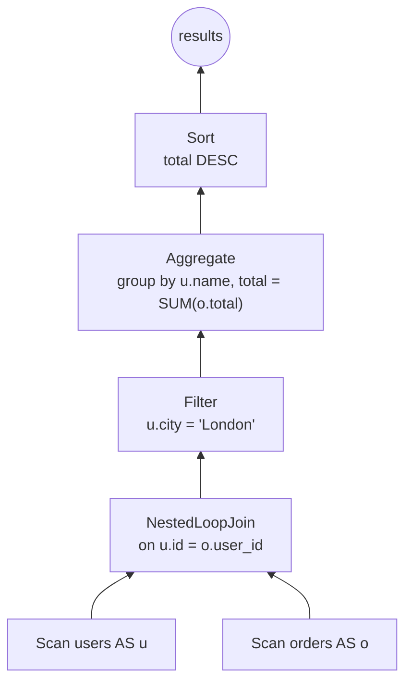

[🏠 Contents](index.md) · [← Previous: Chapter 6 — Referential Integrity](06-referential-integrity.md)

# Chapter 7 — Query Primitives

So far, reading means `select(table, where)`: one table and one filter. Real questions span tables and summarize: *"the total spent by each customer in London, biggest spenders first."* In this chapter we implement Codd's relational algebra ([§1.1](01-relational-model.md#relational-algebra)), plus the sorting, grouping and limiting SQL adds, as small **operators** that plug together like pipes. Then we put a fluent builder on top so queries read naturally:

```python
(db.query("users", "u")
   .join("orders", on=lambda r: r["u.id"] == r["o.user_id"], alias="o")
   .where(lambda r: r["u.city"] == "London")
   .group_by("u.name", total=Sum("o.total"))
   .order_by("-total")
   .all())
```

## 7.1 The iterator model

The standard design for query execution is the **iterator model**, also called the *Volcano* model after the system that popularized it ([Graefe 1994](references.md#graefe1994)). Every operator:

- has zero or more **child operators**,
- produces rows **one at a time** when asked (`next()`),
- gets its own input by asking its children for rows.

A query is a **tree** of operators. Asking the root for rows makes rows flow up from the leaves. In Python, "an object you can ask for the next row" is simply an *iterable*, and generators make each operator a few lines long.



Two properties make this model last:

1. **Composability.** Any operator can sit on top of any other, the same way relational algebra composes.
2. **Pipelining.** Most operators handle one row and pass it on, without storing the whole input. `Limit(10)` on top of a million-row scan reads ten rows and stops. Some operators are **blocking**: `Sort` and `Aggregate` must see all their input before producing anything. Knowing which is which is half of query performance.

## 7.2 Rows with qualified names

When two tables are joined, both may have an `id` column. The toy in [Chapter 1](01-relational-model.md#12-a-database-in-forty-lines) lost one of them in `lrow | rrow`. The operators live in a new module, `operators.py`, and they key rows by **qualified names**, `alias.column`, so a joined row has both `u.id` and `o.id`. Typing `r["u.city"]` everywhere would be tedious, though. So rows also accept the *unqualified* name when exactly one column has it, as SQL does:

```python
# src/minidb/operators.py
"""Implement query operators in the iterator (Volcano) model.

Every operator is iterable: it yields :class:`Row` objects, which it gets by
iterating over its child operators. A query is a tree of operators, and
iterating over the root makes rows flow up from the leaves.
"""

import itertools
from typing import TYPE_CHECKING
from typing import Protocol
from typing import cast
from typing import override

from minidb.values import ordered

if TYPE_CHECKING:
    from collections.abc import Callable
    from collections.abc import Iterator

    from minidb.values import Ordered
    from minidb.values import Row as StoredRow
    from minidb.values import Value


class Row(dict[str, "Value | None"]):
    """Hold a result row, keyed by qualified names such as ``"u.age"``.

    An unqualified name such as ``"age"`` also works when exactly one
    column has it.

    >>> row = Row({"u.id": 1, "o.id": 10, "o.total": 25})
    >>> row["total"]
    25
    >>> row["id"]
    Traceback (most recent call last):
      ...
    KeyError: "ambiguous column 'id': one of ['o.id', 'u.id']"
    """

    def __missing__(self, key: str) -> Value | None:
        if "." not in key:
            found = [k for k in self if k.rpartition(".")[2] == key]
            if len(found) == 1:
                return self[found[0]]
            if found:
                raise KeyError(f"ambiguous column {key!r}: one of {sorted(found)}")
        raise KeyError(key)
```

The operators need to *compare* values: to sort them, and to find a minimum or maximum. A column always holds values of a single type, so two of its values can always be compared, but the type checker only sees `Value`, a union of several types, and `int < str` is not something it can allow. Two small protocols say precisely what we rely on, and two helpers state the assumption at each place it's made:

```python
# src/minidb/values.py (append)
class Ordered(Protocol):
    """Describe values that can be ordered among themselves."""

    def __lt__(self, other: Self, /) -> bool: ...
    def __le__(self, other: Self, /) -> bool: ...
    def __gt__(self, other: Self, /) -> bool: ...
    def __ge__(self, other: Self, /) -> bool: ...


class Arithmetic(Protocol):
    """Describe values that support the four arithmetic operators among themselves."""

    def __add__(self, other: Self, /) -> Self: ...
    def __sub__(self, other: Self, /) -> Self: ...
    def __mul__(self, other: Self, /) -> Self: ...
    def __truediv__(self, other: Self, /) -> Self: ...


def ordered(value: Value | None) -> Ordered:
    """Return ``value``, typed as orderable.

    Values from one column share a Python type, so they can be compared;
    the type checker can't know that, and this function says so.

    :param value: a value from a column (or a constant of the column's type).
    :return: the same object.
    """
    return cast("Ordered", value)


def arithmetic(value: Value) -> Arithmetic:
    """Return ``value``, typed as supporting arithmetic; see :func:`ordered`.

    :param value: a numeric value.
    :return: the same object.
    """
    return cast("Arithmetic", value)
```

```python
# src/minidb/values.py (imports)
from typing import Protocol
from typing import Self
from typing import cast
```

Scans read from a **source**: anything with a name, column names and a `scan()` method. `Table` already is one. Describing sources with a protocol means a scan can later read from things that aren't tables, such as a transaction's private view of a table ([Chapter 9](09-unit-of-work-ii.md)).

```python
# src/minidb/operators.py (append)
class Source(Protocol):
    """Describe something a :class:`Scan` can read: a table, or a view of one."""

    name: str
    columns: tuple[str, ...]

    def scan(self) -> Iterator[tuple[int, StoredRow]]:
        """Yield every ``(rowid, row)`` pair."""
        ...


type RowPredicate = Callable[[Row], object]
type RowFunction = Callable[[Row], Value | None]
type SortKey = tuple[str | RowFunction, bool]
```

`dict.__missing__` is called by `dict.__getitem__` when a key isn't found, which makes it a cheap hook for the fallback lookup. (It only affects `row[key]`, not `row.get(key)`, which is a subtlety Exercise 1 explores.)

## 7.3 Operators

Each operator is a class with an `__iter__` generator, a `columns()` method listing the names of the columns it produces, and a short `label` for printing plans. Overriding methods are marked with `@override` (from `typing`), which makes the type checker verify that the method really overrides something. A typo in a method name can't silently create a new method.

```python
# src/minidb/operators.py (append)
class Operator:
    """Produce rows when iterated; the base class of every operator.

    Subclasses implement :meth:`__iter__`, :meth:`columns` and :attr:`label`.
    """

    children: tuple[Operator, ...] = ()

    def __iter__(self) -> Iterator[Row]:
        raise NotImplementedError

    def columns(self) -> list[str]:
        """Return the names of the columns this operator produces.

        :return: the names, by default those of the first child.
        """
        return self.children[0].columns()

    @property
    def label(self) -> str:
        """Return a one-line description, used by :meth:`explain`."""
        return type(self).__name__

    def explain(self, indent: int = 0) -> str:
        """Describe the operator tree rooted here, one operator per line.

        :param indent: the nesting depth of this operator; 0 by default.
        :return: the indented description.
        """
        lines = ["  " * indent + self.label]
        lines += [child.explain(indent + 1) for child in self.children]
        return "\n".join(lines)


class Scan(Operator):
    """Yield every row of a source, with names qualified by ``alias``.

    :param source: the table (or view) to read.
    :param alias: the qualifier for column names; ``None`` (the default)
        uses the source's name.
    """

    def __init__(self, source: Source, alias: str | None = None) -> None:
        self.source = source
        self.alias = alias or source.name

    @override
    def __iter__(self) -> Iterator[Row]:
        names = [(c, f"{self.alias}.{c}") for c in self.source.columns]
        for _, row in self.source.scan():
            yield Row({q: row[c] for c, q in names})

    @override
    def columns(self) -> list[str]:
        return [f"{self.alias}.{c}" for c in self.source.columns]

    @property
    @override
    def label(self) -> str:
        return f"Scan {self.source.name} AS {self.alias}"


class Filter(Operator):
    """Keep the rows for which ``predicate`` is exactly ``True`` (WHERE semantics).

    :param child: the input.
    :param predicate: a function of the row; ``False`` and ``None``
        (UNKNOWN) both drop the row.
    """

    def __init__(self, child: Operator, predicate: RowPredicate) -> None:
        self.children = (child,)
        self.predicate = predicate

    @override
    def __iter__(self) -> Iterator[Row]:
        return (row for row in self.children[0] if self.predicate(row) is True)

    @property
    @override
    def label(self) -> str:
        return f"Filter {getattr(self.predicate, '__name__', self.predicate)}"


class Project(Operator):
    """Compute output columns, each from a column name or a function of the row.

    :param child: the input.
    :param outputs: ``{output name: source column or function}``.
    """

    def __init__(self, child: Operator, outputs: dict[str, str | RowFunction]) -> None:
        self.children = (child,)
        self.outputs = outputs

    @override
    def __iter__(self) -> Iterator[Row]:
        getters = [(name, _getter(src)) for name, src in self.outputs.items()]
        for row in self.children[0]:
            yield Row({name: get(row) for name, get in getters})

    @override
    def columns(self) -> list[str]:
        return list(self.outputs)

    @property
    @override
    def label(self) -> str:
        return f"Project {', '.join(self.outputs)}"


def _getter(source: str | RowFunction) -> RowFunction:
    """Turn a column name into a function that reads it; leave functions alone."""
    if callable(source):
        return source
    return lambda row: row[source]


class NestedLoopJoin(Operator):
    """Join every pair of rows for which ``on`` is true.

    The right input is read once into a list: an operator may not be safely
    iterable twice, or may be expensive to re-run.

    :param left: the outer input.
    :param right: the inner input.
    :param on: the join condition; ``None`` (the default) joins every pair.
    :param kind: ``"inner"`` (the default), or ``"left"`` to keep unmatched
        left rows, padded with NULLs.
    :raises ValueError: for any other ``kind``.
    """

    def __init__(
        self, left: Operator, right: Operator, on: RowPredicate | None = None, kind: JoinKind = "inner"
    ) -> None:
        if kind not in ("inner", "left"):
            raise ValueError("kind must be 'inner' or 'left'")
        self.children = (left, right)
        self.on, self.kind = on, kind

    @override
    def __iter__(self) -> Iterator[Row]:
        left, right = self.children
        inner = list(right)  # materialize once: blocking
        nulls = dict.fromkeys(right.columns())
        for lrow in left:
            matches = [row for r in inner if self._matches(row := Row(lrow | r))]
            yield from matches
            if not matches and self.kind == "left":
                yield Row(lrow | nulls)

    def _matches(self, row: Row) -> bool:
        return self.on is None or self.on(row) is True

    @override
    def columns(self) -> list[str]:
        return self.children[0].columns() + self.children[1].columns()

    @property
    @override
    def label(self) -> str:
        return f"NestedLoopJoin ({self.kind})"


class Sort(Operator):
    """Order rows by several keys, each ascending or descending; NULLs sort first.

    :param child: the input.
    :param keys: ``(column name or function, descending)`` pairs, most
        significant first.
    """

    def __init__(self, child: Operator, keys: list[SortKey]) -> None:
        self.children = (child,)
        self.keys = keys

    @override
    def __iter__(self) -> Iterator[Row]:
        rows = list(self.children[0])  # blocking
        for key, descending in reversed(self.keys):  # stable sorts, last key first
            get = _getter(key)
            rows.sort(key=lambda r: _nulls_first(get(r)), reverse=descending)
        return iter(rows)

    @property
    @override
    def label(self) -> str:
        return "Sort " + ", ".join(f"{k}{' DESC' if d else ''}" for k, d in self.keys)


def _nulls_first(value: Value | None) -> tuple[bool, Ordered]:
    """Make a sort key under which NULL sorts before every value.

    ``(False, None) < (True, anything)``, so ``None`` is never compared with
    a real value.
    """
    return (value is not None, ordered(value))


class Limit(Operator):
    """Skip ``offset`` rows, then yield at most ``count``.

    :param child: the input.
    :param count: the maximum number of rows; ``None`` for no maximum.
    :param offset: how many rows to skip first; 0 by default.
    """

    def __init__(self, child: Operator, count: int | None, offset: int = 0) -> None:
        self.children = (child,)
        self.count, self.offset = count, offset

    @override
    def __iter__(self) -> Iterator[Row]:
        stop = None if self.count is None else self.offset + self.count
        return itertools.islice(self.children[0], self.offset, stop)

    @property
    @override
    def label(self) -> str:
        return f"Limit {self.count} offset {self.offset}"


class Distinct(Operator):
    """Drop rows equal to an earlier row, keeping the first of each.

    :param child: the input.
    """

    def __init__(self, child: Operator) -> None:
        self.children = (child,)

    @override
    def __iter__(self) -> Iterator[Row]:
        seen: set[tuple[tuple[str, Value | None], ...]] = set()
        for row in self.children[0]:
            key = tuple(row.items())
            if key not in seen:
                seen.add(key)
                yield row
```

```python
# src/minidb/operators.py (append)
type JoinKind = Literal["inner", "left"]
```

```python
# src/minidb/operators.py (imports)
from typing import Literal
```

A few details are worth slowing down for.

**`Filter` keeps a row only if the predicate returns exactly `True`.** That's `WHERE` semantics in three-valued logic ([§4.2](04-constraints.md#42-three-valued-logic)): FALSE and UNKNOWN (`None`) both drop the row. It's the mirror image of `CHECK`, which drops nothing unless the result is exactly `False`.

**`NestedLoopJoin` materializes its right input.** A child operator might not be safely iterable twice (or might be expensive), so we read it into a list once. The cost is O(|left| × |right|) comparisons. On two tables of 10,000 rows that's 100 million predicate calls. [Chapter 14](14-query-planning.md) adds a hash join that does the common case, an *equi-join*, in O(|left| + |right|).

**`Sort` sorts once per key, last key first.** Python's sort is *stable*: rows that compare equal keep their order. Sorting by the least significant key first and the most significant last produces a correct multi-key sort in which each key can have its own direction. `reverse=True` keeps stability too. The `(value is not None, value)` trick makes NULLs sort before everything without ever comparing `None` with a number. SQLite and SQL Server put NULLs first in ascending order; PostgreSQL and Oracle put them last. The standard lets implementations choose.

**`Limit` is just `islice`.** Because the operators above it are lazy, `islice` stops pulling after `count` rows, and the scan below stops too, unless a blocking operator sits in between.

## 7.4 Aggregation

Aggregation collapses many rows into one per **group**. Each group needs its own running state, such as a count or a sum so far. An aggregate *function* (`Count`, `Sum` …) therefore makes one **accumulator** per group: an object that folds in values one at a time with `add` and reports a `result`. `Accumulator` is a protocol, and `AggregateFunction` is generic in the kind of accumulator it makes. Every SQL aggregate except `COUNT(*)` **ignores NULLs**, and `SUM` of no rows is NULL, not 0.

```python
# src/minidb/operators.py (append)
class Accumulator(Protocol):
    """Fold the values of one group into a single result."""

    def add(self, value: Value) -> None:
        """Fold in one non-NULL value."""
        ...

    def result(self) -> Value | None:
        """Return the aggregate of the values added so far."""
        ...


class AggregateFunction[A: Accumulator]:
    """Name an aggregate over a column, and make one accumulator per group.

    The type parameter is the kind of accumulator the function makes. It
    appears only as a return type, so ``AggregateFunction`` is covariant: a
    ``Count`` is an ``AggregateFunction[Accumulator]``.

    :param column: the column to aggregate; ``None`` (the default) means
        the whole row, as in ``COUNT(*)``.
    """

    def __init__(self, column: str | None = None) -> None:
        self.column = column

    def accumulator(self) -> A:
        """Return a fresh accumulator for one group; subclasses override this.

        :return: the accumulator.
        """
        raise NotImplementedError

    def __repr__(self) -> str:
        return f"{type(self).__name__.upper()}({self.column or '*'})"


class _CountAcc:
    def __init__(self) -> None:
        self.n = 0

    def add(self, value: Value) -> None:  # noqa: ARG002 - only the number of values matters
        self.n += 1

    def result(self) -> Value | None:
        return self.n


class _SumAcc:
    def __init__(self) -> None:
        self.total: Value | None = None

    def add(self, value: Value) -> None:
        self.total = value if self.total is None else cast("Value", arithmetic(self.total) + arithmetic(value))

    def result(self) -> Value | None:
        return self.total


class _AvgAcc(_SumAcc):
    def __init__(self) -> None:
        super().__init__()
        self.n = 0

    @override
    def add(self, value: Value) -> None:
        super().add(value)
        self.n += 1

    @override
    def result(self) -> Value | None:
        if self.total is None:
            return None
        return cast("Value", arithmetic(self.total) / arithmetic(self.n))


class _ExtremeAcc:
    def __init__(self, *, largest: bool) -> None:
        self.largest = largest
        self.best: Value | None = None

    def add(self, value: Value) -> None:
        if self.best is None or (ordered(value) > ordered(self.best)) == self.largest:
            self.best = value

    def result(self) -> Value | None:
        return self.best


class Count(AggregateFunction[_CountAcc]):
    """Count the non-NULL values of a column, or the rows (``COUNT(*)``)."""

    @override
    def accumulator(self) -> _CountAcc:
        return _CountAcc()


class Sum(AggregateFunction[_SumAcc]):
    """Add up the non-NULL values of a column; the sum of no values is NULL."""

    @override
    def accumulator(self) -> _SumAcc:
        return _SumAcc()


class Avg(AggregateFunction[_AvgAcc]):
    """Average the non-NULL values of a column; the average of none is NULL."""

    @override
    def accumulator(self) -> _AvgAcc:
        return _AvgAcc()


class Min(AggregateFunction[_ExtremeAcc]):
    """Find the smallest non-NULL value of a column."""

    @override
    def accumulator(self) -> _ExtremeAcc:
        return _ExtremeAcc(largest=False)


class Max(AggregateFunction[_ExtremeAcc]):
    """Find the largest non-NULL value of a column."""

    @override
    def accumulator(self) -> _ExtremeAcc:
        return _ExtremeAcc(largest=True)


class Aggregate(Operator):
    """Group rows by ``group_by`` and compute ``aggregates`` for each group.

    This is hash aggregation: one dict entry per group. With no
    ``group_by`` the whole input is one group, so an empty input still
    produces one row.

    :param child: the input.
    :param group_by: the grouping columns.
    :param aggregates: ``{output name: aggregate function}``.
    """

    def __init__(
        self, child: Operator, group_by: list[str], aggregates: dict[str, AggregateFunction[Accumulator]]
    ) -> None:
        self.children = (child,)
        self.group_by, self.aggregates = list(group_by), aggregates

    @override
    def __iter__(self) -> Iterator[Row]:
        groups: dict[tuple[Value | None, ...], list[Accumulator]] = {}
        for row in self.children[0]:  # blocking
            key = tuple(row[c] for c in self.group_by)
            if key not in groups:
                groups[key] = self._fresh()
            self._accumulate(groups[key], row)
        if not groups and not self.group_by:  # aggregate of no rows
            groups[()] = self._fresh()
        for key, accs in groups.items():
            out = Row(zip(self.group_by, key, strict=True))
            out.update((name, acc.result()) for name, acc in zip(self.aggregates, accs, strict=True))
            yield out

    def _fresh(self) -> list[Accumulator]:
        return [f.accumulator() for f in self.aggregates.values()]

    def _accumulate(self, accs: list[Accumulator], row: Row) -> None:
        """Fold one row into a group's accumulators; aggregates skip NULLs."""
        for f, acc in zip(self.aggregates.values(), accs, strict=True):
            value = True if f.column is None else row[f.column]  # COUNT(*) counts rows
            if value is not None:
                acc.add(value)

    @override
    def columns(self) -> list[str]:
        return self.group_by + list(self.aggregates)

    @property
    @override
    def label(self) -> str:
        aggs = ", ".join(f"{n}={f!r}" for n, f in self.aggregates.items())
        return f"Aggregate by {self.group_by or '()'}: {aggs}"
```

```python
# src/minidb/operators.py (imports)
from minidb.values import arithmetic
```

This is **hash aggregation**: one dict entry per group. The alternative, *sort aggregation*, sorts by the group key and emits a group each time the key changes. It uses less memory, and its output comes out sorted. Real planners choose between the two.

Note the special case at the end: `SELECT COUNT(*) FROM empty_table` returns one row containing 0, but `SELECT city, COUNT(*) FROM empty_table GROUP BY city` returns no rows. With no `GROUP BY`, the whole input is one group, even if it's empty.

## 7.5 A query builder

Wiring operators by hand works, but it's verbose. A **builder** collects the parts of a query, then assembles the operator tree in the order SQL defines: `FROM`/`JOIN` → `WHERE` → `GROUP BY` → `HAVING` → `ORDER BY` → `SELECT` → `DISTINCT` → `LIMIT`. (SQL is written `SELECT … FROM … WHERE`, but *evaluated* starting from `FROM`. That's why you can't use a `SELECT` alias in `WHERE`.)

Each builder method returns a **new** `Query`, leaving the original unchanged. That makes partial queries safe to reuse:

```python
adults = db.query("users").where(lambda r: r["age"] >= 18)
londoners = adults.where(lambda r: r["city"] == "London")   # adults is unchanged
```

```python
# src/minidb/query.py
"""Provide a fluent, immutable query builder on top of the operators."""

from dataclasses import dataclass
from dataclasses import field
from dataclasses import replace
from typing import TYPE_CHECKING
from typing import Protocol

from minidb.operators import Aggregate
from minidb.operators import Distinct
from minidb.operators import Filter
from minidb.operators import Limit
from minidb.operators import NestedLoopJoin
from minidb.operators import Project
from minidb.operators import Scan
from minidb.operators import Sort

if TYPE_CHECKING:
    from collections.abc import Iterator

    from minidb.operators import Accumulator
    from minidb.operators import AggregateFunction
    from minidb.operators import JoinKind
    from minidb.operators import Operator
    from minidb.operators import Row
    from minidb.operators import RowFunction
    from minidb.operators import RowPredicate
    from minidb.operators import SortKey
    from minidb.operators import Source
    from minidb.values import Value


class QueryState(Protocol):
    """Describe where a query finds its tables: a database, for now."""

    def table(self, name: str) -> Source:
        """Return the table (or view) called ``name``."""
        ...


@dataclass(frozen=True)
class Query:
    """Build a query step by step; each method returns a new, extended query.

    Nothing runs until the query is iterated, or :meth:`all`, :meth:`first`
    or :meth:`explain` is called. The parts are assembled in the order SQL
    evaluates them: FROM and JOIN, WHERE, GROUP BY, HAVING, ORDER BY,
    SELECT, DISTINCT, LIMIT.

    :param state: where the tables come from.
    :param table: the first table, as in ``FROM table``.
    :param alias: its alias; ``None`` (the default) uses the table's name.
    """

    state: QueryState
    table: str
    alias: str | None = None
    joins: tuple[tuple[str, str | None, RowPredicate, JoinKind], ...] = ()
    filters: tuple[RowPredicate, ...] = ()
    grouping: tuple[str, ...] | None = None
    aggregates: dict[str, AggregateFunction[Accumulator]] = field(default_factory=dict)
    having_filters: tuple[RowPredicate, ...] = ()
    ordering: tuple[SortKey, ...] = ()
    outputs: dict[str, str | RowFunction] | None = None
    is_distinct: bool = False
    bounds: tuple[int | None, int] | None = None

    # -- building ---------------------------------------------------------------
    def join(self, table: str, on: RowPredicate, alias: str | None = None, kind: JoinKind = "inner") -> Query:
        """Join another table.

        :param table: the table to join.
        :param on: the join condition.
        :param alias: its alias; ``None`` (the default) uses its name.
        :param kind: ``"inner"`` (the default) or ``"left"``.
        :return: the extended query.
        """
        return replace(self, joins=(*self.joins, (table, alias, on, kind)))

    def where(self, predicate: RowPredicate) -> Query:
        """Keep only rows for which ``predicate`` is true; calls combine with AND.

        :param predicate: a function of the row.
        :return: the extended query.
        """
        return replace(self, filters=(*self.filters, predicate))

    def group_by(self, *columns: str, **aggregates: AggregateFunction[Accumulator]) -> Query:
        """Group rows by ``columns`` and compute ``aggregates`` for each group.

        :param columns: the grouping columns; none for a single group.
        :param aggregates: ``name=function`` for each output aggregate.
        :return: the extended query.
        """
        return replace(self, grouping=columns, aggregates=aggregates)

    def having(self, predicate: RowPredicate) -> Query:
        """Keep only groups for which ``predicate`` is true.

        :param predicate: a function of the aggregated row.
        :return: the extended query.
        """
        return replace(self, having_filters=(*self.having_filters, predicate))

    def order_by(self, *keys: str | RowFunction) -> Query:
        """Sort the result; ``"name"`` ascends, ``"-name"`` descends.

        :param keys: column names, optionally prefixed with ``-``, or
            functions of the row, most significant first.
        :return: the extended query.
        """
        parsed = tuple((k[1:], True) if isinstance(k, str) and k.startswith("-") else (k, False) for k in keys)
        return replace(self, ordering=(*self.ordering, *parsed))

    def select(self, *columns: str, **computed: str | RowFunction) -> Query:
        """Choose the output columns.

        ``select("u.name", total="o.total", double=lambda r: 2 * r["x"])``

        :param columns: columns to output, under their unqualified names.
        :param computed: ``name=column`` or ``name=function`` pairs.
        :return: the extended query.
        :raises ValueError: if two outputs would have the same name.
        """
        outputs: dict[str, str | RowFunction] = {c.rpartition(".")[2]: c for c in columns}
        if len(outputs) != len(columns):
            raise ValueError("duplicate output names; use keyword aliases")
        return replace(self, outputs=outputs | computed)

    def distinct(self) -> Query:
        """Drop duplicate result rows.

        :return: the extended query.
        """
        return replace(self, is_distinct=True)

    def limit(self, count: int | None, offset: int = 0) -> Query:
        """Return at most ``count`` rows, after skipping ``offset``.

        :param count: the maximum number of rows, or ``None`` for no limit.
        :param offset: the rows to skip first; 0 by default.
        :return: the extended query.
        """
        return replace(self, bounds=(count, offset))

    # -- planning ---------------------------------------------------------------
    def plan(self) -> Operator:
        """Assemble the operator tree, in SQL's order of evaluation.

        :return: the root operator.
        """
        op: Operator = Scan(self.state.table(self.table), self.alias)
        for jtable, jalias, on, kind in self.joins:
            op = NestedLoopJoin(op, Scan(self.state.table(jtable), jalias), on, kind)
        for predicate in self.filters:
            op = Filter(op, predicate)
        if self.grouping is not None:
            op = Aggregate(op, list(self.grouping), self.aggregates)
        for predicate in self.having_filters:
            op = Filter(op, predicate)
        return self._finish(op)

    def _finish(self, op: Operator) -> Operator:
        """Add ORDER BY, SELECT, DISTINCT and LIMIT on top of ``op``."""
        if self.ordering:
            op = Sort(op, list(self.ordering))
        if self.outputs is not None:
            op = Project(op, self.outputs)
        if self.is_distinct:
            op = Distinct(op)
        if self.bounds is not None:
            op = Limit(op, *self.bounds)
        return op

    # -- running ----------------------------------------------------------------
    def __iter__(self) -> Iterator[Row]:
        return iter(self.plan())

    def all(self) -> list[dict[str, Value | None]]:
        """Run the query and return every row, as a plain dict.

        :return: the result rows.
        """
        return [dict(row) for row in self.plan()]

    def first(self) -> dict[str, Value | None] | None:
        """Run the query and return its first row.

        :return: the first row, or ``None`` if there are no rows.
        """
        return next((dict(row) for row in self.limit(1).plan()), None)

    def explain(self) -> str:
        """Describe the plan, one operator per line.

        :return: the description.
        """
        return self.plan().explain()
```

`Query` is a frozen dataclass, and each method returns `dataclasses.replace(self, …)`: a copy with some fields changed. The fields are tuples, or dicts that are never mutated after creation, so sharing them between queries is safe. `Query` finds its tables through `QueryState`, a protocol with a single method, `table(name)`. The `Database` satisfies it today; in [Chapter 9](09-unit-of-work-ii.md) a transaction will too.

Hook it into the database:

```python
# src/minidb/database.py (add to Database)
    def query(self, table: str, alias: str | None = None) -> Query:
        """Start a query on ``table``.

        >>> from minidb.schema import Column
        >>> from minidb.types import Integer
        >>> db = Database()
        >>> _ = db.create_table("t", [Column("n", Integer())])
        >>> for n in (3, 1, 2):
        ...     _ = db.insert("t", {"n": n})
        >>> [row["n"] for row in db.query("t").order_by("-n")]
        [3, 2, 1]

        :param table: the first table.
        :param alias: its alias; ``None`` (the default) uses its name.
        :return: a query to extend and run.
        """
        return Query(self, table, alias)
```

```python
# src/minidb/database.py (imports)
from minidb.query import Query
```

```python
# src/minidb/__init__.py (replace __all__)
__all__ = [
    "Avg",
    "Boolean",
    "Check",
    "CheckError",
    "Column",
    "ConstraintError",
    "Count",
    "Database",
    "DatabaseError",
    "Date",
    "DomainError",
    "ForeignKey",
    "ForeignKeyError",
    "Integer",
    "Max",
    "Min",
    "NotNullError",
    "Numeric",
    "Query",
    "Real",
    "SchemaError",
    "Sum",
    "TableSchema",
    "Text",
    "Timestamp",
    "UniqueError",
    "normalizers",
]
```

```python
# src/minidb/__init__.py (imports)
from minidb.operators import Avg
from minidb.operators import Count
from minidb.operators import Max
from minidb.operators import Min
from minidb.operators import Sum
from minidb.query import Query
```

## 7.6 Trying it out

```python
>>> from minidb import *
>>> db = Database()
>>> _ = db.create_table("users", [Column("id", Integer()), Column("name", Text()),
...                               Column("city", Text())], primary_key="id")
>>> _ = db.create_table("orders", [Column("id", Integer()), Column("user_id", Integer()),
...                                Column("total", Numeric(8, 2))], primary_key="id",
...                     foreign_keys=[ForeignKey("user_id", "users")])
>>> for row in [(1, "Ada", "London"), (2, "Alan", "London"), (3, "Grace", "New York"),
...             (4, "Edgar", None)]:
...     _ = db.insert("users", dict(zip(("id", "name", "city"), row)))
>>> for row in [(10, 1, "25.00"), (11, 2, "40.00"), (12, 1, "15.50"), (13, 3, "9.99")]:
...     _ = db.insert("orders", dict(zip(("id", "user_id", "total"), row)))
```

Filtering, projecting, ordering:

```python
>>> db.query("users").where(lambda r: r["city"] == "London").select("name").all()
[{'name': 'Ada'}, {'name': 'Alan'}]
>>> [r["name"] for r in db.query("users").order_by("city", "-name")]
['Edgar', 'Alan', 'Ada', 'Grace']
```

Edgar's NULL city sorts first; within London, names are descending. A join with an aggregate, the query from the start of the chapter:

```python
>>> q = (db.query("users", "u")
...        .join("orders", on=lambda r: r["u.id"] == r["o.user_id"], alias="o")
...        .where(lambda r: r["u.city"] == "London")
...        .group_by("u.name", total=Sum("o.total"), n=Count())
...        .order_by("-total"))
>>> q.all()
[{'u.name': 'Ada', 'total': Decimal('40.50'), 'n': 2}, {'u.name': 'Alan', 'total': Decimal('40.00'), 'n': 1}]
>>> print(q.explain())
Sort total DESC
  Aggregate by ['u.name']: total=SUM(o.total), n=COUNT(*)
    Filter <lambda>
      NestedLoopJoin (inner)
        Scan users AS u
        Scan orders AS o
```

A left join keeps users without orders, and aggregates skip the resulting NULLs:

```python
>>> (db.query("users", "u")
...    .join("orders", on=lambda r: r["u.id"] == r["o.user_id"], alias="o", kind="left")
...    .group_by("u.name", orders=Count("o.id"), spent=Sum("o.total"))
...    .order_by("u.name")
...    .select(name="u.name", orders="orders", spent="spent")
...    .all())
[{'name': 'Ada', 'orders': 2, 'spent': Decimal('40.50')}, {'name': 'Alan', 'orders': 1, 'spent': Decimal('40.00')}, {'name': 'Edgar', 'orders': 0, 'spent': None}, {'name': 'Grace', 'orders': 1, 'spent': Decimal('9.99')}]
>>> db.query("orders").where(lambda r: False).group_by(n=Count(), s=Sum("total")).all()
[{'n': 0, 's': None}]
```

Edgar has 0 orders and a NULL total. `COUNT(o.id)` skips NULLs, while `COUNT(*)` would have counted his one NULL-padded row.

Laziness at work. `Limit` stops the scan early:

```python
>>> pulled = []
>>> def spy(r):
...     pulled.append(r["id"])
...     return True
>>> db.query("orders").where(spy).limit(2).all()
[{'orders.id': 10, 'orders.user_id': 1, 'orders.total': Decimal('25.00')}, {'orders.id': 11, 'orders.user_id': 2, 'orders.total': Decimal('40.00')}]
>>> pulled
[10, 11]
```

Notice the output keys: without `select`, rows keep their qualified names. Only the first two rows were ever read from the table.

## 7.7 What's still missing

Our queries are correct but naive. The builder always produces the same shape of tree. It joins every pair of rows *before* filtering, even when the filter only mentions `u.city` and could have shrunk `users` first. It never uses an index, because predicates are lambdas it can't look inside. Fixing that, with the planner rewriting the tree before running it, is [Chapter 14](14-query-planning.md). The operators we wrote here will be the planner's building blocks.

There's a more immediate problem. A query iterates over live table dicts. A write in the middle of a lazy query can raise `RuntimeError: dictionary changed size during iteration`, and a query that reads two tables can see one before a change and the other after it. Writes need to become *units*, which [Chapter 8](08-unit-of-work-i.md) addresses.

## Questions and exercises

1. `Row.__missing__` is only consulted by `row[key]`. What does `row.get("age")` return for a row with key `u.age`? Override `get` so it's consistent. Are there other `dict` methods you'd need to override?
2. Unqualified-name resolution scans every key on every access. Profile a query that touches `r["age"]` a million times. Then make `Scan` precompute a resolution table once per query. Where would you store it?
3. Add `Union`, `Intersect` and `Except` operators (set semantics, so duplicates are removed). Which are blocking?
4. Implement sort aggregation as `SortAggregate`, which requires its input sorted by the group key. When is it better than hash aggregation?
5. Implement `TopN(child, keys, n)`: `ORDER BY … LIMIT n` without sorting everything, using `heapq`. What's its complexity compared with `Sort` + `Limit`?
6. Our `Avg` divides an `int` sum by an `int` count and returns a `float`. SQL engines disagree here: some return an integer, PostgreSQL returns `numeric`. What should `Avg` of a `Numeric` column return? Make it so.
7. Implement `kind="right"` and `kind="full"` joins. Why does a full outer join need to remember which right rows matched?
8. *(Thought experiment)* A query scans `users` while another thread deletes from it. List every way the result could be wrong or crash. Keep the list for [Chapter 10](10-concurrency-i.md).

*Answers: [Appendix D, Chapter 7](appendix-d-answers.md#chapter-7--query-primitives).*

---

[🏠 Contents](index.md) · [Next: Chapter 8 — Unit of Work I →](08-unit-of-work-i.md)
