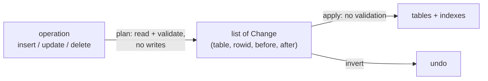

[🏠 Contents](index.md) · [← Previous: Chapter 7 — Query Primitives](07-query-primitives.md)

# Chapter 8 — Unit of Work I: Changes, Commit and Undo

Every `Database` write is now atomic *by itself*. Applications think in bigger units: "place an order" is one order row plus several item rows plus a stock update. If the third insert fails, the first two must disappear. That's **atomicity**, the A in ACID, at the scale of a *transaction*.

Martin Fowler's **Unit of Work** pattern describes the shape of the solution: an object that *"maintains a list of objects affected by a business transaction and coordinates the writing out of changes"* ([Fowler 2002](references.md#fowler2002)). You record what you want to do, then call `commit()`. Either everything happens or nothing does.

We'll build the Unit of Work twice. This chapter's version is simple: it records operations and replays them at commit, using an **undo log** to back out if something fails. Its limitations motivate the much more capable version in [Chapter 9](09-unit-of-work-ii.md). Before either can exist, though, we need a common language for "what a write did": the `Change`.

## 8.1 Changes: writes as data

Look back at [Chapter 6](06-referential-integrity.md)'s `delete`: it *planned* everything, then *applied* the plan. Let's make that split universal, and make the plan a plain list of values:

```python
Change(table="orders", rowid=7, before={...old row...}, after=None)   # a delete
```

A `Change` says: *in this table, the row with this rowid went from `before` to `after`.* `before=None` is an insert; `after=None` is a delete. That's enough to describe any write, and having writes as data unlocks a lot:

| Use | How | Chapter |
|---|---|---|
| Undo a change | swap `before` and `after` | this one |
| Stage changes without applying them | keep a list | [9](09-unit-of-work-ii.md) |
| Detect conflicts between transactions | compare `before` with the current row | [12](12-isolation.md) |
| Make changes durable | append them to a log file | [13](13-persistence.md) |



This is a deep refactoring: the validation logic moves out of `Table` and `Database` into a new module of *pure planning functions*. Planning reads the database state and returns changes; it never writes. Applying writes changes and never validates.

## 8.2 The planning module

The planners take a **state** argument, typed with the protocol `State`: any object with a `table(name)` method and a `foreign_keys` attribute. Today the only state is the `Database` itself. In [Chapter 9](09-unit-of-work-ii.md) a transaction's private view of the database will be a state too, and the same planners will work on it unchanged. That's the payoff of writing them against an interface instead of against `Database`.

The table objects they use are described by a second protocol, `TableLike`, which needs only a handful of members: `name`, `schema`, `row(rowid)`, `match(where)`, `lookup(key)`, `unique_keys()` and `new_rowid()`. Neither protocol is inherited by anything. `Database` and `Table` satisfy them just by having those members, and the type checker verifies it wherever a `Database` is passed as a `State`.

```python
# src/minidb/changes.py
"""Plan writes: turn operations into validated lists of :class:`Change`.

Planners read from a *state*, anything satisfying :class:`State`, and never
modify it. Applying the changes they return is someone else's job.
"""

from dataclasses import dataclass
from typing import TYPE_CHECKING
from typing import Literal
from typing import Protocol

from minidb.errors import ForeignKeyError
from minidb.errors import UniqueError

if TYPE_CHECKING:
    from collections.abc import Iterable
    from collections.abc import Mapping
    from collections.abc import Sequence

    from minidb.schema import ForeignKey
    from minidb.schema import TableSchema
    from minidb.table import Where
    from minidb.values import Row
    from minidb.values import Value

type RowRef = tuple[str, int]  # (table name, rowid)
type ChangeKind = Literal["insert", "update", "delete"]


class TableLike(Protocol):
    """Describe the table interface that planners use: a table, or a view of one."""

    name: str
    schema: TableSchema

    def row(self, rowid: int) -> Row:
        """Return the stored row itself; raise ``KeyError`` if it doesn't exist."""
        ...

    def match(self, where: Where = None) -> list[int]:
        """Return the rowids of the rows matching ``where``."""
        ...

    def lookup(self, key: Mapping[str, Value | None]) -> set[int]:
        """Return the rowids whose columns equal ``key``, through an index."""
        ...

    def unique_keys(self) -> list[tuple[str, ...]]:
        """Return the column tuples of every unique index."""
        ...

    def new_rowid(self) -> int:
        """Hand out a rowid that has never been used."""
        ...


class State(Protocol):
    """Describe what planners read from: a database, or a transaction's view of one."""

    @property
    def foreign_keys(self) -> Sequence[ForeignKey]:
        """Return every foreign key between the tables."""
        ...

    def table(self, name: str) -> TableLike:
        """Return the table called ``name``."""
        ...


@dataclass(frozen=True)
class Change:
    """Record that, in ``table``, row ``rowid`` went from ``before`` to ``after``.

    ``before=None`` describes an insert and ``after=None`` a delete.

    >>> c = Change("t", 7, None, {"n": 1})
    >>> c.kind, c.inverted().kind
    ('insert', 'delete')

    :param table: the table's name.
    :param rowid: the row's rowid.
    :param before: the row before the change, or ``None`` if it didn't exist.
    :param after: the row after the change, or ``None`` if it no longer exists.
    """

    table: str
    rowid: int
    before: Row | None
    after: Row | None

    @property
    def kind(self) -> ChangeKind:
        """Return ``"insert"``, ``"update"`` or ``"delete"``."""
        if self.before is None:
            return "insert"
        return "delete" if self.after is None else "update"

    def inverted(self) -> Change:
        """Return the change that undoes this one.

        :return: the same change with ``before`` and ``after`` swapped.
        """
        return Change(self.table, self.rowid, self.after, self.before)


# -- the three operations ----------------------------------------------------------------
def plan_insert(state: State, table: str, values: Mapping[str, object]) -> list[Change]:
    """Plan inserting one row.

    :param state: where to read the current data.
    :param table: the table's name.
    :param values: the new row's values, by column name.
    :return: the single insert change, with a newly allocated rowid.
    :raises ConstraintError: if the row breaks a constraint.
    """
    t = state.table(table)
    row = t.schema.prepare_row(values)
    check_unique(t, [(None, row)])
    check_parents_exist(state, t, [row])
    return [Change(table, t.new_rowid(), None, row)]


def plan_update(state: State, table: str, changes: Mapping[str, object], where: Where = None) -> list[Change]:
    """Plan setting ``changes`` on every row matching ``where``.

    :param state: where to read the current data.
    :param table: the table's name.
    :param changes: the new values, by column name.
    :param where: which rows change; ``None`` (the default) for all.
    :return: one update change per matching row.
    :raises ConstraintError: if a new row breaks a constraint.
    """
    t = state.table(table)
    old = {rid: t.row(rid) for rid in t.match(where)}
    new = {rid: t.schema.prepare_row(changes, base=row) for rid, row in old.items()}
    check_unique(t, list(new.items()))
    check_parents_exist(state, t, new.values())
    check_no_orphans(state, t, old, new)
    return [Change(table, rid, old[rid], new[rid]) for rid in new]


def plan_delete(state: State, table: str, where: Where = None) -> list[Change]:
    """Plan a delete and everything it implies: cascades and SET NULL updates.

    :param state: where to read the current data.
    :param table: the table's name.
    :param where: which rows go; ``None`` (the default) for all.
    :return: the delete changes, followed by any SET NULL updates.
    :raises ForeignKeyError: if a ``restrict`` reference forbids the delete.
    :raises ConstraintError: if a ``set null`` makes a row invalid.
    """
    deleted = _cascade(state, table, state.table(table).match(where))
    nulled = _nulled_children(state, deleted)
    return [Change(n, rid, row, None) for (n, rid), row in deleted.items()] + [
        Change(n, rid, b, a) for (n, rid), (b, a) in nulled.items()
    ]


def _cascade(state: State, table: str, rowids: Iterable[int]) -> dict[RowRef, Row]:
    """Collect the rows to delete, following ON DELETE CASCADE transitively."""
    deleted: dict[RowRef, Row] = {}
    stack = [(table, rid) for rid in rowids]
    while stack:
        ref = stack.pop()
        if ref in deleted:
            continue  # cycles and diamonds
        row = deleted[ref] = state.table(ref[0]).row(ref[1])
        for fk in references_to(state, ref[0]):
            if fk.on_delete == "cascade":
                stack.extend((fk.table, c) for c in children(state, fk, row))
    return deleted


def _nulled_children(state: State, deleted: dict[RowRef, Row]) -> dict[RowRef, tuple[Row, Row]]:
    """Restrict or null every child that survives the cascade."""
    nulled: dict[RowRef, tuple[Row, Row]] = {}
    for (name, _), row in deleted.items():
        for fk in references_to(state, name):
            survivors = [c for c in children(state, fk, row) if (fk.table, c) not in deleted]
            if survivors:
                _restrict_or_null(state, fk, row, survivors, nulled)
    return nulled


def _restrict_or_null(
    state: State, fk: ForeignKey, parent_row: Row, survivors: list[int], nulled: dict[RowRef, tuple[Row, Row]]
) -> None:
    if fk.on_delete == "restrict":
        raise ForeignKeyError(
            f"{fk.name}: {fk.ref_table} row {fk.child_key(parent_row)} is still "
            f"referenced by {len(survivors)} {fk.table} row(s)"
        )
    child = state.table(fk.table)
    for c in survivors:
        before = child.row(c)
        base = nulled.get((fk.table, c), (before, before))[1]
        nulled[fk.table, c] = (before, child.schema.prepare_row(dict.fromkeys(fk.columns), base=base))


# -- constraint checks ---------------------------------------------------------------------
def check_unique(t: TableLike, batch: list[tuple[int | None, Row]]) -> None:
    """Check that no two rows would share a unique key after applying ``batch``.

    :param t: the table.
    :param batch: pairs of a rowid (``None`` for a new row) and the row it
        will hold.
    :raises UniqueError: if two rows would share a unique key.
    """
    changing = {rid for rid, _ in batch if rid is not None}
    for columns in t.unique_keys():
        _check_unique_key(t, columns, batch, changing)


def _check_unique_key(
    t: TableLike, columns: tuple[str, ...], batch: list[tuple[int | None, Row]], changing: set[int]
) -> None:
    seen: set[tuple[Value | None, ...]] = set()
    for _, row in batch:
        key = tuple(row[c] for c in columns)
        if any(v is None for v in key):
            continue
        if key in seen or t.lookup(dict(zip(columns, key, strict=True))) - changing:
            shown = ", ".join(f"{c}={v!r}" for c, v in zip(columns, key, strict=True))
            raise UniqueError(f"{t.name}: duplicate key ({shown})")
        seen.add(key)


def references_from(state: State, table: str) -> list[ForeignKey]:
    """Return the foreign keys of ``table`` (where it is the child).

    :param state: the database or view.
    :param table: the table's name.
    :return: the foreign keys declared on ``table``.
    """
    return [fk for fk in state.foreign_keys if fk.table == table]


def references_to(state: State, table: str) -> list[ForeignKey]:
    """Return the foreign keys that reference ``table`` (where it is the parent).

    :param state: the database or view.
    :param table: the table's name.
    :return: the foreign keys pointing at ``table``.
    """
    return [fk for fk in state.foreign_keys if fk.ref_table == table]


def children(state: State, fk: ForeignKey, parent_row: Row) -> set[int]:
    """Return the rowids of the rows that reference ``parent_row`` through ``fk``.

    :param state: the database or view.
    :param fk: the foreign key.
    :param parent_row: a row of the referenced table.
    :return: the referencing rowids in the child table.
    """
    return state.table(fk.table).lookup(fk.child_key(parent_row))


def check_parents_exist(
    state: State, child: TableLike, rows: Iterable[Row], fks: Sequence[ForeignKey] | None = None
) -> None:
    """Check, from the child side, that every non-NULL reference finds its parent.

    :param state: the database or view.
    :param child: the referencing table.
    :param rows: the rows to check.
    :param fks: the foreign keys to check; ``None`` (the default) for all of
        ``child``'s.
    :raises ForeignKeyError: if a reference points at nothing.
    """
    for fk in fks if fks is not None else references_from(state, child.name):
        parent = state.table(fk.ref_table)
        for row in rows:
            key = fk.parent_key(row)
            if key is not None and not parent.lookup(key):
                raise ForeignKeyError(f"{fk.name}: no {parent.name} row with {key}")


def check_no_orphans(state: State, parent: TableLike, old: dict[int, Row], new: dict[int, Row]) -> None:
    """Check, from the parent side of an update, that no referenced key changes.

    :param state: the database or view.
    :param parent: the table being updated.
    :param old: the rows before the update, by rowid.
    :param new: the rows after the update, by rowid.
    :raises ForeignKeyError: if a changed key is still referenced.
    """
    for fk in references_to(state, parent.name):
        for rid, before in old.items():
            if fk.child_key(before) != fk.child_key(new[rid]) and children(state, fk, before):
                raise ForeignKeyError(
                    f"{fk.name}: cannot change {parent.name} key {fk.child_key(before)}, it is still referenced"
                )
```

This is mostly code you've seen, moved and lightly reshaped. Three things changed:

- **`check_unique` is written in terms of `t.lookup` and `t.unique_keys()`** instead of reaching into index objects. Any table-like object with those methods can be checked.
- **`plan_delete` returns `Change`s**, including the `before` row of each SET NULL update. Undo will need it.
- **The unique-violation message no longer names the index**, because the planner now works with column lists rather than index objects.

## 8.3 A slimmer `Table`

With validation gone, `Table` is storage plus indexes: the primitives `put`/`remove`, lookups and reads. Its old write operations are deleted.

```python
# src/minidb/table.py
"""Store the rows of one table in memory, together with its indexes.

A table does no validation: see :mod:`minidb.changes` for that. It offers
the two write primitives, :meth:`Table.put` and :meth:`Table.remove`, and
reads.
"""

from types import MappingProxyType
from typing import TYPE_CHECKING

from minidb.errors import SchemaError
from minidb.errors import UniqueError
from minidb.index import HashIndex

if TYPE_CHECKING:
    from collections.abc import Callable
    from collections.abc import Iterable
    from collections.abc import Iterator
    from collections.abc import Mapping

    from minidb.index import Index
    from minidb.schema import TableSchema
    from minidb.values import Row
    from minidb.values import Value

type Predicate = Callable[[Mapping[str, Value | None]], object]
type Where = Predicate | Mapping[str, object] | None


class Table:
    """Hold the rows of one table, keyed by rowid, and keep its indexes in step.

    >>> from minidb.schema import Column, TableSchema
    >>> from minidb.types import Integer
    >>> t = Table(TableSchema("t", (Column("id", Integer()),), primary_key=("id",)))
    >>> t.put(t.new_rowid(), {"id": 5})
    >>> t.lookup({"id": 5})
    {1}

    :param schema: the table's declaration.
    """

    def __init__(self, schema: TableSchema) -> None:
        self.schema = schema
        self.name = schema.name
        self.columns = schema.column_names
        self.rows: dict[int, Row] = {}
        self.indexes: dict[str, Index] = {}
        self._next_rowid = 1
        if schema.primary_key:
            self.create_index("pk", schema.primary_key, unique=True)
        for cols in schema.unique:
            self.create_index("unique_" + "_".join(cols), cols, unique=True)

    def __len__(self) -> int:
        return len(self.rows)

    # -- indexes ------------------------------------------------------------------
    def create_index(self, name: str, columns: Iterable[str], *, unique: bool = False) -> Index:
        """Create an index over the existing rows, and maintain it from now on.

        :param name: the index's name.
        :param columns: the indexed columns, in key order.
        :param unique: whether to refuse duplicate keys; ``False`` by default.
        :return: the new index.
        :raises SchemaError: if the name is taken or a column is unknown.
        :raises UniqueError: if ``unique`` and existing rows share a key.
        """
        if name in self.indexes:
            raise SchemaError(f"{self.name}: index {name!r} already exists")
        columns = tuple(columns)
        for c in columns:
            self.schema.column(c)
        index = HashIndex(name, columns, unique=unique)
        for rowid, row in self.rows.items():
            key = index.key_of(row)
            if unique and key is not None and index.lookup(key):
                raise UniqueError(f"{self.name}: cannot create unique index {name!r}: duplicate key {key}")
            index.add(rowid, row)
        self.indexes[name] = index
        return index

    def index_on(self, columns: Iterable[str]) -> Index | None:
        """Return an index on exactly these columns, in any order, or ``None``.

        :param columns: the columns the index must cover.
        :return: such an index, or ``None``.
        """
        wanted = set(columns)
        return next((i for i in self.indexes.values() if set(i.columns) == wanted), None)

    def unique_keys(self) -> list[tuple[str, ...]]:
        """Return the column tuples of every unique index.

        :return: one tuple of column names per unique index.
        """
        return [i.columns for i in self.indexes.values() if i.unique]

    # -- primitives: no validation ---------------------------------------------------
    def put(self, rowid: int, row: Row) -> None:
        """Store ``row`` at ``rowid``, replacing any old row, and update every index.

        :param rowid: where to store the row.
        :param row: the row, already validated.
        """
        old = self.rows.get(rowid)
        for index in self.indexes.values():
            if old is not None:
                index.remove(rowid, old)
            index.add(rowid, row)
        self.rows[rowid] = row

    def remove(self, rowid: int) -> None:
        """Delete the row at ``rowid`` and its index entries.

        :param rowid: the row to delete.
        :raises KeyError: if there is no such row.
        """
        old = self.rows.pop(rowid)
        for index in self.indexes.values():
            index.remove(rowid, old)

    def new_rowid(self) -> int:
        """Hand out the next rowid; rowids are never reused.

        :return: a rowid no row has ever had.
        """
        rowid = self._next_rowid
        self._next_rowid += 1
        return rowid

    # -- reads -------------------------------------------------------------------------
    def row(self, rowid: int) -> Row:
        """Return the stored row itself; callers must never mutate it.

        :param rowid: the row to fetch.
        :return: the stored row.
        :raises KeyError: if there is no such row.
        """
        return self.rows[rowid]

    def get(self, rowid: int) -> Row | None:
        """Return a copy of the row with ``rowid``, or ``None`` if there is none.

        :param rowid: the row to fetch.
        :return: a copy of the row, or ``None``.
        """
        row = self.rows.get(rowid)
        return dict(row) if row is not None else None

    def scan(self) -> Iterator[tuple[int, Row]]:
        """Yield every ``(rowid, row)`` pair, each row a fresh copy.

        :return: an iterator over the table, in insertion order.
        """
        for rowid, row in self.rows.items():
            yield rowid, dict(row)

    def lookup(self, key: Mapping[str, Value | None]) -> set[int]:
        """Return the rowids whose columns equal ``key``, through an index.

        :param key: ``{column: value}``; the order of the columns doesn't matter.
        :return: the matching rowids, as a new set.
        :raises SchemaError: if no index covers exactly these columns.
        """
        index = self.index_on(key)
        if index is None:
            raise SchemaError(f"{self.name}: no index on {sorted(key)}")
        return index.lookup(tuple(key[c] for c in index.columns))

    def match(self, where: Where = None) -> list[int]:
        """Return the rowids of the rows matching ``where``.

        :param where: ``None`` (the default) for every row; a predicate,
            which sees each row through a read-only view; or a dict of
            ``column: value`` equalities, which can use an index.
        :return: the matching rowids.
        :raises SchemaError: if a dict names an unknown column.
        :raises DomainError: if a dict value doesn't fit its column's type.
        """
        if where is None:
            return list(self.rows)
        if callable(where):
            return [rid for rid, row in self.rows.items() if where(MappingProxyType(row))]
        return self._match_equal(where)

    def _match_equal(self, equal: Mapping[str, object]) -> list[int]:
        """Find rows by equalities, through the index covering most of the columns."""
        wanted = {c: self.schema.column(c).prepare(v) for c, v in equal.items()}
        best = max(
            (i for i in self.indexes.values() if set(i.columns) <= set(wanted)),
            key=lambda i: len(i.columns),
            default=None,
        )
        if best is not None:
            candidates: Iterable[int] = best.lookup(tuple(wanted[c] for c in best.columns))
        else:
            candidates = self.rows.keys()
        return [rid for rid in candidates if all(self.rows[rid][c] == v and v is not None for c, v in wanted.items())]

    def select(self, where: Where = None) -> list[Row]:
        """Return copies of the rows matching ``where``; see :meth:`match`.

        :param where: which rows to return; ``None`` (the default) for all.
        :return: the matching rows.
        """
        return [dict(self.rows[rid]) for rid in self.match(where)]
```

## 8.4 `Database`: plan, then apply

Every write in `Database` is now two lines: plan, then apply. `apply` is the *only* code that writes to tables. That matters a great deal in [Chapter 13](13-persistence.md), where every applied change must also reach the log.

```python
# src/minidb/database.py
"""Provide the public entry point: tables, cross-table constraints and CRUD.

Every write is planned first (:mod:`minidb.changes`) and then applied by
:meth:`Database.apply`, the only method that modifies tables.
"""

from dataclasses import replace
from typing import TYPE_CHECKING

from minidb import changes as ch
from minidb.errors import DatabaseError
from minidb.errors import SchemaError
from minidb.query import Query
from minidb.schema import TableSchema
from minidb.schema import as_key
from minidb.table import Table
from minidb.uow import UnitOfWork

if TYPE_CHECKING:
    from collections.abc import Mapping
    from collections.abc import Sequence

    from minidb.changes import Change
    from minidb.schema import Check
    from minidb.schema import Column
    from minidb.schema import ForeignKey
    from minidb.table import Where
    from minidb.values import Row


class Database:
    """Hold tables and the foreign keys between them, and run CRUD on them."""

    def __init__(self) -> None:
        self.tables: dict[str, Table] = {}
        self.foreign_keys: list[ForeignKey] = []

    # -- schema --------------------------------------------------------------------
    def create_table(
        self,
        name: str,
        columns: Sequence[Column],
        *,
        primary_key: str | Sequence[str] = (),
        unique: Sequence[str | Sequence[str]] = (),
        checks: Sequence[Check] = (),
        foreign_keys: Sequence[ForeignKey] = (),
    ) -> Table:
        """Create an empty table and return it; all or nothing.

        >>> from minidb.schema import Column
        >>> from minidb.types import Integer
        >>> db = Database()
        >>> db.create_table("t", [Column("id", Integer())], primary_key="id").name
        't'

        :param name: the new table's name.
        :param columns: its columns, in order.
        :param primary_key: the primary-key column or columns; none by default.
        :param unique: the columns of each UNIQUE constraint; none by default.
        :param checks: its row-level CHECK constraints; none by default.
        :param foreign_keys: its references to other tables; none by default.
        :return: the new table.
        :raises SchemaError: if the table already exists, or the definition
            is invalid.
        """
        if name in self.tables:
            raise SchemaError(f"table {name!r} already exists")
        schema = TableSchema(name, tuple(columns), tuple(checks), as_key(primary_key), tuple(as_key(u) for u in unique))
        table = self.tables[name] = Table(schema)
        try:
            for fk in foreign_keys:
                self._add_foreign_key(replace(fk, table=name))
        except DatabaseError:
            self._forget_table(name)
            raise
        return table

    def _forget_table(self, name: str) -> None:
        del self.tables[name]
        self.foreign_keys = [f for f in self.foreign_keys if f.table != name]

    def _add_foreign_key(self, fk: ForeignKey) -> None:
        """Validate ``fk`` against both tables and the existing data, then register it."""
        child, parent = self.table(fk.table), self.table(fk.ref_table)
        if not fk.ref_columns:
            if not parent.schema.primary_key:
                raise SchemaError(f"{parent.name} has no primary key to reference")
            fk = replace(fk, ref_columns=parent.schema.primary_key)
        self._check_fk_columns(fk, child, parent)
        if child.index_on(fk.columns) is None:
            child.create_index(fk.name, fk.columns)
        ch.check_parents_exist(self, child, child.rows.values(), [fk])
        self.foreign_keys.append(fk)

    @staticmethod
    def _check_fk_columns(fk: ForeignKey, child: Table, parent: Table) -> None:
        """Check that ``fk`` pairs columns of the same types and targets a key."""
        if len(fk.columns) != len(fk.ref_columns):
            raise SchemaError(f"{fk.name}: column count mismatch")
        for c, r in zip(fk.columns, fk.ref_columns, strict=True):
            if type(child.schema.column(c).type) is not type(parent.schema.column(r).type):
                raise SchemaError(f"{fk.name}: {c} and {parent.name}.{r} differ in type")
        target = parent.index_on(fk.ref_columns)
        if target is None or not target.unique:
            raise SchemaError(f"{fk.name}: {parent.name}{fk.ref_columns} is not a key")

    def drop_table(self, name: str) -> None:
        """Delete a table that no other table references.

        :param name: the table to delete.
        :raises SchemaError: if there is no such table, or another table
            references it.
        """
        self.table(name)
        if any(fk.ref_table == name and fk.table != name for fk in self.foreign_keys):
            raise SchemaError(f"{name!r} is referenced by a foreign key")
        self._forget_table(name)

    def table(self, name: str) -> Table:
        """Return the table called ``name``.

        :param name: the table's name.
        :return: the table.
        :raises SchemaError: if there is no such table.
        """
        try:
            return self.tables[name]
        except KeyError:
            raise SchemaError(f"no such table: {name!r}") from None

    def create_index(self, table: str, name: str, columns: Sequence[str], *, unique: bool = False) -> None:
        """Create an index on ``table``; see :meth:`Table.create_index`.

        :param table: the table's name.
        :param name: the index's name.
        :param columns: the indexed columns, in key order.
        :param unique: whether to refuse duplicate keys; ``False`` by default.
        """
        self.table(table).create_index(name, columns, unique=unique)

    # -- reads ---------------------------------------------------------------------
    def get(self, table: str, rowid: int) -> Row | None:
        """Return a copy of one row, or ``None``; see :meth:`Table.get`.

        :param table: the table's name.
        :param rowid: the row to fetch.
        :return: the row, or ``None``.
        """
        return self.table(table).get(rowid)

    def select(self, table: str, where: Where = None) -> list[Row]:
        """Return the rows of ``table`` matching ``where``; see :meth:`Table.match`.

        :param table: the table's name.
        :param where: a predicate, a dict of equalities, or ``None`` for all rows.
        :return: copies of the matching rows.
        """
        return self.table(table).select(where)

    def query(self, table: str, alias: str | None = None) -> Query:
        """Start a query on ``table``; see :class:`Query`.

        :param table: the first table.
        :param alias: its alias; ``None`` (the default) uses its name.
        :return: a query to extend and run.
        """
        return Query(self, table, alias)

    # -- writes ----------------------------------------------------------------------
    def insert(self, table: str, values: Mapping[str, object]) -> int:
        """Insert a row; see :func:`minidb.changes.plan_insert`.

        :param table: the table's name.
        :param values: the new row's values, by column name.
        :return: the new rowid.
        """
        changes = ch.plan_insert(self, table, values)
        self.apply(changes)
        return changes[0].rowid

    def update(self, table: str, changes: Mapping[str, object], where: Where = None) -> int:
        """Update rows; see :func:`minidb.changes.plan_update`.

        :param table: the table's name.
        :param changes: the new values, by column name.
        :param where: a predicate, a dict of equalities, or ``None`` for all rows.
        :return: the number of rows changed.
        """
        planned = ch.plan_update(self, table, changes, where)
        self.apply(planned)
        return len(planned)

    def delete(self, table: str, where: Where = None) -> int:
        """Delete rows and their cascades; see :func:`minidb.changes.plan_delete`.

        :param table: the table's name.
        :param where: a predicate, a dict of equalities, or ``None`` for all rows.
        :return: the number of rows deleted from ``table`` itself.
        """
        planned = ch.plan_delete(self, table, where)
        self.apply(planned)
        return sum(1 for c in planned if c.table == table and c.kind == "delete")

    def apply(self, changes: Sequence[Change]) -> None:
        """Write already-validated changes; the only method that modifies tables.

        :param changes: the changes to write, in order.
        """
        for c in changes:
            if c.after is None:
                self.tables[c.table].remove(c.rowid)
            else:
                self.tables[c.table].put(c.rowid, c.after)

    def unit_of_work(self) -> UnitOfWork:
        """Start a transaction; see :class:`UnitOfWork`.

        :return: a new, active unit of work.
        """
        return UnitOfWork(self)
```

`unit_of_work` returns a `UnitOfWork`, defined in a new module below.


## 8.5 The Unit of Work, version 1

Our first Unit of Work is a **command log**. Calls to `insert`, `update` and `delete` don't touch the database. Each one appends a small function to a list, a closure that will plan the operation when called. `commit()` plans and applies each operation in order, and records every applied change in an **undo log**. If any operation fails, the undo log is applied *in reverse*, with every change inverted, and the error is re-raised.


```python
# src/minidb/uow.py
"""Group writes into an all-or-nothing transaction: the Unit of Work."""

from typing import TYPE_CHECKING
from typing import Self

from minidb import changes as ch
from minidb.errors import DatabaseError

if TYPE_CHECKING:
    from collections.abc import Callable
    from collections.abc import Mapping
    from types import TracebackType

    from minidb.changes import Change
    from minidb.database import Database
    from minidb.table import Where


class TransactionError(DatabaseError):
    """Signal that a unit of work was used in the wrong state, e.g. after commit."""


class UnitOfWork:
    """Record writes, and replay them all at commit, undoing them if one fails.

    Version 1: a command log plus an undo log. Nothing reaches the database
    until :meth:`commit`.

    :param db: the database to write to.
    """

    def __init__(self, db: Database) -> None:
        self.db = db
        self.state = "active"
        self._pending: list[Callable[[], list[Change]]] = []

    # -- recording -------------------------------------------------------------------
    def insert(self, table: str, values: Mapping[str, object]) -> None:
        """Record an insert, to be planned and applied at commit.

        :param table: the table's name.
        :param values: the new row's values, by column name.
        :raises TransactionError: if the unit of work is no longer active.
        """
        self._record(lambda: ch.plan_insert(self.db, table, values))

    def update(self, table: str, changes: Mapping[str, object], where: Where = None) -> None:
        """Record an update, to be planned and applied at commit.

        :param table: the table's name.
        :param changes: the new values, by column name.
        :param where: which rows change; ``None`` (the default) for all.
        :raises TransactionError: if the unit of work is no longer active.
        """
        self._record(lambda: ch.plan_update(self.db, table, changes, where))

    def delete(self, table: str, where: Where = None) -> None:
        """Record a delete, to be planned and applied at commit.

        :param table: the table's name.
        :param where: which rows go; ``None`` (the default) for all.
        :raises TransactionError: if the unit of work is no longer active.
        """
        self._record(lambda: ch.plan_delete(self.db, table, where))

    def _record(self, plan: Callable[[], list[Change]]) -> None:
        self._require_active()
        self._pending.append(plan)

    # -- finishing -------------------------------------------------------------------
    def commit(self) -> None:
        """Plan and apply every recorded operation, in order, or none of them.

        Each applied change is kept in an undo log. If any operation fails,
        the undo log is applied in reverse, with every change inverted, and
        the error is re-raised.

        :raises TransactionError: if the unit of work is no longer active.
        :raises DatabaseError: whatever made an operation fail.
        """
        self._require_active()
        undo: list[Change] = []
        try:
            for plan in self._pending:
                changes = plan()
                self.db.apply(changes)
                undo.extend(changes)
        except BaseException:
            self.db.apply([c.inverted() for c in reversed(undo)])
            self.state = "rolled back"
            raise
        self.state = "committed"

    def rollback(self) -> None:
        """Discard every recorded operation.

        :raises TransactionError: if the unit of work is no longer active.
        """
        self._require_active()
        self._pending.clear()
        self.state = "rolled back"

    def _require_active(self) -> None:
        if self.state != "active":
            raise TransactionError(f"unit of work is already {self.state}")

    # -- context manager: commit on success, roll back on error -------------------------
    def __enter__(self) -> Self:
        return self

    def __exit__(
        self, exc_type: type[BaseException] | None, exc: BaseException | None, tb: TracebackType | None
    ) -> None:
        if self.state != "active":
            return
        if exc_type is None:
            self.commit()
        else:
            self.rollback()
```

```python
# src/minidb/__init__.py (replace __all__)
__all__ = [
    "Avg",
    "Boolean",
    "Change",
    "Check",
    "CheckError",
    "Column",
    "ConstraintError",
    "Count",
    "Database",
    "DatabaseError",
    "Date",
    "DomainError",
    "ForeignKey",
    "ForeignKeyError",
    "Integer",
    "Max",
    "Min",
    "NotNullError",
    "Numeric",
    "Query",
    "Real",
    "SchemaError",
    "Sum",
    "TableSchema",
    "Text",
    "Timestamp",
    "TransactionError",
    "UniqueError",
    "UnitOfWork",
    "normalizers",
]
```

```python
# src/minidb/__init__.py (imports)
from minidb.changes import Change
from minidb.uow import TransactionError
from minidb.uow import UnitOfWork
```

Why is undo correct? Each `Change` holds the complete before and after rows, and `apply` uses only `put` and `remove`. Inverting an insert gives a delete of that rowid. Inverting a delete puts the old row back *at its old rowid*, and `put` re-adds it to every index. Inverting an update puts the old row back. Undoing in reverse order matters when one transaction touches the same row twice: we must restore the oldest `before`, so it has to be applied last.

Why catch `BaseException`, not `Exception`? A `KeyboardInterrupt` arriving halfway through `commit` must also be rolled back. Otherwise a Ctrl-C at the wrong moment leaves half a transaction in place.

## 8.6 Trying it out

```python
>>> from minidb import *
>>> db = Database()
>>> _ = db.create_table("products", [Column("sku", Text()), Column("stock", Integer(min=0))],
...                     primary_key="sku")
>>> _ = db.create_table("orders", [Column("id", Integer())], primary_key="id")
>>> _ = db.create_table("items", [Column("order_id", Integer()), Column("sku", Text()),
...                               Column("qty", Integer(min=1))],
...     primary_key=("order_id", "sku"),
...     foreign_keys=[ForeignKey("order_id", "orders", on_delete="cascade"),
...                   ForeignKey("sku", "products")])
>>> _ = db.insert("products", {"sku": "TEA", "stock": 10})
>>> with db.unit_of_work() as uow:
...     uow.insert("orders", {"id": 1})
...     uow.insert("items", {"order_id": 1, "sku": "TEA", "qty": 3})
...     uow.update("products", {"stock": 7}, where={"sku": "TEA"})
>>> db.select("products"), len(db.select("items"))
([{'sku': 'TEA', 'stock': 7}], 1)
```

Now a transaction that fails in its third step:

```python
>>> with db.unit_of_work() as uow:
...     uow.insert("orders", {"id": 2})
...     uow.insert("items", {"order_id": 2, "sku": "TEA", "qty": 1})
...     uow.insert("items", {"order_id": 2, "sku": "COFFEE", "qty": 1})   # no such product
Traceback (most recent call last):
  ...
minidb.errors.ForeignKeyError: fk_items_sku: no products row with {'sku': 'COFFEE'}
>>> [r["id"] for r in db.select("orders")]          # order 2 was undone
[1]
>>> uow.state
'rolled back'
```

The undo log also handles deletes with cascades:

```python
>>> uow = db.unit_of_work()
>>> uow.delete("orders", {"id": 1})                 # cascades to its item
>>> uow.update("products", {"stock": -1})           # violates min=0
>>> uow.commit()
Traceback (most recent call last):
  ...
minidb.errors.DomainError: products.stock: -1 is not a valid Integer(min=0, max=None): below minimum 0
>>> len(db.select("orders")), len(db.select("items"))   # both restored
(1, 1)
```

## 8.7 What's wrong with version 1

It works, and it's honest about how many systems implement atomicity: apply changes in place, keep enough information to undo them. (Real engines write that undo information to disk, so they can roll back even after a crash. ARIES is the classic design ([Mohan et al. 1992](references.md#mohan1992)).) Used through an API, though, version 1 has real problems:

1. **You can't read your own writes.** Inside the `with` block, a query doesn't see the order you just "inserted". It only exists in `_pending`. Any logic that depends on earlier steps ("insert an order, then compute its total from its items") is impossible.
2. **Errors arrive late and far from their cause.** A typo in step 1 is reported at `commit()`. The traceback points at the commit, not at the line that recorded the bad insert.
3. **No rowids.** `uow.insert` can't return the new row's rowid, because it hasn't been planned yet.
4. **Constraints are still checked statement by statement.** Two rows that reference each other still can't be inserted, because the first one fails its foreign-key check before the second exists.
5. **During `commit`, the database is temporarily inconsistent.** Between applying step 1 and undoing it, the half-finished transaction is visible to everyone. Today nobody else is looking, but [Chapter 10](10-concurrency-i.md) adds threads.

[Chapter 9](09-unit-of-work-ii.md) fixes the first four by inverting the design: changes are planned *immediately* into a private workspace, and the shared database isn't touched until commit. The fifth needs locks.

## Questions and exercises

1. Prove (informally) that applying `[c.inverted() for c in reversed(undo)]` restores the original state, even when the same row is changed several times in one transaction. What property of `Change` does your argument rely on?
2. The undo itself calls `db.apply`. Could *that* fail? Under what circumstances? What should happen if it does?
3. `rollback()` on version 1 is trivial. Why? Will it stay trivial in [Chapter 9](09-unit-of-work-ii.md)?
4. Rowids consumed by a rolled-back transaction are lost. Is that a problem? PostgreSQL sequences behave the same way. Why do they not roll back?
5. Add **savepoints**: `sp = uow.savepoint()` records a position in `_pending`, and `uow.rollback_to(sp)` discards later operations. Then think about how you'd implement them in a design where changes are applied immediately.
6. `Change` is a frozen dataclass holding dicts, which are mutable. Is `Change` really immutable? Does it matter, given the rule from [§2.3](02-tables-and-crud.md#updates-replace-the-row)?
7. *(Design)* Our command log stores *operations* (`update where sku = 'TEA'`). The undo log stores *effects* (`row 7: before → after`). Which would you replicate to a second server, and why? Look up "statement-based" vs "row-based" replication in MySQL.

*Answers: [Appendix D, Chapter 8](appendix-d-answers.md#chapter-8--the-unit-of-work-version-1).*

---

[🏠 Contents](index.md) · [Next: Chapter 9 — Unit of Work II →](09-unit-of-work-ii.md)
