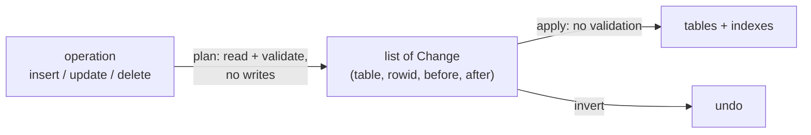
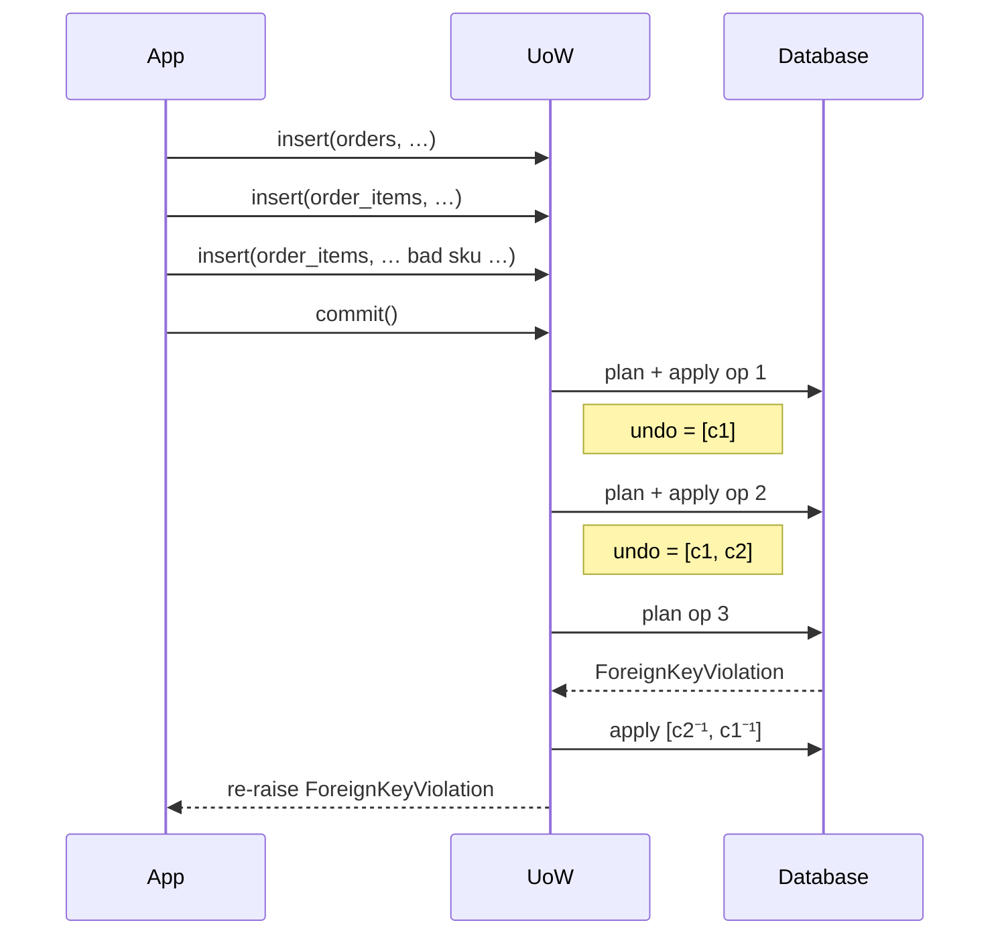

[🏠 Contents](index.md) · [← Previous: Chapter 7 — Query Primitives](07-query-primitives.md)

# Chapter 8 — Unit of Work I: Changes, Commit and Undo

Every `Database` write is now atomic *by itself*. Applications think in bigger units: "place an order" is one order row plus several item rows plus a stock update. If the third insert fails, the first two must disappear. That's **atomicity**, the A in ACID, at the scale of a *transaction*.

Martin Fowler's **Unit of Work** pattern describes the shape of the solution: an object that *"maintains a list of objects affected by a business transaction and coordinates the writing out of changes"* ([Fowler 2002](references.md#fowler2002)). You record what you want to do, then call `commit()`. Either everything happens or nothing does.

We'll build the Unit of Work twice. This chapter's version is simple: it records operations and replays them at commit, using an **undo log** to back out if something fails. Its limitations motivate the much more capable version in [Chapter 9](09-unit-of-work-ii.md). Before either can exist, though, we need a common language for "what a write did": the `Change`.

## 8.1 Changes: writes as data

Look back at [Chapter 6](06-referential-integrity.md)'s `delete`: it *planned* everything, then *applied* the plan. Let's make that split universal, and make the plan a plain list of values:

```python
Change(table="orders", rowid=7, before={...old row...}, after=None)   # a delete
```

A `Change` says: *in this table, the row with this rowid went from `before` to `after`.* `before=None` is an insert; `after=None` is a delete. That's enough to describe any write, and having writes as data unlocks a lot:

| Use | How | Chapter |
|---|---|---|
| Undo a change | swap `before` and `after` | this one |
| Stage changes without applying them | keep a list | [9](09-unit-of-work-ii.md) |
| Detect conflicts between transactions | compare `before` with the current row | [12](12-isolation.md) |
| Make changes durable | append them to a log file | [13](13-persistence.md) |



This is a deep refactoring: the validation logic moves out of `Table` and `Database` into a new module of *pure planning functions*. Planning reads the database state and returns changes; it never writes. Applying writes changes and never validates.

## 8.2 The planning module

The planners take a **state** argument: any object with a `table(name)` method and a `foreign_keys` list. Today the only state is the `Database` itself. In [Chapter 9](09-unit-of-work-ii.md) a transaction's private view of the database will be a state too, and the same planners will work on it unchanged. That's the payoff of writing them against an interface instead of against `Database`.

The table objects they use need only a handful of methods: `schema`, `row(rowid)`, `match(where)`, `lookup(key)`, `unique_keys()` and `new_rowid()`.

```python
# minidb/changes.py
"""Planning writes: turn operations into validated lists of Changes.

Planners read from a *state* (anything with .table(name) and
.foreign_keys) and never modify it.
"""
from collections.abc import Iterable, Mapping
from dataclasses import dataclass

from minidb.errors import ForeignKeyViolation, UniqueViolation
from minidb.schema import ForeignKey

type Row = dict[str, object]


@dataclass(frozen=True)
class Change:
    """In `table`, row `rowid` went from `before` to `after` (None = absent)."""
    table: str
    rowid: int
    before: Row | None
    after: Row | None

    @property
    def kind(self) -> str:
        if self.before is None:
            return "insert"
        return "delete" if self.after is None else "update"

    def inverted(self) -> "Change":
        return Change(self.table, self.rowid, self.after, self.before)


# -- the three operations --------------------------------------------------------------
def plan_insert(state, table: str, values: Mapping[str, object]) -> list[Change]:
    t = state.table(table)
    row = t.schema.prepare_row(values)
    check_unique(t, [(None, row)])
    check_parents_exist(state, t, [row])
    return [Change(table, t.new_rowid(), None, row)]


def plan_update(state, table: str, changes: Mapping[str, object],
                where=None) -> list[Change]:
    t = state.table(table)
    old = {rid: t.row(rid) for rid in t.match(where)}
    new = {rid: t.schema.prepare_row(changes, base=row) for rid, row in old.items()}
    check_unique(t, list(new.items()))
    check_parents_exist(state, t, new.values())
    check_no_orphans(state, t, old, new)
    return [Change(table, rid, old[rid], new[rid]) for rid in new]


def plan_delete(state, table: str, where=None) -> list[Change]:
    """A delete and everything it implies (cascades, SET NULL), or raise."""
    t = state.table(table)
    # 1. follow ON DELETE CASCADE transitively
    deleted: dict[tuple[str, int], Row] = {}
    stack = [(table, rid) for rid in t.match(where)]
    while stack:
        name, rid = stack.pop()
        if (name, rid) in deleted:
            continue
        row = deleted[(name, rid)] = state.table(name).row(rid)
        for fk in references_to(state, name):
            if fk.on_delete == "cascade":
                stack.extend((fk.table, c) for c in children(state, fk, row))
    # 2. surviving children are restricted or nulled
    nulled: dict[tuple[str, int], tuple[Row, Row]] = {}
    for (name, rid), row in deleted.items():
        for fk in references_to(state, name):
            child = state.table(fk.table)
            survivors = [c for c in children(state, fk, row)
                         if (fk.table, c) not in deleted]
            if not survivors:
                continue
            if fk.on_delete == "restrict":
                raise ForeignKeyViolation(
                    f"{fk.name}: {name} row {fk.child_key(row)} is still "
                    f"referenced by {len(survivors)} {fk.table} row(s)")
            if fk.on_delete == "set null":
                for c in survivors:
                    before = child.row(c)
                    base = nulled.get((fk.table, c), (before, before))[1]
                    after = child.schema.prepare_row(dict.fromkeys(fk.columns), base=base)
                    nulled[(fk.table, c)] = (before, after)
    return ([Change(n, rid, row, None) for (n, rid), row in deleted.items()] +
            [Change(n, rid, b, a) for (n, rid), (b, a) in nulled.items()])


# -- constraint checks -------------------------------------------------------------------
def check_unique(t, batch: list[tuple[int | None, Row]]) -> None:
    """No two rows may share a unique key after applying `batch`.

    `batch` pairs each rowid (None for a new row) with the row it will hold.
    """
    changing = {rid for rid, _ in batch if rid is not None}
    for columns in t.unique_keys():
        seen: set[tuple] = set()
        for _, row in batch:
            key = tuple(row[c] for c in columns)
            if any(v is None for v in key):
                continue
            if key in seen or t.lookup(dict(zip(columns, key))) - changing:
                shown = ", ".join(f"{c}={v!r}" for c, v in zip(columns, key))
                raise UniqueViolation(f"{t.name}: duplicate key ({shown})")
            seen.add(key)


def references_from(state, table: str) -> list[ForeignKey]:
    return [fk for fk in state.foreign_keys if fk.table == table]


def references_to(state, table: str) -> list[ForeignKey]:
    return [fk for fk in state.foreign_keys if fk.ref_table == table]


def children(state, fk: ForeignKey, parent_row: Row) -> set[int]:
    return state.table(fk.table).lookup(fk.child_key(parent_row))


def check_parents_exist(state, child, rows: Iterable[Row],
                        fks: list[ForeignKey] | None = None) -> None:
    for fk in fks if fks is not None else references_from(state, child.name):
        parent = state.table(fk.ref_table)
        for row in rows:
            key = fk.parent_key(row)
            if key is not None and not parent.lookup(key):
                raise ForeignKeyViolation(f"{fk.name}: no {parent.name} row with {key}")


def check_no_orphans(state, parent, old: dict[int, Row], new: dict[int, Row]) -> None:
    for fk in references_to(state, parent.name):
        for rid, before in old.items():
            if fk.child_key(before) != fk.child_key(new[rid]) and children(state, fk, before):
                raise ForeignKeyViolation(
                    f"{fk.name}: cannot change {parent.name} key "
                    f"{fk.child_key(before)}, it is still referenced")
```

This is mostly code you've seen, moved and lightly reshaped. Three things changed:

- **`check_unique` is written in terms of `t.lookup` and `t.unique_keys()`** instead of reaching into index objects. Any table-like object with those methods can be checked.
- **`plan_delete` returns `Change`s**, including the `before` row of each SET NULL update. Undo will need it.
- **The unique-violation message no longer names the index**, because the planner now works with column lists rather than index objects.

## 8.3 A slimmer `Table`

With validation gone, `Table` is storage plus indexes: the primitives `put`/`remove`, lookups and reads. Its old write operations are deleted.

```python
# minidb/table.py
"""In-memory storage for one table: rows by rowid, plus indexes.

Table does no validation; see changes.py for that.
"""
from collections.abc import Callable, Iterable, Iterator, Mapping
from types import MappingProxyType

from minidb.errors import SchemaError, UniqueViolation
from minidb.index import HashIndex
from minidb.schema import TableSchema

type Row = dict[str, object]
type Predicate = Callable[[Mapping[str, object]], bool]
type Where = Predicate | Mapping[str, object] | None


class Table:
    def __init__(self, schema: TableSchema):
        self.schema = schema
        self.name = schema.name
        self.columns = schema.column_names
        self.rows: dict[int, Row] = {}
        self.indexes: dict[str, HashIndex] = {}
        self._next_rowid = 1
        if schema.primary_key:
            self.create_index("pk", schema.primary_key, unique=True)
        for cols in schema.unique:
            self.create_index("unique_" + "_".join(cols), cols, unique=True)

    def __len__(self) -> int:
        return len(self.rows)

    # -- indexes -------------------------------------------------------------------
    def create_index(self, name: str, columns: Iterable[str],
                     unique: bool = False) -> HashIndex:
        if name in self.indexes:
            raise SchemaError(f"{self.name}: index {name!r} already exists")
        for c in columns:
            self.schema.column(c)
        index = HashIndex(name, columns, unique)
        for rowid, row in self.rows.items():
            if unique and (key := index.key_of(row)) and index.lookup(key):
                raise UniqueViolation(
                    f"{self.name}: cannot create unique index {name!r}: "
                    f"duplicate key {key}")
            index.add(rowid, row)
        self.indexes[name] = index
        return index

    def index_on(self, columns: Iterable[str]) -> HashIndex | None:
        wanted = set(columns)
        return next((i for i in self.indexes.values() if set(i.columns) == wanted), None)

    def unique_keys(self) -> list[tuple[str, ...]]:
        return [i.columns for i in self.indexes.values() if i.unique]

    # -- primitives: no validation ---------------------------------------------------
    def put(self, rowid: int, row: Row) -> None:
        old = self.rows.get(rowid)
        for index in self.indexes.values():
            if old is not None:
                index.remove(rowid, old)
            index.add(rowid, row)
        self.rows[rowid] = row

    def remove(self, rowid: int) -> None:
        old = self.rows.pop(rowid)
        for index in self.indexes.values():
            index.remove(rowid, old)

    def new_rowid(self) -> int:
        rowid = self._next_rowid
        self._next_rowid += 1
        return rowid

    # -- reads -------------------------------------------------------------------------
    def row(self, rowid: int) -> Row:
        """The stored row itself (KeyError if absent). Never mutate it."""
        return self.rows[rowid]

    def get(self, rowid: int) -> Row | None:
        row = self.rows.get(rowid)
        return dict(row) if row is not None else None

    def scan(self) -> Iterator[tuple[int, Row]]:
        for rowid, row in self.rows.items():
            yield rowid, dict(row)

    def lookup(self, key: Mapping[str, object]) -> set[int]:
        """Rowids whose columns equal `key`, using an index on exactly those columns."""
        index = self.index_on(key)
        if index is None:
            raise SchemaError(f"{self.name}: no index on {sorted(key)}")
        return index.lookup(tuple(key[c] for c in index.columns))

    def match(self, where: Where = None) -> list[int]:
        if where is None:
            return list(self.rows)
        if callable(where):
            return [rid for rid, row in self.rows.items()
                    if where(MappingProxyType(row))]
        return self._match_equal(where)

    def _match_equal(self, equal: Mapping[str, object]) -> list[int]:
        wanted = {c: self.schema.column(c).prepare(v) for c, v in equal.items()}
        best = max((i for i in self.indexes.values() if set(i.columns) <= set(wanted)),
                   key=lambda i: len(i.columns), default=None)
        if best is not None:
            candidates = best.lookup(tuple(wanted[c] for c in best.columns))
        else:
            candidates = self.rows.keys()
        return [rid for rid in candidates
                if all(self.rows[rid][c] == v and v is not None for c, v in wanted.items())]

    def select(self, where: Where = None) -> list[Row]:
        return [dict(self.rows[rid]) for rid in self.match(where)]
```

## 8.4 `Database`: plan, then apply

Every write in `Database` is now two lines: plan, then apply. `apply` is the *only* code that writes to tables. That matters a great deal in [Chapter 13](13-persistence.md), where every applied change must also reach the log.

```python
# minidb/database.py
"""The public entry point: tables, cross-table constraints and CRUD."""
from dataclasses import replace

from minidb import changes as ch
from minidb.changes import Change
from minidb.errors import SchemaError
from minidb.query import Query
from minidb.schema import Check, Column, ForeignKey, TableSchema
from minidb.table import Row, Table, Where


class Database:
    def __init__(self):
        self.tables: dict[str, Table] = {}
        self.foreign_keys: list[ForeignKey] = []

    # -- schema --------------------------------------------------------------------
    def create_table(self, name: str, columns: list[Column], *,
                     primary_key: str | tuple[str, ...] = (),
                     unique: tuple[str | tuple[str, ...], ...] = (),
                     checks: list[Check] = (),
                     foreign_keys: list[ForeignKey] = ()) -> Table:
        if name in self.tables:
            raise SchemaError(f"table {name!r} already exists")
        schema = TableSchema(name, tuple(columns), tuple(checks),
                             primary_key, tuple(unique))
        table = self.tables[name] = Table(schema)
        try:
            for fk in foreign_keys:
                self._add_foreign_key(replace(fk, table=name))
        except Exception:
            del self.tables[name]
            self.foreign_keys = [f for f in self.foreign_keys if f.table != name]
            raise
        return table

    def _add_foreign_key(self, fk: ForeignKey) -> None:
        child, parent = self.table(fk.table), self.table(fk.ref_table)
        if not fk.ref_columns:
            if not parent.schema.primary_key:
                raise SchemaError(f"{parent.name} has no primary key to reference")
            fk = replace(fk, ref_columns=parent.schema.primary_key)
        if len(fk.columns) != len(fk.ref_columns):
            raise SchemaError(f"{fk.name}: column count mismatch")
        for c, r in zip(fk.columns, fk.ref_columns):
            if type(child.schema.column(c).type) is not type(parent.schema.column(r).type):
                raise SchemaError(f"{fk.name}: {c} and {parent.name}.{r} differ in type")
        target = parent.index_on(fk.ref_columns)
        if target is None or not target.unique:
            raise SchemaError(f"{fk.name}: {parent.name}{fk.ref_columns} is not a key")
        if child.index_on(fk.columns) is None:
            child.create_index(fk.name, fk.columns)
        ch.check_parents_exist(self, child, child.rows.values(), [fk])
        self.foreign_keys.append(fk)

    def drop_table(self, name: str) -> None:
        self.table(name)
        if any(fk.ref_table == name and fk.table != name for fk in self.foreign_keys):
            raise SchemaError(f"{name!r} is referenced by a foreign key")
        self.foreign_keys = [fk for fk in self.foreign_keys if fk.table != name]
        del self.tables[name]

    def table(self, name: str) -> Table:
        try:
            return self.tables[name]
        except KeyError:
            raise SchemaError(f"no such table: {name!r}") from None

    def create_index(self, table: str, name: str, columns: list[str],
                     unique: bool = False) -> None:
        self.table(table).create_index(name, columns, unique)

    # -- reads ---------------------------------------------------------------------
    def get(self, table: str, rowid: int) -> Row | None:
        return self.table(table).get(rowid)

    def select(self, table: str, where: Where = None) -> list[Row]:
        return self.table(table).select(where)

    def query(self, table: str, alias: str | None = None) -> Query:
        return Query(self, table, alias)

    # -- writes ----------------------------------------------------------------------
    def insert(self, table: str, values: Row) -> int:
        changes = ch.plan_insert(self, table, values)
        self.apply(changes)
        return changes[0].rowid

    def update(self, table: str, changes: Row, where: Where = None) -> int:
        planned = ch.plan_update(self, table, changes, where)
        self.apply(planned)
        return len(planned)

    def delete(self, table: str, where: Where = None) -> int:
        planned = ch.plan_delete(self, table, where)
        self.apply(planned)
        return sum(1 for c in planned if c.table == table and c.kind == "delete")

    def apply(self, changes: list[Change]) -> None:
        """Write already-validated changes. The only method that modifies tables."""
        for c in changes:
            if c.after is None:
                self.tables[c.table].remove(c.rowid)
            else:
                self.tables[c.table].put(c.rowid, c.after)

    def unit_of_work(self) -> UnitOfWork:
        return UnitOfWork(self)
```

`unit_of_work` returns a `UnitOfWork`, defined in a new module below. Add its import to `database.py`:

```python
# minidb/database.py (imports)
from minidb.uow import UnitOfWork
```

## 8.5 The Unit of Work, version 1

Our first Unit of Work is a **command log**. Calls to `insert`, `update` and `delete` don't touch the database; they append the operation to a list. `commit()` plans and applies each operation in order, and records every applied change in an **undo log**. If any operation fails, the undo log is applied *in reverse*, with every change inverted, and the error is re-raised.



```python
# minidb/uow.py
"""The Unit of Work: group writes into an all-or-nothing transaction."""
from minidb import changes as ch
from minidb.changes import Change
from minidb.errors import DatabaseError

_PLANNERS = {"insert": ch.plan_insert, "update": ch.plan_update, "delete": ch.plan_delete}


class TransactionError(DatabaseError):
    """The Unit of Work was used in the wrong state (e.g. after commit)."""


class UnitOfWork:
    """Version 1: record operations; replay them at commit with an undo log."""

    def __init__(self, db):
        self.db = db
        self.state = "active"
        self._pending: list[tuple] = []

    # -- recording -------------------------------------------------------------------
    def insert(self, table: str, values: dict) -> None:
        self._record("insert", table, values)

    def update(self, table: str, changes: dict, where=None) -> None:
        self._record("update", table, changes, where)

    def delete(self, table: str, where=None) -> None:
        self._record("delete", table, where)

    def _record(self, *op) -> None:
        self._require_active()
        self._pending.append(op)

    # -- finishing -------------------------------------------------------------------
    def commit(self) -> None:
        self._require_active()
        undo: list[Change] = []
        try:
            for kind, *args in self._pending:
                changes = _PLANNERS[kind](self.db, *args)
                self.db.apply(changes)
                undo.extend(changes)
        except BaseException:
            self.db.apply([c.inverted() for c in reversed(undo)])
            self.state = "rolled back"
            raise
        self.state = "committed"

    def rollback(self) -> None:
        self._require_active()
        self._pending.clear()
        self.state = "rolled back"

    def _require_active(self) -> None:
        if self.state != "active":
            raise TransactionError(f"unit of work is already {self.state}")

    # -- context manager: commit on success, roll back on error -------------------------
    def __enter__(self) -> "UnitOfWork":
        return self

    def __exit__(self, exc_type, exc, tb) -> None:
        if self.state != "active":
            return
        if exc_type is None:
            self.commit()
        else:
            self.rollback()
```

```python
# minidb/__init__.py (append)
from minidb.changes import Change
from minidb.uow import TransactionError, UnitOfWork
__all__ += ["Change", "UnitOfWork", "TransactionError"]
```

Why is undo correct? Each `Change` holds the complete before and after rows, and `apply` uses only `put` and `remove`. Inverting an insert gives a delete of that rowid. Inverting a delete puts the old row back *at its old rowid*, and `put` re-adds it to every index. Inverting an update puts the old row back. Undoing in reverse order matters when one transaction touches the same row twice: we must restore the oldest `before`, so it has to be applied last.

Why catch `BaseException`, not `Exception`? A `KeyboardInterrupt` arriving halfway through `commit` must also be rolled back. Otherwise a Ctrl-C at the wrong moment leaves half a transaction in place.

## 8.6 Trying it out

```python
>>> from minidb import *
>>> db = Database()
>>> _ = db.create_table("products", [Column("sku", Text()), Column("stock", Integer(min=0))],
...                     primary_key="sku")
>>> _ = db.create_table("orders", [Column("id", Integer())], primary_key="id")
>>> _ = db.create_table("items", [Column("order_id", Integer()), Column("sku", Text()),
...                               Column("qty", Integer(min=1))],
...     primary_key=("order_id", "sku"),
...     foreign_keys=[ForeignKey("order_id", "orders", on_delete="cascade"),
...                   ForeignKey("sku", "products")])
>>> _ = db.insert("products", {"sku": "TEA", "stock": 10})
>>> with db.unit_of_work() as uow:
...     uow.insert("orders", {"id": 1})
...     uow.insert("items", {"order_id": 1, "sku": "TEA", "qty": 3})
...     uow.update("products", {"stock": 7}, where={"sku": "TEA"})
>>> db.select("products"), len(db.select("items"))
([{'sku': 'TEA', 'stock': 7}], 1)
```

Now a transaction that fails in its third step:

```python
>>> with db.unit_of_work() as uow:
...     uow.insert("orders", {"id": 2})
...     uow.insert("items", {"order_id": 2, "sku": "TEA", "qty": 1})
...     uow.insert("items", {"order_id": 2, "sku": "COFFEE", "qty": 1})   # no such product
Traceback (most recent call last):
  ...
minidb.errors.ForeignKeyViolation: fk_items_sku: no products row with {'sku': 'COFFEE'}
>>> [r["id"] for r in db.select("orders")]          # order 2 was undone
[1]
>>> uow.state
'rolled back'
```

The undo log also handles deletes with cascades:

```python
>>> uow = db.unit_of_work()
>>> uow.delete("orders", {"id": 1})                 # cascades to its item
>>> uow.update("products", {"stock": -1})           # violates min=0
>>> uow.commit()
Traceback (most recent call last):
  ...
minidb.errors.DomainError: products.stock: -1 is not a valid Integer(min=0, max=None): below minimum 0
>>> len(db.select("orders")), len(db.select("items"))   # both restored
(1, 1)
```

## 8.7 What's wrong with version 1

It works, and it's honest about how many systems implement atomicity: apply changes in place, keep enough information to undo them. (Real engines write that undo information to disk, so they can roll back even after a crash. ARIES is the classic design ([Mohan et al. 1992](references.md#mohan1992)).) Used through an API, though, version 1 has real problems:

1. **You can't read your own writes.** Inside the `with` block, a query doesn't see the order you just "inserted". It only exists in `_pending`. Any logic that depends on earlier steps ("insert an order, then compute its total from its items") is impossible.
2. **Errors arrive late and far from their cause.** A typo in step 1 is reported at `commit()`. The traceback points at the commit, not at the line that recorded the bad insert.
3. **No rowids.** `uow.insert` can't return the new row's rowid, because it hasn't been planned yet.
4. **Constraints are still checked statement by statement.** Two rows that reference each other still can't be inserted, because the first one fails its foreign-key check before the second exists.
5. **During `commit`, the database is temporarily inconsistent.** Between applying step 1 and undoing it, the half-finished transaction is visible to everyone. Today nobody else is looking, but [Chapter 10](10-concurrency-i.md) adds threads.

[Chapter 9](09-unit-of-work-ii.md) fixes the first four by inverting the design: changes are planned *immediately* into a private workspace, and the shared database isn't touched until commit. The fifth needs locks.

## Questions and exercises

1. Prove (informally) that applying `[c.inverted() for c in reversed(undo)]` restores the original state, even when the same row is changed several times in one transaction. What property of `Change` does your argument rely on?
2. The undo itself calls `db.apply`. Could *that* fail? Under what circumstances? What should happen if it does?
3. `rollback()` on version 1 is trivial. Why? Will it stay trivial in [Chapter 9](09-unit-of-work-ii.md)?
4. Rowids consumed by a rolled-back transaction are lost. Is that a problem? PostgreSQL sequences behave the same way. Why do they not roll back?
5. Add **savepoints**: `sp = uow.savepoint()` records a position in `_pending`, and `uow.rollback_to(sp)` discards later operations. Then think about how you'd implement them in a design where changes are applied immediately.
6. `Change` is a frozen dataclass holding dicts, which are mutable. Is `Change` really immutable? Does it matter, given the rule from [§2.3](02-tables-and-crud.md#updates-replace-the-row)?
7. *(Design)* Our command log stores *operations* (`update where sku = 'TEA'`). The undo log stores *effects* (`row 7: before → after`). Which would you replicate to a second server, and why? Look up "statement-based" vs "row-based" replication in MySQL.

---

[🏠 Contents](index.md) · [Next: Chapter 9 — Unit of Work II →](09-unit-of-work-ii.md)
