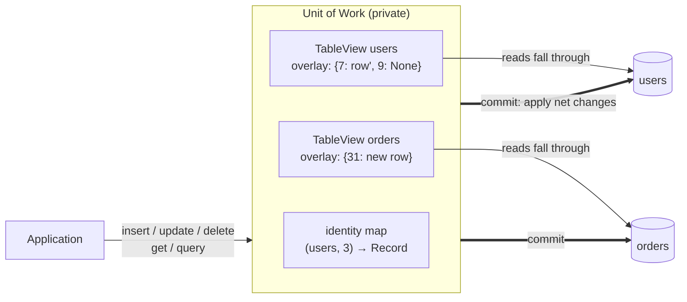
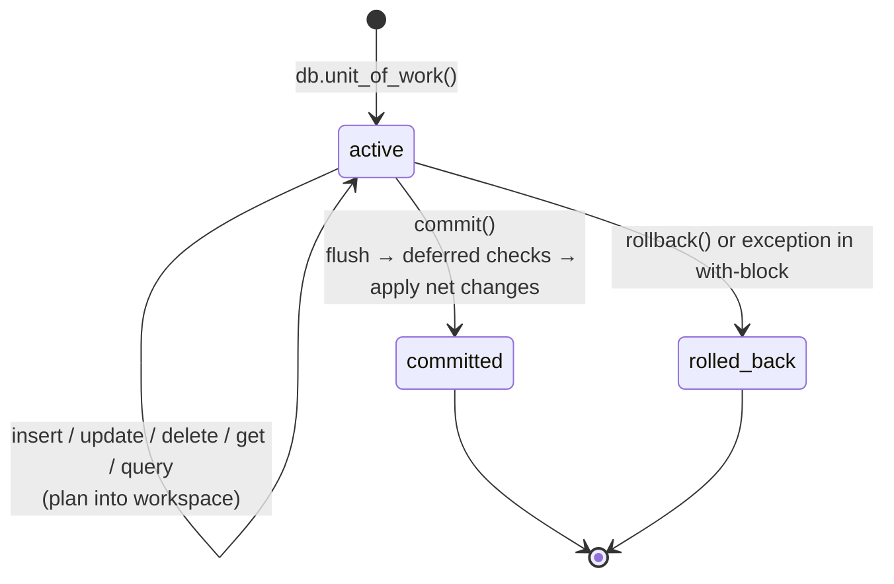

[🏠 Contents](index.md) · [← Previous: Chapter 8 — Unit of Work I](08-unit-of-work-i.md)

# Chapter 9 — Unit of Work II: Workspaces, Identity Map and Deferred Constraints

Version 1 of the Unit of Work recorded *commands* and ran them at commit. Version 2 turns that around: every operation is **planned immediately** against a **private workspace**, a view of the database that includes the transaction's own changes. The shared tables aren't touched until `commit()` applies the transaction's net changes in one step.



This one change fixes four of the five problems listed in [§8.7](08-unit-of-work-i.md#87-whats-wrong-with-version-1):

1. **Read your own writes.** Queries inside the transaction run against the workspace.
2. **Errors arrive where they're caused.** `uow.insert(...)` validates immediately.
3. **Rowids.** `uow.insert` returns the new row's rowid.
4. **Constraints can be checked per transaction.** In *deferred* mode, keys and foreign keys are checked once at commit, over the final state.

We'll also add the second half of Fowler's pattern: an **identity map** with **dirty checking**. You load a row as a record object, modify it like a dict, and the Unit of Work notices and saves the change ([Fowler 2002](references.md#fowler2002)). This is how ORMs like SQLAlchemy and Hibernate work.

## 9.1 The table view

A `TableView` wraps a committed `Table` and adds an **overlay**: a dict from rowid to the row as this transaction sees it, or `None` if this transaction deleted it. Reads check the overlay first and fall through to the table. Writes only touch the overlay.

The view implements the table interface the planners use (`schema`, `row`, `match`, `lookup`, `unique_keys`, `new_rowid`), plus `scan`, `columns` and `select` for queries. That's why we wrote the planners against an interface in [§8.2](08-unit-of-work-i.md#82-the-planning-module): they now work on a transaction's view with no changes at all.

```python
# minidb/uow.py
"""The Unit of Work: a private workspace, an identity map, atomic commit."""
from collections.abc import Iterator, Mapping
from types import MappingProxyType

from minidb import changes as ch
from minidb.changes import Change
from minidb.errors import DatabaseError
from minidb.query import Query

type Row = dict[str, object]


class TransactionError(DatabaseError):
    """The Unit of Work was used in the wrong state (e.g. after commit)."""


class TableView:
    """A table as one unit of work sees it: committed rows + private overlay."""

    def __init__(self, table):
        self.base = table
        self.name, self.schema, self.columns = table.name, table.schema, table.columns
        self.overlay: dict[int, Row | None] = {}          # rowid -> row, None = deleted

    # -- the interface used by planners and queries ------------------------------------
    def row(self, rowid: int) -> Row:
        if rowid in self.overlay:
            row = self.overlay[rowid]
            if row is None:
                raise KeyError(rowid)
            return row
        return self.base.row(rowid)

    def get(self, rowid: int) -> Row | None:
        try:
            return dict(self.row(rowid))
        except KeyError:
            return None

    def scan(self) -> Iterator[tuple[int, Row]]:
        for rowid, row in self.base.rows.items():
            if rowid in self.overlay:
                row = self.overlay[rowid]
                if row is None:
                    continue
            yield rowid, dict(row)
        for rowid, row in self.overlay.items():           # rows inserted here
            if row is not None and rowid not in self.base.rows:
                yield rowid, dict(row)

    def match(self, where=None) -> list[int]:
        if where is None or callable(where):
            return [rid for rid, row in self.scan()
                    if where is None or where(MappingProxyType(row))]
        wanted = {c: self.schema.column(c).prepare(v) for c, v in where.items()}
        found = [rid for rid in self.base.match(wanted) if rid not in self.overlay]
        found += [rid for rid, row in self.overlay.items()
                  if row is not None and _equal(row, wanted)]
        return found

    def lookup(self, key: Mapping[str, object]) -> set[int]:
        found = {rid for rid in self.base.lookup(key) if rid not in self.overlay}
        found |= {rid for rid, row in self.overlay.items()
                  if row is not None and _equal(row, key)}
        return found

    def select(self, where=None) -> list[Row]:
        return [dict(self.row(rid)) for rid in self.match(where)]

    def unique_keys(self) -> list[tuple[str, ...]]:
        return self.base.unique_keys()

    def index_on(self, columns):
        return self.base.index_on(columns)

    def new_rowid(self) -> int:
        return self.base.new_rowid()

    def __len__(self) -> int:
        return sum(1 for _ in self.scan())


def _equal(row: Mapping, key: Mapping) -> bool:
    """SQL equality on every column of `key`: NULL never equals anything."""
    return all(v is not None and row[c] == v for c, v in key.items())
```

Note `_equal`: `lookup({"email": None})` must find nothing, just as the committed index never stores NULL keys ([§5.2](05-keys-and-indexes.md#52-a-hash-index)). The overlay must answer *exactly* as the index would, or a transaction's view and the committed table would disagree about what's "equal".

Lookups scan the overlay linearly. Transactions are usually small, so this is fine. A transaction that bulk-loads 100,000 rows would want indexes on its overlay too (Exercise 4).

## 9.2 Planners with options

The planners need two new options:

- **`rowids=`** lets a caller target exact rows instead of a `where` clause. Dirty checking (§9.4) knows *which* record changed, not a predicate that selects it.
- **`check=False`** skips the checks that involve *other rows*: uniqueness and foreign keys. Deferred mode (§9.5) runs those at commit instead. Single-row checks (types, NOT NULL, CHECK) always run immediately: there's no reason to defer them, because no later statement can fix them.

```python
# minidb/changes.py (replace plan_insert)
def plan_insert(state, table: str, values: Mapping[str, object], *,
                check: bool = True) -> list[Change]:
    t = state.table(table)
    row = t.schema.prepare_row(values)
    if check:
        check_unique(t, [(None, row)])
        check_parents_exist(state, t, [row])
    return [Change(table, t.new_rowid(), None, row)]
```

```python
# minidb/changes.py (replace plan_update)
def plan_update(state, table: str, changes: Mapping[str, object], where=None, *,
                rowids: Iterable[int] | None = None, check: bool = True) -> list[Change]:
    t = state.table(table)
    targets = t.match(where) if rowids is None else rowids
    old = {rid: t.row(rid) for rid in targets}
    new = {rid: t.schema.prepare_row(changes, base=row) for rid, row in old.items()}
    if check:
        check_unique(t, list(new.items()))
        check_parents_exist(state, t, new.values())
        check_no_orphans(state, t, old, new)
    return [Change(table, rid, old[rid], new[rid]) for rid in new]
```

```python
# minidb/changes.py (replace plan_delete)
def plan_delete(state, table: str, where=None, *,
                rowids: Iterable[int] | None = None, check: bool = True) -> list[Change]:
    """A delete and everything it implies (cascades, SET NULL), or raise."""
    t = state.table(table)
    targets = t.match(where) if rowids is None else rowids
    deleted: dict[tuple[str, int], Row] = {}
    stack = [(table, rid) for rid in targets]
    while stack:
        name, rid = stack.pop()
        if (name, rid) in deleted:
            continue
        row = deleted[(name, rid)] = state.table(name).row(rid)
        for fk in references_to(state, name):
            if fk.on_delete == "cascade":
                stack.extend((fk.table, c) for c in children(state, fk, row))
    nulled: dict[tuple[str, int], tuple[Row, Row]] = {}
    for (name, rid), row in deleted.items():
        for fk in references_to(state, name):
            child = state.table(fk.table)
            survivors = [c for c in children(state, fk, row)
                         if (fk.table, c) not in deleted]
            if not survivors:
                continue
            if fk.on_delete == "restrict" and check:
                raise ForeignKeyViolation(
                    f"{fk.name}: {name} row {fk.child_key(row)} is still "
                    f"referenced by {len(survivors)} {fk.table} row(s)")
            if fk.on_delete == "set null":
                for c in survivors:
                    before = child.row(c)
                    base = nulled.get((fk.table, c), (before, before))[1]
                    after = child.schema.prepare_row(dict.fromkeys(fk.columns), base=base)
                    nulled[(fk.table, c)] = (before, after)
    return ([Change(n, rid, row, None) for (n, rid), row in deleted.items()] +
            [Change(n, rid, b, a) for (n, rid), (b, a) in nulled.items()])
```

Cascades and SET NULL are *actions*, not checks, so they run even when `check=False`. Only the `RESTRICT` refusal is deferred.

Two more functions compute a transaction's **net changes** and run the deferred checks over them:

```python
# minidb/changes.py (append)
def net_changes(changes: Iterable[Change]) -> list[Change]:
    """Collapse a sequence of changes to one per row: first before, last after."""
    net: dict[tuple[str, int], Change] = {}
    for c in changes:
        key = (c.table, c.rowid)
        if key in net:
            net[key] = Change(c.table, c.rowid, net[key].before, c.after)
        else:
            net[key] = c
    return [c for c in net.values() if c.before is not None or c.after is not None]


def check_deferred(state, changes: Iterable[Change]) -> None:
    """Multi-row constraints over a transaction's net effect, in its final state."""
    by_table: dict[str, list[Change]] = {}
    for c in net_changes(changes):
        by_table.setdefault(c.table, []).append(c)
    for name, cs in by_table.items():
        t = state.table(name)
        written = [(c.rowid, c.after) for c in cs if c.after is not None]
        check_unique(t, written)
        check_parents_exist(state, t, [row for _, row in written])
        for c in cs:
            if c.before is not None:
                check_not_dangling(state, t, c.before)


def check_not_dangling(state, parent, old_row: Row) -> None:
    """If `old_row`'s key is gone, nothing may still reference it."""
    for fk in references_to(state, parent.name):
        key = {r: old_row[r] for r in fk.ref_columns}
        if any(v is None for v in key.values()) or parent.lookup(key):
            continue                          # NULL key, or a row still has it
        if children(state, fk, old_row):
            raise ForeignKeyViolation(
                f"{fk.name}: {parent.name} row {key} is gone but still referenced")
```

`net_changes` is subtle in one case. A row inserted and then deleted in the same transaction becomes `Change(before=None, after=None)`, which means "nothing happened", and is dropped.

`check_not_dangling` asks the right question for a deleted or re-keyed parent row: *is the old key still present in the final state?* Another row might have taken it over. If it's gone, any remaining child is an orphan. This one check covers RESTRICT on delete *and* on key updates.

## 9.3 The Unit of Work, version 2

The Unit of Work is itself a **state** in the planner's sense: it has `table(name)`, which returns a lazily created `TableView`, and `foreign_keys`. Each write plans against `self` and records the resulting changes into the views:

```python
# minidb/uow.py (append)
class Record(dict):
    """A row loaded through a unit of work. Mutate it; commit saves it."""

    def __init__(self, table: str, rowid: int, row: Row):
        super().__init__(row)
        self.table, self.rowid = table, rowid

    def __repr__(self):
        return f"Record({self.table}#{self.rowid}, {dict.__repr__(self)})"


class UnitOfWork:
    """Version 2: plan into a private workspace; apply net changes on commit."""

    def __init__(self, db, *, deferred: bool = False):
        self.db = db
        self.deferred = deferred
        self.state = "active"
        self._views: dict[str, TableView] = {}
        self._changes: list[Change] = []
        self._identity: dict[tuple[str, int], Record] = {}
        self._snapshots: dict[tuple[str, int], Row] = {}

    # -- the planner "state" interface ---------------------------------------------------
    @property
    def foreign_keys(self):
        return self.db.foreign_keys

    def table(self, name: str) -> TableView:
        view = self._views.get(name)
        if view is None:
            view = self._views[name] = TableView(self.db.table(name))
        return view

    # -- writes: plan now, against the workspace -------------------------------------------
    def insert(self, table: str, values: Mapping[str, object]) -> int:
        self._require_active()
        self.flush()
        changes = ch.plan_insert(self, table, values, check=not self.deferred)
        self._record(changes)
        return changes[0].rowid

    def update(self, table: str, changes: Mapping[str, object], where=None) -> int:
        self._require_active()
        self.flush()
        planned = ch.plan_update(self, table, changes, where, check=not self.deferred)
        self._record(planned)
        return len(planned)

    def delete(self, table: str, where=None) -> int:
        self._require_active()
        self.flush()
        planned = ch.plan_delete(self, table, where, check=not self.deferred)
        self._record(planned)
        return sum(1 for c in planned if c.table == table and c.kind == "delete")

    def _record(self, changes: list[Change]) -> None:
        for c in changes:
            self.table(c.table).overlay[c.rowid] = c.after
            self._changes.append(c)
            key = (c.table, c.rowid)
            if key in self._identity:                   # keep loaded records current
                if c.after is None:
                    del self._identity[key], self._snapshots[key]
                else:
                    record = self._identity[key]
                    record.clear()
                    record.update(c.after)
                    self._snapshots[key] = dict(c.after)

    # -- reads -------------------------------------------------------------------------
    def get(self, table: str, rowid: int) -> Record | None:
        """The row as a tracked Record. Same rowid -> same object."""
        self._require_active()
        key = (table, rowid)
        if key in self._identity:
            return self._identity[key]
        row = self.table(table).get(rowid)
        if row is None:
            return None
        record = self._identity[key] = Record(table, rowid, row)
        self._snapshots[key] = dict(row)
        return record

    def find(self, table: str, where=None) -> list[Record]:
        self.flush()
        return [self.get(table, rid) for rid in self.table(table).match(where)]

    def select(self, table: str, where=None) -> list[Row]:
        self.flush()
        return self.table(table).select(where)

    def query(self, table: str, alias: str | None = None) -> Query:
        self.flush()
        return Query(self, table, alias)

    # -- dirty checking ---------------------------------------------------------------------
    def flush(self) -> None:
        """Turn modifications of loaded Records into planned updates."""
        for key, record in list(self._identity.items()):
            before = self._snapshots[key]
            if record != before:
                diff = {c: v for c, v in record.items() if before.get(c, _MISSING) != v}
                planned = ch.plan_update(self, key[0], diff, rowids=[key[1]],
                                         check=not self.deferred)
                self._record(planned)

    # -- finishing ---------------------------------------------------------------------
    def commit(self) -> None:
        self._require_active()
        self.flush()
        if self.deferred:
            ch.check_deferred(self, self._changes)
        self.db.apply(ch.net_changes(self._changes))
        self.state = "committed"

    def rollback(self) -> None:
        self._require_active()
        self._views.clear()
        self._changes.clear()
        self._identity.clear()
        self.state = "rolled back"

    def _require_active(self) -> None:
        if self.state != "active":
            raise TransactionError(f"unit of work is already {self.state}")

    def __enter__(self) -> "UnitOfWork":
        return self

    def __exit__(self, exc_type, exc, tb) -> None:
        if self.state != "active":
            return
        if exc_type is not None:
            self.rollback()
            return
        try:
            self.commit()
        except BaseException:
            self.rollback()                     # a failed commit must not stay open
            raise


_MISSING = object()
```

Let's walk through the important decisions.

**Commit applies *net* changes.** Ten updates to the same row become one `Change`. An insert followed by a delete becomes nothing. This matters more later: [Chapter 12](12-isolation.md) validates each changed row once, and [Chapter 13](13-persistence.md) writes one log record per row.

**Commit can't fail half way any more.** Every check has already run, either while planning or in `check_deferred`, against the workspace, which is exactly the state `apply` will produce. `apply` itself only calls `put` and `remove`, which don't validate. So we no longer need an undo log. As long as nobody else changes the tables between our reads and our commit, this is correct. That "as long as" is the whole subject of [Chapter 12](12-isolation.md).

**Rollback just forgets.** The shared tables were never touched, so there is nothing to undo. Compare [Chapter 8](08-unit-of-work-i.md), where rollback-after-failure had to replay inverted changes. Systems built like this are said to use *deferred update* or *no-steal* buffering: uncommitted data never reaches the shared state.

**Records are kept in step with writes.** If you load a record and then run `uow.update(...)` over the same row, `_record` refreshes the record's contents *and* its snapshot. Without that, the next `flush` would see the old values in the record as "modifications" and silently undo your update.

**A failed commit at the end of a `with` block rolls back.** If `commit()` raises (a flush finds an invalid record, or a deferred check fails), `__exit__` rolls back before re-raising, so the Unit of Work never stays half open. A `commit()` you call yourself leaves the Unit of Work active on failure, so you can fix the problem and try again.

**Everything flushes first.** Every write and query calls `flush()`, so modified records are planned before anything that could observe them. SQLAlchemy calls this *autoflush*. Without it, `record["age"] = 37` followed by a query for people aged 37 would miss the record.

Finally, `Database` routes its own writes through a one-statement Unit of Work. Now there is exactly **one write path** into the tables: `UnitOfWork.commit` → `Database.apply`.

```python
# minidb/database.py (replace Database.insert)
    def insert(self, table: str, values: Row) -> int:
        with self.unit_of_work() as uow:
            return uow.insert(table, values)
```

```python
# minidb/database.py (replace Database.update)
    def update(self, table: str, changes: Row, where: Where = None) -> int:
        with self.unit_of_work() as uow:
            return uow.update(table, changes, where)
```

```python
# minidb/database.py (replace Database.delete)
    def delete(self, table: str, where: Where = None) -> int:
        with self.unit_of_work() as uow:
            return uow.delete(table, where)
```

```python
# minidb/database.py (replace Database.unit_of_work)
    def unit_of_work(self, *, deferred: bool = False) -> UnitOfWork:
        return UnitOfWork(self, deferred=deferred)
```

A `return` inside `with` leaves the block normally, so `__exit__` commits. The returned value is computed before the commit, but the function only returns after it.

```python
# minidb/__init__.py (append)
from minidb.uow import Record
__all__ += ["Record"]
```

## 9.4 Trying it out

Read your own writes, and errors reported at the line that caused them:

```python
>>> from minidb import *
>>> db = Database()
>>> _ = db.create_table("users", [Column("id", Integer()), Column("name", Text()),
...                               Column("age", Integer(min=0))], primary_key="id")
>>> _ = db.insert("users", {"id": 1, "name": "Ada", "age": 36})
>>> uow = db.unit_of_work()
>>> uow.insert("users", {"id": 2, "name": "Alan", "age": 41})
2
>>> [r["name"] for r in uow.query("users").order_by("name")]     # sees Alan
['Ada', 'Alan']
>>> [r["name"] for r in db.query("users")]                       # the world doesn't
['Ada']
>>> uow.insert("users", {"id": 1, "name": "Ada again"})
Traceback (most recent call last):
  ...
minidb.errors.UniqueViolation: users: duplicate key (id=1)
>>> uow.commit()                                                 # the failed insert left no trace
>>> [r["name"] for r in db.query("users")]
['Ada', 'Alan']
```

The identity map and dirty checking:

```python
>>> with db.unit_of_work() as uow:
...     ada = uow.find("users", {"name": "Ada"})[0]
...     ada is uow.get("users", ada.rowid)          # one object per row
...     ada["age"] += 1                             # just mutate it
...     uow.select("users", {"age": 37})            # autoflush: the query sees it
True
[{'id': 1, 'name': 'Ada', 'age': 37}]
>>> db.select("users", {"id": 1})
[{'id': 1, 'name': 'Ada', 'age': 37}]
```

Invalid modifications are caught at the next flush:

```python
>>> with db.unit_of_work() as uow:
...     alan = uow.get("users", 2)
...     alan["age"] = -5
...     uow.commit()
Traceback (most recent call last):
  ...
minidb.errors.DomainError: users.age: -5 is not a valid Integer(min=0, max=None): below minimum 0
>>> db.get("users", 2)["age"]
41
```

## 9.5 Deferred constraints

Some valid end states can't be reached one valid statement at a time. Here are two classics.

**Swapping unique values across statements.** In [§5.6](05-keys-and-indexes.md#56-trying-it-out) we needed a single batch to swap two keys. In a deferred transaction it can take as many statements as you like:

```python
>>> with db.unit_of_work(deferred=True) as uow:
...     uow.update("users", {"id": 2}, where={"name": "Ada"})     # temporarily two id=2!
...     uow.update("users", {"id": 1}, where={"name": "Alan"})
1
1
>>> sorted((r["name"], r["id"]) for r in db.select("users"))
[('Ada', 2), ('Alan', 1)]
```

**Rows that reference each other.** Each employee names a "buddy", who must be an employee:

```python
>>> _ = db.create_table("employees", [Column("id", Integer()), Column("buddy", Integer())],
...     primary_key="id", foreign_keys=[ForeignKey("buddy", "employees")])
>>> db.insert("employees", {"id": 1, "buddy": 2})
Traceback (most recent call last):
  ...
minidb.errors.ForeignKeyViolation: fk_employees_buddy: no employees row with {'id': 2}
>>> with db.unit_of_work(deferred=True) as uow:
...     _ = uow.insert("employees", {"id": 1, "buddy": 2})
...     _ = uow.insert("employees", {"id": 2, "buddy": 1})
>>> len(db.select("employees"))
2
```

And a deferred transaction whose *end state* is invalid fails at commit, leaving the database untouched:

```python
>>> with db.unit_of_work(deferred=True) as uow:
...     _ = uow.delete("employees", {"id": 1})       # 2 still names 1 as buddy
Traceback (most recent call last):
  ...
minidb.errors.ForeignKeyViolation: fk_employees_buddy: employees row {'id': 1} is gone but still referenced
>>> len(db.select("employees"))
2
```

SQL offers the same choice per constraint: `DEFERRABLE INITIALLY DEFERRED` checks at commit, and the default (`NOT DEFERRABLE`) checks per statement. We chose one switch per transaction for simplicity. Exercise 6 makes it per constraint.

## 9.6 Where we are



We have atomic, consistent transactions with a pleasant API: **A** and **C** of ACID. All of it assumes one thread. Two Units of Work running at once could both check that `id = 3` is free, both commit, and produce a duplicate key: each validated against a world that had changed by the time it committed. **I**solation is next, in three steps: threads and a big lock ([Chapter 10](10-concurrency-i.md)), a fair readers–writer lock ([Chapter 11](11-readers-writer-locks.md)) and optimistic validation ([Chapter 12](12-isolation.md)).

## Questions and exercises

1. A transaction inserts a row and then deletes it. Trace `_record`, `net_changes` and `apply`. What reaches the tables? What happens to the rowid?
2. Why does `TableView.scan` iterate over `self.base.rows` *and then* over the overlay, instead of building one merged dict first? What does each choice cost for a transaction with 3 changes over a table with 1,000,000 rows?
3. `Record` is a `dict`. What happens if application code does `record["nonexistent"] = 1`? When is the error raised? Is that the right moment?
4. Give the overlay its own `HashIndex`es, so `lookup` on a view is O(1) even for huge transactions. Which methods of `TableView` change?
5. **Lost updates within a transaction?** Load a record, then call `uow.update` on the same row with a different column, then modify the record again. Trace what happens. Is anything lost? Write a test.
6. Make deferral per constraint: `ForeignKey(..., deferrable=True)`, `TableSchema(unique_deferrable=...)`. Non-deferrable constraints are checked while planning even in a deferred transaction.
7. `flush()` diffs each record against a snapshot: O(columns) per loaded record per flush. With 10,000 loaded records and a flush before every query, that adds up. Sketch an alternative where `Record.__setitem__` marks the record dirty. What can that approach miss? (Hint: mutable values; recall [Exercise 3.4](03-types-and-normalization.md#questions-and-exercises).)
8. *(Research)* SQLAlchemy's `Session` implements both the identity map and the Unit of Work. Read the "Unit of Work" section of its documentation and list two features it has that ours lacks.

---

[🏠 Contents](index.md) · [Next: Chapter 10 — Concurrency I →](10-concurrency-i.md)
