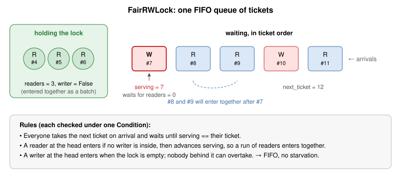
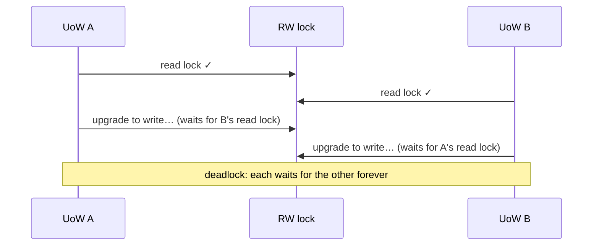

[🏠 Contents](index.md) · [← Previous: Chapter 10 — Concurrency I](10-concurrency-i.md)

# Chapter 11 — Readers–Writer Locks and Starvation

[Chapter 10](10-concurrency-i.md)'s single lock made readers wait for readers. That's needless: two threads that only *read* can't interfere with each other. A **readers–writer lock** (RW lock) has two modes:

- **shared** (read): any number of holders at once;
- **exclusive** (write): exactly one holder, and no readers.

The idea is simple. Getting the *waiting* rules right is not. This is one of the classic problems of concurrent programming, posed by Courtois, Heymans and Parnas in 1971 ([Courtois et al. 1971](references.md#courtois1971)). Their paper gave two solutions, and each lets one side **starve**: wait forever while the other side keeps getting in. In this chapter we build both, watch them starve, and then build a **fair** lock that serves everyone in arrival order. Finally we plug it into minidb.

## 11.1 Building blocks: monitors and condition variables

All our locks are written in the same style: a **monitor** ([Hoare 1974](references.md#hoare1974)). There's a little state (how many readers are inside? is a writer inside?), a mutex protecting that state, and a **condition variable** that threads wait on until the state is right for them. Python provides both in `threading.Condition`:

```python
with cond:                             # take the condition's mutex
    cond.wait_for(lambda: ready())     # release it, sleep, re-take it, re-check
    ...update state...
    cond.notify_all()                  # wake waiters so they re-check
```

`wait_for(predicate)` is the important call. It atomically releases the mutex and sleeps; when woken, it re-takes the mutex and re-evaluates the predicate, going back to sleep if it's still false. That loop protects against *spurious wakeups* and against another thread getting in first. Every lock in this chapter is "state + predicates + `notify_all` on every state change".

## 11.2 The interface

The interface is a protocol, `RWLock`: the four acquire/release methods, plus `read()` and `write()` context managers that pair each acquire with its release. Anything with those six methods is a readers–writer lock as far as minidb is concerned. The context managers are the same for every lock, so a small base class, `RWLockBase`, implements them once in terms of the other four.

```python
# src/minidb/locks.py
"""Implement readers-writer locks: any number of readers, or exactly one writer."""

import threading
from contextlib import contextmanager
from typing import TYPE_CHECKING
from typing import Protocol

if TYPE_CHECKING:
    from collections.abc import Iterator
    from contextlib import AbstractContextManager


class RWLock(Protocol):
    """Describe a readers-writer lock: shared mode for readers, exclusive for a writer."""

    def acquire_read(self) -> None:
        """Wait until the lock can be held in shared mode, and take it."""
        ...

    def release_read(self) -> None:
        """Release a shared hold."""
        ...

    def acquire_write(self) -> None:
        """Wait until the lock can be held exclusively, and take it."""
        ...

    def release_write(self) -> None:
        """Release the exclusive hold."""
        ...

    def read(self) -> AbstractContextManager[None]:
        """Return a context manager that holds the lock in shared mode."""
        ...

    def write(self) -> AbstractContextManager[None]:
        """Return a context manager that holds the lock exclusively."""
        ...


class RWLockBase:
    """Provide :meth:`read` and :meth:`write` on top of the four acquire/release methods.

    Subclasses implement the four methods; the context managers make sure
    every acquire is matched by a release, even when an exception escapes.
    """

    def acquire_read(self) -> None:
        """Wait until the lock can be held in shared mode, and take it."""
        raise NotImplementedError

    def release_read(self) -> None:
        """Release a shared hold."""
        raise NotImplementedError

    def acquire_write(self) -> None:
        """Wait until the lock can be held exclusively, and take it."""
        raise NotImplementedError

    def release_write(self) -> None:
        """Release the exclusive hold."""
        raise NotImplementedError

    @contextmanager
    def read(self) -> Iterator[None]:
        """Hold the lock in shared mode for the duration of a ``with`` block.

        :return: a context manager.
        """
        self.acquire_read()
        try:
            yield
        finally:
            self.release_read()

    @contextmanager
    def write(self) -> Iterator[None]:
        """Hold the lock exclusively for the duration of a ``with`` block.

        :return: a context manager.
        """
        self.acquire_write()
        try:
            yield
        finally:
            self.release_write()
```

## 11.3 Attempt 1: readers first

The first solution in Courtois et al.: a reader may enter whenever no *writer* is inside. A writer must wait until there are no readers and no writer.

```python
# src/minidb/locks.py (append)
class ReaderPreferringLock(RWLockBase):
    """Never make readers wait for waiting writers: Courtois et al.'s first problem.

    A steady stream of readers starves writers forever.
    """

    def __init__(self) -> None:
        self._cond = threading.Condition()
        self._readers = 0
        self._writer = False

    @override
    def acquire_read(self) -> None:
        with self._cond:
            self._cond.wait_for(lambda: not self._writer)
            self._readers += 1

    @override
    def release_read(self) -> None:
        with self._cond:
            self._readers -= 1
            if self._readers == 0:
                self._cond.notify_all()

    @override
    def acquire_write(self) -> None:
        with self._cond:
            self._cond.wait_for(lambda: not self._writer and self._readers == 0)
            self._writer = True

    @override
    def release_write(self) -> None:
        with self._cond:
            self._writer = False
            self._cond.notify_all()
```

```python
# src/minidb/locks.py (imports)
from typing import override
```

The flaw: suppose readers arrive in an overlapping stream, so a new one always enters before the last one leaves. `_readers` never reaches 0, and a waiting writer waits **forever**. On a busy reporting dashboard, nobody can ever save anything.

## 11.4 Attempt 2: writers first

The second solution reverses the priority. Once a writer is *waiting*, no new reader may enter:

```python
# src/minidb/locks.py (append)
class WriterPreferringLock(RWLockBase):
    """Make new readers wait while a writer waits: Courtois et al.'s second problem.

    A steady stream of writers starves readers forever.
    """

    def __init__(self) -> None:
        self._cond = threading.Condition()
        self._readers = 0
        self._writer = False
        self._writers_waiting = 0

    @override
    def acquire_read(self) -> None:
        with self._cond:
            self._cond.wait_for(lambda: not self._writer and self._writers_waiting == 0)
            self._readers += 1

    @override
    def release_read(self) -> None:
        with self._cond:
            self._readers -= 1
            if self._readers == 0:
                self._cond.notify_all()

    @override
    def acquire_write(self) -> None:
        with self._cond:
            self._writers_waiting += 1
            self._cond.wait_for(lambda: not self._writer and self._readers == 0)
            self._writers_waiting -= 1
            self._writer = True

    @override
    def release_write(self) -> None:
        with self._cond:
            self._writer = False
            self._cond.notify_all()
```

Now the readers starve: with a steady stream of writers, `_writers_waiting` never drops to 0. We've moved the problem, not solved it.

## 11.5 The fix: one queue, served in order

Starvation happens because a lock lets later arrivals **overtake** earlier ones. The cure is to forbid overtaking altogether: serve requests strictly in **arrival order**. That's the "third readers–writers problem", and the classic tool for it is the **ticket**, as at a deli counter. It's the idea behind Lamport's bakery algorithm ([Lamport 1974](references.md#lamport1974)) and the ticket locks used in operating-system kernels ([Mellor-Crummey & Scott 1991](references.md#mellorcrummey1991)).



- Every arriving thread, reader or writer, takes the next ticket number.
- `_serving` is the ticket at the head of the queue. Only the thread holding that ticket may try to enter.
- A **reader** at the head enters as soon as no writer is inside, and immediately advances `_serving`. If the next ticket is also a reader, it enters too, so a run of consecutive readers enters together. Readers still share!
- A **writer** at the head waits until the lock is empty, then enters and advances `_serving`. Everyone behind it, readers included, waits.

```python
# src/minidb/locks.py (append)
class FairRWLock(RWLockBase):
    """Admit requests strictly in arrival (ticket) order, so nobody starves.

    Consecutive readers are admitted together; a writer waits for the
    readers ahead of it to leave, and nobody behind it can overtake it.

    >>> lock = FairRWLock()
    >>> with lock.read(), lock.read():  # readers share
    ...     pass
    >>> with lock.write():
    ...     pass
    """

    def __init__(self) -> None:
        self._cond = threading.Condition()
        self._next_ticket = 0  # handed to the next arrival
        self._serving = 0  # ticket at the head of the queue
        self._readers = 0  # readers inside
        self._writer = False  # writer inside?

    def _take_ticket(self) -> int:
        ticket = self._next_ticket
        self._next_ticket += 1
        return ticket

    @override
    def acquire_read(self) -> None:
        with self._cond:
            ticket = self._take_ticket()
            self._cond.wait_for(lambda: self._serving == ticket and not self._writer)
            self._readers += 1
            self._serving += 1
            self._cond.notify_all()  # the next ticket may be a reader too

    @override
    def release_read(self) -> None:
        with self._cond:
            self._readers -= 1
            if self._readers == 0:
                self._cond.notify_all()  # a writer may be waiting at the head

    @override
    def acquire_write(self) -> None:
        with self._cond:
            ticket = self._take_ticket()
            self._cond.wait_for(lambda: self._serving == ticket and not self._writer and self._readers == 0)
            self._writer = True
            self._serving += 1

    @override
    def release_write(self) -> None:
        with self._cond:
            self._writer = False
            self._cond.notify_all()
```

### Why it can't starve

Here is the argument, in three steps.

1. **The head always makes progress.** The thread holding ticket `_serving` waits only for threads *already inside* (a writer, or readers). Holders eventually release, because each operation is finite. When they do, every state change calls `notify_all`, so the head re-checks and enters.
2. **Entering advances the head.** Each thread increments `_serving` exactly once, when it enters. So ticket *t+1* becomes the head as soon as ticket *t* is inside.
3. **Nobody overtakes.** The predicate `_serving == ticket` admits only the head. A thread with a later ticket can't enter before an earlier one.

So a thread with ticket *t* waits at most for the threads holding tickets below *t*, a finite number, each holding the lock for a finite time. That's *bounded waiting*, which is the formal meaning of starvation-free.

Note one subtle point in `acquire_read`. The reader increments `_serving` *after* checking `not self._writer`, but it doesn't wait for other readers to leave. That's what lets a batch of consecutive readers in together. A writer, by contrast, requires `_readers == 0`, so it waits for the batch ahead of it to drain.

### The cost: `notify_all`

Every state change wakes **all** waiting threads, and all but one go straight back to sleep. With 1,000 waiting threads, each release causes 1,000 wakeups. This is the *thundering herd* problem. The fix is to give each waiter its own `Condition` in a queue and wake only the head (Exercise 3). For a teaching database with a handful of threads, simplicity wins.

## 11.6 Watching starvation happen

This experiment, `examples/starvation.py`, runs a stream of overlapping readers (each holds the lock for 10 ms, staggered so one is always inside) and two threads writing in a tight loop. A quarter of the way in, one extra reader and one extra writer arrive, and we measure how long each waits:

```python
# examples/starvation.py
"""Measure how long a late reader and a late writer wait under each lock.

A stream of overlapping readers and two looping writers keep each lock busy
for one second; a quarter of the way in, one more reader and one more
writer arrive and time how long they wait.
"""

import threading
import time

from minidb.locks import FairRWLock
from minidb.locks import ReaderPreferringLock
from minidb.locks import RWLockBase
from minidb.locks import WriterPreferringLock

DURATION, HOLD = 1.0, 0.01


def reader_stream(lock: RWLockBase, stop: threading.Event, offset: float) -> None:
    """Hold the lock for reading, again and again, until ``stop`` is set.

    :param lock: the lock under test.
    :param stop: set when the experiment is over.
    :param offset: how long to wait before starting, to stagger readers.
    """
    time.sleep(offset)
    while not stop.is_set():
        with lock.read():
            time.sleep(HOLD)


def writer_stream(lock: RWLockBase, stop: threading.Event) -> None:
    """Hold the lock for writing, briefly, again and again, until ``stop`` is set.

    :param lock: the lock under test.
    :param stop: set when the experiment is over.
    """
    while not stop.is_set():
        with lock.write():
            time.sleep(HOLD / 10)


def probe(lock: RWLockBase, kind: str, waited: dict[str, float]) -> None:
    """Arrive late, and record how long it takes to get the lock.

    :param lock: the lock under test.
    :param kind: ``"reader"`` or ``"writer"``.
    :param waited: where to record the wait, in seconds.
    """
    time.sleep(DURATION / 4)
    t0 = time.perf_counter()
    with lock.read() if kind == "reader" else lock.write():
        waited[kind] = time.perf_counter() - t0


def starvation_test(lock: RWLockBase) -> dict[str, float]:
    """Run the experiment on one lock.

    :param lock: the lock under test.
    :return: the late reader's and late writer's waits, in seconds.
    """
    stop, waited = threading.Event(), dict[str, float]()
    threads = [threading.Thread(target=reader_stream, args=(lock, stop, i * HOLD / 4)) for i in range(4)]
    threads += [threading.Thread(target=writer_stream, args=(lock, stop)) for _ in range(2)]
    threads += [threading.Thread(target=probe, args=(lock, k, waited)) for k in ("reader", "writer")]
    for t in threads:
        t.start()
    time.sleep(DURATION)
    stop.set()
    for t in threads:
        t.join()
    return waited


def main() -> None:
    """Print a table of waits for the three locks."""
    print(f"{'lock':<24}{'reader waited':>15}{'writer waited':>15}")
    for cls in (ReaderPreferringLock, WriterPreferringLock, FairRWLock):
        w = starvation_test(cls())
        print(f"{cls.__name__:<24}{w['reader'] * 1000:>12.1f} ms{w['writer'] * 1000:>12.1f} ms")


if __name__ == "__main__":
    main()
```

On the machine used to write this book, with free-threaded 3.14t:

```text
lock                      reader waited  writer waited
ReaderPreferringLock             0.1 ms       760.3 ms
WriterPreferringLock           753.1 ms        26.2 ms
FairRWLock                       5.7 ms         5.7 ms
```

The table shows each lock's behaviour:

- **Reader-preferring.** The writer waited until the reader stream *ended*: it would have waited forever. The reader got in at once.
- **Writer-preferring.** The mirror image: the reader starved behind the writer stream.
- **Fair.** Both waited a few milliseconds, roughly "the requests ahead of me in the queue".

On the GIL build, the writer-preferring lock's probe *writer* also waited about 750 ms: it lost every race against the two writer threads already looping. Preferring writers says nothing about the order *among* writers. Only the fair lock gives a bound to everyone.

## 11.7 Plugging it into minidb

Reads outside a transaction now take the lock in **shared** mode, so they run in parallel. What about a Unit of Work? It reads first and may write later. Two tempting designs fail:

**Take a read lock, upgrade on the first write.** Two transactions each hold a read lock. Each tries to upgrade, and each waits for the *other* to release its read lock. Neither will: **deadlock**.



This isn't hypothetical. SQLite's default `BEGIN DEFERRED` transactions upgrade lazily, and two such transactions that both try to write can get `SQLITE_BUSY`. That's why SQLite also offers `BEGIN IMMEDIATE`, which takes the write lock up front ([SQLite transactions](references.md#sqlite-transactions)).

**Release the read lock, then take the write lock.** That allows another writer in between, and we're back to the check-then-act race from [Chapter 10](10-concurrency-i.md#102-breaking-minidb).

The robust choice is to **declare the mode up front**, as SQL's `SET TRANSACTION READ ONLY` does. A Unit of Work created with `readonly=True` takes the shared lock and refuses to write. Otherwise it takes the exclusive lock.

```python
# src/minidb/database.py (imports)
from minidb.locks import FairRWLock
```

```python
# src/minidb/database.py (typing imports)
from minidb.locks import RWLock
```

```python
# src/minidb/database.py (replace Database.__init__)
    def __init__(self, *, lock: RWLock | None = None) -> None:
        self.tables: dict[str, Table] = {}
        self.foreign_keys: list[ForeignKey] = []
        self._lock: RWLock = lock if lock is not None else FairRWLock()
        self._local = threading.local()  # .uow: this thread's active unit of work
```

The database now accepts any lock that satisfies the `RWLock` protocol, which makes it easy to experiment with the alternatives: `Database(lock=ReaderPreferringLock())`. The default is the fair lock.
```

```python
# src/minidb/database.py (replace Database.begin)
    def begin(self, uow: UnitOfWork) -> None:
        """Take the lock on behalf of a new unit of work: shared if it is read-only.

        Units of work call this themselves; applications don't need to.

        :param uow: the unit of work that is starting.
        :raises TransactionError: if the thread already has an active one.
        """
        if self.active_unit_of_work() is not None:
            raise TransactionError("this thread already has an active unit of work")
        if uow.readonly:
            self._lock.acquire_read()
        else:
            self._lock.acquire_write()
        self._local.uow = uow
```

```python
# src/minidb/database.py (replace Database.end)
    def end(self, uow: UnitOfWork) -> None:
        """Release the lock when a unit of work commits or rolls back.

        :param uow: the unit of work that is finishing.
        """
        self._local.uow = None
        if uow.readonly:
            self._lock.release_read()
        else:
            self._lock.release_write()
```

```python
# src/minidb/database.py (replace Database.reading)
    @contextmanager
    def reading(self) -> Iterator[Database]:
        """Hold the lock in shared mode for one read outside any unit of work.

        :return: a context manager that yields the database.
        :raises TransactionError: if the thread has an active unit of work.
        """
        if self.active_unit_of_work() is not None:
            raise TransactionError("inside a unit of work, read through the unit of work")
        with self._lock.read():
            yield self
```

```python
# src/minidb/database.py (replace Database.unit_of_work)
    def unit_of_work(self, *, deferred: bool = False, readonly: bool = False) -> UnitOfWork:
        """Start a transaction; see :class:`UnitOfWork`.

        :param deferred: whether to check multi-row constraints only at
            commit; ``False`` by default.
        :param readonly: whether the transaction only reads, and so may
            share the lock; ``False`` by default.
        :return: a new, active unit of work.
        """
        return UnitOfWork(self, deferred=deferred, readonly=readonly)
```

The Unit of Work records its mode and refuses writes in read-only mode. The check must come *before* planning, because planning calls `new_rowid()`, which mutates shared state. Concurrent read-only transactions would race on it. For dirty records, `flush` refuses only if a record actually changed.

```python
# src/minidb/uow.py (replace UnitOfWork.__init__)
    def __init__(self, db: Database, *, deferred: bool = False, readonly: bool = False) -> None:
        self.db = db
        self.deferred = deferred
        self.readonly = readonly
        self.state = "active"
        self._views: dict[str, TableView] = {}
        self._changes: list[Change] = []
        self._identity: dict[tuple[str, int], Record] = {}
        self._snapshots: dict[tuple[str, int], Row] = {}
        db.begin(self)
```

```python
# src/minidb/uow.py (replace UnitOfWork._require_active)
    def _require_active(self, *, writing: bool = False) -> None:
        if self.state != "active":
            raise TransactionError(f"unit of work is already {self.state}")
        if writing and self.readonly:
            raise TransactionError("cannot write in a read-only unit of work")
```

```python
# src/minidb/uow.py (replace UnitOfWork.insert)
    def insert(self, table: str, values: Mapping[str, object]) -> int:
        """Insert a row into the workspace.

        :param table: the table's name.
        :param values: the new row's values, by column name.
        :return: the new rowid.
        :raises ConstraintError: if the row breaks a constraint.
        :raises TransactionError: if the unit of work is no longer active,
            or is read-only.
        """
        self._require_active(writing=True)
        self.flush()
        changes = ch.plan_insert(self, table, values, check=not self.deferred)
        self._record(changes)
        return changes[0].rowid
```

```python
# src/minidb/uow.py (replace UnitOfWork.update)
    def update(self, table: str, changes: Mapping[str, object], where: Where = None) -> int:
        """Update rows in the workspace.

        :param table: the table's name.
        :param changes: the new values, by column name.
        :param where: which rows change; ``None`` (the default) for all.
        :return: the number of rows changed.
        :raises ConstraintError: if a new row breaks a constraint.
        :raises TransactionError: if the unit of work is no longer active,
            or is read-only.
        """
        self._require_active(writing=True)
        self.flush()
        planned = ch.plan_update(self, table, changes, where, check=not self.deferred)
        self._record(planned)
        return len(planned)
```

```python
# src/minidb/uow.py (replace UnitOfWork.delete)
    def delete(self, table: str, where: Where = None) -> int:
        """Delete rows, and their cascades, from the workspace.

        :param table: the table's name.
        :param where: which rows go; ``None`` (the default) for all.
        :return: the number of rows deleted from ``table`` itself.
        :raises ForeignKeyError: if a ``restrict`` reference forbids it.
        :raises TransactionError: if the unit of work is no longer active,
            or is read-only.
        """
        self._require_active(writing=True)
        self.flush()
        planned = ch.plan_delete(self, table, where, check=not self.deferred)
        self._record(planned)
        return sum(1 for c in planned if c.table == table and c.kind == "delete")
```

```python
# src/minidb/uow.py (replace UnitOfWork.flush)
    def flush(self) -> None:
        """Turn modifications of loaded records into planned updates.

        :raises ConstraintError: if a modified record breaks a constraint.
        :raises TransactionError: if a record was modified in a read-only
            unit of work.
        """
        for key, record in list(self._identity.items()):
            before = self._snapshots[key]
            if record != before:
                self._require_active(writing=True)
                diff = {c: v for c, v in record.items() if before.get(c, _MISSING) != v}
                self._record(ch.plan_update(self, key[0], diff, rowids=[key[1]], check=not self.deferred))
```

```python
# src/minidb/__init__.py (replace __all__)
__all__ = [
    "Avg",
    "Boolean",
    "Change",
    "Check",
    "CheckError",
    "Column",
    "ConstraintError",
    "Count",
    "Database",
    "DatabaseError",
    "Date",
    "DomainError",
    "FairRWLock",
    "ForeignKey",
    "ForeignKeyError",
    "Integer",
    "Max",
    "Min",
    "NotNullError",
    "Numeric",
    "Query",
    "Real",
    "Record",
    "SchemaError",
    "Sum",
    "TableSchema",
    "Text",
    "Timestamp",
    "TransactionError",
    "UniqueError",
    "UnitOfWork",
    "normalizers",
]
```

```python
# src/minidb/__init__.py (imports)
from minidb.locks import FairRWLock
```

## 11.8 Trying it out

```python
>>> from minidb import *
>>> db = Database()
>>> _ = db.create_table("t", [Column("id", Integer())], primary_key="id")
>>> _ = db.insert("t", {"id": 1})
>>> with db.unit_of_work(readonly=True) as uow:
...     uow.select("t")
...     uow.insert("t", {"id": 2})
Traceback (most recent call last):
  ...
minidb.uow.TransactionError: cannot write in a read-only unit of work
>>> with db.unit_of_work(readonly=True) as uow:
...     uow.get("t", 1)["id"] = 99            # modifying a record is a write too
Traceback (most recent call last):
  ...
minidb.uow.TransactionError: cannot write in a read-only unit of work
>>> db.select("t")
[{'id': 1}]
```

Readers now really run in parallel on a free-threaded build. This benchmark, `examples/shared_reads.py`, runs the same aggregate query 20 times in each of 4 threads, once with the fair RW lock and once with a stand-in that turns every read into an exclusive lock, as in [Chapter 10](10-concurrency-i.md). The stand-in is passed in with `Database(lock=...)`:

```python
# examples/shared_reads.py
"""Compare shared reads under the fair lock with reads that exclude each other.

``MutexAsRWLock`` satisfies the :class:`~minidb.locks.RWLock` protocol, but
makes every acquisition exclusive, as the single lock of Chapter 10 did.
"""

import sys
import threading
import time

from minidb import Column
from minidb import Database
from minidb import Integer
from minidb import Sum
from minidb.locks import RWLockBase


class MutexAsRWLock(RWLockBase):
    """Behave like Chapter 10's lock: every acquisition is exclusive."""

    def __init__(self) -> None:
        self._mutex = threading.Lock()

    def acquire_read(self) -> None:
        """Take the mutex."""
        self._mutex.acquire()

    def release_read(self) -> None:
        """Release the mutex."""
        self._mutex.release()

    def acquire_write(self) -> None:
        """Take the mutex."""
        self._mutex.acquire()

    def release_write(self) -> None:
        """Release the mutex."""
        self._mutex.release()


def filled(db: Database) -> Database:
    """Create and fill the test table in ``db``.

    :param db: an empty database.
    :return: the same database.
    """
    db.create_table("t", [Column("id", Integer()), Column("v", Integer())], primary_key="id")
    with db.unit_of_work() as uow:
        for i in range(20_000):
            uow.insert("t", {"id": i, "v": i % 7})
    return db


def run(db: Database, threads: int = 4, queries: int = 20) -> float:
    """Run ``queries`` aggregate queries in each of ``threads`` threads.

    :param db: the database to query.
    :param threads: the number of threads; 4 by default.
    :param queries: the queries per thread; 20 by default.
    :return: the elapsed wall-clock time, in seconds.
    """

    def work() -> None:
        for _ in range(queries):
            db.query("t").group_by(total=Sum("v")).all()

    ts = [threading.Thread(target=work) for _ in range(threads)]
    t0 = time.perf_counter()
    for t in ts:
        t.start()
    for t in ts:
        t.join()
    return time.perf_counter() - t0


def main() -> None:
    """Time both locks and print the speed-up."""
    shared = run(filled(Database()))
    exclusive = run(filled(Database(lock=MutexAsRWLock())))
    gil = getattr(sys, "_is_gil_enabled", lambda: True)()
    print(f"GIL={gil}  exclusive: {exclusive:.2f}s   shared: {shared:.2f}s   speed-up: {exclusive / shared:.1f}x")


if __name__ == "__main__":
    main()
```

```text
GIL=True   exclusive: 1.87s   shared: 1.83s   speed-up: 1.0x
GIL=False  exclusive: 2.16s   shared: 1.33s   speed-up: 1.6x
```

With the GIL, shared reads don't help: only one thread runs Python at a time anyway. Without the GIL, the readers really run in parallel. The machine had only two cores, so 2x is the ceiling, and 1.6x is a respectable fraction of it. On a machine with more cores the gap grows.

## 11.9 What's left

Readers no longer block readers, and nobody starves. But a read-write Unit of Work still holds an *exclusive* lock for its whole life. While it runs, even read-only transactions wait. And the third problem from [§10.6](10-concurrency-i.md#106-the-price-of-one-big-lock) remains: a slow or forgotten transaction blocks everyone. [Chapter 12](12-isolation.md) removes the long-held lock completely. Transactions will run with no lock at all and take the write lock only for the few microseconds of commit, checking then that what they read is still true.

## Questions and exercises

1. In `FairRWLock.acquire_read`, why must `_serving += 1` come *after* `wait_for`, not before? What breaks if a reader advances `_serving` before checking for a writer?
2. Prove that `FairRWLock` never lets a reader and a writer inside at the same time. Which predicates guarantee it?
3. **Fix the thundering herd.** Rewrite `FairRWLock` so each waiting thread has its own `threading.Condition` (or `threading.Event`) in a `collections.deque`, and a release wakes only the threads that can actually proceed. Measure the difference with 200 waiting threads.
4. **Timeouts.** Add `acquire_write(timeout=None)`. What must happen to the ticket of a thread that gives up? (If nothing, the queue gets stuck at its ticket forever.) Implement a fix.
5. Our lock isn't re-entrant: a thread holding a read lock that asks for another read lock can deadlock. Construct the exact interleaving (you need a writer). How does minidb avoid this situation?
6. Is `FairRWLock` fair to *batches*? Suppose the queue is R W R W R W …. How much parallelism do readers get? Design a variant that admits *all* waiting readers when a writer leaves, while still bounding writer waits. (This is sometimes called "phase-fair" locking.)
7. Python's `threading.Condition` itself is built on a lock, and waiters may be woken in any order. Does our fairness argument rely on the order in which `notify_all` wakes threads? Why not?
8. *(Research)* Read [Courtois et al. 1971](references.md#courtois1971). It's two pages. Their solutions use semaphores instead of monitors. Translate their first solution into Python using `threading.Semaphore`.

*Answers: [Appendix D, Chapter 11](appendix-d-answers.md#chapter-11--readerswriter-locks).*

---

[🏠 Contents](index.md) · [Next: Chapter 12 — Isolation →](12-isolation.md)
