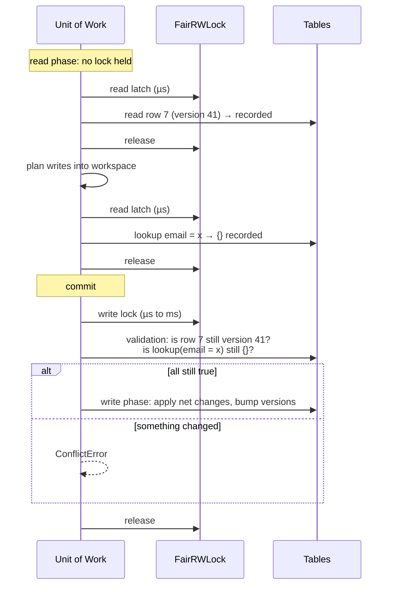

[🏠 Contents](index.md) · [← Previous: Chapter 11 — Readers–Writer Locks](11-readers-writer-locks.md)

# Chapter 12 — Isolation: Optimistic Concurrency Control

A read-write Unit of Work still holds the database's exclusive lock from start to finish. Transactions run one at a time, and a slow one stops everybody. In this chapter we stop holding locks *during* transactions. Each Unit of Work runs freely, writes only to its private workspace, and **records everything it reads**. At commit it takes the exclusive lock for a moment and checks that **everything it read is still true**. If so, it applies its changes. If not, it fails with a `ConflictError` and can be retried.

This is **optimistic concurrency control** (OCC), introduced by Kung and Robinson ([Kung & Robinson 1981](references.md#kung1981)). It bets that conflicts are rare, so it's cheaper to occasionally redo a transaction than to always make everyone wait. The FairRWLock from [Chapter 11](11-readers-writer-locks.md) stays, but now it protects *data structures* for microseconds at a time. That's the *latch* role from [§10.3](10-concurrency-i.md#103-two-kinds-of-protection).

## 12.1 What can go wrong: isolation anomalies

The SQL standard defines isolation in terms of **anomalies**, things that must not happen at a given isolation level. Berenson et al. ([Berenson et al. 1995](references.md#berenson1995)) showed the standard's definitions were incomplete and gave the list most people use today:

| Anomaly | Example | Prevented by |
|---|---|---|
| **Dirty read** | T1 sees T2's uncommitted change, then T2 rolls back | Workspaces ([Ch. 9](09-unit-of-work-ii.md)): nobody sees uncommitted data |
| **Lost update** | T1 and T2 both read `stock = 10`, both write `stock = 9`; one sale vanishes | Validating the rows we overwrite |
| **Non-repeatable read** | T1 reads a row twice and gets different values | Validating rows we read |
| **Phantom** | T1 counts "orders today" twice and gets different counts, because T2 inserted one | Validating *predicates*, not just rows |
| **Write skew** | Two doctors each check "someone else is on call" and both go off call | Validating everything read, not just what's written |

A system that prevents *all* anomalies is **serializable**: every execution is equivalent to running the transactions one at a time in some order ([Eswaran et al. 1976](references.md#eswaran1976); [Bernstein, Hadzilacos & Goodman 1987](references.md#bernstein1987)). [Chapter 10](10-concurrency-i.md)'s big lock was serializable by brute force. We want to keep serializability without the waiting.

Write skew deserves attention because many real databases allow it by default. *Snapshot isolation*, the default "serializable-sounding" level in several popular systems, gives each transaction a consistent snapshot and checks only **write–write** conflicts. Two doctors who each update *their own* row never write the same row, so both commit, and the hospital has nobody on call. Preventing it requires checking what each transaction *read*.

## 12.2 The plan: read set, validation, write

Kung and Robinson split a transaction into three phases:



To validate, we need to know *whether something changed*. So every committed change now gets a **version**: a global commit counter, `commit_seq`. Each table remembers:

- `version`: the commit that last changed *any* of its rows;
- `row_versions[rowid]`: the commit that last changed *that* row.

A `TableView` records three kinds of reads, because the planners and queries read in three ways:

| Read | Recorded as | Still true at commit if… |
|---|---|---|
| `row(rowid)` | rowid → row version | the row's version is unchanged (or it's still absent) |
| `lookup(key)` / `match({col: value})` | the key → set of rowids found | re-running the lookup returns the same set |
| `scan()`, `match(predicate)` | the table's version | no commit has touched the table since |

The second row is how we prevent **phantoms**. A uniqueness check is a lookup: "rows with `email = x`" was empty. If another transaction commits a row with `email = x`, re-running the lookup returns a different set, and the check is no longer true. The same goes for foreign-key checks ("the parent exists") and cascades ("these are all the children"). All our constraint checks are reads, so they're all validated, and constraints stay correct under concurrency without any special code.

The third row is the coarse part. We can't cheaply re-run an arbitrary Python predicate against the table, so any commit to a table invalidates every transaction that *scanned* it. That's correct but pessimistic. A finer scheme would validate predicates ([Eswaran et al. 1976](references.md#eswaran1976) called them *predicate locks*), and [Chapter 14](14-query-planning.md)'s expression objects make that possible (Exercise 5).

Why is "every read is still true at commit" enough for serializability? Because while we hold the exclusive lock, the transaction's reads equal the current state. Its results are therefore exactly what it would have computed had it run *in that instant*, alone. The serial order is the commit order.

## 12.3 Code

The new error:

```python
# src/minidb/errors.py (append)
class ConflictError(DatabaseError):
    """Signal that a concurrent transaction changed something this one read; retry it."""
```

Tables carry versions. Rowid allocation now happens during planning, *outside* the exclusive lock, so it needs its own small latch. This is exactly Experiment 1 from [§10.2](10-concurrency-i.md#102-breaking-minidb).

```python
# src/minidb/table.py (replace Table.__init__)
    def __init__(self, schema: TableSchema) -> None:
        self.schema = schema
        self.name = schema.name
        self.columns = schema.column_names
        self.rows: dict[int, Row] = {}
        self.indexes: dict[str, Index] = {}
        self.version = 0  # the last commit that changed this table
        self.row_versions: dict[int, int] = {}  # rowid -> the last commit that changed it
        self._next_rowid = 1
        self._rowid_latch = threading.Lock()
        if schema.primary_key:
            self.create_index("pk", schema.primary_key, unique=True)
        for cols in schema.unique:
            self.create_index("unique_" + "_".join(cols), cols, unique=True)
```

```python
# src/minidb/table.py (replace Table.new_rowid)
    def new_rowid(self) -> int:
        """Hand out the next rowid; rowids are never reused.

        Planning happens outside the exclusive lock, so the counter has a
        small latch of its own.

        :return: a rowid no row has ever had.
        """
        with self._rowid_latch:
            rowid = self._next_rowid
            self._next_rowid += 1
            return rowid
```

```python
# src/minidb/table.py (imports)
import threading
```

The database stamps versions as it applies a commit, decides per mode which lock a Unit of Work holds for its lifetime, and gains a `transaction()` helper that retries on conflict. Two small public methods, `shared_lock()` and `exclusive_lock()`, let Units of Work use the lock without reaching into the database's private attributes:

```python
# src/minidb/database.py (replace Database.__init__)
    def __init__(self, *, lock: RWLock | None = None) -> None:
        self.tables: dict[str, Table] = {}
        self.foreign_keys: list[ForeignKey] = []
        self.commit_seq = 0  # the number of the last commit
        self._lock: RWLock = lock if lock is not None else FairRWLock()
        self._local = threading.local()  # .uow: this thread's active unit of work

    def shared_lock(self) -> AbstractContextManager[None]:
        """Return a context manager that holds the database lock in shared mode.

        :return: the context manager.
        """
        return self._lock.read()

    def exclusive_lock(self) -> AbstractContextManager[None]:
        """Return a context manager that holds the database lock exclusively.

        :return: the context manager.
        """
        return self._lock.write()
```

```python
# src/minidb/database.py (typing imports)
from contextlib import AbstractContextManager
```

```python
# src/minidb/database.py (replace Database.apply)
    def apply(self, changes: Sequence[Change]) -> None:
        """Write validated changes as one commit, stamping every row with its version.

        The caller holds the exclusive lock.

        :param changes: the changes to write.
        """
        self.commit_seq += 1
        seq = self.commit_seq
        for c in changes:
            t = self.tables[c.table]
            if c.after is None:
                t.remove(c.rowid)
                t.row_versions.pop(c.rowid, None)
            else:
                t.put(c.rowid, c.after)
                t.row_versions[c.rowid] = seq
            t.version = seq
```

```python
# src/minidb/database.py (replace Database.begin)
    def begin(self, uow: UnitOfWork) -> None:
        """Register a new unit of work, taking the lock it needs for its lifetime.

        Optimistic units of work take no lock at all; read-only ones share
        it; exclusive ones hold it alone. Units of work call this
        themselves; applications don't need to.

        :param uow: the unit of work that is starting.
        :raises TransactionError: if the thread already has an active one.
        """
        if self.active_unit_of_work() is not None:
            raise TransactionError("this thread already has an active unit of work")
        if uow.readonly:
            self._lock.acquire_read()
        elif uow.exclusive:
            self._lock.acquire_write()
        self._local.uow = uow
```

```python
# src/minidb/database.py (replace Database.end)
    def end(self, uow: UnitOfWork) -> None:
        """Unregister a finishing unit of work, releasing any lock it held.

        :param uow: the unit of work that is finishing.
        """
        self._local.uow = None
        if uow.readonly:
            self._lock.release_read()
        elif uow.exclusive:
            self._lock.release_write()
```

```python
# src/minidb/database.py (replace Database.unit_of_work)
    def unit_of_work(self, *, deferred: bool = False, readonly: bool = False, exclusive: bool = False) -> UnitOfWork:
        """Start a transaction; see :class:`UnitOfWork`.

        :param deferred: whether to check multi-row constraints only at
            commit; ``False`` by default.
        :param readonly: whether the transaction only reads; it then holds
            the lock in shared mode and never conflicts; ``False`` by default.
        :param exclusive: whether to hold the lock alone for the whole
            transaction, so it can't conflict; ``False`` by default.
        :return: a new, active unit of work.
        """
        return UnitOfWork(self, deferred=deferred, readonly=readonly, exclusive=exclusive)

    def transaction[T](self, fn: Callable[[UnitOfWork], T], *, retries: int = 5, deferred: bool = False) -> T:
        """Run ``fn(uow)`` and commit, retrying when another transaction conflicts.

        ``fn`` may run several times, so it must not have effects outside
        the database. After ``retries`` optimistic attempts, the final
        attempt runs exclusively and can't conflict: every transaction
        finishes.

        >>> from minidb.schema import Column
        >>> from minidb.types import Integer
        >>> db = Database()
        >>> _ = db.create_table("t", [Column("n", Integer())])
        >>> db.transaction(lambda uow: uow.insert("t", {"n": 1}))
        1

        :param fn: the work to do, given a fresh unit of work each time.
        :param retries: the optimistic attempts before the exclusive one; 5 by default.
        :param deferred: whether to defer multi-row checks to commit; ``False`` by default.
        :return: whatever ``fn`` returned on the attempt that committed.
        :raises DatabaseError: whatever ``fn`` or the commit raised, other
            than a conflict.
        """
        for attempt in range(retries):
            try:
                return self._attempt(self.unit_of_work(deferred=deferred), fn)
            except ConflictError:
                time.sleep(random.uniform(0, 0.0005 * 2**attempt))  # noqa: S311 - back-off jitter, not cryptography
        return self._attempt(self.unit_of_work(deferred=deferred, exclusive=True), fn)

    @staticmethod
    def _attempt[T](uow: UnitOfWork, fn: Callable[[UnitOfWork], T]) -> T:
        try:
            result = fn(uow)
            uow.commit()
        except BaseException:
            if uow.state == "active":
                uow.rollback()
            raise
        return result
```

```python
# src/minidb/database.py (replace Database.insert)
    def insert(self, table: str, values: Mapping[str, object]) -> int:
        """Insert a row, in a transaction of its own.

        :param table: the table's name.
        :param values: the new row's values, by column name.
        :return: the new rowid.
        :raises ConstraintError: if the row breaks a constraint.
        """
        return self.transaction(lambda uow: uow.insert(table, values))
```

```python
# src/minidb/database.py (replace Database.update)
    def update(self, table: str, changes: Mapping[str, object], where: Where = None) -> int:
        """Update rows, in a transaction of its own.

        :param table: the table's name.
        :param changes: the new values, by column name.
        :param where: a predicate, a dict of equalities, or ``None`` for all rows.
        :return: the number of rows changed.
        :raises ConstraintError: if a new row breaks a constraint.
        """
        return self.transaction(lambda uow: uow.update(table, changes, where))
```

```python
# src/minidb/database.py (replace Database.delete)
    def delete(self, table: str, where: Where = None) -> int:
        """Delete rows and their cascades, in a transaction of its own.

        :param table: the table's name.
        :param where: a predicate, a dict of equalities, or ``None`` for all rows.
        :return: the number of rows deleted from ``table`` itself.
        :raises ForeignKeyError: if a ``restrict`` reference forbids it.
        """
        return self.transaction(lambda uow: uow.delete(table, where))
```

```python
# src/minidb/database.py (imports)
import random
import time

from minidb.errors import ConflictError
```

```python
# src/minidb/database.py (typing imports)
from collections.abc import Callable
```

```python
# src/minidb/__init__.py (replace __all__)
__all__ = [
    "Avg",
    "Boolean",
    "Change",
    "Check",
    "CheckError",
    "Column",
    "ConflictError",
    "ConstraintError",
    "Count",
    "Database",
    "DatabaseError",
    "Date",
    "DomainError",
    "FairRWLock",
    "ForeignKey",
    "ForeignKeyError",
    "Integer",
    "Max",
    "Min",
    "NotNullError",
    "Numeric",
    "Query",
    "Real",
    "Record",
    "SchemaError",
    "Sum",
    "TableSchema",
    "Text",
    "Timestamp",
    "TransactionError",
    "UniqueError",
    "UnitOfWork",
    "normalizers",
]
```

```python
# src/minidb/__init__.py (imports)
from minidb.errors import ConflictError
```

`transaction` is a generic method, written with the new syntax `def transaction[T](self, fn: Callable[[UnitOfWork], T], …) -> T`. Whatever type `fn` returns, `transaction` returns the same type: `db.transaction(lambda uow: uow.insert(…))` is known to be an `int`.

Note the **exclusive fallback** in `transaction()`. Optimistic schemes have a fairness problem of their own: a long transaction that reads a lot can lose validation again and again to a stream of short ones. That's starvation, reappearing one level up from [Chapter 11](11-readers-writer-locks.md). Falling back to the exclusive lock after a few failures bounds the number of attempts. The exclusive attempt still has to wait its turn in the FairRWLock queue, so its wait is bounded too.

The Unit of Work changes in many small places, so here is the whole module. The new parts are the read set in `TableView`, `conflicts()`, `latch()` and the three commit paths.

```python
# src/minidb/uow.py
"""Group writes into all-or-nothing transactions: the Unit of Work.

Version 3: optimistic concurrency control. A read-write unit of work holds
no lock while it runs. It records what it read (its *read set*), and at
commit, under the exclusive lock, checks that all of it is still true.
"""

from contextlib import nullcontext
from types import MappingProxyType
from typing import TYPE_CHECKING
from typing import Self

from minidb import changes as ch
from minidb.errors import ConflictError
from minidb.errors import DatabaseError
from minidb.query import Query

if TYPE_CHECKING:
    from collections.abc import Iterator
    from collections.abc import Mapping
    from collections.abc import Sequence
    from contextlib import AbstractContextManager
    from types import TracebackType

    from minidb.changes import Change
    from minidb.database import Database
    from minidb.schema import ForeignKey
    from minidb.table import Table
    from minidb.table import Where
    from minidb.values import Row
    from minidb.values import Value

type ReadKey = tuple[str, tuple[tuple[str, Value | None], ...]]  # ("lookup" | "match", frozen key)


class TransactionError(DatabaseError):
    """Signal that a unit of work was used in the wrong state, e.g. after commit."""


class TableView:
    """Show a table as one unit of work sees it, recording every read of committed data.

    Each read of the committed table happens under a short shared latch,
    and is remembered in the view's read set, so that commit can check it
    is still true.

    :param uow: the unit of work this view belongs to.
    :param table: the committed table.
    """

    def __init__(self, uow: UnitOfWork, table: Table) -> None:
        self.uow, self.base = uow, table
        self.name, self.schema, self.columns = table.name, table.schema, table.columns
        self.overlay: dict[int, Row | None] = {}  # rowid -> row, None = deleted
        # -- the read set -------------------------------------------------------------
        self.scanned_version: int | None = None  # table version at the first scan
        self.row_reads: dict[int, int | None] = {}  # rowid -> row version read
        self.key_reads: dict[ReadKey, frozenset[int]] = {}  # equality read -> rowids seen

    # -- reads of committed data, latched and recorded ----------------------------------
    def _base_row(self, rowid: int) -> Row | None:
        with self.uow.latch():
            row = self.base.rows.get(rowid)
            self.row_reads.setdefault(rowid, self.base.row_versions.get(rowid))
        return row

    def _base_items(self) -> list[tuple[int, Row]]:
        with self.uow.latch():
            items = list(self.base.rows.items())
            if self.scanned_version is None:
                self.scanned_version = self.base.version
        return items

    def _base_equal(self, kind: str, key: Mapping[str, Value | None]) -> set[int]:
        with self.uow.latch():
            found = self.base.lookup(key) if kind == "lookup" else set(self.base.match(key))
        self.key_reads.setdefault((kind, _freeze(key)), frozenset(found))
        return found

    # -- the interface used by planners and queries ------------------------------------
    def row(self, rowid: int) -> Row:
        """Return the row as this transaction sees it.

        :param rowid: the row to fetch.
        :return: the row; callers must never mutate it.
        :raises KeyError: if the row doesn't exist here.
        """
        row = self.overlay[rowid] if rowid in self.overlay else self._base_row(rowid)
        if row is None:
            raise KeyError(rowid)
        return row

    def get(self, rowid: int) -> Row | None:
        """Return a copy of the row, or ``None`` if it doesn't exist here.

        :param rowid: the row to fetch.
        :return: a copy of the row, or ``None``.
        """
        try:
            return dict(self.row(rowid))
        except KeyError:
            return None

    def scan(self) -> Iterator[tuple[int, Row]]:
        """Yield every ``(rowid, row)`` pair this transaction sees, rows copied.

        The committed rows are copied under the latch, and iterated without
        it: a lock must never be held across a ``yield``.

        :return: committed rows (as changed here), then rows inserted here.
        """
        items = self._base_items()
        seen: set[int] = set()
        for rowid, row in items:
            seen.add(rowid)
            current = self.overlay.get(rowid, row)
            if current is not None:
                yield rowid, dict(current)
        for rowid, row in list(self.overlay.items()):  # rows inserted here
            if row is not None and rowid not in seen:
                yield rowid, dict(row)

    def match(self, where: Where = None) -> list[int]:
        """Return the rowids matching ``where``; see :meth:`Table.match`.

        :param where: a predicate, a dict of equalities, or ``None`` for all.
        :return: the matching rowids.
        """
        if where is None or callable(where):
            return [rid for rid, row in self.scan() if where is None or where(MappingProxyType(row))]
        wanted = {c: self.schema.column(c).prepare(v) for c, v in where.items()}
        found = [rid for rid in self._base_equal("match", wanted) if rid not in self.overlay]
        found += [rid for rid, row in self.overlay.items() if row is not None and _equal(row, wanted)]
        return found

    def lookup(self, key: Mapping[str, Value | None]) -> set[int]:
        """Return the rowids whose columns equal ``key``, as the index would.

        :param key: ``{column: value}``.
        :return: the matching rowids.
        :raises SchemaError: if no index covers exactly these columns.
        """
        found = {rid for rid in self._base_equal("lookup", key) if rid not in self.overlay}
        found |= {rid for rid, row in self.overlay.items() if row is not None and _equal(row, key)}
        return found

    def select(self, where: Where = None) -> list[Row]:
        """Return copies of the rows matching ``where``.

        :param where: a predicate, a dict of equalities, or ``None`` for all.
        :return: the matching rows.
        """
        return [dict(self.row(rid)) for rid in self.match(where)]

    def unique_keys(self) -> list[tuple[str, ...]]:
        """Return the column tuples of every unique index of the table.

        :return: one tuple of column names per unique index.
        """
        return self.base.unique_keys()

    def new_rowid(self) -> int:
        """Hand out a new rowid from the table's counter.

        :return: a rowid nobody has ever had.
        """
        return self.base.new_rowid()

    def __len__(self) -> int:
        return sum(1 for _ in self.scan())

    # -- validation; the caller holds the exclusive lock ----------------------------------
    def conflicts(self) -> str | None:
        """Describe the first recorded read that is no longer true.

        :return: a description of the conflict, or ``None`` if every read
            still holds.
        """
        return self._scan_conflict() or self._row_conflict() or self._key_conflict()

    def _scan_conflict(self) -> str | None:
        if self.scanned_version is not None and self.base.version != self.scanned_version:
            return f"{self.name} changed since it was scanned"
        return None

    def _row_conflict(self) -> str | None:
        for rowid, version in self.row_reads.items():
            if self.base.row_versions.get(rowid) != version:
                return f"{self.name} row {rowid} changed since it was read"
        return None

    def _key_conflict(self) -> str | None:
        for (kind, key), seen in self.key_reads.items():
            now = self.base.lookup(dict(key)) if kind == "lookup" else set(self.base.match(dict(key)))
            if frozenset(now) != seen:
                return f"{self.name} rows matching {dict(key)} changed"
        return None


def _equal(row: Mapping[str, Value | None], key: Mapping[str, Value | None]) -> bool:
    """Compare like SQL on every column of ``key``: NULL never equals anything."""
    return all(v is not None and row[c] == v for c, v in key.items())


def _freeze(key: Mapping[str, Value | None]) -> tuple[tuple[str, Value | None], ...]:
    return tuple(sorted(key.items(), key=lambda kv: kv[0]))


class Record(dict[str, "Value | None"]):
    """Hold a row loaded through a unit of work; mutate it, and commit saves it.

    :param table: the table the row is in.
    :param rowid: the row's rowid.
    :param row: its current values.
    """

    def __init__(self, table: str, rowid: int, row: Row) -> None:
        super().__init__(row)
        self.table, self.rowid = table, rowid

    def __repr__(self) -> str:
        return f"Record({self.table}#{self.rowid}, {dict.__repr__(self)})"


_MISSING = object()


class UnitOfWork:
    """Plan writes into a private workspace; validate and apply them at commit.

    There are three modes. By default the unit of work is *optimistic*: it
    holds no lock while running, and validates its read set at commit. With
    ``readonly=True`` it holds the lock in shared mode for its whole life,
    and may not write. With ``exclusive=True`` it holds the lock alone for
    its whole life, so it never conflicts.

    :param db: the database to write to.
    :param deferred: whether to check uniqueness and references only at
        commit; ``False`` by default.
    :param readonly: whether the transaction only reads; ``False`` by default.
    :param exclusive: whether to hold the lock throughout; ``False`` by default.
    :raises ValueError: if both ``readonly`` and ``exclusive`` are set.
    """

    def __init__(
        self, db: Database, *, deferred: bool = False, readonly: bool = False, exclusive: bool = False
    ) -> None:
        if readonly and exclusive:
            raise ValueError("a unit of work cannot be both readonly and exclusive")
        self.db = db
        self.deferred = deferred
        self.readonly = readonly
        self.exclusive = exclusive
        self.state = "active"
        self._views: dict[str, TableView] = {}
        self._changes: list[Change] = []
        self._identity: dict[tuple[str, int], Record] = {}
        self._snapshots: dict[tuple[str, int], Row] = {}
        self._committing = False
        db.begin(self)

    def latch(self) -> AbstractContextManager[None]:
        """Return the short lock to hold around each read of committed data.

        It does nothing when the unit of work already holds the lock: being
        read-only or exclusive, or in the middle of committing.

        :return: a context manager.
        """
        if self.readonly or self.exclusive or self._committing:
            return nullcontext()
        return self.db.shared_lock()

    def reading(self) -> nullcontext[Self]:
        """Return a context manager for queries, which does nothing: views latch each read.

        :return: a context manager that yields the unit of work.
        """
        return nullcontext(self)

    # -- the planner "state" interface ---------------------------------------------------
    @property
    def foreign_keys(self) -> Sequence[ForeignKey]:
        """Return the database's foreign keys."""
        return self.db.foreign_keys

    def table(self, name: str) -> TableView:
        """Return this transaction's view of the table called ``name``.

        :param name: the table's name.
        :return: the view, created on first use.
        :raises SchemaError: if there is no such table.
        """
        view = self._views.get(name)
        if view is None:
            view = self._views[name] = TableView(self, self.db.table(name))
        return view

    # -- writes: plan now, against the workspace -------------------------------------------
    def insert(self, table: str, values: Mapping[str, object]) -> int:
        """Insert a row into the workspace.

        :param table: the table's name.
        :param values: the new row's values, by column name.
        :return: the new rowid.
        :raises ConstraintError: if the row breaks a constraint.
        :raises TransactionError: if the unit of work is no longer active,
            or is read-only.
        """
        self._require_active(writing=True)
        self.flush()
        changes = ch.plan_insert(self, table, values, check=not self.deferred)
        self._record(changes)
        return changes[0].rowid

    def update(self, table: str, changes: Mapping[str, object], where: Where = None) -> int:
        """Update rows in the workspace.

        :param table: the table's name.
        :param changes: the new values, by column name.
        :param where: which rows change; ``None`` (the default) for all.
        :return: the number of rows changed.
        :raises ConstraintError: if a new row breaks a constraint.
        :raises TransactionError: if the unit of work is no longer active,
            or is read-only.
        """
        self._require_active(writing=True)
        self.flush()
        planned = ch.plan_update(self, table, changes, where, check=not self.deferred)
        self._record(planned)
        return len(planned)

    def delete(self, table: str, where: Where = None) -> int:
        """Delete rows, and their cascades, from the workspace.

        :param table: the table's name.
        :param where: which rows go; ``None`` (the default) for all.
        :return: the number of rows deleted from ``table`` itself.
        :raises ForeignKeyError: if a ``restrict`` reference forbids it.
        :raises TransactionError: if the unit of work is no longer active,
            or is read-only.
        """
        self._require_active(writing=True)
        self.flush()
        planned = ch.plan_delete(self, table, where, check=not self.deferred)
        self._record(planned)
        return sum(1 for c in planned if c.table == table and c.kind == "delete")

    def _record(self, changes: list[Change]) -> None:
        """Put planned changes into the overlays, and keep loaded records current."""
        for c in changes:
            self.table(c.table).overlay[c.rowid] = c.after
            self._changes.append(c)
            key = (c.table, c.rowid)
            if key in self._identity:
                self._refresh(key, c.after)

    def _refresh(self, key: tuple[str, int], after: Row | None) -> None:
        if after is None:
            del self._identity[key], self._snapshots[key]
            return
        record = self._identity[key]
        record.clear()
        record.update(after)
        self._snapshots[key] = dict(after)

    # -- reads -------------------------------------------------------------------------
    def get(self, table: str, rowid: int) -> Record | None:
        """Return the row as a tracked :class:`Record`; one object per row.

        :param table: the table's name.
        :param rowid: the row to load.
        :return: the record, or ``None`` if the row doesn't exist here.
        :raises TransactionError: if the unit of work is no longer active.
        """
        self._require_active()
        key = (table, rowid)
        if key in self._identity:
            return self._identity[key]
        row = self.table(table).get(rowid)
        if row is None:
            return None
        record = self._identity[key] = Record(table, rowid, row)
        self._snapshots[key] = dict(row)
        return record

    def find(self, table: str, where: Where = None) -> list[Record]:
        """Return the matching rows as tracked records.

        :param table: the table's name.
        :param where: a predicate, a dict of equalities, or ``None`` for all.
        :return: one record per matching row.
        """
        self.flush()
        records = [self.get(table, rid) for rid in self.table(table).match(where)]
        return [r for r in records if r is not None]

    def select(self, table: str, where: Where = None) -> list[Row]:
        """Return copies of the matching rows, as this transaction sees them.

        :param table: the table's name.
        :param where: a predicate, a dict of equalities, or ``None`` for all.
        :return: the matching rows.
        """
        self.flush()
        return self.table(table).select(where)

    def query(self, table: str, alias: str | None = None) -> Query:
        """Start a query that sees this transaction's changes.

        :param table: the first table.
        :param alias: its alias; ``None`` (the default) uses its name.
        :return: a query to extend and run.
        """
        self.flush()
        return Query(self, table, alias)

    # -- dirty checking ---------------------------------------------------------------------
    def flush(self) -> None:
        """Turn modifications of loaded records into planned updates.

        :raises ConstraintError: if a modified record breaks a constraint.
        :raises TransactionError: if a record was modified in a read-only
            unit of work.
        """
        for key, record in list(self._identity.items()):
            before = self._snapshots[key]
            if record != before:
                self._require_active(writing=True)
                diff = {c: v for c, v in record.items() if before.get(c, _MISSING) != v}
                self._record(ch.plan_update(self, key[0], diff, rowids=[key[1]], check=not self.deferred))

    # -- finishing ---------------------------------------------------------------------
    def commit(self) -> None:
        """Flush, then validate and apply, in the way this unit of work's mode requires.

        :raises ConflictError: if an optimistic unit of work read something
            that has changed since; it then stays active, for a rollback.
        :raises ConstraintError: if a deferred check fails.
        :raises TransactionError: if the unit of work is no longer active.
        """
        self._require_active()
        self.flush()
        if self.exclusive:
            self._apply()  # nobody else ran: nothing to validate
        elif not self.readonly:
            with self.db.exclusive_lock():  # the only exclusive section
                self._committing = True
                try:
                    self._validate()
                    self._apply()
                finally:
                    self._committing = False
        self.state = "committed"
        self.db.end(self)

    def _validate(self) -> None:
        for view in self._views.values():
            problem = view.conflicts()
            if problem:
                raise ConflictError(problem)

    def _apply(self) -> None:
        if self.deferred:
            ch.check_deferred(self, self._changes)
        self.db.apply(ch.net_changes(self._changes))

    def rollback(self) -> None:
        """Forget every change and release any lock held.

        :raises TransactionError: if the unit of work is no longer active.
        """
        self._require_active()
        self._views.clear()
        self._changes.clear()
        self._identity.clear()
        self.state = "rolled back"
        self.db.end(self)

    def _require_active(self, *, writing: bool = False) -> None:
        if self.state != "active":
            raise TransactionError(f"unit of work is already {self.state}")
        if writing and self.readonly:
            raise TransactionError("cannot write in a read-only unit of work")

    def __enter__(self) -> Self:
        return self

    def __exit__(
        self, exc_type: type[BaseException] | None, exc: BaseException | None, tb: TracebackType | None
    ) -> None:
        if self.state != "active":
            return
        if exc_type is not None:
            self.rollback()
            return
        try:
            self.commit()
        except BaseException:
            self.rollback()
            raise
```

Points worth noticing:

- **Reads take the shared latch only for the moment of the read.** `_base_items` copies the table's items under the latch and iterates the copy without it. Holding a lock across a `yield` is the trap from [§10.4](10-concurrency-i.md#104-one-big-lock).
- **Each read is recorded the *first* time.** `setdefault` keeps the earliest version seen. If a later read of the same row returns a newer version, validation still compares against the first, which is conservative and correct.
- **Commit-time reads don't re-take the latch.** Deferred constraint checks run inside the exclusive section. Taking the shared latch there would deadlock, because the lock isn't re-entrant. `_committing` switches latching off.
- **Read-only transactions hold the shared lock for their lifetime** instead of being optimistic. They see a consistent state from start to end and never need to retry, at the cost of making commits wait for them. That's a deliberate trade. Exercise 7 explores MVCC, which avoids even that.

## 12.4 Trying it out

A **lost update**, the classic. Two transactions both read a stock level and both decrement it. With OCC, the second to commit finds that the row it read has changed:

```python
>>> import threading
>>> from minidb import *
>>> db = Database()
>>> _ = db.create_table("stock", [Column("sku", Text()), Column("qty", Integer(min=0))],
...                     primary_key="sku")
>>> _ = db.insert("stock", {"sku": "TEA", "qty": 10})
>>> a_has_read, b_done, log = threading.Event(), threading.Event(), []
>>> def sale_a():
...     uow = db.unit_of_work()
...     item = uow.find("stock", {"sku": "TEA"})[0]       # reads qty = 10
...     a_has_read.set(); b_done.wait()
...     item["qty"] -= 1
...     try:
...         uow.commit()
...     except ConflictError as e:
...         log.append(f"A: {e}")
...         uow.rollback()
>>> def sale_b():
...     a_has_read.wait()
...     with db.unit_of_work() as uow:
...         uow.find("stock", {"sku": "TEA"})[0]["qty"] -= 1
...     log.append("B committed")
...     b_done.set()
>>> threads = [threading.Thread(target=sale_a), threading.Thread(target=sale_b)]
>>> for t in threads: t.start()
>>> for t in threads: t.join()
>>> log
['B committed', 'A: stock row 1 changed since it was read']
>>> db.select("stock")
[{'sku': 'TEA', 'qty': 9}]
```

Retried with `transaction()`, A would have re-read 9 and written 8. **Write skew**: two doctors are on call, and each goes off call if the other is still on. Each transaction updates *only its own row*, so a write–write check sees no conflict:

```python
>>> _ = db.create_table("doctors", [Column("name", Text()), Column("on_call", Boolean())],
...                     primary_key="name")
>>> _ = db.insert("doctors", {"name": "Alice", "on_call": True})
>>> _ = db.insert("doctors", {"name": "Bob", "on_call": True})
>>> def go_off_call(me, ready, go, log):
...     uow = db.unit_of_work()
...     on_call = uow.query("doctors").where(lambda r: r["on_call"]).all()
...     ready.set(); go.wait()
...     if len(on_call) >= 2:
...         uow.update("doctors", {"on_call": False}, where={"name": me})
...     try:
...         uow.commit(); log.append(f"{me} went off call")
...     except ConflictError:
...         uow.rollback(); log.append(f"{me}: conflict")
>>> ready_a, ready_b = threading.Event(), threading.Event()
>>> go_a, go_b, log = threading.Event(), threading.Event(), []
>>> t1 = threading.Thread(target=go_off_call, args=("Alice", ready_a, go_a, log))
>>> t2 = threading.Thread(target=go_off_call, args=("Bob", ready_b, go_b, log))
>>> t1.start(); t2.start()
>>> _ = ready_a.wait(), ready_b.wait()      # both have counted 2 doctors on call
>>> go_a.set(); t1.join()                   # Alice commits first...
>>> go_b.set(); t2.join()                   # ...then Bob tries
>>> log
['Alice went off call', 'Bob: conflict']
>>> [d["name"] for d in db.select("doctors", lambda r: r["on_call"])]
['Bob']
```

The events force both transactions to read before either commits. That's the dangerous interleaving, and the one a real server would hit sooner or later. Bob's query scanned the `doctors` table; Alice's commit changed it; Bob's validation fails. Under snapshot isolation both would have committed.

A **phantom** through a constraint. Two transactions insert the same new key concurrently. Both uniqueness checks see "no such key", but the second commit fails validation because its lookup result changed:

```python
>>> _ = db.create_table("users", [Column("email", Text())], primary_key="email")
>>> u_ready, v_done, log = threading.Event(), threading.Event(), []
>>> def first():
...     uow = db.unit_of_work()
...     uow.insert("users", {"email": "ada@example.org"})   # lookup: no such key
...     u_ready.set(); v_done.wait()
...     try:
...         uow.commit()
...     except ConflictError as e:
...         log.append(str(e)); uow.rollback()
>>> def second():
...     u_ready.wait()
...     db.insert("users", {"email": "ada@example.org"})
...     v_done.set()
>>> threads = [threading.Thread(target=first), threading.Thread(target=second)]
>>> for t in threads: t.start()
>>> for t in threads: t.join()
>>> log
["users rows matching {'email': 'ada@example.org'} changed"]
>>> len(db.select("users"))
1
```

Finally, a stress test, `examples/counter.py`. Eight threads each increment a shared counter 200 times through `transaction()`. Every increment conflicts with every concurrent one, yet none is lost, and every transaction finishes:

```python
# examples/counter.py
"""Increment one shared counter from eight threads, through ``Database.transaction``.

Every increment conflicts with every concurrent one, so this is the worst
case for optimistic concurrency; the test is that no increment is lost.
"""

import sys
import threading

from minidb import Column
from minidb import Database
from minidb import Integer
from minidb import UnitOfWork

THREADS, INCREMENTS = 8, 200


def increment(uow: UnitOfWork, attempts: list[int]) -> None:
    """Add one to the counter, recording the attempt.

    :param uow: the transaction to work in.
    :param attempts: one entry is appended per attempt, retries included.
    """
    attempts.append(1)
    record = uow.find("counter", {"id": 1})[0]
    record["n"] = int(record["n"] or 0) + 1


def worker(db: Database, attempts: list[int]) -> None:
    """Increment the counter ``INCREMENTS`` times, retrying on conflicts.

    :param db: the database.
    :param attempts: where :func:`increment` records its attempts.
    """
    for _ in range(INCREMENTS):
        db.transaction(lambda uow: increment(uow, attempts))


def main() -> None:
    """Run the threads, then print the counter and the number of retries."""
    db = Database()
    db.create_table("counter", [Column("id", Integer()), Column("n", Integer())], primary_key="id")
    db.insert("counter", {"id": 1, "n": 0})
    attempts: list[int] = []
    threads = [threading.Thread(target=worker, args=(db, attempts)) for _ in range(THREADS)]
    for t in threads:
        t.start()
    for t in threads:
        t.join()
    n = int(db.select("counter")[0]["n"] or 0)
    gil = getattr(sys, "_is_gil_enabled", lambda: True)()
    print(f"GIL={gil} n={n} attempts={len(attempts)} conflicts={len(attempts) - n}")
    assert n == THREADS * INCREMENTS


if __name__ == "__main__":
    main()
```

```text
GIL=True n=1600 attempts=1633 conflicts=33
GIL=False n=1600 attempts=3189 conflicts=1589
```

A counter that every transaction updates is the *worst* case for OCC: almost every attempt conflicts. When transactions touch different rows, as most real workloads do, conflicts are rare and nobody waits. Choose pessimistic locking for hot spots and optimism everywhere else. That's exactly the hybrid `transaction()` uses.

## 12.5 Isolation in real systems

| System | Default level | Mechanism |
|---|---|---|
| minidb (this chapter) | serializable | OCC with read-set validation; shared lock for read-only |
| SQLite | serializable | one writer at a time (database-level lock), WAL readers see snapshots |
| PostgreSQL | read committed (serializable available) | MVCC snapshots; SSI for serializable |
| MySQL/InnoDB | repeatable read | MVCC + row and gap locks |

Our version validates *everything read*, so it's serializable. The cost is false conflicts from coarse table-level scan tracking. PostgreSQL's *serializable snapshot isolation* tracks read–write dependencies between transactions to detect only dangerous patterns, which gives far fewer false aborts. It's the state of the art and worth reading about once this chapter feels comfortable. See [Bernstein, Hadzilacos & Goodman 1987](references.md#bernstein1987), freely available online, for the theory.

## 12.6 Fairness has a price

One last measurement, because it's easy to believe that "fair" means "fast". One thread inserts 2,000 rows (each `db.insert` is its own transaction) while another repeatedly runs a `COUNT(*)` over the same table. Here are the results on the free-threaded build, with the database code from three chapters:

| Code from | Lock | Time for 2,000 inserts | Reader queries meanwhile |
|---|---|---|---|
| [Chapter 10](10-concurrency-i.md) | one `threading.Lock` | 0.4 s | 527 |
| [Chapter 11](11-readers-writer-locks.md) | `FairRWLock`, exclusive UoWs | 2.0 s | 1,991 |
| this chapter | `FairRWLock` latches + OCC | 2.0 s | 1,999 |

`threading.Lock` makes no promise about order. A thread that releases it and immediately asks again usually wins, so the writer raced through its inserts and the reader got a turn now and then. The fair lock does exactly what it promises: it alternates. Every insert waits behind one full scan, and every scan waits behind one insert. The writer is five times slower, and the reader does four times as much work.

Neither is "right". Fairness bounds the *worst-case* wait. Unfair locks often give better *throughput*, because a thread that already has the CPU and warm caches keeps going. The queues of threads that form behind a fair lock are called *convoys*, and real systems fight them with tricks such as letting a releasing thread keep the lock briefly ("barging"), batching writers, or shortening what readers hold the lock for, which is what MVCC achieves (Exercise 7). The lesson for a database designer is to decide *which* guarantee you need, measure, and be suspicious of any lock that claims to give both.

## Questions and exercises

1. Why must the uniqueness lookup be recorded by its *result set* rather than by the versions of the rows it found? Construct a phantom that row versions alone would miss.
2. A transaction reads row 7, a concurrent transaction updates row 7 *back to the same values*, and the first commits. Our validation reports a conflict. Is that necessary for serializability? How could you avoid it, and what would it cost?
3. Change `TableView.conflicts` to report *all* problems, not just the first. Use it to print a "conflict report" from the write-skew example.
4. **Backward vs forward validation.** We validate a committing transaction against those that committed before it (*backward*). Kung and Robinson also describe *forward* validation against transactions still running. What would minidb need to track for that?
5. **Predicate validation.** Once [Chapter 14](14-query-planning.md) gives us expression objects, `match(expr)` can record the expression and re-evaluate it at commit, only against rows changed since the read. Sketch the data structure you'd need (hint: per-table lists of changed rowids per commit).
6. `transaction()` backs off with random sleeps that grow exponentially. Why randomize? What happens with fixed delays when two transactions keep conflicting?
7. **MVCC.** Instead of holding a shared lock, a read-only transaction could read a *snapshot*: each table keeps old row versions tagged by commit number, and a reader started at commit 41 sees each row as it was at commit 41. Sketch the changes to `Table.put`/`remove` and to `TableView`. When can old versions be thrown away?
8. A single `uow.insert` takes the shared latch several times: once per lookup (primary key, each unique key, each foreign-key parent). Under a fair lock, each acquisition may wait behind a whole queue. Change the Unit of Work to take the latch *once per operation* instead, and re-run the measurement in §12.6.
9. *(Thought experiment)* Our validation needs the exclusive lock, so commits are serialized. Is that a bottleneck? How long does a commit hold the lock, as a function of the transaction's read set and write set?

*Answers: [Appendix D, Chapter 12](appendix-d-answers.md#chapter-12--isolation).*

---

[🏠 Contents](index.md) · [Next: Chapter 13 — Persistence →](13-persistence.md)
