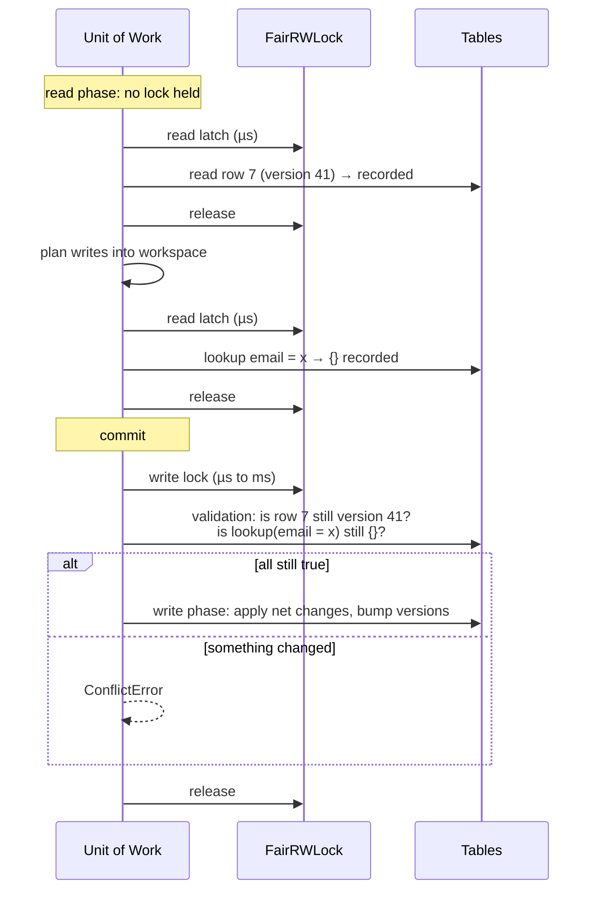

[🏠 Contents](index.md) · [← Previous: Chapter 11 — Readers–Writer Locks](11-readers-writer-locks.md)

# Chapter 12 — Isolation: Optimistic Concurrency Control

A read-write Unit of Work still holds the database's exclusive lock from start to finish. Transactions run one at a time, and a slow one stops everybody. In this chapter we stop holding locks *during* transactions. Each Unit of Work runs freely, writes only to its private workspace, and **records everything it reads**. At commit it takes the exclusive lock for a moment and checks that **everything it read is still true**. If so, it applies its changes. If not, it fails with a `ConflictError` and can be retried.

This is **optimistic concurrency control** (OCC), introduced by Kung and Robinson ([Kung & Robinson 1981](references.md#kung1981)). It bets that conflicts are rare, so it's cheaper to occasionally redo a transaction than to always make everyone wait. The FairRWLock from [Chapter 11](11-readers-writer-locks.md) stays, but now it protects *data structures* for microseconds at a time. That's the *latch* role from [§10.3](10-concurrency-i.md#103-two-kinds-of-protection).

## 12.1 What can go wrong: isolation anomalies

The SQL standard defines isolation in terms of **anomalies**, things that must not happen at a given isolation level. Berenson et al. ([Berenson et al. 1995](references.md#berenson1995)) showed the standard's definitions were incomplete and gave the list most people use today:

| Anomaly | Example | Prevented by |
|---|---|---|
| **Dirty read** | T1 sees T2's uncommitted change, then T2 rolls back | Workspaces ([Ch. 9](09-unit-of-work-ii.md)): nobody sees uncommitted data |
| **Lost update** | T1 and T2 both read `stock = 10`, both write `stock = 9`; one sale vanishes | Validating the rows we overwrite |
| **Non-repeatable read** | T1 reads a row twice and gets different values | Validating rows we read |
| **Phantom** | T1 counts "orders today" twice and gets different counts, because T2 inserted one | Validating *predicates*, not just rows |
| **Write skew** | Two doctors each check "someone else is on call" and both go off call | Validating everything read, not just what's written |

A system that prevents *all* anomalies is **serializable**: every execution is equivalent to running the transactions one at a time in some order ([Eswaran et al. 1976](references.md#eswaran1976); [Bernstein, Hadzilacos & Goodman 1987](references.md#bernstein1987)). [Chapter 10](10-concurrency-i.md)'s big lock was serializable by brute force. We want to keep serializability without the waiting.

Write skew deserves attention because many real databases allow it by default. *Snapshot isolation*, the default "serializable-sounding" level in several popular systems, gives each transaction a consistent snapshot and checks only **write–write** conflicts. Two doctors who each update *their own* row never write the same row, so both commit, and the hospital has nobody on call. Preventing it requires checking what each transaction *read*.

## 12.2 The plan: read set, validation, write

Kung and Robinson split a transaction into three phases:



To validate, we need to know *whether something changed*. So every committed change now gets a **version**: a global commit counter, `commit_seq`. Each table remembers:

- `version`: the commit that last changed *any* of its rows;
- `row_versions[rowid]`: the commit that last changed *that* row.

A `TableView` records three kinds of reads, because the planners and queries read in three ways:

| Read | Recorded as | Still true at commit if… |
|---|---|---|
| `row(rowid)` | rowid → row version | the row's version is unchanged (or it's still absent) |
| `lookup(key)` / `match({col: value})` | the key → set of rowids found | re-running the lookup returns the same set |
| `scan()`, `match(predicate)` | the table's version | no commit has touched the table since |

The second row is how we prevent **phantoms**. A uniqueness check is a lookup: "rows with `email = x`" was empty. If another transaction commits a row with `email = x`, re-running the lookup returns a different set, and the check is no longer true. The same goes for foreign-key checks ("the parent exists") and cascades ("these are all the children"). All our constraint checks are reads, so they're all validated, and constraints stay correct under concurrency without any special code.

The third row is the coarse part. We can't cheaply re-run an arbitrary Python predicate against the table, so any commit to a table invalidates every transaction that *scanned* it. That's correct but pessimistic. A finer scheme would validate predicates ([Eswaran et al. 1976](references.md#eswaran1976) called them *predicate locks*), and [Chapter 14](14-query-planning.md)'s expression objects make that possible (Exercise 5).

Why is "every read is still true at commit" enough for serializability? Because while we hold the exclusive lock, the transaction's reads equal the current state. Its results are therefore exactly what it would have computed had it run *in that instant*, alone. The serial order is the commit order.

## 12.3 Code

The new error:

```python
# minidb/errors.py (append)
class ConflictError(DatabaseError):
    """A concurrent transaction changed something this one read. Retry it."""
```

Tables carry versions. Rowid allocation now happens during planning, *outside* the exclusive lock, so it needs its own small latch. This is exactly Experiment 1 from [§10.2](10-concurrency-i.md#102-breaking-minidb).

```python
# minidb/table.py (replace Table.__init__)
    def __init__(self, schema: TableSchema):
        self.schema = schema
        self.name = schema.name
        self.columns = schema.column_names
        self.rows: dict[int, Row] = {}
        self.indexes: dict[str, HashIndex] = {}
        self.version = 0                          # last commit that changed this table
        self.row_versions: dict[int, int] = {}    # rowid -> last commit that changed it
        self._next_rowid = 1
        self._rowid_latch = threading.Lock()
        if schema.primary_key:
            self.create_index("pk", schema.primary_key, unique=True)
        for cols in schema.unique:
            self.create_index("unique_" + "_".join(cols), cols, unique=True)
```

```python
# minidb/table.py (replace Table.new_rowid)
    def new_rowid(self) -> int:
        with self._rowid_latch:
            rowid = self._next_rowid
            self._next_rowid += 1
            return rowid
```

```python
# minidb/table.py (imports)
import threading
```

The database stamps versions as it applies a commit, decides per mode which lock a Unit of Work holds for its lifetime, and gains a `transaction()` helper that retries on conflict:

```python
# minidb/database.py (replace Database.__init__)
    def __init__(self):
        self.tables: dict[str, Table] = {}
        self.foreign_keys: list[ForeignKey] = []
        self.commit_seq = 0                     # number of the last commit
        self._lock = FairRWLock()
        self._local = threading.local()         # .uow: this thread's active UoW
```

```python
# minidb/database.py (replace Database.apply)
    def apply(self, changes: list[Change]) -> None:
        """Write validated changes as one commit. The caller holds the write lock."""
        self.commit_seq += 1
        seq = self.commit_seq
        for c in changes:
            t = self.tables[c.table]
            if c.after is None:
                t.remove(c.rowid)
                t.row_versions.pop(c.rowid, None)
            else:
                t.put(c.rowid, c.after)
                t.row_versions[c.rowid] = seq
            t.version = seq
```

```python
# minidb/database.py (replace Database._begin)
    def _begin(self, uow) -> None:
        """Called by a new UnitOfWork. Optimistic ones take no lock at all."""
        if self._active_uow() is not None:
            raise TransactionError("this thread already has an active unit of work")
        if uow.readonly:
            self._lock.acquire_read()
        elif uow.exclusive:
            self._lock.acquire_write()
        self._local.uow = uow
```

```python
# minidb/database.py (replace Database._end)
    def _end(self, uow) -> None:
        self._local.uow = None
        if uow.readonly:
            self._lock.release_read()
        elif uow.exclusive:
            self._lock.release_write()
```

```python
# minidb/database.py (replace Database.unit_of_work)
    def unit_of_work(self, *, deferred: bool = False, readonly: bool = False,
                     exclusive: bool = False) -> UnitOfWork:
        return UnitOfWork(self, deferred=deferred, readonly=readonly, exclusive=exclusive)

    def transaction(self, fn, *, retries: int = 5, deferred: bool = False):
        """Run fn(uow) and commit, retrying on ConflictError.

        `fn` may run several times, so it must not have side effects outside
        the database. After `retries` optimistic attempts, the final attempt
        runs exclusively and cannot conflict: every transaction finishes.
        """
        for attempt in range(retries + 1):
            uow = self.unit_of_work(deferred=deferred, exclusive=(attempt == retries))
            try:
                result = fn(uow)
                uow.commit()
                return result
            except ConflictError:
                uow.rollback()
                time.sleep(random.uniform(0, 0.0005 * 2 ** attempt))   # back off
            except BaseException:
                if uow.state == "active":
                    uow.rollback()
                raise
```

```python
# minidb/database.py (replace Database.insert)
    def insert(self, table: str, values: Row) -> int:
        return self.transaction(lambda uow: uow.insert(table, values))
```

```python
# minidb/database.py (replace Database.update)
    def update(self, table: str, changes: Row, where: Where = None) -> int:
        return self.transaction(lambda uow: uow.update(table, changes, where))
```

```python
# minidb/database.py (replace Database.delete)
    def delete(self, table: str, where: Where = None) -> int:
        return self.transaction(lambda uow: uow.delete(table, where))
```

```python
# minidb/database.py (imports)
import random
import time
from minidb.errors import ConflictError
```

```python
# minidb/__init__.py (append)
from minidb.errors import ConflictError
__all__ += ["ConflictError"]
```

Note the **exclusive fallback** in `transaction()`. Optimistic schemes have a fairness problem of their own: a long transaction that reads a lot can lose validation again and again to a stream of short ones. That's starvation, reappearing one level up from [Chapter 11](11-readers-writer-locks.md). Falling back to the exclusive lock after a few failures bounds the number of attempts. The exclusive attempt still has to wait its turn in the FairRWLock queue, so its wait is bounded too.

The Unit of Work changes in many small places, so here is the whole module. The new parts are the read set in `TableView`, `conflicts()`, `_latch()` and the three commit paths.

```python
# minidb/uow.py
"""The Unit of Work: a private workspace, an identity map, atomic commit.

Version 3: optimistic concurrency control. A read-write unit of work holds
no lock while it runs. It records what it read (its *read set*), and at
commit, under the exclusive lock, checks that none of it has changed.
"""
from collections.abc import Iterator, Mapping
from contextlib import nullcontext
from types import MappingProxyType

from minidb import changes as ch
from minidb.changes import Change
from minidb.errors import ConflictError, DatabaseError
from minidb.query import Query

type Row = dict[str, object]


class TransactionError(DatabaseError):
    """The Unit of Work was used in the wrong state (e.g. after commit)."""


class TableView:
    """A table as one unit of work sees it: committed rows + private overlay.

    Every read of committed data happens under a short shared latch and is
    recorded in the read set, so commit can check it is still true.
    """

    def __init__(self, uow, table):
        self.uow, self.base = uow, table
        self.name, self.schema, self.columns = table.name, table.schema, table.columns
        self.overlay: dict[int, Row | None] = {}          # rowid -> row, None = deleted
        # -- the read set ------------------------------------------------------------
        self.scanned_version: int | None = None            # table version at first scan
        self.row_reads: dict[int, int | None] = {}         # rowid -> row version read
        self.key_reads: dict[tuple, frozenset[int]] = {}   # equality read -> rowids seen

    # -- reads of committed data (latched and recorded) ---------------------------------
    def _base_row(self, rowid: int) -> Row | None:
        with self.uow._latch():
            row = self.base.rows.get(rowid)
            self.row_reads.setdefault(rowid, self.base.row_versions.get(rowid))
        return row

    def _base_items(self) -> list[tuple[int, Row]]:
        with self.uow._latch():
            items = list(self.base.rows.items())
            if self.scanned_version is None:
                self.scanned_version = self.base.version
        return items

    def _base_equal(self, kind: str, key: Mapping[str, object]) -> set[int]:
        with self.uow._latch():
            found = (self.base.lookup(key) if kind == "lookup"
                     else set(self.base.match(key)))
        self.key_reads.setdefault((kind, _freeze(key)), frozenset(found))
        return found

    # -- the interface used by planners and queries ------------------------------------
    def row(self, rowid: int) -> Row:
        row = self.overlay[rowid] if rowid in self.overlay else self._base_row(rowid)
        if row is None:
            raise KeyError(rowid)
        return row

    def get(self, rowid: int) -> Row | None:
        try:
            return dict(self.row(rowid))
        except KeyError:
            return None

    def scan(self) -> Iterator[tuple[int, Row]]:
        items = self._base_items()
        seen = set()
        for rowid, row in items:
            seen.add(rowid)
            if rowid in self.overlay:
                row = self.overlay[rowid]
                if row is None:
                    continue
            yield rowid, dict(row)
        for rowid, row in list(self.overlay.items()):     # rows inserted here
            if row is not None and rowid not in seen:
                yield rowid, dict(row)

    def match(self, where=None) -> list[int]:
        if where is None or callable(where):
            return [rid for rid, row in self.scan()
                    if where is None or where(MappingProxyType(row))]
        wanted = {c: self.schema.column(c).prepare(v) for c, v in where.items()}
        found = [rid for rid in self._base_equal("match", wanted) if rid not in self.overlay]
        found += [rid for rid, row in self.overlay.items()
                  if row is not None and _equal(row, wanted)]
        return found

    def lookup(self, key: Mapping[str, object]) -> set[int]:
        found = {rid for rid in self._base_equal("lookup", key) if rid not in self.overlay}
        found |= {rid for rid, row in self.overlay.items()
                  if row is not None and _equal(row, key)}
        return found

    def select(self, where=None) -> list[Row]:
        return [dict(self.row(rid)) for rid in self.match(where)]

    def unique_keys(self) -> list[tuple[str, ...]]:
        return self.base.unique_keys()

    def index_on(self, columns):
        return self.base.index_on(columns)

    def new_rowid(self) -> int:
        return self.base.new_rowid()

    def __len__(self) -> int:
        return sum(1 for _ in self.scan())

    # -- validation (caller holds the exclusive lock) ------------------------------------
    def conflicts(self) -> str | None:
        """Describe the first read that is no longer true, or None."""
        b = self.base
        if self.scanned_version is not None and b.version != self.scanned_version:
            return f"{self.name} changed since it was scanned"
        for rowid, version in self.row_reads.items():
            if b.row_versions.get(rowid) != version:
                return f"{self.name} row {rowid} changed since it was read"
        for (kind, key), seen in self.key_reads.items():
            now = b.lookup(dict(key)) if kind == "lookup" else set(b.match(dict(key)))
            if frozenset(now) != seen:
                return f"{self.name} rows matching {dict(key)} changed"
        return None


def _equal(row: Mapping, key: Mapping) -> bool:
    """SQL equality on every column of `key`: NULL never equals anything."""
    return all(v is not None and row[c] == v for c, v in key.items())


def _freeze(key: Mapping[str, object]) -> tuple:
    return tuple(sorted(key.items(), key=lambda kv: kv[0]))


class Record(dict):
    """A row loaded through a unit of work. Mutate it; commit saves it."""

    def __init__(self, table: str, rowid: int, row: Row):
        super().__init__(row)
        self.table, self.rowid = table, rowid

    def __repr__(self):
        return f"Record({self.table}#{self.rowid}, {dict.__repr__(self)})"


class UnitOfWork:
    """Plan into a private workspace; validate and apply at commit.

    Modes:
      default        optimistic: no lock while running, validate at commit
      readonly=True  shared lock for the whole unit of work; no writes
      exclusive=True exclusive lock for the whole unit of work; never conflicts
    """

    def __init__(self, db, *, deferred: bool = False, readonly: bool = False,
                 exclusive: bool = False):
        if readonly and exclusive:
            raise ValueError("a unit of work cannot be both readonly and exclusive")
        self.db = db
        self.deferred = deferred
        self.readonly = readonly
        self.exclusive = exclusive
        self.state = "active"
        self._views: dict[str, TableView] = {}
        self._changes: list[Change] = []
        self._identity: dict[tuple[str, int], Record] = {}
        self._snapshots: dict[tuple[str, int], Row] = {}
        self._committing = False
        db._begin(self)

    def _latch(self):
        """The short lock around each read of committed data."""
        if self.readonly or self.exclusive or self._committing:
            return nullcontext()                  # we already hold the lock
        return self.db._lock.read()

    def reading(self):
        return nullcontext(self)                  # views latch each read themselves

    # -- the planner "state" interface ---------------------------------------------------
    @property
    def foreign_keys(self):
        return self.db.foreign_keys

    def table(self, name: str) -> TableView:
        view = self._views.get(name)
        if view is None:
            view = self._views[name] = TableView(self, self.db.table(name))
        return view

    # -- writes: plan now, against the workspace -------------------------------------------
    def insert(self, table: str, values: Mapping[str, object]) -> int:
        self._require_active(writing=True)
        self.flush()
        changes = ch.plan_insert(self, table, values, check=not self.deferred)
        self._record(changes)
        return changes[0].rowid

    def update(self, table: str, changes: Mapping[str, object], where=None) -> int:
        self._require_active(writing=True)
        self.flush()
        planned = ch.plan_update(self, table, changes, where, check=not self.deferred)
        self._record(planned)
        return len(planned)

    def delete(self, table: str, where=None) -> int:
        self._require_active(writing=True)
        self.flush()
        planned = ch.plan_delete(self, table, where, check=not self.deferred)
        self._record(planned)
        return sum(1 for c in planned if c.table == table and c.kind == "delete")

    def _record(self, changes: list[Change]) -> None:
        for c in changes:
            self.table(c.table).overlay[c.rowid] = c.after
            self._changes.append(c)
            key = (c.table, c.rowid)
            if key in self._identity:
                if c.after is None:
                    del self._identity[key], self._snapshots[key]
                else:
                    record = self._identity[key]
                    record.clear()
                    record.update(c.after)
                    self._snapshots[key] = dict(c.after)

    # -- reads -------------------------------------------------------------------------
    def get(self, table: str, rowid: int) -> Record | None:
        self._require_active()
        key = (table, rowid)
        if key in self._identity:
            return self._identity[key]
        row = self.table(table).get(rowid)
        if row is None:
            return None
        record = self._identity[key] = Record(table, rowid, row)
        self._snapshots[key] = dict(row)
        return record

    def find(self, table: str, where=None) -> list[Record]:
        self.flush()
        return [self.get(table, rid) for rid in self.table(table).match(where)]

    def select(self, table: str, where=None) -> list[Row]:
        self.flush()
        return self.table(table).select(where)

    def query(self, table: str, alias: str | None = None) -> Query:
        self.flush()
        return Query(self, table, alias)

    # -- dirty checking ---------------------------------------------------------------------
    def flush(self) -> None:
        for key, record in list(self._identity.items()):
            before = self._snapshots[key]
            if record != before:
                self._require_active(writing=True)
                diff = {c: v for c, v in record.items() if before.get(c, _MISSING) != v}
                planned = ch.plan_update(self, key[0], diff, rowids=[key[1]],
                                         check=not self.deferred)
                self._record(planned)

    # -- finishing ---------------------------------------------------------------------
    def commit(self) -> None:
        self._require_active()
        self.flush()
        if self.readonly:
            pass                                  # nothing to write, nothing to check
        elif self.exclusive:
            self._apply()                         # nobody else ran: nothing to validate
        else:
            with self.db._lock.write():           # the only exclusive section
                self._committing = True
                try:
                    self._validate()
                    self._apply()
                finally:
                    self._committing = False
        self.state = "committed"
        self.db._end(self)

    def _validate(self) -> None:
        for view in self._views.values():
            problem = view.conflicts()
            if problem:
                raise ConflictError(problem)

    def _apply(self) -> None:
        if self.deferred:
            ch.check_deferred(self, self._changes)
        self.db.apply(ch.net_changes(self._changes))

    def rollback(self) -> None:
        self._require_active()
        self._views.clear()
        self._changes.clear()
        self._identity.clear()
        self.state = "rolled back"
        self.db._end(self)

    def _require_active(self, writing: bool = False) -> None:
        if self.state != "active":
            raise TransactionError(f"unit of work is already {self.state}")
        if writing and self.readonly:
            raise TransactionError("cannot write in a read-only unit of work")

    def __enter__(self) -> "UnitOfWork":
        return self

    def __exit__(self, exc_type, exc, tb) -> None:
        if self.state != "active":
            return
        if exc_type is not None:
            self.rollback()
            return
        try:
            self.commit()
        except BaseException:
            self.rollback()
            raise


_MISSING = object()
```

Points worth noticing:

- **Reads take the shared latch only for the moment of the read.** `_base_items` copies the table's items under the latch and iterates the copy without it. Holding a lock across a `yield` is the trap from [§10.4](10-concurrency-i.md#104-one-big-lock).
- **Each read is recorded the *first* time.** `setdefault` keeps the earliest version seen. If a later read of the same row returns a newer version, validation still compares against the first, which is conservative and correct.
- **Commit-time reads don't re-take the latch.** Deferred constraint checks run inside the exclusive section. Taking the shared latch there would deadlock, because the lock isn't re-entrant. `_committing` switches latching off.
- **Read-only transactions hold the shared lock for their lifetime** instead of being optimistic. They see a consistent state from start to end and never need to retry, at the cost of making commits wait for them. That's a deliberate trade. Exercise 7 explores MVCC, which avoids even that.

## 12.4 Trying it out

A **lost update**, the classic. Two transactions both read a stock level and both decrement it. With OCC, the second to commit finds that the row it read has changed:

```python
>>> import threading
>>> from minidb import *
>>> db = Database()
>>> _ = db.create_table("stock", [Column("sku", Text()), Column("qty", Integer(min=0))],
...                     primary_key="sku")
>>> _ = db.insert("stock", {"sku": "TEA", "qty": 10})
>>> a_has_read, b_done, log = threading.Event(), threading.Event(), []
>>> def sale_a():
...     uow = db.unit_of_work()
...     item = uow.find("stock", {"sku": "TEA"})[0]       # reads qty = 10
...     a_has_read.set(); b_done.wait()
...     item["qty"] -= 1
...     try:
...         uow.commit()
...     except ConflictError as e:
...         log.append(f"A: {e}")
...         uow.rollback()
>>> def sale_b():
...     a_has_read.wait()
...     with db.unit_of_work() as uow:
...         uow.find("stock", {"sku": "TEA"})[0]["qty"] -= 1
...     log.append("B committed")
...     b_done.set()
>>> threads = [threading.Thread(target=sale_a), threading.Thread(target=sale_b)]
>>> for t in threads: t.start()
>>> for t in threads: t.join()
>>> log
['B committed', 'A: stock row 1 changed since it was read']
>>> db.select("stock")
[{'sku': 'TEA', 'qty': 9}]
```

Retried with `transaction()`, A would have re-read 9 and written 8. **Write skew**: two doctors are on call, and each goes off call if the other is still on. Each transaction updates *only its own row*, so a write–write check sees no conflict:

```python
>>> _ = db.create_table("doctors", [Column("name", Text()), Column("on_call", Boolean())],
...                     primary_key="name")
>>> _ = db.insert("doctors", {"name": "Alice", "on_call": True})
>>> _ = db.insert("doctors", {"name": "Bob", "on_call": True})
>>> def go_off_call(me, ready, go, log):
...     uow = db.unit_of_work()
...     on_call = uow.query("doctors").where(lambda r: r["on_call"]).all()
...     ready.set(); go.wait()
...     if len(on_call) >= 2:
...         uow.update("doctors", {"on_call": False}, where={"name": me})
...     try:
...         uow.commit(); log.append(f"{me} went off call")
...     except ConflictError:
...         uow.rollback(); log.append(f"{me}: conflict")
>>> ready_a, ready_b = threading.Event(), threading.Event()
>>> go_a, go_b, log = threading.Event(), threading.Event(), []
>>> t1 = threading.Thread(target=go_off_call, args=("Alice", ready_a, go_a, log))
>>> t2 = threading.Thread(target=go_off_call, args=("Bob", ready_b, go_b, log))
>>> t1.start(); t2.start()
>>> _ = ready_a.wait(), ready_b.wait()      # both have counted 2 doctors on call
>>> go_a.set(); t1.join()                   # Alice commits first...
>>> go_b.set(); t2.join()                   # ...then Bob tries
>>> log
['Alice went off call', 'Bob: conflict']
>>> [d["name"] for d in db.select("doctors", lambda r: r["on_call"])]
['Bob']
```

The events force both transactions to read before either commits. That's the dangerous interleaving, and the one a real server would hit sooner or later. Bob's query scanned the `doctors` table; Alice's commit changed it; Bob's validation fails. Under snapshot isolation both would have committed.

A **phantom** through a constraint. Two transactions insert the same new key concurrently. Both uniqueness checks see "no such key", but the second commit fails validation because its lookup result changed:

```python
>>> _ = db.create_table("users", [Column("email", Text())], primary_key="email")
>>> u_ready, v_done, log = threading.Event(), threading.Event(), []
>>> def first():
...     uow = db.unit_of_work()
...     uow.insert("users", {"email": "ada@example.org"})   # lookup: no such key
...     u_ready.set(); v_done.wait()
...     try:
...         uow.commit()
...     except ConflictError as e:
...         log.append(str(e)); uow.rollback()
>>> def second():
...     u_ready.wait()
...     db.insert("users", {"email": "ada@example.org"})
...     v_done.set()
>>> threads = [threading.Thread(target=first), threading.Thread(target=second)]
>>> for t in threads: t.start()
>>> for t in threads: t.join()
>>> log
["users rows matching {'email': 'ada@example.org'} changed"]
>>> len(db.select("users"))
1
```

Finally, a stress test. Eight threads each increment a shared counter 200 times through `transaction()`. Every increment conflicts with every concurrent one, yet none is lost, and every transaction finishes:

```python
# run
import sys, threading
from minidb import *

db = Database()
db.create_table("counter", [Column("id", Integer()), Column("n", Integer())], primary_key="id")
db.insert("counter", {"id": 1, "n": 0})
attempts = []

def increment(uow):
    attempts.append(1)
    uow.find("counter", {"id": 1})[0]["n"] += 1

def worker():
    for _ in range(200):
        db.transaction(increment)

threads = [threading.Thread(target=worker) for _ in range(8)]
for t in threads: t.start()
for t in threads: t.join()
n = db.select("counter")[0]["n"]
print(f"GIL={sys._is_gil_enabled()} n={n} attempts={len(attempts)} "
      f"conflicts={len(attempts) - n}")
assert n == 1600
```

```text
GIL=True n=1600 attempts=1633 conflicts=33
GIL=False n=1600 attempts=3189 conflicts=1589
```

A counter that every transaction updates is the *worst* case for OCC: almost every attempt conflicts. When transactions touch different rows, as most real workloads do, conflicts are rare and nobody waits. Choose pessimistic locking for hot spots and optimism everywhere else. That's exactly the hybrid `transaction()` uses.

## 12.5 Isolation in real systems

| System | Default level | Mechanism |
|---|---|---|
| minidb (this chapter) | serializable | OCC with read-set validation; shared lock for read-only |
| SQLite | serializable | one writer at a time (database-level lock), WAL readers see snapshots |
| PostgreSQL | read committed (serializable available) | MVCC snapshots; SSI for serializable |
| MySQL/InnoDB | repeatable read | MVCC + row and gap locks |

Our version validates *everything read*, so it's serializable. The cost is false conflicts from coarse table-level scan tracking. PostgreSQL's *serializable snapshot isolation* tracks read–write dependencies between transactions to detect only dangerous patterns, which gives far fewer false aborts. It's the state of the art and worth reading about once this chapter feels comfortable. See [Bernstein, Hadzilacos & Goodman 1987](references.md#bernstein1987), freely available online, for the theory.

## 12.6 Fairness has a price

One last measurement, because it's easy to believe that "fair" means "fast". One thread inserts 2,000 rows (each `db.insert` is its own transaction) while another repeatedly runs a `COUNT(*)` over the same table. Here are the results on the free-threaded build, with the database code from three chapters:

| Code from | Lock | Time for 2,000 inserts | Reader queries meanwhile |
|---|---|---|---|
| [Chapter 10](10-concurrency-i.md) | one `threading.Lock` | 0.4 s | 527 |
| [Chapter 11](11-readers-writer-locks.md) | `FairRWLock`, exclusive UoWs | 2.0 s | 1,991 |
| this chapter | `FairRWLock` latches + OCC | 2.0 s | 1,999 |

`threading.Lock` makes no promise about order. A thread that releases it and immediately asks again usually wins, so the writer raced through its inserts and the reader got a turn now and then. The fair lock does exactly what it promises: it alternates. Every insert waits behind one full scan, and every scan waits behind one insert. The writer is five times slower, and the reader does four times as much work.

Neither is "right". Fairness bounds the *worst-case* wait. Unfair locks often give better *throughput*, because a thread that already has the CPU and warm caches keeps going. The queues of threads that form behind a fair lock are called *convoys*, and real systems fight them with tricks such as letting a releasing thread keep the lock briefly ("barging"), batching writers, or shortening what readers hold the lock for, which is what MVCC achieves (Exercise 7). The lesson for a database designer is to decide *which* guarantee you need, measure, and be suspicious of any lock that claims to give both.

## Questions and exercises

1. Why must the uniqueness lookup be recorded by its *result set* rather than by the versions of the rows it found? Construct a phantom that row versions alone would miss.
2. A transaction reads row 7, a concurrent transaction updates row 7 *back to the same values*, and the first commits. Our validation reports a conflict. Is that necessary for serializability? How could you avoid it, and what would it cost?
3. Change `TableView.conflicts` to report *all* problems, not just the first. Use it to print a "conflict report" from the write-skew example.
4. **Backward vs forward validation.** We validate a committing transaction against those that committed before it (*backward*). Kung and Robinson also describe *forward* validation against transactions still running. What would minidb need to track for that?
5. **Predicate validation.** Once [Chapter 14](14-query-planning.md) gives us expression objects, `match(expr)` can record the expression and re-evaluate it at commit, only against rows changed since the read. Sketch the data structure you'd need (hint: per-table lists of changed rowids per commit).
6. `transaction()` backs off with random sleeps that grow exponentially. Why randomize? What happens with fixed delays when two transactions keep conflicting?
7. **MVCC.** Instead of holding a shared lock, a read-only transaction could read a *snapshot*: each table keeps old row versions tagged by commit number, and a reader started at commit 41 sees each row as it was at commit 41. Sketch the changes to `Table.put`/`remove` and to `TableView`. When can old versions be thrown away?
8. A single `uow.insert` takes the shared latch several times: once per lookup (primary key, each unique key, each foreign-key parent). Under a fair lock, each acquisition may wait behind a whole queue. Change the Unit of Work to take the latch *once per operation* instead, and re-run the measurement in §12.6.
9. *(Thought experiment)* Our validation needs the exclusive lock, so commits are serialized. Is that a bottleneck? How long does a commit hold the lock, as a function of the transaction's read set and write set?

---

[🏠 Contents](index.md) · [Next: Chapter 13 — Persistence →](13-persistence.md)
