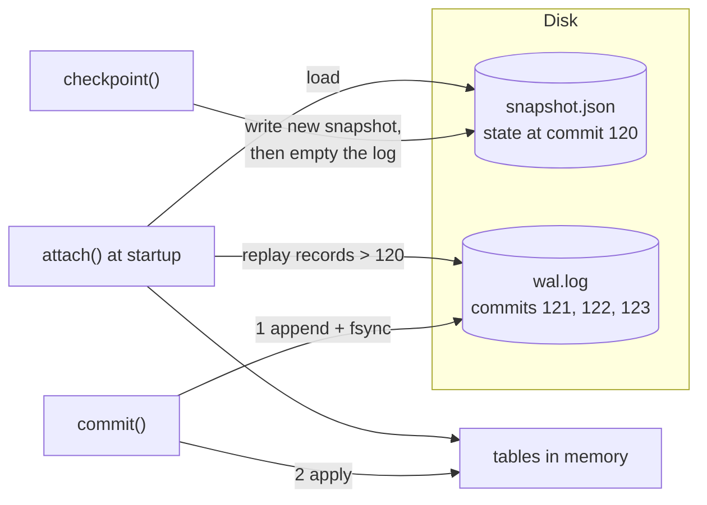

[🏠 Contents](index.md) · [← Previous: Chapter 12 — Isolation](12-isolation.md)

# Chapter 13 — Persistence: Snapshots, a Write-Ahead Log and Pluggable Formats

Everything so far lives in memory and vanishes when the process exits. This chapter adds the **D** of ACID, durability: once `commit()` returns, the data survives a crash, even a power cut in the middle of the next commit.

We keep the in-memory design. Tables stay dicts, and disk is used only to *reconstruct* them on startup. That's how Redis, many embedded stores and most "main-memory databases" work. It uses two files:

- a **snapshot**: the whole database at some commit, written occasionally;
- a **write-ahead log** (WAL): one record per commit since the snapshot, appended and flushed *before* the commit is applied in memory.

On startup we load the snapshot and replay the log. Both files are written through a **pluggable `Format`**, so the encoding (JSON here) can be swapped without touching anything else.



## 13.1 Values on disk

A format like JSON knows strings, numbers, booleans, lists, dicts and null. It knows nothing of `Decimal`, `date` or `datetime`. Each `Type` therefore learns to convert its canonical values to and from *primitives*. Writing is a one-liner in the base class: anything that isn't natively a primitive, a `Decimal` or a date, is written as its string form, which is exact. Reading back is free: `from_primitive` just calls `normalize`, which already accepts decimal strings for `Numeric` and ISO strings for dates ([Chapter 3](03-types-and-normalization.md)). That's a nice payoff of the "lenient input, strict output" design.

```python
# src/minidb/types.py (add to Type)
    def to_primitive(self, value: Value | None) -> Primitive:
        """Convert a canonical value into something any :class:`Format` can store.

        :param value: a value of this type, or ``None``.
        :return: the value itself, in the base class.
        """
        return value if not isinstance(value, Decimal | dt.date) else str(value)

    def from_primitive(self, value: Primitive) -> T | None:
        """Convert a stored primitive back into a canonical value, and validate it.

        :param value: what :meth:`to_primitive` produced.
        :return: the canonical value, or ``None``.
        :raises DomainError: if the stored value is not valid for this type.
        """
        result = self.normalize(value)
        self.validate(result)
        return result
```

```python
# src/minidb/types.py (typing imports)
from minidb.values import Primitive
```

And a name for "something any format can store", next to `Value`. It's a *recursive* type alias: a primitive can be a list or dict of primitives.

```python
# src/minidb/values.py (append)
type Primitive = bool | int | float | str | list[Primitive] | dict[str, Primitive] | None
```

```python
# src/minidb/types.py (add to Timestamp)
    @override
    def to_primitive(self, value: Value | None) -> Primitive:
        return value.isoformat() if isinstance(value, dt.datetime) else None
```

Only `Timestamp` overrides `to_primitive`, to write the standard ISO form with a `T` between date and time rather than `str()`'s space. `Real` needs nothing special: Python's `repr` of a float round-trips exactly through JSON, and we banned NaN in [§3.2](03-types-and-normalization.md#32-the-type-base-class), which JSON can't represent anyway.

## 13.2 Formats

A `Format` turns a structure of primitives into bytes and back. That's the whole interface:

```python
# src/minidb/storage.py
"""Make data durable: pluggable formats, an atomic snapshot and a write-ahead log."""

import hashlib
import json
import os
import struct
import threading
import zlib
from pathlib import Path
from typing import TYPE_CHECKING
from typing import Protocol
from typing import TypedDict

if TYPE_CHECKING:
    from collections.abc import Iterator
    from collections.abc import Mapping
    from collections.abc import Sequence
    from io import BufferedWriter

    from minidb.schema import ForeignKey
    from minidb.schema import TableSchema
    from minidb.table import Table
    from minidb.values import Primitive
    from minidb.values import Row


class Format(Protocol):
    """Describe a file format: how to turn primitives into bytes, and back."""

    name: str
    suffix: str

    def dumps(self, obj: object) -> bytes:
        """Encode a structure of primitives (dicts, lists, strings, numbers, None)."""
        ...

    def loads(self, data: bytes) -> object:
        """Decode what :meth:`dumps` produced."""
        ...


class JsonFormat:
    """Store primitives as compact UTF-8 JSON.

    >>> JsonFormat().loads(JsonFormat().dumps({"a": [1, None, "x"]}))
    {'a': [1, None, 'x']}
    """

    name = "json"
    suffix = ".json"

    def dumps(self, obj: object) -> bytes:
        """Encode ``obj`` as JSON; NaN and infinities are refused.

        :param obj: a structure of primitives.
        :return: the encoded bytes.
        :raises ValueError: if ``obj`` contains NaN or an infinity.
        """
        return json.dumps(obj, ensure_ascii=False, separators=(",", ":"), allow_nan=False).encode()

    def loads(self, data: bytes) -> object:
        """Decode JSON bytes.

        :param data: what :meth:`dumps` produced.
        :return: the decoded structure.
        :raises ValueError: if ``data`` is not valid JSON.
        """
        result: object = json.loads(data.decode())
        return result
```

`allow_nan=False` makes `json` raise rather than write the non-standard `NaN` token. It's a second line of defence behind the type system.

`Format` is a protocol, so swapping formats means writing any class with a `name`, a `suffix`, `dumps` and `loads`, without inheriting from anything. Exercise 1 asks for a `PickleFormat` and a hand-written binary one. Everything that follows uses only `dumps` and `loads`.

## 13.3 Encoding the database

Rows are stored as **lists in column order**, not dicts, so column names aren't repeated a million times. The schema itself is *not* stored, because parts of it are Python code: check predicates, normalizers, callable defaults. Instead the application declares its tables in code on every start, as with most ORMs, and we store a **fingerprint** of the declarative parts. Loading into a database whose schema differs is refused, not silently misread.

The shapes of a snapshot and a log record are written down as `TypedDict`s. They're ordinary dicts at run time, but the type checker knows which keys each one has, and what type each value is.

```python
# src/minidb/storage.py (append)
def encode_row(schema: TableSchema, row: Row) -> list[Primitive]:
    """Encode a row as a list of primitives, in column order.

    :param schema: the row's table.
    :param row: the row.
    :return: one primitive per column.
    """
    return [c.type.to_primitive(row[c.name]) for c in schema.columns]


def decode_row(schema: TableSchema, values: Sequence[Primitive]) -> Row:
    """Decode what :func:`encode_row` produced, validating every value.

    :param schema: the row's table.
    :param values: one primitive per column.
    :return: the row.
    :raises ValueError: if the number of values is wrong.
    :raises DomainError: if a value is not valid for its column.
    """
    if len(values) != len(schema.columns):
        raise ValueError(f"{schema.name}: stored row has {len(values)} values")
    return {c.name: c.type.from_primitive(v) for c, v in zip(schema.columns, values, strict=True)}


def schema_fingerprint(tables: Mapping[str, Table], foreign_keys: Sequence[ForeignKey]) -> str:
    """Hash everything declarative about a schema; checks and defaults are code, and left out.

    :param tables: the tables, by name.
    :param foreign_keys: the foreign keys between them.
    :return: a short hexadecimal digest.
    """
    parts: list[object] = []
    for name in sorted(tables):
        s = tables[name].schema
        parts.append((name, [(c.name, repr(c.type), c.nullable) for c in s.columns], s.primary_key, sorted(s.unique)))
    parts.append(sorted((fk.table, fk.columns, fk.ref_table, fk.ref_columns, fk.on_delete) for fk in foreign_keys))
    return hashlib.sha256(repr(parts).encode()).hexdigest()[:16]


class TableData(TypedDict):
    """Describe one table in a snapshot."""

    next_rowid: int
    rows: list[tuple[int, list[Primitive]]]


class Snapshot(TypedDict):
    """Describe a snapshot: the whole database at one commit."""

    format: int
    fingerprint: str
    commit_seq: int
    tables: dict[str, TableData]


class LogRecord(TypedDict):
    """Describe one commit in the write-ahead log."""

    seq: int
    changes: list[tuple[str, int, list[Primitive] | None]]  # (table, rowid, values or None)
```

## 13.4 Writing files that survive crashes

Two rules make file writes crash-safe. They are the heart of this chapter.

**Rule 1: replace whole files atomically.** Never overwrite a snapshot in place: a crash half way leaves half a file. Write a temporary file, `fsync` it, then `os.replace` it over the old one. On POSIX systems a rename within a directory is atomic, so afterwards the path names either the complete old file or the complete new one. Then `fsync` the *directory*, because the rename itself is directory metadata that may otherwise sit in a cache.

**Rule 2: make log records self-checking.** An append can be torn by a crash: half a record reaches the disk. Each record is therefore **framed** with its length and a CRC-32 checksum:

```text
┌──────────────┬──────────────┬───────────────────────────────┐
│ length (4 B) │ crc32 (4 B)  │ payload (format.dumps(record)) │
└──────────────┴──────────────┴───────────────────────────────┘
```

On recovery we read frames until the file ends, a frame is short, or a checksum doesn't match. Everything before that point is intact. Everything after it is the torn tail of a commit that never returned, so we truncate it. The frame is format-independent: JSON, pickle or anything else goes in the payload.

And underneath both rules: **`fsync` before claiming success.** `write()` only hands bytes to the operating system's cache; a power cut can still lose them. `os.fsync` waits until the device reports them stored. It's slow (milliseconds on many disks), which is why databases batch commits. Even `fsync` is less simple than it looks: Pillai et al. ([Pillai et al. 2014](references.md#pillai2014)) found crash-consistency bugs in many widely used systems, and SQLite's [atomic commit document](references.md#sqlite-atomic) is a superb account of everything that can go wrong.

```python
# src/minidb/storage.py (append)
_FRAME = struct.Struct(">II")  # payload length, crc32


class Storage:
    """Keep a database in a directory: ``snapshot<suffix>`` plus ``wal.log``.

    :param directory: where the files live; created if missing.
    :param fmt: the format of the snapshot and log payloads;
        ``None`` (the default) means :class:`JsonFormat`.
    :param sync: whether to ``fsync`` before reporting a write as done;
        ``True`` by default. ``False`` is faster but not crash-safe.
    """

    def __init__(self, directory: str | os.PathLike[str], fmt: Format | None = None, *, sync: bool = True) -> None:
        self.dir = Path(directory)
        self.dir.mkdir(parents=True, exist_ok=True)
        self.format: Format = fmt if fmt is not None else JsonFormat()
        self.sync = sync
        self.snapshot_path = self.dir / f"snapshot{self.format.suffix}"
        self.log_path = self.dir / "wal.log"
        self._latch = threading.Lock()  # serializes file operations
        self._log: BufferedWriter | None = None

    # -- snapshot ----------------------------------------------------------------------
    def write_snapshot(self, state: Snapshot) -> None:
        """Replace the snapshot atomically: write a temporary file, then rename it.

        :param state: the whole database.
        """
        tmp = self.snapshot_path.with_name(self.snapshot_path.name + ".tmp")
        with self._latch:
            with tmp.open("wb") as f:
                f.write(self.format.dumps(state))
                self._fsync(f)
            tmp.replace(self.snapshot_path)  # atomic switch
            self._fsync_dir()

    def read_snapshot(self) -> Snapshot | None:
        """Return the last snapshot, or ``None`` if there is none yet.

        :return: the snapshot, or ``None``.
        """
        if not self.snapshot_path.exists():
            return None
        return cast("Snapshot", self.format.loads(self.snapshot_path.read_bytes()))

    # -- log ------------------------------------------------------------------------------
    def append(self, record: LogRecord) -> None:
        """Append one framed record to the log, and make it durable.

        :param record: the commit to log.
        """
        payload = self.format.dumps(record)
        frame = _FRAME.pack(len(payload), zlib.crc32(payload)) + payload
        with self._latch:
            if self._log is None:
                self._log = self.log_path.open("ab")
            self._log.write(frame)
            self._fsync(self._log)

    def read_log(self) -> Iterator[LogRecord]:
        """Yield the intact records, then cut off any torn or corrupt tail.

        :return: an iterator over the logged commits, oldest first.
        """
        if not self.log_path.exists():
            return
        data = self.log_path.read_bytes()
        pos = 0
        while (payload := _frame_at(data, pos)) is not None:
            yield cast("LogRecord", self.format.loads(payload))
            pos += _FRAME.size + len(payload)
        if pos < len(data):
            with self._latch, self.log_path.open("r+b") as f:
                f.truncate(pos)
                self._fsync(f)

    def truncate_log(self) -> None:
        """Empty the log, after a snapshot has made its records redundant."""
        with self._latch:
            if self._log is not None:
                self._log.close()
                self._log = None
            with self.log_path.open("wb") as f:
                self._fsync(f)

    def close(self) -> None:
        """Close the log file, if it is open."""
        with self._latch:
            if self._log is not None:
                self._log.close()
                self._log = None

    # -- fsync helpers --------------------------------------------------------------------
    def _fsync(self, f: BufferedWriter | BufferedRandom) -> None:
        f.flush()
        if self.sync:
            os.fsync(f.fileno())

    def _fsync_dir(self) -> None:
        if not self.sync or os.name != "posix":
            return  # Windows can't open directories
        fd = os.open(self.dir, os.O_RDONLY)
        try:
            os.fsync(fd)
        finally:
            os.close(fd)


def _frame_at(data: bytes, pos: int) -> bytes | None:
    """Return the payload of the intact frame at ``pos``, or ``None`` if there isn't one."""
    if pos + _FRAME.size > len(data):
        return None
    length, crc = _FRAME.unpack_from(data, pos)
    payload = data[pos + _FRAME.size : pos + _FRAME.size + length]
    if len(payload) < length or zlib.crc32(payload) != crc:
        return None  # torn write
    return payload
```

```python
# src/minidb/storage.py (imports)
from typing import cast
```

```python
# src/minidb/storage.py (typing imports)
from io import BufferedRandom
```

`sync=False` skips the `fsync`s. It's useful for tests and for data you can rebuild. SQLite exposes the same trade-off as `PRAGMA synchronous`.

## 13.5 The database side

The **write-ahead rule**: a commit's log record must be on disk *before* the commit changes anything in memory. If we crash after the append, recovery replays the commit. If we crash before it, the commit never happened, and its caller never got a return value. Either way, what's in memory after recovery matches what callers were told.

`Database.apply` is the single write path we built in [Chapter 9](09-unit-of-work-ii.md), so it's the only place that needs to log:

```python
# src/minidb/database.py (replace Database.apply)
    def apply(self, changes: Sequence[Change]) -> None:
        """Write validated changes as one commit: log first, then memory.

        The caller holds the exclusive lock.

        :param changes: the changes to write.
        """
        seq = self.commit_seq + 1
        if self.storage is not None:  # the write-ahead rule
            self.storage.append({"seq": seq, "changes": [self._encode(c) for c in changes]})
        self.commit_seq = seq
        for c in changes:
            self._apply_one(c.table, c.rowid, c.after, seq)

    def _encode(self, c: Change) -> tuple[str, int, list[Primitive] | None]:
        values = None if c.after is None else encode_row(self.tables[c.table].schema, c.after)
        return (c.table, c.rowid, values)

    def _apply_one(self, table: str, rowid: int, row: Row | None, seq: int) -> None:
        t = self.tables[table]
        if row is None:
            if rowid in t.rows:
                t.remove(rowid)
            t.row_versions.pop(rowid, None)
        else:
            t.put(rowid, row)
            t.row_versions[rowid] = seq
            t.reserve_rowid(rowid)
        t.version = seq
```

Replaying the log needs to move a table's rowid counter past the rowids it sees, and a snapshot needs to save the counter. Two small methods on `Table` do that:

```python
# src/minidb/table.py (add to Table)
    @property
    def next_rowid(self) -> int:
        """Return the rowid the next insert will get."""
        return self._next_rowid

    def reserve_rowid(self, rowid: int) -> None:
        """Make sure the counter never hands out ``rowid``, or anything below it.

        :param rowid: a rowid that is in use.
        """
        with self._rowid_latch:
            self._next_rowid = max(self._next_rowid, rowid + 1)
```

Attaching storage loads the snapshot, replays the log, and from then on logs every commit. A checkpoint writes a fresh snapshot and empties the log. It needs only the *shared* lock: readers may continue, and writers wait, which is exactly what's needed for the snapshot to be one consistent state.

```python
# src/minidb/database.py (add to Database)
    # -- persistence ---------------------------------------------------------------------
    def attach(self, storage: Storage) -> None:
        """Load the saved data, and log every future commit to ``storage``.

        Declare the tables first, then attach.

        :param storage: where the data lives.
        :raises SchemaError: if storage is already attached, data was
            inserted before attaching, or the stored data was written with a
            different schema.
        """
        with self.exclusive_lock():
            self._check_attachable()
            state = storage.read_snapshot()
            if state is not None:
                self._load_state(state)
            for record in storage.read_log():
                if record["seq"] > self.commit_seq:  # else it is in the snapshot already
                    self._replay(record)
            self.storage = storage

    def _check_attachable(self) -> None:
        if self.storage is not None:
            raise SchemaError("storage already attached")
        if any(len(t) for t in self.tables.values()):
            raise SchemaError("attach storage before inserting data")

    def _replay(self, record: LogRecord) -> None:
        for table, rowid, values in record["changes"]:
            row = None if values is None else decode_row(self.tables[table].schema, values)
            self._apply_one(table, rowid, row, record["seq"])
        self.commit_seq = record["seq"]

    def checkpoint(self) -> None:
        """Write a snapshot and empty the log. Writers wait; readers don't.

        :raises SchemaError: if no storage is attached.
        """
        if self.storage is None:
            raise SchemaError("no storage attached")
        with self.shared_lock():
            tables: dict[str, TableData] = {
                name: {
                    "next_rowid": t.next_rowid,
                    "rows": [(rid, encode_row(t.schema, row)) for rid, row in t.rows.items()],
                }
                for name, t in self.tables.items()
            }
            self.storage.write_snapshot(
                {"format": 1, "fingerprint": self._fingerprint(), "commit_seq": self.commit_seq, "tables": tables}
            )
            self.storage.truncate_log()

    def _fingerprint(self) -> str:
        return schema_fingerprint(self.tables, self.foreign_keys)

    def _load_state(self, state: Snapshot) -> None:
        if state["fingerprint"] != self._fingerprint():
            raise SchemaError("stored data was written with a different schema")
        self.commit_seq = state["commit_seq"]
        for name, data in state["tables"].items():
            t = self.tables[name]
            for rowid, values in data["rows"]:
                t.put(rowid, decode_row(t.schema, values))
                t.row_versions[rowid] = self.commit_seq
            t.reserve_rowid(data["next_rowid"] - 1)
            t.version = self.commit_seq

    def close(self) -> None:
        """Close the attached storage's files, if any."""
        if self.storage is not None:
            self.storage.close()
```

```python
# src/minidb/database.py (replace Database.__init__)
    def __init__(self, *, lock: RWLock | None = None) -> None:
        self.tables: dict[str, Table] = {}
        self.foreign_keys: list[ForeignKey] = []
        self.commit_seq = 0
        self.storage: Storage | None = None
        self._lock: RWLock = lock if lock is not None else FairRWLock()
        self._local = threading.local()
```

```python
# src/minidb/database.py (imports)
from minidb.storage import decode_row
from minidb.storage import encode_row
from minidb.storage import schema_fingerprint
```

```python
# src/minidb/database.py (typing imports)
from minidb.storage import LogRecord
from minidb.storage import Snapshot
from minidb.storage import Storage
from minidb.storage import TableData
from minidb.values import Primitive
```

```python
# src/minidb/__init__.py (replace __all__)
__all__ = [
    "Avg",
    "Boolean",
    "Change",
    "Check",
    "CheckError",
    "Column",
    "ConflictError",
    "ConstraintError",
    "Count",
    "Database",
    "DatabaseError",
    "Date",
    "DomainError",
    "FairRWLock",
    "ForeignKey",
    "ForeignKeyError",
    "Format",
    "Integer",
    "JsonFormat",
    "Max",
    "Min",
    "NotNullError",
    "Numeric",
    "Query",
    "Real",
    "Record",
    "SchemaError",
    "Storage",
    "Sum",
    "TableSchema",
    "Text",
    "Timestamp",
    "TransactionError",
    "UniqueError",
    "UnitOfWork",
    "normalizers",
]
```

```python
# src/minidb/__init__.py (imports)
from minidb.storage import Format
from minidb.storage import JsonFormat
from minidb.storage import Storage
```

Three subtleties:

- **The crash window inside `checkpoint`.** If we crash after writing the new snapshot but before emptying the log, the log still holds commits the snapshot already contains. Recovery skips records whose `seq` is not above the snapshot's `commit_seq`. Sequence numbers make replay *idempotent*.
- **Replay moves the rowid counter forward** (`Table.reserve_rowid`). The log only contains committed rows. A rowid used by a transaction that rolled back may be handed out again after a restart. That's harmless, because no committed data ever referred to it.
- **Constraints are not re-checked during recovery.** Every logged commit was valid when it was written. The checksum protects against torn writes, but not against a buggy older version of the code. Exercise 5 adds a verification pass.

## 13.6 Trying it out

```python
>>> import tempfile, os
>>> from decimal import Decimal
>>> from minidb import *
>>> folder = tempfile.mkdtemp()
>>> def open_db():
...     db = Database()
...     db.create_table("accounts", [Column("id", Integer()), Column("owner", Text()),
...                                  Column("balance", Numeric(10, 2)),
...                                  Column("opened", Date())], primary_key="id")
...     db.attach(Storage(folder, JsonFormat(), sync=False))
...     return db
>>> db = open_db()
>>> _ = db.insert("accounts", {"id": 1, "owner": "Ada", "balance": "100.00", "opened": "2026-01-05"})
>>> _ = db.insert("accounts", {"id": 2, "owner": "Alan", "balance": "50.00", "opened": "2026-02-01"})
>>> db.checkpoint()
>>> _ = db.update("accounts", {"balance": "75.25"}, where={"id": 2})
>>> db.close()
>>> sorted(os.listdir(folder))
['snapshot.json', 'wal.log']
>>> import json
>>> snap = json.loads(open(os.path.join(folder, "snapshot.json"), "rb").read())
>>> snap["commit_seq"], snap["tables"]["accounts"]["rows"]
(2, [[1, [1, 'Ada', '100.00', '2026-01-05']], [2, [2, 'Alan', '50.00', '2026-02-01']]])
```

The snapshot holds commits 1 and 2. The update (commit 3) is only in the log. Re-opening combines the two:

```python
>>> db = open_db()                           # snapshot (2 rows) + log (1 update)
>>> db.select("accounts", {"id": 2})
[{'id': 2, 'owner': 'Alan', 'balance': Decimal('75.25'), 'opened': datetime.date(2026, 2, 1)}]
>>> db.commit_seq
3
```

A torn write. Append half a record to the log, as a crash during `append` would:

```python
>>> _ = db.insert("accounts", {"id": 3, "owner": "Grace", "balance": "1.00", "opened": "2026-03-03"})
>>> db.close()
>>> with open(os.path.join(folder, "wal.log"), "ab") as f:
...     _ = f.write(b"\x00\x00\x01\x00garbage")             # a torn frame
>>> db = open_db()
>>> [r["owner"] for r in db.query("accounts").order_by("id")]
['Ada', 'Alan', 'Grace']
>>> db.close()
```

A schema mismatch is refused:

```python
>>> other = Database()
>>> _ = other.create_table("accounts", [Column("id", Integer())], primary_key="id")
>>> other.attach(Storage(folder, sync=False))
Traceback (most recent call last):
  ...
minidb.errors.SchemaError: stored data was written with a different schema
```

### Pulling the plug

The real test of durability is killing the process at a random moment. `examples/crash_test.py` starts a child process, `examples/crash_child.py`, that performs money transfers as fast as it can, with `fsync` on. It kills the child with `SIGKILL` (no cleanup, no `finally` blocks), then recovers the database and checks that no money was created or destroyed: every transfer is either entirely present or entirely absent.

```python
# examples/crash_child.py
"""Make money transfers against a database on disk as fast as possible, forever.

``examples.crash_test`` starts this program and kills it at a random moment.
"""

import random
import sys

from minidb import Column
from minidb import Database
from minidb import Integer
from minidb import Storage
from minidb import UnitOfWork

ACCOUNTS, START = 10, 1000


def open_db(folder: str) -> Database:
    """Declare the schema and attach the storage in ``folder``.

    :param folder: the database directory.
    :return: the database, with its saved data loaded.
    """
    db = Database()
    db.create_table("acct", [Column("id", Integer()), Column("bal", Integer(min=0))], primary_key="id")
    db.attach(Storage(folder))
    return db


def move(uow: UnitOfWork, a: int, b: int, amount: int) -> None:
    """Move ``amount`` from account ``a`` to account ``b``, if ``a`` has enough.

    :param uow: the transaction.
    :param a: the paying account.
    :param b: the receiving account.
    :param amount: the sum to move.
    """
    src, dst = uow.find("acct", {"id": a})[0], uow.find("acct", {"id": b})[0]
    if int(src["bal"] or 0) >= amount:
        src["bal"] = int(src["bal"] or 0) - amount
        dst["bal"] = int(dst["bal"] or 0) + amount


def main() -> None:
    """Fill the accounts if needed, say "ready", then transfer until killed."""
    if len(sys.argv) != 2:
        print("usage: python -m examples.crash_child FOLDER")
        return
    db = open_db(sys.argv[1])
    if not db.select("acct"):
        with db.unit_of_work() as uow:
            for i in range(ACCOUNTS):
                uow.insert("acct", {"id": i, "bal": START})
    print("ready", flush=True)
    rnd = random.Random()  # noqa: S311 - test data, not cryptography
    while True:
        a, b = rnd.sample(range(ACCOUNTS), 2)
        n = rnd.randint(1, 50)
        db.transaction(lambda uow, a=a, b=b, n=n: move(uow, a, b, n))


if __name__ == "__main__":
    main()
```

```python
# examples/crash_test.py
"""Kill a process that is committing transfers, recover its database, and check the total.

Every transfer is either entirely present or entirely absent, so the total
must always be what it was at the start.
"""

import subprocess
import sys
import tempfile
import time

from examples.crash_child import ACCOUNTS
from examples.crash_child import START
from examples.crash_child import open_db


def main() -> None:
    """Kill and recover the child five times, checkpointing once in between."""
    folder = tempfile.mkdtemp()
    for round_ in range(5):
        child = subprocess.Popen(  # noqa: S603 - runs this interpreter on our own module
            [sys.executable, "-m", "examples.crash_child", folder], stdout=subprocess.PIPE, text=True
        )
        assert child.stdout is not None
        child.stdout.readline()  # wait for "ready"
        time.sleep(0.2 + round_ * 0.1)
        child.kill()  # SIGKILL: no cleanup at all
        child.wait()
        child.stdout.close()
        db = open_db(folder)
        total = sum(int(r["bal"] or 0) for r in db.select("acct"))
        print(f"round {round_}: recovered commit {db.commit_seq:>5}, total = {total}")
        assert total == ACCOUNTS * START
        if round_ == 2:
            db.checkpoint()  # also survive a kill after a checkpoint
        db.close()


if __name__ == "__main__":
    main()
```

```text
round 0: recovered commit   660, total = 10000
round 1: recovered commit  1772, total = 10000
round 2: recovered commit  2998, total = 10000
round 3: recovered commit  4545, total = 10000
round 4: recovered commit  6083, total = 10000
```

Commit numbers keep growing across kills, and the total is always 10,000.

## 13.7 Real-world notes

- **Group commit.** One `fsync` per commit limits a disk to a few hundred commits per second. Real databases let concurrent transactions *share* an fsync: whoever flushes the log flushes everyone's records written so far. Exercise 4.
- **Logical vs physical logging.** We log *rows* (after-images): "row 7 of `accounts` is now [...]". Disk-based databases mostly log *page* changes, and ARIES combines redo and undo logging with careful rules about when pages may be written ([Mohan et al. 1992](references.md#mohan1992)). Our design needs no undo log because uncommitted data never leaves the workspace.
- **Formats.** JSON is readable and slow. A real system uses a compact binary encoding. Because `Storage` only calls `dumps` and `loads`, the format is one small class. That's the reason we made it pluggable.

## Questions and exercises

1. Write `PickleFormat` (careful: never unpickle untrusted files, because pickle can execute code). Then write `CompactFormat`, a hand-written binary encoding for our primitives using `struct` (a type tag byte, then the value). Compare file sizes and load times with JSON on 100,000 rows.
2. Why does `apply` append to the log *before* changing memory? Describe a crash scenario that loses an acknowledged commit if the order is reversed.
3. `read_log` stops at the first bad frame. Could a *valid* record ever follow a bad one? When might you want to keep scanning? (Hint: some file systems can reorder writes after a crash. Look up "torn writes" and "write barriers".)
4. **Group commit.** Change `Storage.append` to only `write`, add a `sync()` method, and make commits wait until a background flusher has `fsync`ed past their record. Measure commits per second with 1, 4 and 16 committing threads.
5. Add `Database.verify()`, which re-runs every constraint over all data (types, NOT NULL, checks, uniqueness, foreign keys) and reports violations. When would you run it automatically?
6. The fingerprint excludes checks and defaults. Describe a schema change that keeps the fingerprint but makes stored data invalid. How do real databases handle schema migrations?
7. Our snapshot holds the shared lock while encoding *every row*. For a large database that blocks writers for seconds. Sketch a *fuzzy checkpoint*: copy one table at a time, and record from which log position replay must start.
8. *(Research)* Read SQLite's [atomic commit](references.md#sqlite-atomic) document. SQLite's rollback journal stores *before*-images, and its WAL mode stores *after*-images. Which of the two does minidb resemble? What does SQLite do that minidb doesn't?

*Answers: [Appendix D, Chapter 13](appendix-d-answers.md#chapter-13--persistence).*

---

[🏠 Contents](index.md) · [Next: Chapter 14 — Query Planning →](14-query-planning.md)
