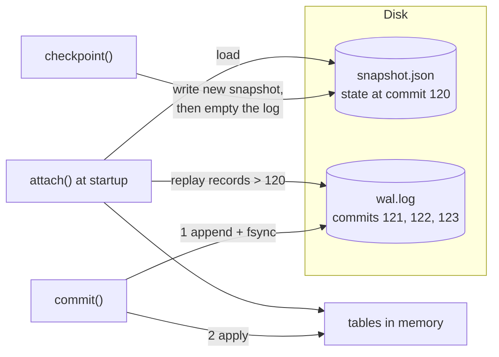

[🏠 Contents](index.md) · [← Previous: Chapter 12 — Isolation](12-isolation.md)

# Chapter 13 — Persistence: Snapshots, a Write-Ahead Log and Pluggable Formats

Everything so far lives in memory and vanishes when the process exits. This chapter adds the **D** of ACID, durability: once `commit()` returns, the data survives a crash, even a power cut in the middle of the next commit.

We keep the in-memory design. Tables stay dicts, and disk is used only to *reconstruct* them on startup. That's how Redis, many embedded stores and most "main-memory databases" work. It uses two files:

- a **snapshot**: the whole database at some commit, written occasionally;
- a **write-ahead log** (WAL): one record per commit since the snapshot, appended and flushed *before* the commit is applied in memory.

On startup we load the snapshot and replay the log. Both files are written through a **pluggable `Format`**, so the encoding (JSON here) can be swapped without touching anything else.



## 13.1 Values on disk

A format like JSON knows strings, numbers, booleans, lists, dicts and null. It knows nothing of `Decimal`, `date` or `datetime`. Each `Type` therefore learns to convert its canonical values to and from *primitives*. Converting back is mostly free: `normalize` already accepts ISO strings for dates and decimal strings for `Numeric` ([Chapter 3](03-types-and-normalization.md)). That's a nice payoff of the "lenient input, strict output" design.

```python
# minidb/types.py (add to Type)
    def to_primitive(self, value):
        """A canonical value as something any Format can store."""
        return value

    def from_primitive(self, value):
        value = self.normalize(value)
        self.validate(value)
        return value
```

```python
# minidb/types.py (add to Numeric)
    def to_primitive(self, value):
        return None if value is None else str(value)       # exact, unlike float
```

```python
# minidb/types.py (add to Date)
    def to_primitive(self, value):
        return None if value is None else value.isoformat()
```

```python
# minidb/types.py (add to Timestamp)
    def to_primitive(self, value):
        return None if value is None else value.isoformat()
```

`Real` needs no override: Python's `repr` of a float round-trips exactly through JSON, and we banned NaN in [§3.2](03-types-and-normalization.md#32-the-type-base-class), which JSON can't represent anyway.

## 13.2 Formats

A `Format` turns a structure of primitives into bytes and back. That's the whole interface:

```python
# minidb/storage.py
"""Durability: pluggable formats, an atomic snapshot and a write-ahead log."""
import hashlib
import json
import os
import struct
import threading
import zlib
from collections.abc import Iterator
from pathlib import Path


class Format:
    """Serializes primitives (dict, list, str, int, float, bool, None) to bytes."""
    name = "abstract"
    suffix = ".bin"

    def dumps(self, obj) -> bytes:
        raise NotImplementedError

    def loads(self, data: bytes):
        raise NotImplementedError


class JsonFormat(Format):
    name = "json"
    suffix = ".json"

    def dumps(self, obj) -> bytes:
        return json.dumps(obj, ensure_ascii=False, separators=(",", ":"),
                          allow_nan=False).encode("utf-8")

    def loads(self, data: bytes):
        return json.loads(data.decode("utf-8"))
```

`allow_nan=False` makes `json` raise rather than write the non-standard `NaN` token. It's a second line of defence behind the type system.

Swapping formats means writing a subclass. Exercise 1 asks for a `PickleFormat` and a hand-written binary one. Everything that follows uses only `dumps` and `loads`.

## 13.3 Encoding the database

Rows are stored as **lists in column order**, not dicts, so column names aren't repeated a million times. The schema itself is *not* stored, because parts of it are Python code: check predicates, normalizers, callable defaults. Instead the application declares its tables in code on every start, as with most ORMs, and we store a **fingerprint** of the declarative parts. Loading into a database whose schema differs is refused, not silently misread.

```python
# minidb/storage.py (append)
def encode_row(schema, row: dict) -> list:
    return [c.type.to_primitive(row[c.name]) for c in schema.columns]


def decode_row(schema, values: list) -> dict:
    if len(values) != len(schema.columns):
        raise ValueError(f"{schema.name}: stored row has {len(values)} values")
    return {c.name: c.type.from_primitive(v) for c, v in zip(schema.columns, values)}


def schema_fingerprint(db) -> str:
    """A hash of everything declarative about the schema (not checks or defaults)."""
    parts = []
    for name in sorted(db.tables):
        s = db.tables[name].schema
        parts.append((name, [(c.name, repr(c.type), c.nullable) for c in s.columns],
                      s.primary_key, sorted(s.unique)))
    parts.append(sorted((fk.table, fk.columns, fk.ref_table, fk.ref_columns, fk.on_delete)
                        for fk in db.foreign_keys))
    return hashlib.sha256(repr(parts).encode()).hexdigest()[:16]
```

## 13.4 Writing files that survive crashes

Two rules make file writes crash-safe. They are the heart of this chapter.

**Rule 1: replace whole files atomically.** Never overwrite a snapshot in place: a crash half way leaves half a file. Write a temporary file, `fsync` it, then `os.replace` it over the old one. On POSIX systems a rename within a directory is atomic, so afterwards the path names either the complete old file or the complete new one. Then `fsync` the *directory*, because the rename itself is directory metadata that may otherwise sit in a cache.

**Rule 2: make log records self-checking.** An append can be torn by a crash: half a record reaches the disk. Each record is therefore **framed** with its length and a CRC-32 checksum:

```text
┌──────────────┬──────────────┬───────────────────────────────┐
│ length (4 B) │ crc32 (4 B)  │ payload (format.dumps(record)) │
└──────────────┴──────────────┴───────────────────────────────┘
```

On recovery we read frames until the file ends, a frame is short, or a checksum doesn't match. Everything before that point is intact. Everything after it is the torn tail of a commit that never returned, so we truncate it. The frame is format-independent: JSON, pickle or anything else goes in the payload.

And underneath both rules: **`fsync` before claiming success.** `write()` only hands bytes to the operating system's cache; a power cut can still lose them. `os.fsync` waits until the device reports them stored. It's slow (milliseconds on many disks), which is why databases batch commits. Even `fsync` is less simple than it looks: Pillai et al. ([Pillai et al. 2014](references.md#pillai2014)) found crash-consistency bugs in many widely used systems, and SQLite's [atomic commit document](references.md#sqlite-atomic) is a superb account of everything that can go wrong.

```python
# minidb/storage.py (append)
_FRAME = struct.Struct(">II")        # payload length, crc32


class Storage:
    """A directory holding `snapshot<suffix>` and `wal.log`."""

    def __init__(self, directory: str | os.PathLike, format: Format | None = None,
                 *, sync: bool = True):
        self.dir = Path(directory)
        self.dir.mkdir(parents=True, exist_ok=True)
        self.format = format or JsonFormat()
        self.sync = sync
        self.snapshot_path = self.dir / f"snapshot{self.format.suffix}"
        self.log_path = self.dir / "wal.log"
        self._latch = threading.Lock()           # serializes file operations
        self._log = None

    # -- snapshot ----------------------------------------------------------------------
    def write_snapshot(self, state: dict) -> None:
        tmp = self.snapshot_path.with_name(self.snapshot_path.name + ".tmp")
        with self._latch:
            with open(tmp, "wb") as f:
                f.write(self.format.dumps(state))
                self._fsync(f)
            os.replace(tmp, self.snapshot_path)             # atomic switch
            self._fsync_dir()

    def read_snapshot(self) -> dict | None:
        if not self.snapshot_path.exists():
            return None
        return self.format.loads(self.snapshot_path.read_bytes())

    # -- log ------------------------------------------------------------------------------
    def append(self, record: dict) -> None:
        payload = self.format.dumps(record)
        frame = _FRAME.pack(len(payload), zlib.crc32(payload)) + payload
        with self._latch:
            if self._log is None:
                self._log = open(self.log_path, "ab")
            self._log.write(frame)
            self._fsync(self._log)

    def read_log(self) -> Iterator[dict]:
        """Yield intact records; cut off a torn or corrupt tail."""
        if not self.log_path.exists():
            return
        data = self.log_path.read_bytes()
        pos = 0
        while pos + _FRAME.size <= len(data):
            length, crc = _FRAME.unpack_from(data, pos)
            payload = data[pos + _FRAME.size: pos + _FRAME.size + length]
            if len(payload) < length or zlib.crc32(payload) != crc:
                break                                        # torn write
            yield self.format.loads(payload)
            pos += _FRAME.size + length
        if pos < len(data):
            with self._latch, open(self.log_path, "r+b") as f:
                f.truncate(pos)
                self._fsync(f)

    def truncate_log(self) -> None:
        with self._latch:
            if self._log is not None:
                self._log.close()
                self._log = None
            with open(self.log_path, "wb") as f:
                self._fsync(f)

    def close(self) -> None:
        with self._latch:
            if self._log is not None:
                self._log.close()
                self._log = None

    # -- fsync helpers --------------------------------------------------------------------
    def _fsync(self, f) -> None:
        f.flush()
        if self.sync:
            os.fsync(f.fileno())

    def _fsync_dir(self) -> None:
        if not self.sync or os.name != "posix":
            return                                # Windows can't open directories
        fd = os.open(self.dir, os.O_RDONLY)
        try:
            os.fsync(fd)
        finally:
            os.close(fd)
```

`sync=False` skips the `fsync`s. It's useful for tests and for data you can rebuild. SQLite exposes the same trade-off as `PRAGMA synchronous`.

## 13.5 The database side

The **write-ahead rule**: a commit's log record must be on disk *before* the commit changes anything in memory. If we crash after the append, recovery replays the commit. If we crash before it, the commit never happened, and its caller never got a return value. Either way, what's in memory after recovery matches what callers were told.

`Database.apply` is the single write path we built in [Chapter 9](09-unit-of-work-ii.md), so it's the only place that needs to log:

```python
# minidb/database.py (replace Database.apply)
    def apply(self, changes: list[Change]) -> None:
        """Write validated changes as one commit. The caller holds the write lock."""
        seq = self.commit_seq + 1
        if self.storage is not None:                        # write-ahead rule
            self.storage.append({"seq": seq, "changes": [
                [c.table, c.rowid,
                 None if c.after is None
                 else encode_row(self.tables[c.table].schema, c.after)]
                for c in changes]})
        self.commit_seq = seq
        for c in changes:
            self._apply_one(c.table, c.rowid, c.after, seq)

    def _apply_one(self, table: str, rowid: int, row: Row | None, seq: int) -> None:
        t = self.tables[table]
        if row is None:
            if rowid in t.rows:
                t.remove(rowid)
            t.row_versions.pop(rowid, None)
        else:
            t.put(rowid, row)
            t.row_versions[rowid] = seq
            t._next_rowid = max(t._next_rowid, rowid + 1)
        t.version = seq
```

Attaching storage loads the snapshot, replays the log, and from then on logs every commit. A checkpoint writes a fresh snapshot and empties the log. It needs only the *shared* lock: readers may continue, and writers wait, which is exactly what's needed for the snapshot to be one consistent state.

```python
# minidb/database.py (add to Database)
    # -- persistence ---------------------------------------------------------------------
    def attach(self, storage: Storage) -> None:
        """Load saved data and log all future commits. Call after create_table()."""
        with self._lock.write():
            if self.storage is not None:
                raise SchemaError("storage already attached")
            if any(len(t) for t in self.tables.values()):
                raise SchemaError("attach storage before inserting data")
            state = storage.read_snapshot()
            if state is not None:
                if state["fingerprint"] != schema_fingerprint(self):
                    raise SchemaError("stored data was written with a different schema")
                self._load_state(state)
            for record in storage.read_log():
                if record["seq"] <= self.commit_seq:
                    continue                    # already in the snapshot
                for table, rowid, values in record["changes"]:
                    row = None if values is None else decode_row(
                        self.tables[table].schema, values)
                    self._apply_one(table, rowid, row, record["seq"])
                self.commit_seq = record["seq"]
            self.storage = storage

    def checkpoint(self) -> None:
        """Write a snapshot and empty the log. Writers wait; readers don't."""
        with self._lock.read():
            state = {
                "format": 1,
                "fingerprint": schema_fingerprint(self),
                "commit_seq": self.commit_seq,
                "tables": {name: {"next_rowid": t._next_rowid,
                                  "rows": [[rid, encode_row(t.schema, row)]
                                           for rid, row in t.rows.items()]}
                           for name, t in self.tables.items()},
            }
            self.storage.write_snapshot(state)
            self.storage.truncate_log()

    def _load_state(self, state: dict) -> None:
        self.commit_seq = state["commit_seq"]
        for name, data in state["tables"].items():
            t = self.tables[name]
            for rowid, values in data["rows"]:
                t.put(rowid, decode_row(t.schema, values))
                t.row_versions[rowid] = self.commit_seq
            t._next_rowid = data["next_rowid"]
            t.version = self.commit_seq

    def close(self) -> None:
        if self.storage is not None:
            self.storage.close()
```

```python
# minidb/database.py (replace Database.__init__)
    def __init__(self):
        self.tables: dict[str, Table] = {}
        self.foreign_keys: list[ForeignKey] = []
        self.commit_seq = 0
        self.storage: Storage | None = None
        self._lock = FairRWLock()
        self._local = threading.local()
```

```python
# minidb/database.py (imports)
from minidb.storage import Storage, decode_row, encode_row, schema_fingerprint
```

```python
# minidb/__init__.py (append)
from minidb.storage import Format, JsonFormat, Storage
__all__ += ["Format", "JsonFormat", "Storage"]
```

Three subtleties:

- **The crash window inside `checkpoint`.** If we crash after writing the new snapshot but before emptying the log, the log still holds commits the snapshot already contains. Recovery skips records whose `seq` is not above the snapshot's `commit_seq`. Sequence numbers make replay *idempotent*.
- **Replay bumps `_next_rowid`.** The log only contains committed rows. A rowid used by a transaction that rolled back may be handed out again after a restart. That's harmless, because no committed data ever referred to it.
- **Constraints are not re-checked during recovery.** Every logged commit was valid when it was written. The checksum protects against torn writes, but not against a buggy older version of the code. Exercise 5 adds a verification pass.

## 13.6 Trying it out

```python
>>> import tempfile, os
>>> from decimal import Decimal
>>> from minidb import *
>>> folder = tempfile.mkdtemp()
>>> def open_db():
...     db = Database()
...     db.create_table("accounts", [Column("id", Integer()), Column("owner", Text()),
...                                  Column("balance", Numeric(10, 2)),
...                                  Column("opened", Date())], primary_key="id")
...     db.attach(Storage(folder, JsonFormat(), sync=False))
...     return db
>>> db = open_db()
>>> _ = db.insert("accounts", {"id": 1, "owner": "Ada", "balance": "100.00", "opened": "2026-01-05"})
>>> _ = db.insert("accounts", {"id": 2, "owner": "Alan", "balance": "50.00", "opened": "2026-02-01"})
>>> db.checkpoint()
>>> _ = db.update("accounts", {"balance": "75.25"}, where={"id": 2})
>>> db.close()
>>> sorted(os.listdir(folder))
['snapshot.json', 'wal.log']
>>> import json
>>> snap = json.loads(open(os.path.join(folder, "snapshot.json"), "rb").read())
>>> snap["commit_seq"], snap["tables"]["accounts"]["rows"]
(2, [[1, [1, 'Ada', '100.00', '2026-01-05']], [2, [2, 'Alan', '50.00', '2026-02-01']]])
```

The snapshot holds commits 1 and 2. The update (commit 3) is only in the log. Re-opening combines the two:

```python
>>> db = open_db()                           # snapshot (2 rows) + log (1 update)
>>> db.select("accounts", {"id": 2})
[{'id': 2, 'owner': 'Alan', 'balance': Decimal('75.25'), 'opened': datetime.date(2026, 2, 1)}]
>>> db.commit_seq
3
```

A torn write. Append half a record to the log, as a crash during `append` would:

```python
>>> _ = db.insert("accounts", {"id": 3, "owner": "Grace", "balance": "1.00", "opened": "2026-03-03"})
>>> db.close()
>>> with open(os.path.join(folder, "wal.log"), "ab") as f:
...     _ = f.write(b"\x00\x00\x01\x00garbage")             # a torn frame
>>> db = open_db()
>>> [r["owner"] for r in db.query("accounts").order_by("id")]
['Ada', 'Alan', 'Grace']
>>> db.close()
```

A schema mismatch is refused:

```python
>>> other = Database()
>>> _ = other.create_table("accounts", [Column("id", Integer())], primary_key="id")
>>> other.attach(Storage(folder, sync=False))
Traceback (most recent call last):
  ...
minidb.errors.SchemaError: stored data was written with a different schema
```

### Pulling the plug

The real test of durability is killing the process at a random moment. This script starts a child process that performs money transfers as fast as it can, with `fsync` on. It kills the child with `SIGKILL` (no cleanup, no `finally` blocks), then recovers the database and checks that no money was created or destroyed: every transfer is either entirely present or entirely absent.

```python
# run
import os, signal, subprocess, sys, tempfile, textwrap, time
from minidb import *

folder = tempfile.mkdtemp()
setup = textwrap.dedent(f"""
    from minidb import *
    def open_db():
        db = Database()
        db.create_table("acct", [Column("id", Integer()), Column("bal", Integer(min=0))],
                        primary_key="id")
        db.attach(Storage({folder!r}))
        return db
""")
child = setup + textwrap.dedent("""
    import random, sys
    db = open_db()
    if not db.select("acct"):
        with db.unit_of_work() as uow:
            for i in range(10):
                uow.insert("acct", {"id": i, "bal": 1000})
    print("ready", flush=True)
    while True:
        a, b = random.sample(range(10), 2)
        def move(uow):
            src = uow.find("acct", {"id": a})[0]
            dst = uow.find("acct", {"id": b})[0]
            n = random.randint(1, 50)
            if src["bal"] >= n:
                src["bal"] -= n
                dst["bal"] += n
        db.transaction(move)
""")
for round_ in range(5):
    p = subprocess.Popen([sys.executable, "-c", child], stdout=subprocess.PIPE, text=True)
    p.stdout.readline()                       # wait for "ready"
    time.sleep(0.2 + round_ * 0.1)
    os.kill(p.pid, signal.SIGKILL)
    p.wait()
    ns = {}
    exec(setup, ns)
    db = ns["open_db"]()
    total = sum(r["bal"] for r in db.select("acct"))
    print(f"round {round_}: recovered commit {db.commit_seq:>5}, total = {total}")
    assert total == 10_000
    if round_ == 2:
        db.checkpoint()                       # also survive a kill after a checkpoint
    db.close()
```

```text
round 0: recovered commit   678, total = 10000
round 1: recovered commit  1675, total = 10000
round 2: recovered commit  3161, total = 10000
round 3: recovered commit  5300, total = 10000
round 4: recovered commit  7420, total = 10000
```

Commit numbers keep growing across kills, and the total is always 10,000.

## 13.7 Real-world notes

- **Group commit.** One `fsync` per commit limits a disk to a few hundred commits per second. Real databases let concurrent transactions *share* an fsync: whoever flushes the log flushes everyone's records written so far. Exercise 4.
- **Logical vs physical logging.** We log *rows* (after-images): "row 7 of `accounts` is now [...]". Disk-based databases mostly log *page* changes, and ARIES combines redo and undo logging with careful rules about when pages may be written ([Mohan et al. 1992](references.md#mohan1992)). Our design needs no undo log because uncommitted data never leaves the workspace.
- **Formats.** JSON is readable and slow. A real system uses a compact binary encoding. Because `Storage` only calls `dumps` and `loads`, the format is one small class. That's the reason we made it pluggable.

## Questions and exercises

1. Write `PickleFormat` (careful: never unpickle untrusted files, because pickle can execute code). Then write `CompactFormat`, a hand-written binary encoding for our primitives using `struct` (a type tag byte, then the value). Compare file sizes and load times with JSON on 100,000 rows.
2. Why does `apply` append to the log *before* changing memory? Describe a crash scenario that loses an acknowledged commit if the order is reversed.
3. `read_log` stops at the first bad frame. Could a *valid* record ever follow a bad one? When might you want to keep scanning? (Hint: some file systems can reorder writes after a crash. Look up "torn writes" and "write barriers".)
4. **Group commit.** Change `Storage.append` to only `write`, add a `sync()` method, and make commits wait until a background flusher has `fsync`ed past their record. Measure commits per second with 1, 4 and 16 committing threads.
5. Add `Database.verify()`, which re-runs every constraint over all data (types, NOT NULL, checks, uniqueness, foreign keys) and reports violations. When would you run it automatically?
6. The fingerprint excludes checks and defaults. Describe a schema change that keeps the fingerprint but makes stored data invalid. How do real databases handle schema migrations?
7. Our snapshot holds the shared lock while encoding *every row*. For a large database that blocks writers for seconds. Sketch a *fuzzy checkpoint*: copy one table at a time, and record from which log position replay must start.
8. *(Research)* Read SQLite's [atomic commit](references.md#sqlite-atomic) document. SQLite's rollback journal stores *before*-images, and its WAL mode stores *after*-images. Which of the two does minidb resemble? What does SQLite do that minidb doesn't?

---

[🏠 Contents](index.md) · [Next: Chapter 14 — Query Planning →](14-query-planning.md)
