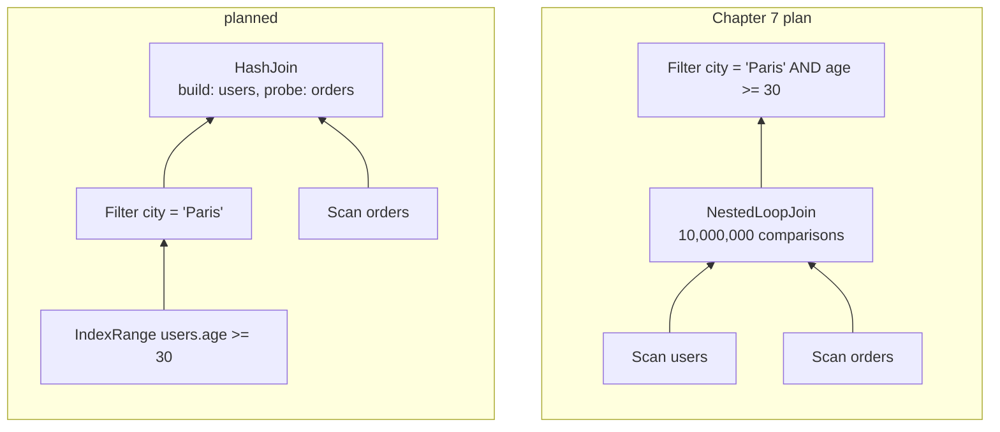

[🏠 Contents](index.md) · [← Previous: Chapter 13 — Persistence](13-persistence.md)

# Chapter 14 — Query Planning

The query builder from [Chapter 7](07-query-primitives.md) always builds the same tree: scan every table, join them in the order written with nested loops, filter at the top. For this query:

```python
(db.query("users", "u")
   .join("orders", on=col("u.id") == col("o.user_id"), alias="o")
   .where((col("u.city") == "Paris") & (col("u.age") >= 30)))
```

with 1,000 users and 10,000 orders, that's 10 million join comparisons to produce a few hundred rows. A **query planner** rewrites the tree before running it. It produces the same answer, and it can be hundreds of times faster:



This chapter builds a small **cost-based planner** in the tradition of IBM's System R ([Selinger et al. 1979](references.md#selinger1979)), the paper that defined how almost every SQL optimizer since has worked. It makes three kinds of decision:

1. **Filter pushdown**: apply each condition as early as possible, as close to its table as it can go.
2. **Access paths**: for each table, choose between a full scan, an index lookup and an index range scan.
3. **Join order and method**: which tables to join first, and whether to use a hash join or nested loops.

Each decision is made by **estimating how many rows** each alternative produces and picking the cheapest. Ioannidis's survey ([Ioannidis 1996](references.md#ioannidis1996)) is a good map of the field.

## 14.1 Predicates the planner can read

Everything starts with a problem we noted in [Chapter 2](02-tables-and-crud.md#questions-and-exercises): a Python `lambda` is opaque. The planner can call it, but can't see that `lambda r: r["age"] >= 30` mentions `age`, compares it with a constant, and could use an index on `age`. We need predicates as **data**: expression trees.

```python
# src/minidb/expr.py
"""Build predicates the planner can look inside: expression trees.

``col("age") > 30`` is not ``True`` or ``False`` but a :class:`Compare`
object. Expressions are callable, so they work anywhere a predicate does,
and they follow SQL's three-valued logic: ``None`` means UNKNOWN.
"""

from typing import TYPE_CHECKING
from typing import Literal
from typing import NoReturn
from typing import Protocol
from typing import cast
from typing import override

from minidb.values import arithmetic
from minidb.values import ordered

if TYPE_CHECKING:
    from collections.abc import Callable
    from collections.abc import Mapping

    from minidb.values import Ordered
    from minidb.values import Value

type CompareOp = Literal["=", "!=", "<", "<=", ">", ">="]
type ArithOp = Literal["+", "-", "*", "/"]

# System R's default selectivities, used when nothing better is known
EQ_SELECTIVITY = 1 / 10
RANGE_SELECTIVITY = 1 / 3
OTHER_SELECTIVITY = 1 / 2


class Statistics(Protocol):
    """Describe what selectivity estimates need to know about columns."""

    def distinct(self, column: str) -> int | None:
        """Return the number of distinct values in ``column``, or ``None`` if unknown."""
        ...


def _eq_selectivity(distinct: int | None) -> float:
    return 1 / distinct if distinct else EQ_SELECTIVITY


class Expr:
    """Represent an expression over a row; the base of every expression node.

    The comparison and arithmetic operators build new expressions instead of
    computing answers, and ``&``, ``|``, ``~`` combine conditions.

    >>> e = (col("age") >= 30) & ~col("city").is_null()
    >>> e
    ((age >= 30) AND NOT city IS NULL)
    >>> e({"age": 41, "city": "Paris"}), e({"age": None, "city": "Paris"})
    (True, None)
    """

    __hash__ = object.__hash__  # we override ==, but keep identity hashing

    def eval(self, row: Mapping[str, Value | None]) -> Value | None:
        """Evaluate the expression against ``row``; subclasses override this.

        :param row: the row, by column name.
        :return: the value, ``None`` meaning NULL or UNKNOWN.
        """
        raise NotImplementedError

    def __call__(self, row: Mapping[str, Value | None]) -> Value | None:  # noqa: D102 - a dunder
        return self.eval(row)

    def columns(self) -> set[str]:
        """Return the names of the columns the expression reads.

        :return: the column names, as written.
        """
        return set()

    def selectivity(self, stats: Statistics) -> float:
        """Estimate the fraction of rows for which this condition is true.

        :param stats: what is known about the columns.
        :return: a number between 0 and 1; 1/2 unless a subclass knows better.
        """
        del stats
        return OTHER_SELECTIVITY

    # -- building expressions with operators -----------------------------------------
    # Returning an expression from == and != is the point of this class, so
    # the incompatibility with object.__eq__ is deliberate.
    @override
    def __eq__(self, other: object) -> Compare:  # pyrefly: ignore[bad-override]
        return Compare("=", self, _wrap(other))

    @override
    def __ne__(self, other: object) -> Compare:  # pyrefly: ignore[bad-override]
        return Compare("!=", self, _wrap(other))

    def __lt__(self, other: object) -> Compare:
        return Compare("<", self, _wrap(other))

    def __le__(self, other: object) -> Compare:
        return Compare("<=", self, _wrap(other))

    def __gt__(self, other: object) -> Compare:
        return Compare(">", self, _wrap(other))

    def __ge__(self, other: object) -> Compare:
        return Compare(">=", self, _wrap(other))

    def __and__(self, other: object) -> And:
        return And(self, _wrap(other))

    def __or__(self, other: object) -> Or:
        return Or(self, _wrap(other))

    def __invert__(self) -> Not:
        return Not(self)

    def __add__(self, other: object) -> Arith:
        return Arith("+", self, _wrap(other))

    def __sub__(self, other: object) -> Arith:
        return Arith("-", self, _wrap(other))

    def __mul__(self, other: object) -> Arith:
        return Arith("*", self, _wrap(other))

    def __truediv__(self, other: object) -> Arith:
        return Arith("/", self, _wrap(other))

    def is_null(self) -> IsNull:
        """Return the condition ``self IS NULL``, which is never UNKNOWN.

        :return: the condition.
        """
        return IsNull(self)

    def is_not_null(self) -> Not:
        """Return the condition ``self IS NOT NULL``.

        :return: the condition.
        """
        return Not(IsNull(self))

    def isin(self, *values: Value | None) -> In:
        """Return the condition ``self IN (values)``.

        :param values: the values to look for.
        :return: the condition.
        """
        return In(self, values)

    def __bool__(self) -> NoReturn:
        raise TypeError("use & | ~ to combine expressions, not and/or/not")


def _wrap(value: object) -> Expr:
    """Turn a Python value into a constant; leave expressions alone."""
    return value if isinstance(value, Expr) else Const(cast("Value | None", value))


class Col(Expr):
    """Read a column: ``Col("age")``, or ``Col("u.age")`` qualified by an alias.

    :param name: the column's name, qualified or not.
    """

    def __init__(self, name: str) -> None:
        self.name = name

    @override
    def eval(self, row: Mapping[str, Value | None]) -> Value | None:
        return row[self.name]

    @override
    def columns(self) -> set[str]:
        return {self.name}

    def __repr__(self) -> str:
        return self.name


class Const(Expr):
    """Hold a constant value.

    :param value: the value; ``None`` is NULL.
    """

    def __init__(self, value: Value | None) -> None:
        self.value = value

    @override
    def eval(self, row: Mapping[str, Value | None]) -> Value | None:
        return self.value

    def __repr__(self) -> str:
        return "NULL" if self.value is None else repr(self.value)


_COMPARE: dict[CompareOp, Callable[[Ordered, Ordered], bool]] = {
    "=": lambda a, b: a == b,
    "!=": lambda a, b: a != b,
    "<": lambda a, b: a < b,
    "<=": lambda a, b: a <= b,
    ">": lambda a, b: a > b,
    ">=": lambda a, b: a >= b,
}
_FLIPPED: dict[CompareOp, CompareOp] = {"=": "=", "!=": "!=", "<": ">", "<=": ">=", ">": "<", ">=": "<="}


class Compare(Expr):
    """Compare two expressions; UNKNOWN if either side is NULL.

    >>> Compare("<", Col("a"), Const(3))({"a": 1}), (col("a") < 3)({"a": None})
    (True, None)

    :param op: one of ``= != < <= > >=``.
    :param left: the left operand.
    :param right: the right operand.
    """

    def __init__(self, op: CompareOp, left: Expr, right: Expr) -> None:
        self.op, self.left, self.right = op, left, right

    @override
    def eval(self, row: Mapping[str, Value | None]) -> bool | None:
        a, b = self.left.eval(row), self.right.eval(row)
        if a is None or b is None:
            return None  # UNKNOWN
        return _COMPARE[self.op](ordered(a), ordered(b))

    @override
    def columns(self) -> set[str]:
        return self.left.columns() | self.right.columns()

    def flipped(self) -> Compare:
        """Return the same condition with the operands swapped: ``3 < a`` becomes ``a > 3``.

        :return: the flipped comparison.
        """
        return Compare(_FLIPPED[self.op], self.right, self.left)

    def column_first(self) -> Compare:
        """Return this comparison with a column on the left, if either side is one.

        :return: ``self`` or :meth:`flipped`.
        """
        return self.flipped() if isinstance(self.right, Col) and not isinstance(self.left, Col) else self

    @override
    def selectivity(self, stats: Statistics) -> float:
        c = self.column_first()
        if isinstance(c.left, Col) and isinstance(c.right, Col):
            if c.op != "=":
                return RANGE_SELECTIVITY
            known = [n for n in (stats.distinct(c.left.name), stats.distinct(c.right.name)) if n]
            return 1 / max(known) if known else EQ_SELECTIVITY
        if not isinstance(c.left, Col):
            return OTHER_SELECTIVITY
        eq = _eq_selectivity(stats.distinct(c.left.name))
        if c.op in ("=", "!="):
            return eq if c.op == "=" else 1 - eq
        return RANGE_SELECTIVITY

    def __repr__(self) -> str:
        return f"({self.left!r} {self.op} {self.right!r})"


class And(Expr):
    """Combine conditions with AND: false if any is false, else UNKNOWN if any is.

    :param items: the conditions.
    """

    def __init__(self, *items: Expr) -> None:
        self.items = items

    @override
    def eval(self, row: Mapping[str, Value | None]) -> bool | None:
        results = [item.eval(row) for item in self.items]
        if any(r is False for r in results):
            return False
        return None if any(r is None for r in results) else True

    @override
    def columns(self) -> set[str]:
        return set[str]().union(*(i.columns() for i in self.items))

    @override
    def selectivity(self, stats: Statistics) -> float:
        result = 1.0
        for item in self.items:
            result *= item.selectivity(stats)  # the independence assumption
        return result

    def __repr__(self) -> str:
        return "(" + " AND ".join(map(repr, self.items)) + ")"


class Or(Expr):
    """Combine conditions with OR: true if any is true, else UNKNOWN if any is.

    :param items: the conditions.
    """

    def __init__(self, *items: Expr) -> None:
        self.items = items

    @override
    def eval(self, row: Mapping[str, Value | None]) -> bool | None:
        results = [item.eval(row) for item in self.items]
        if any(r is True for r in results):
            return True
        return None if any(r is None for r in results) else False

    @override
    def columns(self) -> set[str]:
        return set[str]().union(*(i.columns() for i in self.items))

    @override
    def selectivity(self, stats: Statistics) -> float:
        result = 0.0
        for item in self.items:
            s = item.selectivity(stats)
            result = result + s - result * s
        return result

    def __repr__(self) -> str:
        return "(" + " OR ".join(map(repr, self.items)) + ")"


class Not(Expr):
    """Negate a condition; NOT UNKNOWN is UNKNOWN.

    :param item: the condition.
    """

    def __init__(self, item: Expr) -> None:
        self.item = item

    @override
    def eval(self, row: Mapping[str, Value | None]) -> bool | None:
        v = self.item.eval(row)
        return None if v is None else not v

    @override
    def columns(self) -> set[str]:
        return self.item.columns()

    @override
    def selectivity(self, stats: Statistics) -> float:
        return 1 - self.item.selectivity(stats)

    def __repr__(self) -> str:
        return f"NOT {self.item!r}"


class IsNull(Expr):
    """Test for NULL; the result is never UNKNOWN.

    :param item: the expression to test.
    """

    def __init__(self, item: Expr) -> None:
        self.item = item

    @override
    def eval(self, row: Mapping[str, Value | None]) -> bool:
        return self.item.eval(row) is None

    @override
    def columns(self) -> set[str]:
        return self.item.columns()

    @override
    def selectivity(self, stats: Statistics) -> float:
        return EQ_SELECTIVITY

    def __repr__(self) -> str:
        return f"{self.item!r} IS NULL"


class In(Expr):
    """Test membership in a list of constants, SQL-style.

    ``x IN (1, NULL)`` is UNKNOWN, not false, when ``x`` is 2.

    :param item: the expression to test.
    :param values: the constants.
    """

    def __init__(self, item: Expr, values: tuple[Value | None, ...]) -> None:
        self.item, self.values = item, values

    @override
    def eval(self, row: Mapping[str, Value | None]) -> bool | None:
        v = self.item.eval(row)
        if v is None:
            return None
        if v in self.values:
            return True
        return None if None in self.values else False

    @override
    def columns(self) -> set[str]:
        return self.item.columns()

    @override
    def selectivity(self, stats: Statistics) -> float:
        if not isinstance(self.item, Col):
            return OTHER_SELECTIVITY
        return min(1.0, len(self.values) * _eq_selectivity(stats.distinct(self.item.name)))

    def __repr__(self) -> str:
        return f"{self.item!r} IN {self.values!r}"


_ARITH: dict[ArithOp, Callable[[Value, Value], Value]] = {
    "+": lambda a, b: cast("Value", arithmetic(a) + arithmetic(b)),
    "-": lambda a, b: cast("Value", arithmetic(a) - arithmetic(b)),
    "*": lambda a, b: cast("Value", arithmetic(a) * arithmetic(b)),
    "/": lambda a, b: cast("Value", arithmetic(a) / arithmetic(b)),
}


class Arith(Expr):
    """Apply ``+ - * /`` to two expressions; NULL if either is NULL.

    :param op: the operator.
    :param left: the left operand.
    :param right: the right operand.
    """

    def __init__(self, op: ArithOp, left: Expr, right: Expr) -> None:
        self.op, self.left, self.right = op, left, right

    @override
    def eval(self, row: Mapping[str, Value | None]) -> Value | None:
        a, b = self.left.eval(row), self.right.eval(row)
        return None if a is None or b is None else _ARITH[self.op](a, b)

    @override
    def columns(self) -> set[str]:
        return self.left.columns() | self.right.columns()

    def __repr__(self) -> str:
        return f"({self.left!r} {self.op} {self.right!r})"


def col(name: str) -> Col:
    """Return an expression that reads column ``name``.

    :param name: the column, qualified (``"u.age"``) or not (``"age"``).
    :return: the column expression.
    """
    return Col(name)


def lit(value: Value | None) -> Const:
    """Return a constant expression.

    :param value: the constant; ``None`` is NULL.
    :return: the constant expression.
    """
    return Const(value)


def conjuncts(predicate: Expr) -> list[Expr]:
    """Split a condition on its top-level ANDs.

    >>> conjuncts((col("a") == 1) & (col("b") == 2) & (col("c") == 3))
    [(a = 1), (b = 2), (c = 3)]

    :param predicate: the condition.
    :return: the parts which must all be true.
    """
    if isinstance(predicate, And):
        return [c for item in predicate.items for c in conjuncts(item)]
    return [predicate]
```

Some design notes:

- **Operator overloading builds trees instead of computing answers.** `col("age") >= 30` returns a `Compare` object. Because `Expr` overrides `__eq__`, an expression can't be used as a dict key by value. We keep identity hashing explicitly, and the planner compares expressions with `is`, never `==`. Returning a `Compare` from `__eq__` contradicts `object.__eq__`, which promises a `bool`. That's the whole point of the class, so those two methods carry a `# pyrefly: ignore[bad-override]` comment that names the single check being switched off.
- **Each expression estimates its own selectivity** (§14.3). It asks a `Statistics` object, a one-method protocol, how many distinct values a column has. The planner is that object.
- **`__bool__` raises.** Python's `and`, `or` and `not` call `bool()` on their operands and can't be overloaded. Writing `(col("a") == 1) and (col("b") == 2)` would silently drop the first condition. Raising forces you to write `&`. NumPy, pandas and SQLAlchemy all make the same choice.
- **Three-valued logic, done properly.** `And` returns `False` if any part is `False`, otherwise `None` if any part is UNKNOWN, otherwise `True`. That's the truth table from [§4.2](04-constraints.md#42-three-valued-logic). `IsNull` is never UNKNOWN. `x IN (1, NULL)` is UNKNOWN when `x` is 2, a classic SQL surprise.
- **Expressions are callable.** Anything that accepted a lambda (`Filter`, `Query.where`, even `Check` constraints) accepts an expression. Old code keeps working; new code gets optimized.

```python
>>> from minidb.expr import col, lit
>>> e = (col("age") >= 30) & ~col("city").is_null()
>>> e
((age >= 30) AND NOT city IS NULL)
>>> e({"age": 41, "city": "Paris"}), e({"age": 20, "city": "Paris"}), e({"age": None, "city": "Paris"})
(True, False, None)
>>> (col("x").isin(1, None))({"x": 2})        # UNKNOWN, not False
>>> (col("a") == 1) and (col("b") == 2)
Traceback (most recent call last):
  ...
TypeError: use & | ~ to combine expressions, not and/or/not
```

(The `isin` line prints nothing because the result is `None`.)

## 14.2 An ordered index

A hash index answers `age = 30` but not `age >= 30`. For ranges we need the keys **in order**. The simplest ordered index is a sorted Python list searched with `bisect`. It's O(log n) to find a position, but O(n) to insert, because the list shifts. [Chapter 15](15-b-trees.md) fixes that with a B-tree. The interface is `HashIndex`'s plus `range`.

```python
# src/minidb/index.py (append)
@runtime_checkable
class OrderedIndex(Index, Protocol):
    """Describe an index that also answers range queries, in key order."""

    def range(
        self, lo: Key | None, hi: Key | None, *, lo_inclusive: bool = True, hi_inclusive: bool = True
    ) -> list[int]:
        """Return the rowids with ``lo <= key <= hi``, in key order; ``None`` bounds are open."""
        ...


class IndexFactory(Protocol):
    """Describe what makes an index: any index class's constructor fits."""

    def __call__(self, name: str, columns: Iterable[str], *, unique: bool = False) -> Index:
        """Create an empty index."""
        ...


class SortedIndex(KeyedIndex):
    """Keep ``(key, rowid)`` pairs in a sorted list: lookups and ranges by binary search.

    Inserting shifts the list, so it costs O(n); Chapter 15 fixes that.

    >>> index = SortedIndex("by_age", ["age"])
    >>> for rowid, age in [(1, 41), (2, 36), (3, 85)]:
    ...     index.add(rowid, {"age": age})
    >>> index.range((40,), None)
    [1, 3]

    :param name: the index's name.
    :param columns: the indexed columns, in key order.
    :param unique: whether two rows may share a key; ``False`` by default.
    """

    kind: ClassVar[str] = "sorted"

    def __init__(self, name: str, columns: Iterable[str], *, unique: bool = False) -> None:
        super().__init__(name, columns, unique=unique)
        self._sorted: list[tuple[Key, int]] = []

    def add(self, rowid: int, row: Mapping[str, Value | None]) -> None:
        """Record that ``rowid`` holds ``row``.

        :param rowid: the row's rowid.
        :param row: the row's values.
        """
        key = self.key_of(row)
        if key is not None:
            bisect.insort(self._sorted, (key, rowid))  # O(n): the list shifts

    def remove(self, rowid: int, row: Mapping[str, Value | None]) -> None:
        """Forget that ``rowid`` holds ``row``.

        :param rowid: the row's rowid.
        :param row: the values the row had when it was added.
        """
        key = self.key_of(row)
        if key is None:
            return
        i = bisect.bisect_left(self._sorted, (key, rowid))
        if i < len(self._sorted) and self._sorted[i] == (key, rowid):
            del self._sorted[i]

    def lookup(self, key: Key) -> set[int]:
        """Return the rowids whose key equals ``key``.

        :param key: the key to look up.
        :return: a new set.
        """
        key = tuple(key)
        i = bisect.bisect_left(self._sorted, (key,))  # (key,) sorts before (key, any rowid)
        found: set[int] = set()
        while i < len(self._sorted) and self._sorted[i][0] == key:
            found.add(self._sorted[i][1])
            i += 1
        return found

    def range(
        self, lo: Key | None, hi: Key | None, *, lo_inclusive: bool = True, hi_inclusive: bool = True
    ) -> list[int]:
        """Return the rowids with ``lo <= key <= hi``, in key order.

        :param lo: the lower bound, or ``None`` for none.
        :param hi: the upper bound, or ``None`` for none.
        :param lo_inclusive: whether ``lo`` itself matches; ``True`` by default.
        :param hi_inclusive: whether ``hi`` itself matches; ``True`` by default.
        :return: the matching rowids.
        """
        i = self._start(lo, lo_inclusive=lo_inclusive)
        found: list[int] = []
        while i < len(self._sorted) and not _beyond(self._sorted[i][0], hi, hi_inclusive=hi_inclusive):
            found.append(self._sorted[i][1])
            i += 1
        return found

    def _start(self, lo: Key | None, *, lo_inclusive: bool) -> int:
        if lo is None:
            return 0
        if lo_inclusive:
            return bisect.bisect_left(self._sorted, (lo,))
        return bisect.bisect_right(self._sorted, (lo, math.inf))  # after every (lo, rowid)

    def distinct_keys(self) -> int:
        """Return the number of different keys in the index."""
        return sum(1 for _ in itertools.groupby(self._sorted, key=lambda e: e[0]))


def _beyond(key: Key, hi: Key | None, *, hi_inclusive: bool) -> bool:
    """Tell whether ``key`` lies past the upper bound ``hi``."""
    return hi is not None and (key > hi or (key == hi and not hi_inclusive))
```

```python
# src/minidb/index.py (imports)
import bisect
import itertools
import math
from typing import runtime_checkable
```

The search trick: tuples compare element by element, and a shorter tuple that is a prefix of a longer one sorts first. So `(key,)` sorts before every `(key, rowid)`, and `bisect_left` finds the first entry with that key. For an exclusive lower bound, `(lo, math.inf)` sorts after every `(lo, rowid)`.

Ordered indexes satisfy a second protocol, `OrderedIndex`, which adds `range` to `Index`. It's `@runtime_checkable`, so `isinstance(index, OrderedIndex)` asks "does this index have the methods of an ordered index?". New kinds of index are registered in `INDEX_KINDS`, a dict from kind name to anything matching the `IndexFactory` protocol, which every index class's constructor does. Tables let you choose the kind of index, and gain a `range` method. Units of Work need `range` too, with its result recorded in the read set like any other read ([§12.2](12-isolation.md#122-the-plan-read-set-validation-write)):

```python
# src/minidb/table.py (replace Table.create_index)
    def create_index(self, name: str, columns: Iterable[str], *, unique: bool = False, kind: str = "hash") -> Index:
        """Create an index over the existing rows, and maintain it from now on.

        :param name: the index's name.
        :param columns: the indexed columns, in key order.
        :param unique: whether to refuse duplicate keys; ``False`` by default.
        :param kind: ``"hash"`` (the default) or ``"sorted"``; see :data:`INDEX_KINDS`.
        :return: the new index.
        :raises SchemaError: if the name is taken, a column is unknown, or
            the kind is unknown.
        :raises UniqueError: if ``unique`` and existing rows share a key.
        """
        if name in self.indexes:
            raise SchemaError(f"{self.name}: index {name!r} already exists")
        if kind not in INDEX_KINDS:
            raise SchemaError(f"unknown index kind {kind!r}")
        columns = tuple(columns)
        for c in columns:
            self.schema.column(c)
        index = INDEX_KINDS[kind](name, columns, unique=unique)
        self._fill(index)
        self.indexes[name] = index
        return index

    def _fill(self, index: Index) -> None:
        """Add every existing row to a new index, refusing duplicates if it is unique."""
        for rowid, row in self.rows.items():
            key = index.key_of(row)
            if index.unique and key is not None and index.lookup(key):
                raise UniqueError(f"{self.name}: cannot create unique index {index.name!r}: duplicate key {key}")
            index.add(rowid, row)

    def range(
        self,
        column: str,
        lo: Value | None = None,
        hi: Value | None = None,
        *,
        lo_inclusive: bool = True,
        hi_inclusive: bool = True,
    ) -> list[int]:
        """Return the rowids with ``lo <= column <= hi``, through an ordered index.

        :param column: the column.
        :param lo: the lower bound; ``None`` (the default) for none.
        :param hi: the upper bound; ``None`` (the default) for none.
        :param lo_inclusive: whether ``lo`` itself matches; ``True`` by default.
        :param hi_inclusive: whether ``hi`` itself matches; ``True`` by default.
        :return: the matching rowids, in key order.
        :raises SchemaError: if no ordered index covers exactly ``column``.
        """
        index = next((i for i in self.indexes.values() if i.columns == (column,) and isinstance(i, OrderedIndex)), None)
        if index is None:
            raise SchemaError(f"{self.name}: no ordered index on {column!r}")
        return index.range(
            None if lo is None else (lo,),
            None if hi is None else (hi,),
            lo_inclusive=lo_inclusive,
            hi_inclusive=hi_inclusive,
        )

    def committed(self) -> Table:
        """Return the table itself: a table is its own committed state.

        :return: ``self``.
        """
        return self
```

The planner reads statistics from the table. They start empty, and `Database.analyze` fills them:

```python
# src/minidb/table.py (replace Table.__init__)
    def __init__(self, schema: TableSchema) -> None:
        self.schema = schema
        self.name = schema.name
        self.columns = schema.column_names
        self.rows: dict[int, Row] = {}
        self.indexes: dict[str, Index] = {}
        self.stats: dict[str, int] = {}  # column -> number of distinct values
        self.version = 0
        self.row_versions: dict[int, int] = {}
        self._next_rowid = 1
        self._rowid_latch = threading.Lock()
        if schema.primary_key:
            self.create_index("pk", schema.primary_key, unique=True)
        for cols in schema.unique:
            self.create_index("unique_" + "_".join(cols), cols, unique=True)
```

```python
# src/minidb/table.py (imports)
from minidb.index import OrderedIndex
from minidb.index import SortedIndex
```

```python
# src/minidb/table.py (typing imports)
from minidb.index import IndexFactory
```

The registry of index kinds goes at the end of the module:

```python
# src/minidb/table.py (append)
INDEX_KINDS: dict[str, IndexFactory] = {"hash": HashIndex, "sorted": SortedIndex}
```

```python
# src/minidb/uow.py (add to TableView)
    def range(
        self,
        column: str,
        lo: Value | None = None,
        hi: Value | None = None,
        *,
        lo_inclusive: bool = True,
        hi_inclusive: bool = True,
    ) -> list[int]:
        """Return the rowids with ``lo <= column <= hi``, as this transaction sees them.

        The committed part of the answer is recorded in the read set.

        :param column: the column.
        :param lo: the lower bound; ``None`` (the default) for none.
        :param hi: the upper bound; ``None`` (the default) for none.
        :param lo_inclusive: whether ``lo`` itself matches; ``True`` by default.
        :param hi_inclusive: whether ``hi`` itself matches; ``True`` by default.
        :return: the matching rowids: committed ones in key order, then this
            transaction's.
        :raises SchemaError: if no ordered index covers exactly ``column``.
        """
        bounds: RangeRead = (column, lo, hi, lo_inclusive, hi_inclusive)
        with self.uow.latch():
            found = self.base.range(column, lo, hi, lo_inclusive=lo_inclusive, hi_inclusive=hi_inclusive)
        self.range_reads.setdefault(bounds, frozenset(found))
        found = [rid for rid in found if rid not in self.overlay]
        found += [rid for rid, row in self.overlay.items() if row is not None and _in_range(row[column], bounds)]
        return found

    def committed(self) -> Table:
        """Return the committed table behind this view, for statistics and indexes.

        :return: the table.
        """
        return self.base
```

Range reads are recorded separately from equality reads, keyed by their bounds, and validated the same way: by running them again at commit.

```python
# src/minidb/uow.py (replace TableView.__init__)
    def __init__(self, uow: UnitOfWork, table: Table) -> None:
        self.uow, self.base = uow, table
        self.name, self.schema, self.columns = table.name, table.schema, table.columns
        self.overlay: dict[int, Row | None] = {}  # rowid -> row, None = deleted
        # -- the read set -------------------------------------------------------------
        self.scanned_version: int | None = None  # table version at the first scan
        self.row_reads: dict[int, int | None] = {}  # rowid -> row version read
        self.key_reads: dict[ReadKey, frozenset[int]] = {}  # equality read -> rowids seen
        self.range_reads: dict[RangeRead, frozenset[int]] = {}  # range read -> rowids seen
```

```python
# src/minidb/uow.py (replace TableView.conflicts)
    def conflicts(self) -> str | None:
        """Describe the first recorded read that is no longer true.

        :return: a description of the conflict, or ``None`` if every read
            still holds.
        """
        return self._scan_conflict() or self._row_conflict() or self._key_conflict() or self._range_conflict()

    def _range_conflict(self) -> str | None:
        for (column, lo, hi, lo_inclusive, hi_inclusive), seen in self.range_reads.items():
            now = self.base.range(column, lo, hi, lo_inclusive=lo_inclusive, hi_inclusive=hi_inclusive)
            if frozenset(now) != seen:
                return f"{self.name} rows with {column} in range changed"
        return None
```


```python
# src/minidb/uow.py (append)
type RangeRead = tuple[str, Value | None, Value | None, bool, bool]  # column, lo, hi, inclusive?


def _in_range(value: Value | None, bounds: RangeRead) -> bool:
    """Tell whether ``value`` lies within ``bounds``; NULL never does."""
    _, lo, hi, lo_inclusive, hi_inclusive = bounds
    if value is None:
        return False
    v = ordered(value)
    if lo is not None and (v < ordered(lo) or (value == lo and not lo_inclusive)):
        return False
    return not (hi is not None and (v > ordered(hi) or (value == hi and not hi_inclusive)))
```

```python
# src/minidb/uow.py (imports)
from minidb.values import ordered
```

## 14.3 Estimating sizes

Every planning decision compares estimates of how many rows something produces: its **cardinality**. Getting them exactly right would mean running the query, so planners estimate from **statistics** plus a few assumptions. Ours follow System R:

| Predicate | Estimated selectivity (fraction of rows kept) |
|---|---|
| `col = constant` | 1 / (number of distinct values in `col`), or 1/10 if unknown |
| `col <`, `<=`, `>`, `>=` constant | 1/3 |
| `a.x = b.y` (join) | 1 / max(distinct values of `x`, of `y`) |
| `p AND q` | sel(p) × sel(q): *assumes independence* |
| `p OR q` | sel(p) + sel(q) − sel(p)·sel(q) |
| anything else | 1/2 |

These rules are implemented as `selectivity()` methods on the expression classes from §14.1. The number of distinct values (*NDV*) comes from statistics collected by `analyze()`, like SQL's `ANALYZE`. Failing that, it comes from an index on the column, which knows its number of distinct keys for free.

```python
# src/minidb/database.py (add to Database)
    def analyze(self) -> None:
        """Count the distinct values of every column, for the planner (like SQL's ANALYZE)."""
        with self.reading():
            for t in self.tables.values():
                t.stats = {c: len({row[c] for row in t.rows.values()} - {None}) for c in t.columns}
```

```python
# src/minidb/database.py (replace Database.create_index)
    def create_index(
        self, table: str, name: str, columns: Sequence[str], *, unique: bool = False, kind: str = "hash"
    ) -> None:
        """Create an index on ``table``, while no transaction commits.

        :param table: the table's name.
        :param name: the index's name.
        :param columns: the indexed columns, in key order.
        :param unique: whether to refuse duplicate keys; ``False`` by default.
        :param kind: the kind of index, ``"hash"`` by default; see
            :data:`minidb.table.INDEX_KINDS`.
        """
        with self.exclusive_lock():
            self.table(table).create_index(name, columns, unique=unique, kind=kind)
```

The independence assumption deserves suspicion. `city = 'Paris' AND country = 'France'` has the selectivity of the first condition alone, but the formula multiplies the two and underestimates by a factor of 200 or so. Correlated predicates are the most common source of bad plans in real systems. Modern optimizers fight back with multi-column statistics and sampling. Ours just inherits the problem (Exercise 6).

## 14.4 The planner

The planner works in four steps.

1. **Split** every `where` condition and every inner join's `on` condition into *conjuncts* (the parts of a top-level `AND`). Classify each by the tables it mentions: one table means it's a **local** filter; several means it's a **join** condition. A Python callable can't be analysed, so it's applied at the very end, where the user's query put it.
2. **Choose an access path** for each table using its local filters: a scan, an `IndexLookup` if equality filters cover some index's columns, or an `IndexRange` if range filters hit an ordered index. Pick the lowest estimated cost; the remaining local filters become a `Filter` right above the access path. That's **pushdown**.
3. **Order the joins greedily**: start with the table with the smallest estimated output, then repeatedly add the table that *connects* via a join condition and yields the smallest estimated result. Use a `HashJoin` when there's an equality between the two sides (building the hash table on the smaller side), and a nested loop otherwise.
4. **Finish** with grouping, sorting, projection and limit, exactly as before.

One detail in step 2: **constants are normalized like stored values.** `col("email") == " ADA@example.org"` compares against `"ada@example.org"` if the column strips and lower-cases, and `col("opened") >= "2026-01-01"` compares a `date` with a `date`. This matters for correctness, not just convenience. Without it, the same query could return different rows depending on whether the planner chose an index (which must normalize the key to look it up) or a scan.

Greedy ordering is a simplification. System R used **dynamic programming** over subsets of tables: the best plan for {A, B, C} is built from the best plans for its subsets. That's optimal under the cost model, but exponential in the number of tables (Exercise 5). For the handful of tables in typical queries, greedy usually finds the same plan.

Outer joins are left alone: reordering them, or pushing filters below them, can change the result, so the planner falls back to the written order (Exercise 7).

```python
# src/minidb/planner.py
"""Plan queries: choose access paths, push filters down, and order joins by cost.

The planner turns a :class:`~minidb.query.Query` into a tree of physical
operators. Conditions written as :class:`~minidb.expr.Expr` objects can be
analysed; plain Python callables are opaque, and are applied last, exactly
where the query put them.
"""

import math
from typing import TYPE_CHECKING
from typing import Literal
from typing import override

from minidb.errors import DatabaseError
from minidb.expr import And
from minidb.expr import Col
from minidb.expr import Compare
from minidb.expr import Const
from minidb.expr import Expr
from minidb.expr import conjuncts
from minidb.operators import Filter
from minidb.operators import NestedLoopJoin
from minidb.operators import Operator
from minidb.operators import Row
from minidb.operators import Scan
from minidb.values import ordered

if TYPE_CHECKING:
    from collections.abc import Iterator

    from minidb.expr import CompareOp
    from minidb.index import Index
    from minidb.operators import PlannedSource
    from minidb.operators import RowPredicate
    from minidb.query import Query
    from minidb.values import Value

type Candidate = tuple[float, Operator, list[Expr]]  # (cost, access path, conditions it consumes)
type RangeCondition = tuple[CompareOp, Value, Expr]
type Bounds = tuple[Value | None, Value | None, bool, bool]  # lo, hi, lo_inclusive, hi_inclusive


# -- physical operators that need indexes or hashing ----------------------------------------
class IndexLookup(Operator):
    """Yield the rows whose indexed columns equal ``key``, without a scan.

    :param source: the table or view.
    :param alias: the qualifier for column names.
    :param index_name: the index used, for :meth:`explain`.
    :param key: ``{column: value}`` to look up.
    """

    def __init__(self, source: PlannedSource, alias: str, index_name: str, key: dict[str, Value | None]) -> None:
        self.source, self.alias, self.index_name, self.key = source, alias, index_name, key

    @override
    def __iter__(self) -> Iterator[Row]:
        for rid in self.source.lookup(self.key):
            row = self.source.row(rid)
            yield Row({f"{self.alias}.{c}": row[c] for c in self.source.columns})

    @override
    def columns(self) -> list[str]:
        return [f"{self.alias}.{c}" for c in self.source.columns]

    @property
    @override
    def label(self) -> str:
        return f"IndexLookup {self.source.name} AS {self.alias} using {self.index_name} {self.key}"


class IndexRange(Operator):
    """Yield the rows whose ``column`` lies between ``lo`` and ``hi``, through an ordered index.

    :param source: the table or view.
    :param alias: the qualifier for column names.
    :param index_name: the index used, for :meth:`explain`.
    :param column: the indexed column.
    :param bounds: ``(lo, hi, lo_inclusive, hi_inclusive)``; a ``None``
        bound is open.
    """

    def __init__(self, source: PlannedSource, alias: str, index_name: str, column: str, bounds: Bounds) -> None:
        self.source, self.alias, self.index_name, self.column = source, alias, index_name, column
        self.bounds = bounds

    @override
    def __iter__(self) -> Iterator[Row]:
        lo, hi, lo_inclusive, hi_inclusive = self.bounds
        for rid in self.source.range(self.column, lo, hi, lo_inclusive=lo_inclusive, hi_inclusive=hi_inclusive):
            row = self.source.row(rid)
            yield Row({f"{self.alias}.{c}": row[c] for c in self.source.columns})

    @override
    def columns(self) -> list[str]:
        return [f"{self.alias}.{c}" for c in self.source.columns]

    @property
    @override
    def label(self) -> str:
        lo, hi, lo_inclusive, hi_inclusive = self.bounds
        left = "" if lo is None else f"{lo!r} {'<=' if lo_inclusive else '<'} "
        right = "" if hi is None else f" {'<=' if hi_inclusive else '<'} {hi!r}"
        return f"IndexRange {self.source.name} AS {self.alias} using {self.index_name}: {left}{self.column}{right}"


class HashJoin(Operator):
    """Join on equalities in O(|left| + |right|): hash one side, probe with the other.

    :param left: the left input.
    :param right: the right input.
    :param left_keys: the join columns of the left input.
    :param right_keys: the matching columns of the right input.
    :param build: which side to hash, ideally the smaller; ``"right"`` by default.
    """

    def __init__(
        self,
        left: Operator,
        right: Operator,
        left_keys: list[Expr],
        right_keys: list[Expr],
        build: Literal["left", "right"] = "right",
    ) -> None:
        self.children = (left, right)
        self.left_keys, self.right_keys, self.build = left_keys, right_keys, build

    @override
    def __iter__(self) -> Iterator[Row]:
        left, right = self.children
        if self.build == "right":
            build, build_keys, probe, probe_keys = right, self.right_keys, left, self.left_keys
        else:
            build, build_keys, probe, probe_keys = left, self.left_keys, right, self.right_keys
        buckets = _buckets(build, build_keys)  # blocking on the build side
        for row in probe:
            key = tuple(k.eval(row) for k in probe_keys)
            for match in buckets.get(key, ()):
                yield Row(row | match)

    @override
    def columns(self) -> list[str]:
        return self.children[0].columns() + self.children[1].columns()

    @property
    @override
    def label(self) -> str:
        on = " AND ".join(f"{lk!r} = {rk!r}" for lk, rk in zip(self.left_keys, self.right_keys, strict=True))
        return f"HashJoin (build {self.build}) on {on}"


def _buckets(rows: Operator, keys: list[Expr]) -> dict[tuple[Value | None, ...], list[Row]]:
    """Group ``rows`` by their join key, leaving out keys with NULL: NULL never joins."""
    buckets: dict[tuple[Value | None, ...], list[Row]] = {}
    for row in rows:
        key = tuple(k.eval(row) for k in keys)
        if not any(v is None for v in key):
            buckets.setdefault(key, []).append(row)
    return buckets


def _conjunction(exprs: list[Expr]) -> Expr:
    return exprs[0] if len(exprs) == 1 else And(*exprs)


# -- the planner -------------------------------------------------------------------------
class Relation:
    """Describe one FROM or JOIN item: a source, its alias, and its committed table.

    :param source: the table, or a transaction's view of it.
    :param alias: the name the query uses for it.
    """

    def __init__(self, source: PlannedSource, alias: str) -> None:
        self.source, self.alias = source, alias
        self.table = source.committed()  # for statistics and indexes
        self.columns = set(source.columns)


class Planner:
    """Turn one query into a physical plan; also the query's :class:`~minidb.expr.Statistics`.

    :param query: the query to plan.
    """

    def __init__(self, query: Query) -> None:
        self.q = query
        rels = [Relation(query.state.table(query.table), query.alias or query.table)]
        rels += [Relation(query.state.table(t), a or t) for t, a, _, _ in query.joins]
        self.rels = {r.alias: r for r in rels}

    # -- column resolution and statistics ----------------------------------------------------
    def resolve(self, name: str) -> tuple[str, str] | None:
        """Find which relation a column belongs to.

        :param name: ``"u.age"`` or ``"age"``.
        :return: ``(alias, column)``, or ``None`` if the name is unknown or
            ambiguous.
        """
        if "." in name:
            alias, _, column = name.partition(".")
            rel = self.rels.get(alias)
            return (alias, column) if rel and column in rel.columns else None
        found = [(a, name) for a, r in self.rels.items() if name in r.columns]
        return found[0] if len(found) == 1 else None

    def aliases(self, expr: Expr) -> set[str] | None:
        """Return the relations an expression reads from.

        :param expr: the expression.
        :return: their aliases, or ``None`` if a column can't be resolved.
        """
        out: set[str] = set()
        for name in expr.columns():
            hit = self.resolve(name)
            if hit is None:
                return None
            out.add(hit[0])
        return out

    def distinct(self, column: str) -> int | None:
        """Return the number of distinct values of a column, from statistics or an index.

        :param column: the column, qualified or not.
        :return: the count, or ``None`` if unknown.
        """
        hit = self.resolve(column)
        if hit is None:
            return None
        table = self.rels[hit[0]].table
        if hit[1] in table.stats:
            return table.stats[hit[1]]
        index = table.index_on([hit[1]])
        return max(index.distinct_keys(), 1) if index is not None else None

    # -- access paths: how to read one table ---------------------------------------------------
    def access_path(self, rel: Relation, preds: list[Expr]) -> tuple[Operator, float]:
        """Choose the cheapest way to read ``rel`` given its own conditions.

        :param rel: the relation.
        :param preds: the conditions that mention only ``rel``.
        :return: the access path, with remaining conditions on top, and the
            estimated number of rows it produces.
        """
        preds, eq, ranges = self._canonical(rel, preds)
        n = len(rel.table)
        scan = Scan(rel.source, rel.alias)
        scan.estimate = n
        candidates: list[Candidate] = [(float(n), scan, [])]
        for index in rel.table.indexes.values():
            found = (self._lookup_path(rel, index, eq, n), self._range_path(rel, index, ranges, n))
            candidates.extend(c for c in found if c is not None)
        _, op, consumed = min(candidates, key=lambda c: c[0])
        estimate = n * math.prod(p.selectivity(self) for p in preds)
        residual = [p for p in preds if not any(p is c for c in consumed)]
        if residual:
            op = Filter(op, _conjunction(residual))
            op.estimate = estimate
        return op, estimate

    def _canonical(
        self, rel: Relation, preds: list[Expr]
    ) -> tuple[list[Expr], dict[str, tuple[Value, Expr]], dict[str, list[RangeCondition]]]:
        """Normalize the constants in ``column op constant`` conditions, and sort them by use.

        :return: the rewritten conditions; the equalities by column; and the
            range conditions by column.
        """
        canonical: list[Expr] = []
        eq: dict[str, tuple[Value, Expr]] = {}
        ranges: dict[str, list[RangeCondition]] = {}
        for p in preds:
            found = self._column_constant(rel, p)
            canonical.append(found[0] if found else p)
            if found is None:
                continue
            q, column, value = found
            if q.op == "=":
                eq[column] = (value, q)
            elif q.op in ("<", "<=", ">", ">="):
                ranges.setdefault(column, []).append((q.op, value, q))
        return canonical, eq, ranges

    def _column_constant(self, rel: Relation, p: Expr) -> tuple[Compare, str, Value] | None:
        """Return ``p`` as ``column op constant``, the constant prepared like a stored value."""
        if not isinstance(p, Compare):
            return None
        c = p.column_first()
        if not isinstance(c.left, Col) or not isinstance(c.right, Const) or c.right.value is None:
            return None
        hit = self.resolve(c.left.name)
        value = self._prepared(rel, hit[1], c.right.value) if hit else None
        if hit is None or value is None:
            return None
        return Compare(c.op, c.left, Const(value)), hit[1], value

    @staticmethod
    def _prepared(rel: Relation, column: str, value: Value) -> Value | None:
        """Normalize ``value`` for ``column``, or return ``None`` if it isn't valid there."""
        try:
            return rel.source.schema.column(column).prepare(value)
        except DatabaseError:
            return None  # not a valid value: compare it as written

    @staticmethod
    def _lookup_path(rel: Relation, index: Index, eq: dict[str, tuple[Value, Expr]], n: int) -> Candidate | None:
        if not set(index.columns) <= eq.keys():
            return None
        matches = n / max(index.distinct_keys(), 1)
        op = IndexLookup(rel.source, rel.alias, index.name, {c: eq[c][0] for c in index.columns})
        op.estimate = matches
        return (1 + matches, op, [eq[c][1] for c in index.columns])

    @staticmethod
    def _range_path(rel: Relation, index: Index, ranges: dict[str, list[RangeCondition]], n: int) -> Candidate | None:
        if index.kind == "hash" or len(index.columns) != 1 or index.columns[0] not in ranges:
            return None
        column = index.columns[0]
        bounds = _bounds(ranges[column])
        matches = n * (1 / 3) ** ((bounds[0] is not None) + (bounds[1] is not None))
        op = IndexRange(rel.source, rel.alias, index.name, column, bounds)
        op.estimate = matches
        return (1 + matches, op, [p for _, _, p in ranges[column]])

    # -- join ordering: greedy, smallest intermediate result first ------------------------------
    def join(self, paths: dict[str, tuple[Operator, float]], multi: list[tuple[Expr, set[str]]]) -> Operator:
        """Join the access paths, always adding the relation that gives the smallest result.

        :param paths: the access path and estimate of each relation.
        :param multi: conditions that mention several relations, with their aliases.
        :return: the joined plan.
        """
        remaining = dict(paths)
        start = min(remaining, key=lambda a: remaining[a][1])
        op, est = remaining.pop(start)
        joined, pending = {start}, list(multi)
        while remaining:
            scores = {a: self._score(a, joined, est, remaining[a][1], pending) for a in remaining}
            alias = min(scores, key=scores.__getitem__)
            right, right_est = remaining.pop(alias)
            usable = [e for e, al in pending if alias in al and al <= joined | {alias}]
            pending = [(e, al) for e, al in pending if not any(e is u for u in usable)]
            op = self._join_op(
                op, left_est=est, right=right, right_est=right_est, alias=alias, joined=joined, usable=usable
            )
            est = scores[alias][1]
            op.estimate = est
            joined.add(alias)
        for e, _ in pending:
            op = Filter(op, e)
        return op

    def _score(
        self, alias: str, joined: set[str], est: float, right_est: float, pending: list[tuple[Expr, set[str]]]
    ) -> tuple[bool, float]:
        """Rate joining ``alias`` next: connected joins first, then the smallest estimate."""
        usable = [e for e, al in pending if alias in al and al <= joined | {alias}]
        size = est * right_est * math.prod(e.selectivity(self) for e in usable)
        return (not usable, size)

    def _join_op(
        self,
        left: Operator,
        *,
        left_est: float,
        right: Operator,
        right_est: float,
        alias: str,
        joined: set[str],
        usable: list[Expr],
    ) -> Operator:
        """Join with a hash join when there are equalities between the sides, else nested loops."""
        left_keys: list[Expr] = []
        right_keys: list[Expr] = []
        others: list[Expr] = []
        for e in usable:
            sides = self._equi_sides(e, alias, joined)
            if sides is None:
                others.append(e)
            else:
                left_keys.append(sides[0])
                right_keys.append(sides[1])
        if not left_keys:
            return NestedLoopJoin(left, right, _conjunction(others) if others else None)
        op: Operator = HashJoin(left, right, left_keys, right_keys, "right" if right_est <= left_est else "left")
        return Filter(op, _conjunction(others)) if others else op

    def _equi_sides(self, e: Expr, alias: str, joined: set[str]) -> tuple[Col, Col] | None:
        """Return ``(joined side, new side)`` if ``e`` equates a column of each."""
        if not (isinstance(e, Compare) and e.op == "=" and isinstance(e.left, Col) and isinstance(e.right, Col)):
            return None
        lhs, rhs = self.resolve(e.left.name), self.resolve(e.right.name)
        if lhs is None or rhs is None:
            return None
        if rhs[0] == alias and lhs[0] in joined:
            return e.left, e.right
        return (e.right, e.left) if lhs[0] == alias and rhs[0] in joined else None

    # -- putting it together -----------------------------------------------------------------
    def plan(self) -> Operator:
        """Build the physical plan for the query.

        :return: the root operator.
        """
        if any(kind != "inner" for _, _, _, kind in self.q.joins):
            return self.q.plan_naive()  # outer joins: keep the written order
        local, multi, opaque = self._classify()
        paths = {a: self.access_path(self.rels[a], local[a]) for a in self.rels}
        op = self.join(paths, multi)
        for predicate in opaque:
            op = Filter(op, predicate)
        return self.q.finish_plan(op)

    def _classify(self) -> tuple[dict[str, list[Expr]], list[tuple[Expr, set[str]]], list[RowPredicate]]:
        """Split every condition into conjuncts, and sort them by the relations they mention."""
        local: dict[str, list[Expr]] = {a: [] for a in self.rels}
        multi: list[tuple[Expr, set[str]]] = []
        opaque: list[RowPredicate] = []
        for predicate in [*self.q.filters, *(on for _, _, on, _ in self.q.joins)]:
            parts = conjuncts(predicate) if isinstance(predicate, Expr) else [predicate]
            for part in parts:
                self._place(part, local, multi, opaque)
        return local, multi, opaque

    def _place(
        self,
        part: RowPredicate,
        local: dict[str, list[Expr]],
        multi: list[tuple[Expr, set[str]]],
        opaque: list[RowPredicate],
    ) -> None:
        aliases = self.aliases(part) if isinstance(part, Expr) else None
        if not aliases or not isinstance(part, Expr):
            opaque.append(part)  # callables, unresolvable or constant
        elif len(aliases) == 1:
            local[next(iter(aliases))].append(part)
        else:
            multi.append((part, aliases))


def _bounds(conditions: list[RangeCondition]) -> Bounds:
    """Combine range conditions on one column into the tightest lower and upper bounds."""
    lo: Value | None = None
    hi: Value | None = None
    lo_inclusive = hi_inclusive = True
    for op, value, _ in conditions:
        if op in (">", ">=") and (lo is None or ordered(value) > ordered(lo) or (value == lo and op == ">")):
            lo, lo_inclusive = value, op == ">="
        elif op in ("<", "<=") and (hi is None or ordered(value) < ordered(hi) or (value == hi and op == "<")):
            hi, hi_inclusive = value, op == "<="
    return lo, hi, lo_inclusive, hi_inclusive
```

The `Query` builder now asks the planner for its plan. Chapter 7's plan builder stays as `plan_naive` (used as a fallback, and handy for comparison), and its tail, grouping through limit, is shared as `finish_plan`:

```python
# src/minidb/query.py (replace Query.plan)
    def plan(self) -> Operator:
        """Return the physical plan chosen by the cost-based planner.

        :return: the root operator.
        """
        return Planner(self).plan()

    def plan_naive(self) -> Operator:
        """Return Chapter 7's plan: joins in the written order, every filter on top.

        :return: the root operator.
        """
        op: Operator = Scan(self.state.table(self.table), self.alias)
        for jtable, jalias, on, kind in self.joins:
            op = NestedLoopJoin(op, Scan(self.state.table(jtable), jalias), on, kind)
        for predicate in self.filters:
            op = Filter(op, predicate)
        return self.finish_plan(op)
```

The rest of the old `plan` becomes `finish_plan`, which the planner calls too:

```python
# src/minidb/query.py (replace Query._finish)
    def finish_plan(self, op: Operator) -> Operator:
        """Add GROUP BY, HAVING, ORDER BY, SELECT, DISTINCT and LIMIT on top of ``op``.

        :param op: the plan for FROM, JOIN and WHERE.
        :return: the complete plan.
        """
        return self._shape(self._group(op))

    def _group(self, op: Operator) -> Operator:
        if self.grouping is not None:
            op = Aggregate(op, list(self.grouping), self.aggregates)
        for predicate in self.having_filters:
            op = Filter(op, predicate)
        return op

    def _shape(self, op: Operator) -> Operator:
        if self.ordering:
            op = Sort(op, list(self.ordering))
        if self.outputs is not None:
            op = Project(op, self.outputs)
        if self.is_distinct:
            op = Distinct(op)
        if self.bounds is not None:
            op = Limit(op, *self.bounds)
        return op
```

Index operators need more from a source than `Scan` does. A new protocol in `operators.py` describes it, and `QueryState` now hands out such sources:

```python
# src/minidb/operators.py (append)
class PlannedSource(Source, Protocol):
    """Describe what the planner needs from a source: rows, indexes, and the committed table."""

    schema: TableSchema

    def row(self, rowid: int) -> StoredRow:
        """Return the stored row itself."""
        ...

    def lookup(self, key: Mapping[str, Value | None]) -> set[int]:
        """Return the rowids whose columns equal ``key``, through an index."""
        ...

    def range(
        self,
        column: str,
        lo: Value | None = None,
        hi: Value | None = None,
        *,
        lo_inclusive: bool = True,
        hi_inclusive: bool = True,
    ) -> list[int]:
        """Return the rowids within the bounds, through an ordered index."""
        ...

    def committed(self) -> Table:
        """Return the committed table, for its statistics and indexes."""
        ...
```

```python
# src/minidb/operators.py (typing imports)
from collections.abc import Mapping

from minidb.schema import TableSchema
from minidb.table import Table
```

```python
# src/minidb/query.py (replace QueryState)
class QueryState(Protocol):
    """Describe where a query finds its tables, and how it protects its reads."""

    def table(self, name: str) -> PlannedSource:
        """Return the table (or view) called ``name``."""
        ...

    def reading(self) -> AbstractContextManager[object]:
        """Return a context manager to hold while the query reads."""
        ...
```

```python
# src/minidb/query.py (imports)
from minidb.planner import Planner
```

```python
# src/minidb/query.py (replace typing imports)
from collections.abc import Iterator
from contextlib import AbstractContextManager

from minidb.operators import Accumulator
from minidb.operators import AggregateFunction
from minidb.operators import JoinKind
from minidb.operators import Operator
from minidb.operators import PlannedSource
from minidb.operators import Row
from minidb.operators import RowFunction
from minidb.operators import RowPredicate
from minidb.operators import SortKey
from minidb.values import Value
```

And `explain()` shows the estimates:

```python
# src/minidb/operators.py (replace Operator)
class Operator:
    """Produce rows when iterated; the base class of every operator.

    Subclasses implement :meth:`__iter__`, :meth:`columns` and :attr:`label`.
    The planner sets :attr:`estimate`, the number of rows it expects.
    """

    children: tuple[Operator, ...] = ()
    estimate: float | None = None

    def __iter__(self) -> Iterator[Row]:
        raise NotImplementedError

    def columns(self) -> list[str]:
        """Return the names of the columns this operator produces.

        :return: the names, by default those of the first child.
        """
        return self.children[0].columns()

    @property
    def label(self) -> str:
        """Return a one-line description, used by :meth:`explain`."""
        return type(self).__name__

    def explain(self, indent: int = 0) -> str:
        """Describe the operator tree rooted here, one operator per line, with estimates.

        :param indent: the nesting depth of this operator; 0 by default.
        :return: the indented description.
        """
        line = "  " * indent + self.label
        if self.estimate is not None:
            line += f"  [~{self.estimate:,.0f} rows]"
        return "\n".join([line] + [child.explain(indent + 1) for child in self.children])
```

```python
# src/minidb/__init__.py (replace __all__)
__all__ = [
    "Avg",
    "Boolean",
    "Change",
    "Check",
    "CheckError",
    "Column",
    "ConflictError",
    "ConstraintError",
    "Count",
    "Database",
    "DatabaseError",
    "Date",
    "DomainError",
    "Expr",
    "FairRWLock",
    "ForeignKey",
    "ForeignKeyError",
    "Format",
    "Integer",
    "JsonFormat",
    "Max",
    "Min",
    "NotNullError",
    "Numeric",
    "Query",
    "Real",
    "Record",
    "SchemaError",
    "Storage",
    "Sum",
    "TableSchema",
    "Text",
    "Timestamp",
    "TransactionError",
    "UniqueError",
    "UnitOfWork",
    "col",
    "lit",
    "normalizers",
]
```

```python
# src/minidb/__init__.py (imports)
from minidb.expr import Expr
from minidb.expr import col
from minidb.expr import lit
```

## 14.5 Trying it out

A test database: 1,000 users in 10 cities with ages 18–77, and 10,000 orders:

```python
>>> from minidb import *
>>> db = Database()
>>> _ = db.create_table("users", [Column("id", Integer()), Column("name", Text()),
...                               Column("city", Text()), Column("age", Integer())],
...                     primary_key="id")
>>> _ = db.create_table("orders", [Column("id", Integer()), Column("user_id", Integer()),
...                                Column("total", Integer())], primary_key="id",
...                     foreign_keys=[ForeignKey("user_id", "users")])
>>> cities = ["Paris", "London", "Rome", "Oslo", "Lima", "Pune", "Kyiv", "Cairo", "Quito", "Perth"]
>>> with db.unit_of_work() as uow:
...     for i in range(1000):
...         _ = uow.insert("users", {"id": i, "name": f"user{i}", "city": cities[i % 10],
...                                  "age": 18 + (i * 7) % 60})
...     for i in range(10_000):
...         _ = uow.insert("orders", {"id": i, "user_id": (i * 13) % 1000, "total": i % 100})
>>> db.create_index("users", "by_age", ["age"], kind="sorted")
>>> db.analyze()
```

A primary-key lookup becomes an `IndexLookup`. A lambda still works, but gets a scan:

```python
>>> print(db.query("users").where(col("id") == 42).explain())
IndexLookup users AS users using pk {'id': 42}  [~1 rows]
>>> print(db.query("users").where(lambda r: r["id"] == 42).explain())
Filter <lambda>
  Scan users AS users  [~1,000 rows]
```

A range uses the sorted index; the other condition is pushed right on top of it:

```python
>>> q = db.query("users").where((col("age") >= 60) & (col("city") == "Paris"))
>>> print(q.explain())
Filter (city = 'Paris')  [~33 rows]
  IndexRange users AS users using by_age: 60 <= age  [~333 rows]
>>> len(q.all())
16
```

The estimate (333 rows for `age >= 60`) is the System R default of one third. The real number is 299, so the guess is close. The final estimate, 33, is further off (the true answer is 16), because the 1/10 for `city = 'Paris'` is applied on top. Estimates are guesses, but here they're good enough to pick the right plan. Now the query from the start of the chapter:

```python
>>> q = (db.query("users", "u")
...        .join("orders", on=col("u.id") == col("o.user_id"), alias="o")
...        .where((col("u.city") == "Paris") & (col("u.age") >= 30)))
>>> print(q.plan_naive().explain())
Filter ((u.city = 'Paris') AND (u.age >= 30))
  NestedLoopJoin (inner)
    Scan users AS u
    Scan orders AS o
>>> print(q.explain())
HashJoin (build left) on u.id = o.user_id  [~333 rows]
  Filter (u.city = 'Paris')  [~33 rows]
    IndexRange users AS u using by_age: 30 <= age  [~333 rows]
  Scan orders AS o  [~10,000 rows]
>>> len(q.all()) == len([r for r in q.plan_naive()])
True
```

The planner filtered `users` *before* the join, used the age index, and built the hash table on the small filtered side ("build left"). Then it streamed all 10,000 orders past it once. How much does that matter?

```python
# examples/planner_speed.py
"""Time the same join with Chapter 7's naive plan and with the planner's plan."""

import time

from minidb import Column
from minidb import Database
from minidb import ForeignKey
from minidb import Integer
from minidb import Text
from minidb import col

CITIES = ["Paris", "London", "Rome", "Oslo", "Lima", "Pune", "Kyiv", "Cairo", "Quito", "Perth"]


def build() -> Database:
    """Create 1,000 users and 10,000 orders, with an age index and statistics.

    :return: the filled database.
    """
    db = Database()
    db.create_table(
        "users", [Column("id", Integer()), Column("city", Text()), Column("age", Integer())], primary_key="id"
    )
    db.create_table(
        "orders",
        [Column("id", Integer()), Column("user_id", Integer())],
        primary_key="id",
        foreign_keys=[ForeignKey(("user_id",), "users")],
    )
    with db.unit_of_work() as uow:
        for i in range(1000):
            uow.insert("users", {"id": i, "city": CITIES[i % 10], "age": 18 + (i * 7) % 60})
        for i in range(10_000):
            uow.insert("orders", {"id": i, "user_id": (i * 13) % 1000})
    db.create_index("users", "by_age", ["age"], kind="sorted")
    db.analyze()
    return db


def main() -> None:
    """Run both plans, check they agree, and print the times."""
    db = build()
    q = (
        db.query("users", "u")
        .join("orders", on=col("u.id") == col("o.user_id"), alias="o")
        .where((col("u.city") == "Paris") & (col("u.age") >= 30))
    )
    with db.reading():
        t0 = time.perf_counter()
        naive = list(q.plan_naive())
        t1 = time.perf_counter()
        planned = list(q.plan())
        t2 = time.perf_counter()
    assert len(naive) == len(planned)
    print(
        f"{len(planned)} rows | naive: {t1 - t0:.2f} s | planned: {(t2 - t1) * 1000:.1f} ms | {(t1 - t0) / (t2 - t1):,.0f}x faster"
    )


if __name__ == "__main__":
    main()
```

```text
660 rows | naive: 5.84 s | planned: 8.8 ms | 662x faster
```

The answer is identical; the plan is more than 600 times faster, and the gap grows with the size of the tables.

## 14.6 Where real planners go further

- **Dynamic programming join enumeration** ([Selinger et al. 1979](references.md#selinger1979)), and for many tables, randomized or genetic search (PostgreSQL switches to a genetic optimizer above 12 tables).
- **Histograms** instead of a single distinct count, so `age >= 70` is estimated from the actual distribution rather than "one third".
- **Interesting orders.** A sort-merge join or an index scan produces sorted output that can make a later `ORDER BY` free. System R tracked this; we ignore it.
- **Rewrites before costing**: flattening subqueries, removing redundant joins, deriving `a = c` from `a = b AND b = c`.
- **Adaptive execution**: noticing at runtime that an estimate was badly wrong, and re-planning.

## Questions and exercises

1. `IndexLookup` is chosen when equality filters cover *all* of an index's columns. Extend the planner to use a composite *sorted* index for a prefix: an index on `(city, age)` can serve `city = 'Paris'` alone, and `city = 'Paris' AND age > 30` as a range.
2. Our planner ignores the cost of *maintaining* the sorted index. Insert 100,000 rows into a table with and without a `SortedIndex`, and explain the difference. ([Chapter 15](15-b-trees.md) solves it.)
3. Write `col("name").like("Ad%")` (an `Expr` subclass). Which `LIKE` patterns can use an ordered index, and how?
4. The planner treats `col("age") >= col("min_age")` (two columns of the same table) as a local filter with selectivity 1/3. Is that a reasonable guess? What statistic would let you do better?
5. **Dynamic programming.** Implement System R's join enumeration: for each subset of tables (smallest first), keep the cheapest plan that joins exactly that subset. Compare its plans with the greedy ones on a 5-table chain query. How long does planning take with 10 tables?
6. **Correlation.** Make `city` determine `country` in a test table. Show that the planner underestimates `city = 'Paris' AND country = 'France'`. Propose a fix using `analyze()` (hint: distinct counts of column *pairs*).
7. **Outer joins.** Which filters *can* be pushed below a `LEFT JOIN`? (Those on the preserved left side can; those on the right side can't, unless they reject NULL, in which case the outer join is really an inner join.) Implement both rules.
8. `Database.select(table, where)` still uses its own index logic from [Chapter 5](05-keys-and-indexes.md). Re-implement it on top of the planner so there's only one place that chooses indexes.

*Answers: [Appendix D, Chapter 14](appendix-d-answers.md#chapter-14--query-planning).*

---

[🏠 Contents](index.md) · [Next: Chapter 15 — Beyond Memory: B-Trees →](15-b-trees.md)
