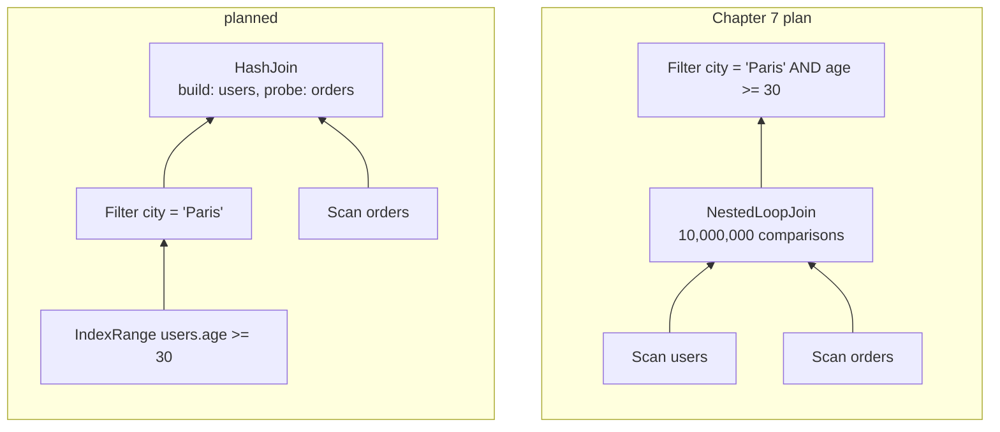

[🏠 Contents](index.md) · [← Previous: Chapter 13 — Persistence](13-persistence.md)

# Chapter 14 — Query Planning

The query builder from [Chapter 7](07-query-primitives.md) always builds the same tree: scan every table, join them in the order written with nested loops, filter at the top. For this query:

```python
(db.query("users", "u")
   .join("orders", on=col("u.id") == col("o.user_id"), alias="o")
   .where((col("u.city") == "Paris") & (col("u.age") >= 30)))
```

with 1,000 users and 10,000 orders, that's 10 million join comparisons to produce a few hundred rows. A **query planner** rewrites the tree before running it. It produces the same answer, and it can be hundreds of times faster:



This chapter builds a small **cost-based planner** in the tradition of IBM's System R ([Selinger et al. 1979](references.md#selinger1979)), the paper that defined how almost every SQL optimizer since has worked. It makes three kinds of decision:

1. **Filter pushdown**: apply each condition as early as possible, as close to its table as it can go.
2. **Access paths**: for each table, choose between a full scan, an index lookup and an index range scan.
3. **Join order and method**: which tables to join first, and whether to use a hash join or nested loops.

Each decision is made by **estimating how many rows** each alternative produces and picking the cheapest. Ioannidis's survey ([Ioannidis 1996](references.md#ioannidis1996)) is a good map of the field.

## 14.1 Predicates the planner can read

Everything starts with a problem we noted in [Chapter 2](02-tables-and-crud.md#questions-and-exercises): a Python `lambda` is opaque. The planner can call it, but can't see that `lambda r: r["age"] >= 30` mentions `age`, compares it with a constant, and could use an index on `age`. We need predicates as **data**: expression trees.

```python
# minidb/expr.py
"""Expression trees: predicates the planner can look inside.

    col("age") > 30            Compare('>', Col('age'), Const(30))
    (col("a") == 1) & ~col("b").is_null()

Expressions are callable, so they work anywhere a predicate does, and
they implement SQL's three-valued logic: None means UNKNOWN.
"""
import operator
from collections.abc import Mapping


class Expr:
    __hash__ = object.__hash__        # we override ==, but keep identity hashing

    def eval(self, row: Mapping):
        raise NotImplementedError

    def __call__(self, row: Mapping):
        return self.eval(row)

    def columns(self) -> set[str]:
        return set()

    # -- building expressions with operators -----------------------------------------
    def __eq__(self, other): return Compare("=", self, _wrap(other))
    def __ne__(self, other): return Compare("!=", self, _wrap(other))
    def __lt__(self, other): return Compare("<", self, _wrap(other))
    def __le__(self, other): return Compare("<=", self, _wrap(other))
    def __gt__(self, other): return Compare(">", self, _wrap(other))
    def __ge__(self, other): return Compare(">=", self, _wrap(other))
    def __and__(self, other): return And(self, _wrap(other))
    def __or__(self, other): return Or(self, _wrap(other))
    def __invert__(self): return Not(self)
    def __add__(self, other): return Arith("+", self, _wrap(other))
    def __sub__(self, other): return Arith("-", self, _wrap(other))
    def __mul__(self, other): return Arith("*", self, _wrap(other))
    def __truediv__(self, other): return Arith("/", self, _wrap(other))
    def __radd__(self, other): return Arith("+", _wrap(other), self)
    def __rsub__(self, other): return Arith("-", _wrap(other), self)
    def __rmul__(self, other): return Arith("*", _wrap(other), self)

    def is_null(self): return IsNull(self)
    def is_not_null(self): return Not(IsNull(self))
    def isin(self, *values): return In(self, values)

    def __bool__(self):
        raise TypeError("use & | ~ to combine expressions, not and/or/not")


def _wrap(value) -> Expr:
    return value if isinstance(value, Expr) else Const(value)


class Col(Expr):
    def __init__(self, name: str):
        self.name = name

    def eval(self, row):
        return row[self.name]

    def columns(self):
        return {self.name}

    def __repr__(self):
        return self.name


class Const(Expr):
    def __init__(self, value):
        self.value = value

    def eval(self, row):
        return self.value

    def __repr__(self):
        return "NULL" if self.value is None else repr(self.value)


_COMPARE = {"=": operator.eq, "!=": operator.ne, "<": operator.lt,
            "<=": operator.le, ">": operator.gt, ">=": operator.ge}
_FLIPPED = {"=": "=", "!=": "!=", "<": ">", "<=": ">=", ">": "<", ">=": "<="}


class Compare(Expr):
    def __init__(self, op: str, left: Expr, right: Expr):
        self.op, self.left, self.right = op, left, right

    def eval(self, row):
        a, b = self.left.eval(row), self.right.eval(row)
        if a is None or b is None:
            return None                                   # UNKNOWN
        return _COMPARE[self.op](a, b)

    def columns(self):
        return self.left.columns() | self.right.columns()

    def flipped(self) -> "Compare":
        """b < a  for  a > b: lets the planner put the column on the left."""
        return Compare(_FLIPPED[self.op], self.right, self.left)

    def __repr__(self):
        return f"({self.left!r} {self.op} {self.right!r})"


class And(Expr):
    def __init__(self, *items: Expr):
        self.items = items

    def eval(self, row):
        result = True
        for item in self.items:
            v = item.eval(row)
            if v is False:
                return False
            if v is None:
                result = None
        return result

    def columns(self):
        return set().union(*(i.columns() for i in self.items))

    def __repr__(self):
        return "(" + " AND ".join(map(repr, self.items)) + ")"


class Or(Expr):
    def __init__(self, *items: Expr):
        self.items = items

    def eval(self, row):
        result = False
        for item in self.items:
            v = item.eval(row)
            if v is True:
                return True
            if v is None:
                result = None
        return result

    def columns(self):
        return set().union(*(i.columns() for i in self.items))

    def __repr__(self):
        return "(" + " OR ".join(map(repr, self.items)) + ")"


class Not(Expr):
    def __init__(self, item: Expr):
        self.item = item

    def eval(self, row):
        v = self.item.eval(row)
        return None if v is None else not v

    def columns(self):
        return self.item.columns()

    def __repr__(self):
        return f"NOT {self.item!r}"


class IsNull(Expr):
    def __init__(self, item: Expr):
        self.item = item

    def eval(self, row):
        return self.item.eval(row) is None                # never UNKNOWN

    def columns(self):
        return self.item.columns()

    def __repr__(self):
        return f"{self.item!r} IS NULL"


class In(Expr):
    def __init__(self, item: Expr, values):
        self.item, self.values = item, tuple(values)

    def eval(self, row):
        v = self.item.eval(row)
        if v is None:
            return None
        if v in self.values:
            return True
        return None if None in self.values else False

    def columns(self):
        return self.item.columns()

    def __repr__(self):
        return f"{self.item!r} IN {self.values!r}"


_ARITH = {"+": operator.add, "-": operator.sub, "*": operator.mul, "/": operator.truediv}


class Arith(Expr):
    def __init__(self, op: str, left: Expr, right: Expr):
        self.op, self.left, self.right = op, left, right

    def eval(self, row):
        a, b = self.left.eval(row), self.right.eval(row)
        return None if a is None or b is None else _ARITH[self.op](a, b)

    def columns(self):
        return self.left.columns() | self.right.columns()

    def __repr__(self):
        return f"({self.left!r} {self.op} {self.right!r})"


def col(name: str) -> Col:
    return Col(name)


def lit(value) -> Const:
    return Const(value)


def conjuncts(predicate) -> list:
    """Split a predicate on AND: (a & b) & c -> [a, b, c]."""
    if isinstance(predicate, And):
        return [c for item in predicate.items for c in conjuncts(item)]
    return [predicate]
```

Some design notes:

- **Operator overloading builds trees instead of computing answers.** `col("age") >= 30` returns a `Compare` object. Because `Expr` overrides `__eq__`, an expression can't be used as a dict key by value. We keep identity hashing explicitly, and the planner compares expressions with `is`, never `==`.
- **`__bool__` raises.** Python's `and`, `or` and `not` call `bool()` on their operands and can't be overloaded. Writing `(col("a") == 1) and (col("b") == 2)` would silently drop the first condition. Raising forces you to write `&`. NumPy, pandas and SQLAlchemy all make the same choice.
- **Three-valued logic, done properly.** `And` returns `False` if any part is `False`, otherwise `None` if any part is UNKNOWN, otherwise `True`. That's the truth table from [§4.2](04-constraints.md#42-three-valued-logic). `IsNull` is never UNKNOWN. `x IN (1, NULL)` is UNKNOWN when `x` is 2, a classic SQL surprise.
- **Expressions are callable.** Anything that accepted a lambda (`Filter`, `Query.where`, even `Check` constraints) accepts an expression. Old code keeps working; new code gets optimized.

```python
>>> from minidb.expr import col, lit
>>> e = (col("age") >= 30) & ~col("city").is_null()
>>> e
((age >= 30) AND NOT city IS NULL)
>>> e({"age": 41, "city": "Paris"}), e({"age": 20, "city": "Paris"}), e({"age": None, "city": "Paris"})
(True, False, None)
>>> (col("x").isin(1, None))({"x": 2})        # UNKNOWN, not False
>>> (col("a") == 1) and (col("b") == 2)
Traceback (most recent call last):
  ...
TypeError: use & | ~ to combine expressions, not and/or/not
```

(The `isin` line prints nothing because the result is `None`.)

## 14.2 An ordered index

A hash index answers `age = 30` but not `age >= 30`. For ranges we need the keys **in order**. The simplest ordered index is a sorted Python list searched with `bisect`. It's O(log n) to find a position, but O(n) to insert, because the list shifts. [Chapter 15](15-b-trees.md) fixes that with a B-tree. The interface is `HashIndex`'s plus `range`.

```python
# minidb/index.py (append)
class SortedIndex(HashIndex):
    """Ordered index: a sorted list of (key, rowid). Supports ranges."""
    kind = "sorted"

    def __init__(self, name: str, columns: Iterable[str], unique: bool = False):
        super().__init__(name, columns, unique)
        self._sorted: list[tuple[Key, int]] = []

    def add(self, rowid: int, row: Mapping[str, object]) -> None:
        key = self.key_of(row)
        if key is not None:
            bisect.insort(self._sorted, (key, rowid))      # O(n): the list shifts

    def remove(self, rowid: int, row: Mapping[str, object]) -> None:
        key = self.key_of(row)
        if key is None:
            return
        i = bisect.bisect_left(self._sorted, (key, rowid))
        if i < len(self._sorted) and self._sorted[i] == (key, rowid):
            del self._sorted[i]

    def lookup(self, key: Key) -> set[int]:
        key = tuple(key)
        i = bisect.bisect_left(self._sorted, (key,))       # (key,) sorts before (key, any)
        found = set()
        while i < len(self._sorted) and self._sorted[i][0] == key:
            found.add(self._sorted[i][1])
            i += 1
        return found

    def range(self, lo: Key | None, hi: Key | None,
              lo_inclusive: bool = True, hi_inclusive: bool = True) -> list[int]:
        """Rowids with lo <= key <= hi (bounds optional), in key order."""
        if lo is None:
            i = 0
        elif lo_inclusive:
            i = bisect.bisect_left(self._sorted, (lo,))
        else:
            i = bisect.bisect_right(self._sorted, (lo, math.inf))
        found = []
        while i < len(self._sorted):
            key, rowid = self._sorted[i]
            if hi is not None and (key > hi or (key == hi and not hi_inclusive)):
                break
            found.append(rowid)
            i += 1
        return found

    def distinct_keys(self) -> int:
        return sum(1 for _ in itertools.groupby(self._sorted, key=lambda e: e[0]))
```

```python
# minidb/index.py (imports)
import bisect
import itertools
import math
```

The search trick: tuples compare element by element, and a shorter tuple that is a prefix of a longer one sorts first. So `(key,)` sorts before every `(key, rowid)`, and `bisect_left` finds the first entry with that key. For an exclusive lower bound, `(lo, math.inf)` sorts after every `(lo, rowid)`.

Tables let you choose the kind of index, and gain a `range` method. Units of Work need `range` too, with its result recorded in the read set like any other read ([§12.2](12-isolation.md#122-the-plan-read-set-validation-write)):

```python
# minidb/table.py (replace Table.create_index)
    def create_index(self, name: str, columns: Iterable[str], unique: bool = False,
                     kind: str = "hash") -> HashIndex:
        if name in self.indexes:
            raise SchemaError(f"{self.name}: index {name!r} already exists")
        columns = tuple(columns)
        for c in columns:
            self.schema.column(c)
        index = INDEX_KINDS[kind](name, columns, unique)
        for rowid, row in self.rows.items():
            if unique and (key := index.key_of(row)) and index.lookup(key):
                raise UniqueViolation(
                    f"{self.name}: cannot create unique index {name!r}: "
                    f"duplicate key {key}")
            index.add(rowid, row)
        self.indexes[name] = index
        return index

    def range(self, column: str, lo=None, hi=None,
              lo_inclusive: bool = True, hi_inclusive: bool = True) -> list[int]:
        """Rowids with lo <= column <= hi, via an ordered index on that column."""
        index = next((i for i in self.indexes.values()
                      if i.columns == (column,) and i.kind != "hash"), None)
        if index is None:
            raise SchemaError(f"{self.name}: no ordered index on {column!r}")
        return index.range(None if lo is None else (lo,), None if hi is None else (hi,),
                           lo_inclusive, hi_inclusive)
```

```python
# minidb/table.py (imports)
from minidb.index import SortedIndex
INDEX_KINDS = {"hash": HashIndex, "sorted": SortedIndex}
```

```python
# minidb/uow.py (add to TableView)
    def range(self, column: str, lo=None, hi=None,
              lo_inclusive: bool = True, hi_inclusive: bool = True) -> list[int]:
        args = (column, lo, hi, lo_inclusive, hi_inclusive)
        with self.uow._latch():
            found = self.base.range(*args)
        self.key_reads.setdefault(("range", args), frozenset(found))
        found = [rid for rid in found if rid not in self.overlay]
        found += [rid for rid, row in self.overlay.items()
                  if row is not None and _in_range(row[column], *args[1:])]
        return found
```

```python
# minidb/uow.py (replace TableView.conflicts)
    def conflicts(self) -> str | None:
        """Describe the first read that is no longer true, or None."""
        b = self.base
        if self.scanned_version is not None and b.version != self.scanned_version:
            return f"{self.name} changed since it was scanned"
        for rowid, version in self.row_reads.items():
            if b.row_versions.get(rowid) != version:
                return f"{self.name} row {rowid} changed since it was read"
        for (kind, key), seen in self.key_reads.items():
            if kind == "range":
                now = set(b.range(*key))
            elif kind == "lookup":
                now = b.lookup(dict(key))
            else:
                now = set(b.match(dict(key)))
            if frozenset(now) != seen:
                return f"{self.name} rows matching {dict(key) if kind != 'range' else key} changed"
        return None
```

```python
# minidb/uow.py (append)
def _in_range(value, lo, hi, lo_inclusive, hi_inclusive) -> bool:
    if value is None:
        return False
    if lo is not None and (value < lo or (value == lo and not lo_inclusive)):
        return False
    return not (hi is not None and (value > hi or (value == hi and not hi_inclusive)))
```

## 14.3 Estimating sizes

Every planning decision compares estimates of how many rows something produces: its **cardinality**. Getting them exactly right would mean running the query, so planners estimate from **statistics** plus a few assumptions. Ours follow System R:

| Predicate | Estimated selectivity (fraction of rows kept) |
|---|---|
| `col = constant` | 1 / (number of distinct values in `col`), or 1/10 if unknown |
| `col <`, `<=`, `>`, `>=` constant | 1/3 |
| `a.x = b.y` (join) | 1 / max(distinct values of `x`, of `y`) |
| `p AND q` | sel(p) × sel(q): *assumes independence* |
| `p OR q` | sel(p) + sel(q) − sel(p)·sel(q) |
| anything else | 1/2 |

The number of distinct values (*NDV*) comes from statistics collected by `analyze()`, like SQL's `ANALYZE`. Failing that, it comes from an index on the column, which knows its number of distinct keys for free.

```python
# minidb/database.py (add to Database)
    def analyze(self) -> None:
        """Collect per-column distinct-value counts for the planner (like SQL ANALYZE)."""
        with self.reading():
            for t in self.tables.values():
                t.stats = {c: len({row[c] for row in t.rows.values()} - {None})
                           for c in t.columns}
```

```python
# minidb/database.py (replace Database.create_index)
    def create_index(self, table: str, name: str, columns: list[str],
                     unique: bool = False, kind: str = "hash") -> None:
        with self._lock.write():
            self.table(table).create_index(name, columns, unique, kind)
```

The independence assumption deserves suspicion. `city = 'Paris' AND country = 'France'` has the selectivity of the first condition alone, but the formula multiplies the two and underestimates by a factor of 200 or so. Correlated predicates are the most common source of bad plans in real systems. Modern optimizers fight back with multi-column statistics and sampling. Ours just inherits the problem (Exercise 6).

## 14.4 The planner

The planner works in four steps.

1. **Split** every `where` condition and every inner join's `on` condition into *conjuncts* (the parts of a top-level `AND`). Classify each by the tables it mentions: one table means it's a **local** filter; several means it's a **join** condition. A Python callable can't be analysed, so it's applied at the very end, where the user's query put it.
2. **Choose an access path** for each table using its local filters: a scan, an `IndexLookup` if equality filters cover some index's columns, or an `IndexRange` if range filters hit an ordered index. Pick the lowest estimated cost; the remaining local filters become a `Filter` right above the access path. That's **pushdown**.
3. **Order the joins greedily**: start with the table with the smallest estimated output, then repeatedly add the table that *connects* via a join condition and yields the smallest estimated result. Use a `HashJoin` when there's an equality between the two sides (building the hash table on the smaller side), and a nested loop otherwise.
4. **Finish** with grouping, sorting, projection and limit, exactly as before.

One detail in step 2: **constants are normalized like stored values.** `col("email") == " ADA@example.org"` compares against `"ada@example.org"` if the column strips and lower-cases, and `col("opened") >= "2026-01-01"` compares a `date` with a `date`. This matters for correctness, not just convenience. Without it, the same query could return different rows depending on whether the planner chose an index (which must normalize the key to look it up) or a scan.

Greedy ordering is a simplification. System R used **dynamic programming** over subsets of tables: the best plan for {A, B, C} is built from the best plans for its subsets. That's optimal under the cost model, but exponential in the number of tables (Exercise 5). For the handful of tables in typical queries, greedy usually finds the same plan.

Outer joins are left alone: reordering them, or pushing filters below them, can change the result, so the planner falls back to the written order (Exercise 7).

```python
# minidb/planner.py
"""A small cost-based planner: access paths, filter pushdown, join order.

It turns a Query into a tree of physical operators. Predicates written as
Expr objects can be analysed; plain Python callables are opaque and are
applied last, exactly where the user's query put them.
"""
from minidb.errors import DatabaseError
from minidb.expr import And, Col, Compare, Const, Expr, In, IsNull, Not, Or, conjuncts
from minidb.query import Filter, NestedLoopJoin, Operator, Row, Scan

# System R's default selectivities, for when we know nothing better
EQ_SELECTIVITY = 1 / 10
RANGE_SELECTIVITY = 1 / 3
OTHER_SELECTIVITY = 1 / 2


# -- physical operators that need indexes or hashing ----------------------------------------
class IndexLookup(Operator):
    """Rows whose indexed columns equal `key`: no scan."""

    def __init__(self, table, alias: str, index_name: str, key: dict):
        self.table, self.alias, self.index_name, self.key = table, alias, index_name, key

    def __iter__(self):
        for rid in self.table.lookup(self.key):
            row = self.table.row(rid)
            yield Row({f"{self.alias}.{c}": row[c] for c in self.table.columns})

    def columns(self):
        return [f"{self.alias}.{c}" for c in self.table.columns]

    @property
    def label(self):
        return f"IndexLookup {self.table.name} AS {self.alias} using {self.index_name} {self.key}"


class IndexRange(Operator):
    """Rows whose column lies between `lo` and `hi`, via a sorted index."""

    def __init__(self, table, alias: str, index_name: str, column: str,
                 lo, hi, lo_inclusive: bool, hi_inclusive: bool):
        self.table, self.alias, self.index_name, self.column = table, alias, index_name, column
        self.bounds = (lo, hi, lo_inclusive, hi_inclusive)

    def __iter__(self):
        for rid in self.table.range(self.column, *self.bounds):
            row = self.table.row(rid)
            yield Row({f"{self.alias}.{c}": row[c] for c in self.table.columns})

    def columns(self):
        return [f"{self.alias}.{c}" for c in self.table.columns]

    @property
    def label(self):
        lo, hi, li, hi_inc = self.bounds
        left = "" if lo is None else f"{lo!r} {'<=' if li else '<'} "
        right = "" if hi is None else f" {'<=' if hi_inc else '<'} {hi!r}"
        return f"IndexRange {self.table.name} AS {self.alias} using {self.index_name}: {left}{self.column}{right}"


class HashJoin(Operator):
    """Equi-join in O(|left| + |right|): hash the smaller side, probe with the other."""

    def __init__(self, left: Operator, right: Operator, left_keys: list[Expr],
                 right_keys: list[Expr], build: str = "right"):
        self.children = (left, right)
        self.left_keys, self.right_keys, self.build = left_keys, right_keys, build

    def __iter__(self):
        left, right = self.children
        if self.build == "right":
            build, build_keys, probe, probe_keys = right, self.right_keys, left, self.left_keys
        else:
            build, build_keys, probe, probe_keys = left, self.left_keys, right, self.right_keys
        buckets: dict[tuple, list[Row]] = {}
        for row in build:                                    # blocking on the build side
            key = tuple(k.eval(row) for k in build_keys)
            if not any(v is None for v in key):              # NULL never joins
                buckets.setdefault(key, []).append(row)
        for row in probe:
            key = tuple(k.eval(row) for k in probe_keys)
            for match in buckets.get(key, ()):
                yield Row(row | match)

    def columns(self):
        return self.children[0].columns() + self.children[1].columns()

    @property
    def label(self):
        on = " AND ".join(f"{l!r} = {r!r}" for l, r in zip(self.left_keys, self.right_keys))
        return f"HashJoin (build {self.build}) on {on}"


# -- the planner -------------------------------------------------------------------------
class Relation:
    """One FROM/JOIN item: a table (or a unit of work's view of it) and its alias."""

    def __init__(self, table, alias: str):
        self.table, self.alias = table, alias
        self.base = getattr(table, "base", table)            # unwrap a TableView
        self.columns = set(table.columns)

    def ndv(self, column: str) -> int | None:
        """Number of distinct values in `column`, if we know or can cheaply tell."""
        stats = getattr(self.base, "stats", {})
        if column in stats:
            return stats[column]
        index = self.base.index_on([column])
        return max(index.distinct_keys(), 1) if index is not None else None


class Planner:
    def __init__(self, query):
        self.q = query
        table, alias = query._from
        rels = [Relation(query._db.table(table), alias or table)]
        rels += [Relation(query._db.table(t), a or t) for t, a, _, _ in query._joins]
        self.rels = {r.alias: r for r in rels}

    # -- column resolution ---------------------------------------------------------------
    def resolve(self, name: str) -> tuple[str, str] | None:
        """'u.age' or 'age' -> (alias, column), if unambiguous."""
        if "." in name:
            alias, _, column = name.partition(".")
            rel = self.rels.get(alias)
            return (alias, column) if rel and column in rel.columns else None
        found = [(a, name) for a, r in self.rels.items() if name in r.columns]
        return found[0] if len(found) == 1 else None

    def aliases(self, expr: Expr) -> set[str] | None:
        out = set()
        for name in expr.columns():
            hit = self.resolve(name)
            if hit is None:
                return None
            out.add(hit[0])
        return out

    # -- cardinality estimation --------------------------------------------------------------
    def selectivity(self, e) -> float:
        if isinstance(e, Compare):
            c = e if isinstance(e.left, Col) else e.flipped()
            if isinstance(c.left, Col) and isinstance(c.right, Col):
                if c.op != "=":
                    return RANGE_SELECTIVITY
                ndvs = [self._ndv(c.left.name), self._ndv(c.right.name)]
                known = [n for n in ndvs if n]
                return 1 / max(known) if known else EQ_SELECTIVITY
            if isinstance(c.left, Col):
                eq = 1 / n if (n := self._ndv(c.left.name)) else EQ_SELECTIVITY
                if c.op == "=":
                    return eq
                return 1 - eq if c.op == "!=" else RANGE_SELECTIVITY
            return OTHER_SELECTIVITY
        if isinstance(e, And):
            result = 1.0
            for item in e.items:
                result *= self.selectivity(item)              # independence assumption
            return result
        if isinstance(e, Or):
            result = 0.0
            for item in e.items:
                s = self.selectivity(item)
                result = result + s - result * s
            return result
        if isinstance(e, Not):
            return 1 - self.selectivity(e.item)
        if isinstance(e, IsNull):
            return EQ_SELECTIVITY
        if isinstance(e, In) and isinstance(e.item, Col):
            eq = 1 / n if (n := self._ndv(e.item.name)) else EQ_SELECTIVITY
            return min(1.0, len(e.values) * eq)
        return OTHER_SELECTIVITY

    def _ndv(self, name: str) -> int | None:
        hit = self.resolve(name)
        return self.rels[hit[0]].ndv(hit[1]) if hit else None

    # -- access paths: how to read one table ---------------------------------------------------
    def access_path(self, rel: Relation, preds: list[Expr]) -> tuple[Operator, float]:
        n = len(rel.base)
        eq: dict[str, tuple[object, Expr]] = {}
        ranges: dict[str, list[tuple[str, object, Expr]]] = {}
        canonical = []
        for p in preds:
            c = p.flipped() if isinstance(p, Compare) and not isinstance(p.left, Col) else p
            if isinstance(c, Compare) and isinstance(c.left, Col) and \
                    isinstance(c.right, Const) and c.right.value is not None:
                column = self.resolve(c.left.name)[1]
                try:                    # normalize the constant like a stored value
                    value = rel.table.schema.column(column).prepare(c.right.value)
                except DatabaseError:
                    value = None        # not a valid value: compare as written
                if value is not None:
                    p = Compare(c.op, c.left, Const(value))
                    if c.op == "=":
                        eq[column] = (value, p)
                    elif c.op in ("<", "<=", ">", ">="):
                        ranges.setdefault(column, []).append((c.op, value, p))
            canonical.append(p)
        preds = canonical

        best_cost, best_op, consumed = float(n), Scan(rel.table, rel.alias), []
        best_op.estimate = n
        for index in rel.base.indexes.values():
            if set(index.columns) <= eq.keys():                       # equality lookup
                matches = n / max(index.distinct_keys(), 1)
                if 1 + matches < best_cost:
                    best_cost, consumed = 1 + matches, [eq[c][1] for c in index.columns]
                    best_op = IndexLookup(rel.table, rel.alias, index.name,
                                          {c: eq[c][0] for c in index.columns})
                    best_op.estimate = matches
            if index.kind != "hash" and len(index.columns) == 1 \
                    and index.columns[0] in ranges:                   # range scan
                column = index.columns[0]
                lo = hi = None
                lo_inc = hi_inc = True
                for op, value, _ in ranges[column]:
                    if op in (">", ">=") and (lo is None or value > lo or (value == lo and op == ">")):
                        lo, lo_inc = value, op == ">="
                    elif op in ("<", "<=") and (hi is None or value < hi or (value == hi and op == "<")):
                        hi, hi_inc = value, op == "<="
                matches = n * RANGE_SELECTIVITY ** ((lo is not None) + (hi is not None))
                if 1 + matches < best_cost:
                    best_cost, consumed = 1 + matches, [p for _, _, p in ranges[column]]
                    best_op = IndexRange(rel.table, rel.alias, index.name, column,
                                         lo, hi, lo_inc, hi_inc)
                    best_op.estimate = matches

        estimate = float(n)
        for p in preds:
            estimate *= self.selectivity(p)
        op = best_op
        residual = [p for p in preds if not any(p is c for c in consumed)]
        if residual:
            op = Filter(op, residual[0] if len(residual) == 1 else And(*residual))
            op.estimate = estimate
        return op, estimate

    # -- join ordering: greedy, smallest intermediate result first ------------------------------
    def join(self, paths: dict[str, tuple[Operator, float]],
             multi: list[tuple[Expr, set[str]]]) -> tuple[Operator, float]:
        remaining = dict(paths)
        start = min(remaining, key=lambda a: remaining[a][1])
        op, est = remaining.pop(start)
        joined, pending = {start}, list(multi)
        while remaining:
            def score(alias):
                usable = [e for e, al in pending if alias in al and al <= joined | {alias}]
                sel = 1.0
                for e in usable:
                    sel *= self.selectivity(e)
                return (not usable, est * remaining[alias][1] * sel)   # prefer connected
            alias = min(remaining, key=score)
            out_est = score(alias)[1]
            right, right_est = remaining.pop(alias)
            usable = [(e, al) for e, al in pending if alias in al and al <= joined | {alias}]
            pending = [(e, al) for e, al in pending if not any(e is u for u, _ in usable)]
            left_keys, right_keys, others = [], [], []
            for e, _ in usable:
                if isinstance(e, Compare) and e.op == "=" and \
                        isinstance(e.left, Col) and isinstance(e.right, Col):
                    sides = (self.resolve(e.left.name)[0], self.resolve(e.right.name)[0])
                    if sides[1] == alias and sides[0] in joined:
                        left_keys.append(e.left); right_keys.append(e.right); continue
                    if sides[0] == alias and sides[1] in joined:
                        left_keys.append(e.right); right_keys.append(e.left); continue
                others.append(e)
            if left_keys:
                build = "right" if right_est <= est else "left"
                op = HashJoin(op, right, left_keys, right_keys, build)
                if others:
                    op = Filter(op, others[0] if len(others) == 1 else And(*others))
            else:
                on = None if not others else others[0] if len(others) == 1 else And(*others)
                op = NestedLoopJoin(op, right, on)
            joined.add(alias)
            est = out_est
            op.estimate = est
        for e, _ in pending:                                  # shouldn't happen, but be safe
            op = Filter(op, e)
        return op, est

    # -- putting it together -----------------------------------------------------------------
    def plan(self) -> Operator:
        q = self.q
        if any(kind != "inner" for _, _, _, kind in q._joins):
            return q.plan_naive()                # outer joins: keep the written order
        local = {a: [] for a in self.rels}
        multi, opaque = [], []
        predicates = list(q._where) + [on for _, _, on, _ in q._joins if on is not None]
        for predicate in predicates:
            for c in (conjuncts(predicate) if isinstance(predicate, Expr) else [predicate]):
                aliases = self.aliases(c) if isinstance(c, Expr) else None
                if not aliases:
                    opaque.append(c)             # callables, unresolvable or constant
                elif len(aliases) == 1:
                    local[next(iter(aliases))].append(c)
                else:
                    multi.append((c, aliases))
        paths = {a: self.access_path(self.rels[a], local[a]) for a in self.rels}
        op, est = self.join(paths, multi)
        for predicate in opaque:
            op = Filter(op, predicate)
        return q.finish_plan(op)
```

The `Query` builder now asks the planner for its plan. Chapter 7's plan builder stays as `plan_naive` (used as a fallback, and handy for comparison), and its tail, grouping through limit, is shared as `finish_plan`:

```python
# minidb/query.py (replace Query.plan)
    def plan(self) -> Operator:
        """The physical plan chosen by the cost-based planner."""
        from minidb.planner import Planner        # imported here: planner imports query
        return Planner(self).plan()

    def plan_naive(self) -> Operator:
        """Chapter 7's plan: joins in written order, every filter on top."""
        table, alias = self._from
        op: Operator = Scan(self._db.table(table), alias)
        for jtable, jalias, on, kind in self._joins:
            op = NestedLoopJoin(op, Scan(self._db.table(jtable), jalias), on, kind)
        for predicate in self._where:
            op = Filter(op, predicate)
        return self.finish_plan(op)

    def finish_plan(self, op: Operator) -> Operator:
        if self._group is not None:
            op = Aggregate(op, list(self._group), self._aggregates)
        for predicate in self._having:
            op = Filter(op, predicate)
        if self._order:
            op = Sort(op, list(self._order))
        if self._select is not None:
            op = Project(op, self._select)
        if self._distinct:
            op = Distinct(op)
        if self._limit is not None:
            op = Limit(op, *self._limit)
        return op
```

And `explain()` shows the estimates:

```python
# minidb/query.py (replace Operator.explain)
    def explain(self, indent: int = 0) -> str:
        estimate = getattr(self, "estimate", None)
        line = "  " * indent + self.label
        if estimate is not None:
            line += f"  [~{estimate:,.0f} rows]"
        return "\n".join([line] + [c.explain(indent + 1) for c in self.children])
```

```python
# minidb/__init__.py (append)
from minidb.expr import Expr, col, lit
__all__ += ["Expr", "col", "lit"]
```

## 14.5 Trying it out

A test database: 1,000 users in 10 cities with ages 18–77, and 10,000 orders:

```python
>>> from minidb import *
>>> db = Database()
>>> _ = db.create_table("users", [Column("id", Integer()), Column("name", Text()),
...                               Column("city", Text()), Column("age", Integer())],
...                     primary_key="id")
>>> _ = db.create_table("orders", [Column("id", Integer()), Column("user_id", Integer()),
...                                Column("total", Integer())], primary_key="id",
...                     foreign_keys=[ForeignKey("user_id", "users")])
>>> cities = ["Paris", "London", "Rome", "Oslo", "Lima", "Pune", "Kyiv", "Cairo", "Quito", "Perth"]
>>> with db.unit_of_work() as uow:
...     for i in range(1000):
...         _ = uow.insert("users", {"id": i, "name": f"user{i}", "city": cities[i % 10],
...                                  "age": 18 + (i * 7) % 60})
...     for i in range(10_000):
...         _ = uow.insert("orders", {"id": i, "user_id": (i * 13) % 1000, "total": i % 100})
>>> db.create_index("users", "by_age", ["age"], kind="sorted")
>>> db.analyze()
```

A primary-key lookup becomes an `IndexLookup`. A lambda still works, but gets a scan:

```python
>>> print(db.query("users").where(col("id") == 42).explain())
IndexLookup users AS users using pk {'id': 42}  [~1 rows]
>>> print(db.query("users").where(lambda r: r["id"] == 42).explain())
Filter <lambda>
  Scan users AS users  [~1,000 rows]
```

A range uses the sorted index; the other condition is pushed right on top of it:

```python
>>> q = db.query("users").where((col("age") >= 60) & (col("city") == "Paris"))
>>> print(q.explain())
Filter (city = 'Paris')  [~33 rows]
  IndexRange users AS users using by_age: 60 <= age  [~333 rows]
>>> len(q.all())
16
```

The estimate (333 rows for `age >= 60`) is the System R default of one third. The real number is 299, so the guess is close. The final estimate, 33, is further off (the true answer is 16), because the 1/10 for `city = 'Paris'` is applied on top. Estimates are guesses, but here they're good enough to pick the right plan. Now the query from the start of the chapter:

```python
>>> q = (db.query("users", "u")
...        .join("orders", on=col("u.id") == col("o.user_id"), alias="o")
...        .where((col("u.city") == "Paris") & (col("u.age") >= 30)))
>>> print(q.plan_naive().explain())
Filter ((u.city = 'Paris') AND (u.age >= 30))
  NestedLoopJoin (inner)
    Scan users AS u
    Scan orders AS o
>>> print(q.explain())
HashJoin (build left) on u.id = o.user_id  [~333 rows]
  Filter (u.city = 'Paris')  [~33 rows]
    IndexRange users AS u using by_age: 30 <= age  [~333 rows]
  Scan orders AS o  [~10,000 rows]
>>> len(q.all()) == len([r for r in q.plan_naive()])
True
```

The planner filtered `users` *before* the join, used the age index, and built the hash table on the small filtered side ("build left"). Then it streamed all 10,000 orders past it once. How much does that matter?

```python
# run
import time
from minidb import *

db = Database()
db.create_table("users", [Column("id", Integer()), Column("city", Text()),
                          Column("age", Integer())], primary_key="id")
db.create_table("orders", [Column("id", Integer()), Column("user_id", Integer())],
                primary_key="id", foreign_keys=[ForeignKey("user_id", "users")])
cities = ["Paris", "London", "Rome", "Oslo", "Lima", "Pune", "Kyiv", "Cairo", "Quito", "Perth"]
with db.unit_of_work() as uow:
    for i in range(1000):
        uow.insert("users", {"id": i, "city": cities[i % 10], "age": 18 + (i * 7) % 60})
    for i in range(10_000):
        uow.insert("orders", {"id": i, "user_id": (i * 13) % 1000})
db.create_index("users", "by_age", ["age"], kind="sorted")
db.analyze()

q = (db.query("users", "u")
       .join("orders", on=col("u.id") == col("o.user_id"), alias="o")
       .where((col("u.city") == "Paris") & (col("u.age") >= 30)))
with db.reading():
    t0 = time.perf_counter(); naive = list(q.plan_naive()); t1 = time.perf_counter()
    planned = list(q.plan()); t2 = time.perf_counter()
assert len(naive) == len(planned)
print(f"{len(planned)} rows | naive: {t1 - t0:.2f} s | planned: {(t2 - t1) * 1000:.1f} ms"
      f" | {(t1 - t0) / (t2 - t1):,.0f}x faster")
```

```text
660 rows | naive: 4.48 s | planned: 8.8 ms | 509x faster
```

The answer is identical; the plan is about 500 times faster, and the gap grows with the size of the tables.

## 14.6 Where real planners go further

- **Dynamic programming join enumeration** ([Selinger et al. 1979](references.md#selinger1979)), and for many tables, randomized or genetic search (PostgreSQL switches to a genetic optimizer above 12 tables).
- **Histograms** instead of a single distinct count, so `age >= 70` is estimated from the actual distribution rather than "one third".
- **Interesting orders.** A sort-merge join or an index scan produces sorted output that can make a later `ORDER BY` free. System R tracked this; we ignore it.
- **Rewrites before costing**: flattening subqueries, removing redundant joins, deriving `a = c` from `a = b AND b = c`.
- **Adaptive execution**: noticing at runtime that an estimate was badly wrong, and re-planning.

## Questions and exercises

1. `IndexLookup` is chosen when equality filters cover *all* of an index's columns. Extend the planner to use a composite *sorted* index for a prefix: an index on `(city, age)` can serve `city = 'Paris'` alone, and `city = 'Paris' AND age > 30` as a range.
2. Our planner ignores the cost of *maintaining* the sorted index. Insert 100,000 rows into a table with and without a `SortedIndex`, and explain the difference. ([Chapter 15](15-b-trees.md) solves it.)
3. Write `col("name").like("Ad%")` (an `Expr` subclass). Which `LIKE` patterns can use an ordered index, and how?
4. The planner treats `col("age") >= col("min_age")` (two columns of the same table) as a local filter with selectivity 1/3. Is that a reasonable guess? What statistic would let you do better?
5. **Dynamic programming.** Implement System R's join enumeration: for each subset of tables (smallest first), keep the cheapest plan that joins exactly that subset. Compare its plans with the greedy ones on a 5-table chain query. How long does planning take with 10 tables?
6. **Correlation.** Make `city` determine `country` in a test table. Show that the planner underestimates `city = 'Paris' AND country = 'France'`. Propose a fix using `analyze()` (hint: distinct counts of column *pairs*).
7. **Outer joins.** Which filters *can* be pushed below a `LEFT JOIN`? (Those on the preserved left side can; those on the right side can't, unless they reject NULL, in which case the outer join is really an inner join.) Implement both rules.
8. `Database.select(table, where)` still uses its own index logic from [Chapter 5](05-keys-and-indexes.md). Re-implement it on top of the planner so there's only one place that chooses indexes.

---

[🏠 Contents](index.md) · [Next: Chapter 15 — Beyond Memory: B-Trees →](15-b-trees.md)
