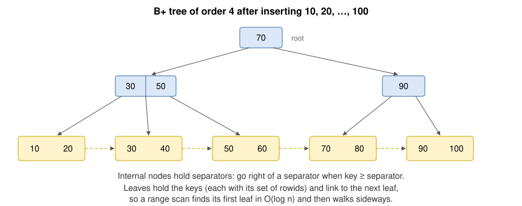
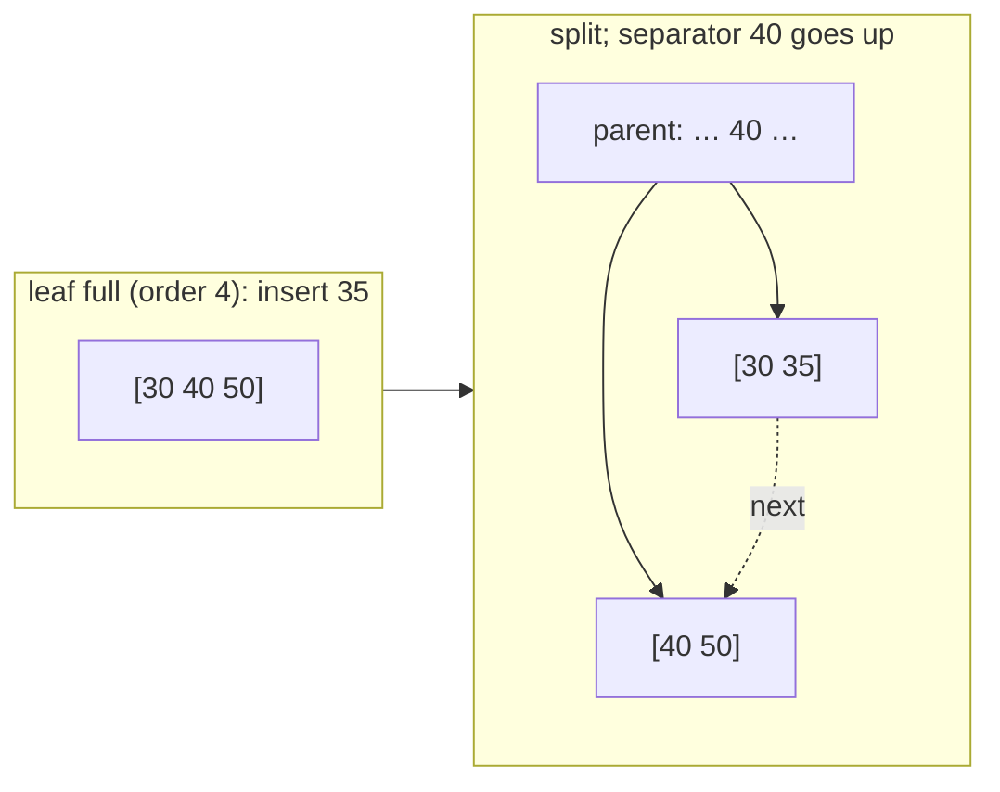

[🏠 Contents](index.md) · [← Previous: Chapter 14 — Query Planning](14-query-planning.md)

# Chapter 15 — Beyond Memory: B-Trees

The `SortedIndex` from [Chapter 14](14-query-planning.md) finds keys in O(log n), but inserting a key shifts on average half the list: O(n). At a million keys, every insert moves half a million entries. The data structure that fixes this, and that sits underneath nearly every relational database ever shipped, is the **B-tree**, invented by Bayer and McCreight in 1970 ([Bayer & McCreight 1972](references.md#bayer1972)). By 1979 Douglas Comer could already call it "ubiquitous" ([Comer 1979](references.md#comer1979)).

This chapter explains why B-trees won, builds an in-memory **B+ tree** (the variant databases actually use), plugs it into minidb as a third kind of index, and then sketches what changes when the tree lives on disk.

## 15.1 Why not a binary tree?

A balanced binary search tree (red–black, AVL) also does everything in O(log n). Why did databases choose something else? Because B-trees were designed for **disks**, where the cost model is different:

- Reading **one byte** from disk costs about the same as reading a whole **page** of 4–16 KB. An SSD random read takes tens of microseconds and a spinning disk several milliseconds, while the CPU can compare thousands of keys in that time.
- So the thing to minimize isn't comparisons but **pages touched**, which for a tree means its **height**.

A binary tree node holds one key and has two children, so a billion keys need about 30 levels: 30 random page reads per lookup. A B-tree node fills a whole page with keys. With 8 KB pages and small keys, a node can have hundreds of children (its **fanout**). Height grows with log<sub>fanout</sub>(n):

| Keys | Height, fanout 2 (binary) | Height, fanout 100 | Height, fanout 500 |
|---|---|---|---|
| 1 thousand | 10 | 2 | 2 |
| 1 million | 20 | 3 | 3 |
| 1 billion | 30 | 5 | 4 |

The top levels are few and small, so they're almost always cached in memory. A lookup among a billion rows then costs one or two actual disk reads. That's the whole trick.

The same reasoning applies, more weakly, in memory: a cache line is 64 bytes, and a node that fills several of them is faster to search than a chain of pointer hops. That's why in-memory B-trees are popular too.

## 15.2 The B+ tree

A **B+ tree** is a B-tree in which:

- **Leaves** hold all the keys, each with its value (for us, the set of rowids having that key), and each leaf **links to the next one**.
- **Internal nodes** hold only **separator keys** that guide the search. `keys[i]` is the smallest key reachable through `children[i + 1]`.



The leaf links make **range scans** cheap: descend once to find where the range starts, then walk sideways along the leaves. That's exactly what `IndexRange` needs.

The **order** of the tree is the maximum number of children per node. The two invariants that keep it balanced:

1. Every leaf is at the same depth.
2. Every node except the root is at least about half full.

**Insertion** keeps both invariants by **splitting**. Insert into the right leaf. If it's now too full, split it in half and push the first key of the new right half up into the parent as a separator. If that overfills the parent, split the parent too, and so on. When the *root* splits, a new root is created above it. **That's the only way the tree grows taller**, and it's why all leaves stay at the same depth.



**Deletion** in a textbook B-tree is the mirror image: when a node drops below half full, borrow from a sibling or merge with it. It's fiddly, and many real systems simplify it. PostgreSQL, for example, doesn't merge pages that are merely under-full; it only reclaims pages that become completely empty, during vacuum. We go further and never rebalance at all. Exercise 2 asks you to implement real deletion.

## 15.3 Implementation

```python
# minidb/btree.py
"""An in-memory B+ tree, and an index built on it.

Internal nodes hold separator keys and children; leaves hold keys, their
values (sets of rowids) and a link to the next leaf, so range scans walk
the leaf level without going back up the tree.
"""
import bisect
from collections.abc import Iterable, Iterator, Mapping

from minidb.index import HashIndex, Key


class _Leaf:
    __slots__ = ("keys", "values", "next")

    def __init__(self):
        self.keys: list = []
        self.values: list[set[int]] = []
        self.next: "_Leaf | None" = None


class _Internal:
    __slots__ = ("keys", "children")

    def __init__(self, keys: list, children: list):
        self.keys = keys            # keys[i] is the smallest key under children[i + 1]
        self.children = children    # always len(keys) + 1 of them


class BPlusTree:
    """Maps keys to sets of ints. `order` = maximum children per node."""

    def __init__(self, order: int = 64):
        if order < 3:
            raise ValueError("order must be at least 3")
        self.order = order
        self.root: _Leaf | _Internal = _Leaf()
        self._len = 0

    def __len__(self) -> int:
        """Number of distinct keys."""
        return self._len

    @property
    def height(self) -> int:
        node, h = self.root, 1
        while isinstance(node, _Internal):
            node, h = node.children[0], h + 1
        return h

    # -- search ---------------------------------------------------------------------------
    def _descend(self, key) -> tuple[_Leaf, list[_Internal]]:
        """The leaf where `key` belongs, plus the internal nodes on the way."""
        node, path = self.root, []
        while isinstance(node, _Internal):
            path.append(node)
            node = node.children[bisect.bisect_right(node.keys, key)]
        return node, path

    def get(self, key) -> set[int]:
        leaf, _ = self._descend(key)
        i = bisect.bisect_left(leaf.keys, key)
        if i < len(leaf.keys) and leaf.keys[i] == key:
            return set(leaf.values[i])
        return set()

    def items(self, lo=None, hi=None, lo_inclusive: bool = True,
              hi_inclusive: bool = True) -> Iterator[tuple[object, set[int]]]:
        """(key, values) for keys between lo and hi, in order, walking the leaves."""
        if lo is None:
            leaf = self.root
            while isinstance(leaf, _Internal):
                leaf = leaf.children[0]
            i = 0
        else:
            leaf, _ = self._descend(lo)
            i = (bisect.bisect_left if lo_inclusive else bisect.bisect_right)(leaf.keys, lo)
        while leaf is not None:
            while i < len(leaf.keys):
                key = leaf.keys[i]
                if hi is not None and (key > hi or (key == hi and not hi_inclusive)):
                    return
                yield key, leaf.values[i]
                i += 1
            leaf, i = leaf.next, 0

    # -- insert ---------------------------------------------------------------------------
    def insert(self, key, value: int) -> None:
        leaf, path = self._descend(key)
        i = bisect.bisect_left(leaf.keys, key)
        if i < len(leaf.keys) and leaf.keys[i] == key:
            leaf.values[i].add(value)
            return
        leaf.keys.insert(i, key)
        leaf.values.insert(i, {value})
        self._len += 1
        if len(leaf.keys) >= self.order:
            self._split_leaf(leaf, path)

    def _split_leaf(self, leaf: _Leaf, path: list[_Internal]) -> None:
        mid = len(leaf.keys) // 2
        right = _Leaf()
        right.keys, leaf.keys = leaf.keys[mid:], leaf.keys[:mid]
        right.values, leaf.values = leaf.values[mid:], leaf.values[:mid]
        right.next, leaf.next = leaf.next, right
        self._insert_in_parent(leaf, right.keys[0], right, path)

    def _insert_in_parent(self, left, separator, right, path: list[_Internal]) -> None:
        if not path:                                     # the root split: grow upwards
            self.root = _Internal([separator], [left, right])
            return
        parent = path.pop()
        i = parent.children.index(left)
        parent.keys.insert(i, separator)
        parent.children.insert(i + 1, right)
        if len(parent.children) > self.order:
            mid = len(parent.keys) // 2
            up = parent.keys[mid]
            sibling = _Internal(parent.keys[mid + 1:], parent.children[mid + 1:])
            parent.keys, parent.children = parent.keys[:mid], parent.children[:mid + 1]
            self._insert_in_parent(parent, up, sibling, path)

    # -- delete ---------------------------------------------------------------------------
    def remove(self, key, value: int) -> None:
        """Remove `value` from `key`; drop the key when its set is empty.

        Nodes are never merged ("lazy deletion"): simple, and fine for
        workloads that insert more than they delete. See the exercises.
        """
        leaf, _ = self._descend(key)
        i = bisect.bisect_left(leaf.keys, key)
        if i < len(leaf.keys) and leaf.keys[i] == key:
            leaf.values[i].discard(value)
            if not leaf.values[i]:
                del leaf.keys[i], leaf.values[i]
                self._len -= 1

    # -- for teaching ----------------------------------------------------------------------
    def dump(self) -> str:
        lines, level = [], [self.root]
        while level:
            lines.append("   ".join(
                "[" + " ".join(map(str, n.keys)) + "]" for n in level))
            level = [c for n in level if isinstance(n, _Internal) for c in n.children]
        return "\n".join(lines)


class BTreeIndex(HashIndex):
    """An ordered index on a B+ tree: O(log n) inserts, lookups and range starts."""
    kind = "btree"

    def __init__(self, name: str, columns: Iterable[str], unique: bool = False,
                 order: int = 64):
        super().__init__(name, columns, unique)
        self.tree = BPlusTree(order)

    def add(self, rowid: int, row: Mapping[str, object]) -> None:
        key = self.key_of(row)
        if key is not None:
            self.tree.insert(key, rowid)

    def remove(self, rowid: int, row: Mapping[str, object]) -> None:
        key = self.key_of(row)
        if key is not None:
            self.tree.remove(key, rowid)

    def lookup(self, key: Key) -> set[int]:
        return self.tree.get(tuple(key))

    def range(self, lo: Key | None, hi: Key | None,
              lo_inclusive: bool = True, hi_inclusive: bool = True) -> list[int]:
        return [rowid for _, rowids in self.tree.items(lo, hi, lo_inclusive, hi_inclusive)
                for rowid in sorted(rowids)]

    def distinct_keys(self) -> int:
        return len(self.tree)
```

The parts that deserve a second look:

- **`_descend` uses `bisect_right`** on the separators: a key equal to `keys[i]` belongs to `children[i + 1]`, because the separator *is* the smallest key on the right.
- **`_descend` returns the path.** A split must update the parent, and the parent's parent, and so on. Since nodes don't store parent pointers, we remember the path on the way down. (Parent pointers would have to be updated on every split, a classic source of bugs.)
- **Splitting a leaf copies the separator up; splitting an internal node *moves* it up.** In a leaf split, the separator is the first key of the new right leaf, and stays there, because leaves must hold every key. In an internal split, the middle key is removed and pushed up, since the parent now does its job.
- **`BTreeIndex` subclasses `HashIndex`** only to reuse `key_of` and the constructor. It has the same interface as `SortedIndex`, so the planner's range logic ([§14.4](14-query-planning.md#144-the-planner)) uses it with no changes.

Register it as a third kind of index:

```python
# minidb/table.py (imports)
from minidb.btree import BTreeIndex
```

```python
# minidb/table.py (append)
INDEX_KINDS["btree"] = BTreeIndex
```

## 15.4 Trying it out

Here is the tree from the picture, built with a tiny order so the splits are visible:

```python
>>> from minidb.btree import BPlusTree
>>> t = BPlusTree(order=4)
>>> for k in [10, 20, 30, 40, 50, 60, 70, 80, 90, 100]:
...     t.insert(k, k)
>>> print(t.dump())
[70]
[30 50]   [90]
[10 20]   [30 40]   [50 60]   [70 80]   [90 100]
>>> t.height, len(t)
(3, 10)
>>> [k for k, _ in t.items(35, 80, hi_inclusive=False)]
[40, 50, 60, 70]
>>> t.insert(35, 35); print(t.dump())
[70]
[30 50]   [90]
[10 20]   [30 35 40]   [50 60]   [70 80]   [90 100]
```

And as an index the planner picks up:

```python
>>> from minidb import *
>>> db = Database()
>>> _ = db.create_table("events", [Column("id", Integer()), Column("at", Integer())],
...                     primary_key="id")
>>> with db.unit_of_work() as uow:
...     for i in range(5000):
...         _ = uow.insert("events", {"id": i, "at": (i * 7919) % 100_000})
>>> db.create_index("events", "by_time", ["at"], kind="btree")
>>> q = db.query("events").where((col("at") >= 1000) & (col("at") < 1500))
>>> print(q.explain())
IndexRange events AS events using by_time: 1000 <= at < 1500  [~556 rows]
>>> len(q.all())
25
```

How much did we gain over the sorted list? Here we insert 200,000 random keys into each kind of index, then run 1,000 range queries:

```python
# run
import random, time
from minidb.btree import BTreeIndex
from minidb.index import HashIndex, SortedIndex

rnd = random.Random(1)
rows = [{"k": rnd.randrange(10**9)} for _ in range(200_000)]
print(f"{'index':<12}{'200k inserts':>14}{'1k range scans':>16}")
for cls in (HashIndex, SortedIndex, BTreeIndex):
    index = cls("i", ["k"])
    t0 = time.perf_counter()
    for rowid, row in enumerate(rows):
        index.add(rowid, row)
    t1 = time.perf_counter()
    if cls is HashIndex:
        print(f"{cls.__name__:<12}{t1 - t0:>12.2f} s{'(no ranges)':>16}")
        continue
    for _ in range(1000):
        lo = rnd.randrange(10**9)
        index.range((lo,), (lo + 10**6,))
    t2 = time.perf_counter()
    print(f"{cls.__name__:<12}{t1 - t0:>12.2f} s{t2 - t1:>14.2f} s")
```

```text
index         200k inserts  1k range scans
HashIndex           0.35 s     (no ranges)
SortedIndex         2.69 s          0.07 s
BTreeIndex          1.01 s          0.16 s
```

At 200,000 keys the B-tree inserts only about 2.7 times faster. Shifting a Python list is a single C `memmove`, which is very fast. What matters is how each one *grows*. Repeating the insert test at larger sizes:

| Keys | SortedIndex | BTreeIndex |
|---|---|---|
| 100,000 | 0.79 s | 0.28 s |
| 200,000 | 2.61 s | 0.85 s |
| 400,000 | 13.37 s | 2.45 s |
| 800,000 | 61.28 s | 5.63 s |

Each doubling multiplies the sorted list's time by four or five: total work is quadratic. The B-tree's roughly doubles, plus a little: n log n. At 800,000 keys the gap is already 11x, and it keeps widening.

Range scans tell the opposite story: the sorted list is a single contiguous array, so walking it is faster than hopping between leaf objects. That's the same cache-friendliness argument that favours wide B-tree nodes, at a smaller scale.

## 15.5 From memory to disk

Our tree's nodes are Python objects. A disk-based B-tree has the same shape, with every node a fixed-size **page** in a file, and children referenced by page number. Making that work brings a handful of new components, each a chapter in a full database book ([Petrov 2019](references.md#petrov2019) covers them all very well):

- **Page layout.** A *slotted page* stores variable-length keys from the end of the page backwards, and an array of offsets from the front. Keys can then move around inside the page without changing their slot numbers.
- **Buffer pool.** A fixed amount of memory caches pages. Reading a node means "pin page 1234": return it from cache, or evict a page (LRU or clock) and read it from disk. Modified pages are *dirty* and must be written back.
- **Crash safety.** A split modifies three pages (the old node, the new node and the parent). A crash between those writes corrupts the tree. Two families of solution exist: write-ahead logging of page changes ([Mohan et al. 1992](references.md#mohan1992)), or *copy-on-write*, where modified pages are written to new locations and the root pointer is switched atomically, as LMDB does. That's the same idea as our atomic snapshot replace in [§13.4](13-persistence.md#134-writing-files-that-survive-crashes).
- **Concurrency.** Locking the whole tree for every insert would serialize writers. *Latch coupling* (or "crabbing") holds latches on a parent and child while descending, and releases the parent once the child is known not to split. Lehman and Yao's B-link trees go further with right-sibling pointers. See [Graefe 2010](references.md#graefe2010) and [Graefe 2011](references.md#graefe2011).
- **Clustered storage.** Many systems store the *rows themselves* in the leaves of the primary-key tree (SQLite, InnoDB), instead of in a separate heap.

With a disk-based B-tree, minidb's architecture would change in one essential way: `Table.rows` would no longer be a dict holding everything, but a B-tree keyed by rowid, backed by the buffer pool. The planner, Unit of Work, locks and log would keep their roles. That's a fair measure of how well the layers in this book are separated.

### The alternative: LSM trees

B-trees update pages *in place*, which costs random writes. **Log-structured merge trees** ([O'Neil et al. 1996](references.md#oneil1996)) never update in place. Writes go to an in-memory sorted buffer, which is flushed to disk as an immutable sorted file when full. Files are merged in the background. Writes become sequential and fast; reads may need to check several files, which is helped by Bloom filters. LevelDB, RocksDB and Cassandra are built this way. The trade-off between B-trees (read-optimized) and LSM trees (write-optimized) is one of the central design choices in storage engines today.

## 15.6 Where we've arrived

Look back at the toy in [Chapter 1](01-relational-model.md#12-a-database-in-30-lines), a list of dicts and three functions. minidb now has:

- typed, normalized values and declarative constraints of every kind ([Chapters 3](03-types-and-normalization.md)–[6](06-referential-integrity.md));
- hash, sorted and B-tree indexes ([5](05-keys-and-indexes.md), [14](14-query-planning.md), [15](15-b-trees.md));
- composable query operators and a cost-based planner ([7](07-query-primitives.md), [14](14-query-planning.md));
- transactions with a Unit of Work, identity map and deferred constraints ([8](08-unit-of-work-i.md), [9](09-unit-of-work-ii.md));
- serializable isolation through optimistic validation over a fair readers–writer lock ([10](10-concurrency-i.md)–[12](12-isolation.md));
- crash-safe durability with a write-ahead log and pluggable formats ([13](13-persistence.md)).

[Appendix A](appendix-a-sql-parser.md) adds the last missing piece: a SQL front end. [Appendix B](appendix-b-testing.md) shows how to test all of it, and [Appendix C](appendix-c-complete-code.md) lists the complete code.

## Questions and exercises

1. Using the table in §15.1, compute the height of a B+ tree over 100 million 16-byte keys with 8 KB pages, assuming 8 bytes per child pointer and pages 70% full. How many pages must be read for a lookup if the top two levels are cached?
2. **Real deletion.** Implement rebalancing: when a leaf drops below `order // 2` keys, borrow a key from a sibling with the same parent if it has spare keys, or merge with it otherwise, and fix the separators. Propagate merges upward. Test against a dict as the property test in [Appendix B](appendix-b-testing.md) does.
3. **Bulk loading.** Building a B+ tree from *sorted* input by repeated `insert` leaves every leaf half full. Write `BPlusTree.from_sorted(items)`, which fills leaves completely and builds the internal levels bottom-up. Compare build time and height.
4. `BTreeIndex.range` sorts the rowids of each key to make output deterministic. Is that necessary? What would a disk-based implementation return?
5. Our tree stores each key's rowids as a Python `set`. Some systems instead make keys unique by appending the rowid, `(key, rowid)`, and store no values at all. What are the trade-offs? (Hint: duplicates with millions of rowids.)
6. **Prefix compression.** Separators only need to *separate*: between leaves ending in `"Smith, Joan"` and starting with `"Smithers"`, the separator `"Smithe"` suffices. Implement suffix truncation for string keys and measure the change in fanout.
7. *(Research)* Read [Comer 1979](references.md#comer1979) and list the B-tree variants it describes. Which one is our B+ tree?
8. *(Design)* Sketch the changes needed to make minidb's tables live in a disk-based B-tree with a buffer pool. Which modules change, and which don't? Which of our design decisions made this easier, and which make it harder?

---

[🏠 Contents](index.md) · [Next: Appendix A — A SQL Front End →](appendix-a-sql-parser.md)
