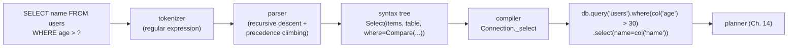

[🏠 Contents](index.md) · [← Previous: Chapter 15 — Beyond Memory: B-Trees](15-b-trees.md)

# Appendix A — A SQL Front End

Everything minidb does is reachable from Python. This appendix adds the traditional way in: SQL text. As you suspected when planning the book, this part is mostly mechanical once the engine exists. A parser turns text into a syntax tree, and a small compiler maps the tree onto the operations we already have: `Query`, `Expr`, the Unit of Work and `create_table`. Nothing in the engine changes.



For parsing techniques, Robert Nystrom's free book *Crafting Interpreters* ([Nystrom 2021](references.md#nystrom2021)) is the best introduction there is. Our expression parser uses *precedence climbing*, a form of Pratt parsing ([Pratt 1973](references.md#pratt1973)). The authoritative description of SQL syntax, as understood by one real implementation, is SQLite's railroad-diagram documentation ([SQLite SQL](references.md#sqlite-lang)).

## A.1 The language

This is the subset we support, in EBNF (`[x]` optional, `{x}` zero or more, `|` alternatives):

```text
statement   = select | insert | update | delete | create_table | create_index
            | "BEGIN" | "COMMIT" | "ROLLBACK" ;

select      = "SELECT" ["DISTINCT"] ( "*" | item {"," item} )
              "FROM" table_ref { join }
              ["WHERE" expr] ["GROUP BY" column {"," column}] ["HAVING" expr]
              ["ORDER BY" expr ["ASC"|"DESC"] {"," expr ["ASC"|"DESC"]}]
              ["LIMIT" integer ["OFFSET" integer]] ;
item        = expr [["AS"] name] ;
table_ref   = name [["AS"] name] ;
join        = ["INNER" | "LEFT" ["OUTER"]] "JOIN" table_ref "ON" expr ;

insert      = "INSERT" "INTO" name ["(" name {"," name} ")"]
              "VALUES" "(" expr {"," expr} ")" {"," "(" expr {"," expr} ")"} ;
update      = "UPDATE" name "SET" name "=" expr {"," name "=" expr} ["WHERE" expr] ;
delete      = "DELETE" "FROM" name ["WHERE" expr] ;

create_table = "CREATE" "TABLE" name "(" table_elem {"," table_elem} ")" ;
table_elem  = name type {column_opt}
            | "PRIMARY" "KEY" "(" names ")" | "UNIQUE" "(" names ")" | "CHECK" "(" expr ")" ;
column_opt  = "NOT" "NULL" | "NULL" | "PRIMARY" "KEY" | "UNIQUE" | "DEFAULT" expr
            | "CHECK" "(" expr ")"
            | "REFERENCES" name ["(" names ")"] ["ON" "DELETE" ("CASCADE"|"SET" "NULL"|"RESTRICT")] ;
create_index = "CREATE" ["UNIQUE"] "INDEX" name "ON" name "(" names ")" ["USING" name] ;

expr        = expr "OR" expr | expr "AND" expr | "NOT" expr
            | expr ("=" | "!=" | "<>" | "<" | "<=" | ">" | ">=") expr
            | expr "IS" ["NOT"] "NULL" | expr ["NOT"] "IN" "(" expr {"," expr} ")"
            | expr ("+" | "-" | "*" | "/") expr | "-" expr
            | number | string | "TRUE" | "FALSE" | "NULL" | "?"
            | column | aggregate "(" ("*" | column) ")" | "(" expr ")" ;
column      = name ["." name] ;
```

Operator precedence, loosest first: `OR`, `AND`, `NOT`, comparisons (`=`, `<`, `IS`, `IN`), `+ -`, `* /`, unary minus. So `a OR b AND NOT c = 1` means `a OR (b AND (NOT (c = 1)))`.

## A.2 How it works

The module has four parts.

**1. Tokens.** One regular expression with a named group per token kind. `re.match` at the current position returns whichever alternative matches; `lastgroup` says which one. Numbers with a decimal point become `Decimal`, so `3.50` is exact. Keywords are recognized case-insensitively, and `"double quoted"` names let you use a keyword as a column name.

**2. Syntax tree.** Plain dataclasses, one per statement kind. Expressions reuse the `Expr` classes from [Chapter 14](14-query-planning.md), plus one new node, `AggCall`, for `COUNT(*)`, `SUM(x)` and so on.

**3. Parser.** One method per grammar rule (`select`, `insert`, `column_def`, …). That's *recursive descent*: the call stack mirrors the grammar. Expressions use **precedence climbing**. `expr(min_bp)` parses a prefix (a literal, a column, `NOT x`, `(…)`), then keeps absorbing infix operators *whose binding power is higher than `min_bp`*. Parsing `a OR b AND c`: after `a`, it sees `OR` (10 > 0), so it parses the right side with `min_bp = 10`. Inside, after `b`, it sees `AND` (20 > 10), so `AND` binds to `b`, which gives `a OR (b AND c)`. One loop handles every precedence level.

**4. Compiler and executor.** `Connection.execute` parses one statement and runs it. A `SELECT` becomes a `Query`. `INSERT` and `DELETE` map directly onto the Unit of Work. `UPDATE … SET x = x + 1` needs a *per-row* new value, so it loads each matching row as a `Record`, assigns the computed values and lets dirty checking ([§9.3](09-unit-of-work-ii.md#93-the-unit-of-work-version-2)) turn them into updates. Statements outside `BEGIN … COMMIT` run in their own transaction, with automatic retries; `SELECT` runs in a read-only one.

**Parameters.** `?` placeholders are replaced by *values*, never pasted into the SQL text. Building SQL by string formatting, like `f"... WHERE name = '{name}'"`, is how SQL injection happens. With parameters, `name = "x' OR '1'='1"` is just an odd name.

```python
# minidb/sql.py
"""A SQL front end for a useful subset of SQL, compiled onto minidb's API."""
import re
from dataclasses import dataclass
from decimal import Decimal

from minidb.errors import DatabaseError
from minidb.expr import And, Arith, Col, Compare, Const, Expr, In, IsNull, Not, Or
from minidb.query import Avg, Count, Max, Min, Sum
from minidb.schema import Check, Column, ForeignKey
from minidb.types import Boolean, Date, Integer, Numeric, Real, Text, Timestamp


class SQLError(DatabaseError):
    """The SQL text could not be parsed or compiled."""


# -- 1. tokens ------------------------------------------------------------------------------
KEYWORDS = {
    "SELECT", "DISTINCT", "FROM", "AS", "JOIN", "INNER", "LEFT", "OUTER", "ON", "WHERE",
    "GROUP", "BY", "HAVING", "ORDER", "ASC", "DESC", "LIMIT", "OFFSET", "AND", "OR",
    "NOT", "IS", "NULL", "IN", "TRUE", "FALSE", "INSERT", "INTO", "VALUES", "UPDATE",
    "SET", "DELETE", "CREATE", "TABLE", "INDEX", "UNIQUE", "PRIMARY", "KEY", "DEFAULT",
    "REFERENCES", "CHECK", "CASCADE", "RESTRICT", "USING", "BEGIN", "COMMIT", "ROLLBACK",
}

_TOKEN = re.compile(r"""
      (?P<space>\s+|--[^\n]*)
    | (?P<number>\d+\.\d*|\.\d+|\d+)
    | (?P<string>'(?:[^']|'')*')
    | (?P<name>[A-Za-z_][A-Za-z_0-9]*)
    | (?P<quoted>"(?:[^"]|"")+")
    | (?P<op><=|>=|<>|!=|[=<>(),.*+\-/;?])
""", re.VERBOSE)


@dataclass
class Token:
    kind: str        # 'number' 'string' 'name' 'keyword' 'op' 'end'
    value: object
    pos: int


def tokenize(sql: str) -> list[Token]:
    tokens, pos = [], 0
    while pos < len(sql):
        m = _TOKEN.match(sql, pos)
        if m is None:
            raise SQLError(f"unexpected character {sql[pos]!r} at position {pos}")
        kind, text = m.lastgroup, m.group()
        if kind == "number":
            tokens.append(Token(kind, Decimal(text) if "." in text else int(text), pos))
        elif kind == "string":
            tokens.append(Token(kind, text[1:-1].replace("''", "'"), pos))
        elif kind == "name":
            upper = text.upper()
            tokens.append(Token("keyword", upper, pos) if upper in KEYWORDS
                          else Token("name", text, pos))
        elif kind == "quoted":
            tokens.append(Token("name", text[1:-1].replace('""', '"'), pos))
        elif kind == "op":
            tokens.append(Token("op", "!=" if text == "<>" else text, pos))
        pos = m.end()
    tokens.append(Token("end", None, pos))
    return tokens


# -- 2. syntax tree for statements ------------------------------------------------------------
@dataclass(eq=False, repr=False)       # keep Expr's == (it builds a Compare)
class AggCall(Expr):
    """COUNT(*), SUM(x), ... inside an expression; evaluated after grouping."""
    func: str
    column: str | None

    @property
    def key(self) -> str:
        return f"{self.func}({self.column or '*'})"

    def eval(self, row):
        return row[self.key]

    def __repr__(self):
        return self.key


@dataclass
class Select:
    items: list               # [(Expr, alias or None)] or ["*"]
    distinct: bool
    table: tuple              # (name, alias)
    joins: list               # [(name, alias, on, kind)]
    where: Expr | None
    group_by: list
    having: Expr | None
    order_by: list            # [(Expr, descending)]
    limit: int | None
    offset: int


@dataclass
class Insert:
    table: str
    columns: list | None
    rows: list


@dataclass
class Update:
    table: str
    assignments: dict
    where: Expr | None


@dataclass
class Delete:
    table: str
    where: Expr | None


@dataclass
class CreateTable:
    name: str
    columns: list
    primary_key: tuple
    unique: list
    checks: list
    foreign_keys: list


@dataclass
class CreateIndex:
    name: str
    table: str
    columns: list
    unique: bool
    kind: str


@dataclass
class TransactionControl:
    action: str               # BEGIN, COMMIT, ROLLBACK


# -- 3. the parser ----------------------------------------------------------------------------
class Parser:
    """Recursive descent for statements; Pratt (precedence climbing) for expressions."""

    def __init__(self, sql: str, params=()):
        self.tokens = tokenize(sql)
        self.i = 0
        self.params = list(params)
        self.used_params = 0

    # -- token helpers ------------------------------------------------------------------
    def peek(self, offset: int = 0) -> Token:
        return self.tokens[min(self.i + offset, len(self.tokens) - 1)]

    def next(self) -> Token:
        tok = self.peek()
        self.i += 1
        return tok

    def accept(self, *values) -> Token | None:
        tok = self.peek()
        if tok.kind in ("keyword", "op") and tok.value in values:
            self.i += 1
            return tok
        return None

    def expect(self, *values) -> Token:
        tok = self.accept(*values)
        if tok is None:
            got = self.peek()
            raise SQLError(f"expected {' or '.join(values)} at position {got.pos}, "
                           f"got {got.value!r}")
        return tok

    def name(self) -> str:
        tok = self.next()
        if tok.kind != "name":
            raise SQLError(f"expected a name at position {tok.pos}, got {tok.value!r}")
        return tok.value

    def name_list(self) -> list[str]:
        self.expect("(")
        names = [self.name()]
        while self.accept(","):
            names.append(self.name())
        self.expect(")")
        return names

    # -- statements -----------------------------------------------------------------------
    def statement(self):
        tok = self.peek()
        if tok.kind != "keyword":
            raise SQLError(f"expected a statement at position {tok.pos}")
        handler = {"SELECT": self.select, "INSERT": self.insert, "UPDATE": self.update,
                   "DELETE": self.delete, "CREATE": self.create,
                   "BEGIN": self.tx, "COMMIT": self.tx, "ROLLBACK": self.tx}.get(tok.value)
        if handler is None:
            raise SQLError(f"unsupported statement {tok.value}")
        stmt = handler()
        self.accept(";")
        if self.peek().kind != "end":
            raise SQLError(f"unexpected {self.peek().value!r} at position {self.peek().pos}")
        if self.used_params != len(self.params):
            raise SQLError(f"{len(self.params)} parameters given, {self.used_params} used")
        return stmt

    def tx(self):
        return TransactionControl(self.next().value)

    def select(self) -> Select:
        self.expect("SELECT")
        distinct = bool(self.accept("DISTINCT"))
        items = []
        if self.accept("*"):
            items = ["*"]
        else:
            while True:
                e = self.expr()
                alias = self.name() if self.accept("AS") else (
                    self.name() if self.peek().kind == "name" else None)
                items.append((e, alias))
                if not self.accept(","):
                    break
        self.expect("FROM")
        table = self.table_ref()
        joins = []
        while True:
            if self.accept("JOIN") or (self.accept("INNER") and self.expect("JOIN")):
                kind = "inner"
            elif self.accept("LEFT"):
                self.accept("OUTER")
                self.expect("JOIN")
                kind = "left"
            else:
                break
            name, alias = self.table_ref()
            self.expect("ON")
            joins.append((name, alias, self.expr(), kind))
        where = self.expr() if self.accept("WHERE") else None
        group_by = []
        if self.accept("GROUP"):
            self.expect("BY")
            group_by = [self.column_name()]
            while self.accept(","):
                group_by.append(self.column_name())
        having = self.expr() if self.accept("HAVING") else None
        order_by = []
        if self.accept("ORDER"):
            self.expect("BY")
            while True:
                e = self.expr()
                descending = bool(self.accept("DESC"))
                if not descending:
                    self.accept("ASC")
                order_by.append((e, descending))
                if not self.accept(","):
                    break
        limit, offset = None, 0
        if self.accept("LIMIT"):
            limit = self.integer()
            if self.accept("OFFSET"):
                offset = self.integer()
        return Select(items, distinct, table, joins, where, group_by, having,
                      order_by, limit, offset)

    def table_ref(self) -> tuple[str, str | None]:
        name = self.name()
        if self.accept("AS"):
            return name, self.name()
        return (name, self.name()) if self.peek().kind == "name" else (name, None)

    def column_name(self) -> str:
        name = self.name()
        return f"{name}.{self.name()}" if self.accept(".") else name

    def integer(self) -> int:
        e = self.primary()
        if not isinstance(e, Const) or not isinstance(e.value, int):
            raise SQLError("expected an integer")
        return e.value

    def insert(self) -> Insert:
        self.expect("INSERT")
        self.expect("INTO")
        table = self.name()
        columns = self.name_list() if self.peek().value == "(" else None
        self.expect("VALUES")
        rows = []
        while True:
            self.expect("(")
            row = [self.constant()]
            while self.accept(","):
                row.append(self.constant())
            self.expect(")")
            rows.append(row)
            if not self.accept(","):
                break
        return Insert(table, columns, rows)

    def constant(self):
        e = self.expr()
        if not isinstance(e, Const):
            raise SQLError("VALUES must contain constants")
        return e.value

    def update(self) -> Update:
        self.expect("UPDATE")
        table = self.name()
        self.expect("SET")
        assignments = {}
        while True:
            column = self.name()
            self.expect("=")
            assignments[column] = self.expr()
            if not self.accept(","):
                break
        where = self.expr() if self.accept("WHERE") else None
        return Update(table, assignments, where)

    def delete(self) -> Delete:
        self.expect("DELETE")
        self.expect("FROM")
        table = self.name()
        return Delete(table, self.expr() if self.accept("WHERE") else None)

    def create(self):
        self.expect("CREATE")
        unique = bool(self.accept("UNIQUE"))
        if self.accept("INDEX"):
            name = self.name()
            self.expect("ON")
            table = self.name()
            columns = self.name_list()
            kind = "hash"
            if self.accept("USING"):
                kind = self.name().lower()
            return CreateIndex(name, table, columns, unique, kind)
        if unique:
            raise SQLError("expected INDEX after CREATE UNIQUE")
        self.expect("TABLE")
        stmt = CreateTable(self.name(), [], (), [], [], [])
        self.expect("(")
        while True:
            if self.accept("PRIMARY"):
                self.expect("KEY")
                stmt.primary_key = tuple(self.name_list())
            elif self.accept("UNIQUE"):
                stmt.unique.append(tuple(self.name_list()))
            elif self.accept("CHECK"):
                stmt.checks.append(self.check_expr())
            else:
                self.column_def(stmt)
            if not self.accept(","):
                break
        self.expect(")")
        return stmt

    def check_expr(self) -> Expr:
        self.expect("(")
        e = self.expr()
        self.expect(")")
        return e

    def column_def(self, stmt: CreateTable) -> None:
        name = self.name()
        type_ = self.type_name()
        options = {}
        while True:
            if self.accept("NOT"):
                self.expect("NULL")
                options["nullable"] = False
            elif self.accept("NULL"):
                options["nullable"] = True
            elif self.accept("PRIMARY"):
                self.expect("KEY")
                stmt.primary_key = (name,)
            elif self.accept("UNIQUE"):
                stmt.unique.append((name,))
            elif self.accept("DEFAULT"):
                options["default"] = self.constant()
            elif self.accept("CHECK"):
                stmt.checks.append(self.check_expr())
            elif self.accept("REFERENCES"):
                ref_table = self.name()
                ref_cols = self.name_list() if self.peek().value == "(" else ()
                on_delete = "restrict"
                if self.accept("ON"):
                    self.expect("DELETE")
                    if self.accept("CASCADE"):
                        on_delete = "cascade"
                    elif self.accept("SET"):
                        self.expect("NULL")
                        on_delete = "set null"
                    else:
                        self.expect("RESTRICT")
                stmt.foreign_keys.append(ForeignKey((name,), ref_table, tuple(ref_cols), on_delete))
            else:
                break
        stmt.columns.append(Column(name, type_, **options))

    def type_name(self):
        name = self.name().upper()
        args = []
        if self.accept("("):
            args = [self.integer()]
            while self.accept(","):
                args.append(self.integer())
            self.expect(")")
        if name in ("INT", "INTEGER", "BIGINT"):
            return Integer()
        if name in ("REAL", "FLOAT", "DOUBLE"):
            return Real()
        if name in ("TEXT", "VARCHAR", "CHAR"):
            return Text(*args[:1])
        if name in ("BOOL", "BOOLEAN"):
            return Boolean()
        if name in ("NUMERIC", "DECIMAL"):
            return Numeric(*args) if args else Numeric()
        if name == "DATE":
            return Date()
        if name == "TIMESTAMP":
            return Timestamp()
        raise SQLError(f"unknown type {name}")

    # -- expressions: precedence climbing ------------------------------------------------
    # binding power of each infix operator: higher binds tighter
    INFIX = {"OR": 10, "AND": 20, "=": 40, "!=": 40, "<": 40, "<=": 40, ">": 40,
             ">=": 40, "IS": 40, "IN": 40, "NOT": 40, "+": 50, "-": 50, "*": 60, "/": 60}

    def expr(self, min_bp: int = 0) -> Expr:
        left = self.prefix()
        while True:
            tok = self.peek()
            op = tok.value if tok.kind in ("op", "keyword") else None
            bp = self.INFIX.get(op)
            if bp is None or bp <= min_bp:
                return left
            self.next()
            if op == "OR":
                left = Or(left, self.expr(bp))
            elif op == "AND":
                left = And(left, self.expr(bp))
            elif op == "IS":
                negate = bool(self.accept("NOT"))
                self.expect("NULL")
                left = Not(IsNull(left)) if negate else IsNull(left)
            elif op in ("IN", "NOT"):
                if op == "NOT":
                    self.expect("IN")
                left = In(left, self.in_list()) if op == "IN" else Not(In(left, self.in_list()))
            elif op in ("+", "-", "*", "/"):
                left = Arith(op, left, self.expr(bp))
            else:
                left = Compare(op, left, self.expr(bp))

    def in_list(self) -> list:
        self.expect("(")
        values = [self.constant()]
        while self.accept(","):
            values.append(self.constant())
        self.expect(")")
        return values

    def prefix(self) -> Expr:
        if self.accept("NOT"):
            return Not(self.expr(30))
        if self.accept("-"):
            operand = self.expr(70)
            if isinstance(operand, Const) and operand.value is not None:
                return Const(-operand.value)
            return Arith("-", Const(0), operand)
        return self.primary()

    def primary(self) -> Expr:
        tok = self.next()
        if tok.kind in ("number", "string"):
            return Const(tok.value)
        if tok.kind == "keyword" and tok.value in ("TRUE", "FALSE", "NULL"):
            return Const({"TRUE": True, "FALSE": False, "NULL": None}[tok.value])
        if tok.value == "?":
            if self.used_params >= len(self.params):
                raise SQLError("not enough parameters")
            self.used_params += 1
            return Const(self.params[self.used_params - 1])
        if tok.value == "(":
            e = self.expr()
            self.expect(")")
            return e
        if tok.kind == "name":
            if self.peek().value == "(" and tok.value.upper() in AGGREGATES:
                self.next()
                column = None if self.accept("*") else self.column_name()
                self.expect(")")
                return AggCall(tok.value.upper(), column)
            if self.accept("."):
                return Col(f"{tok.value}.{self.name()}")
            return Col(tok.value)
        raise SQLError(f"unexpected {tok.value!r} at position {tok.pos}")


AGGREGATES = {"COUNT": Count, "SUM": Sum, "AVG": Avg, "MIN": Min, "MAX": Max}


# -- 4. execution ------------------------------------------------------------------------------
class Connection:
    """Runs SQL against a Database. Statements autocommit unless inside BEGIN/COMMIT."""

    def __init__(self, db):
        self.db = db
        self.uow = None

    def execute(self, sql: str, params=()):
        stmt = Parser(sql, params).statement()
        if isinstance(stmt, TransactionControl):
            return self._transaction_control(stmt.action)
        if isinstance(stmt, (CreateTable, CreateIndex)):
            if self.uow is not None:
                raise SQLError("DDL is not allowed inside a transaction")
            return self._ddl(stmt)
        if self.uow is not None:
            return self._run(stmt, self.uow)
        if isinstance(stmt, Select):
            with self.db.unit_of_work(readonly=True) as uow:
                return self._run(stmt, uow)
        return self.db.transaction(lambda uow: self._run(stmt, uow))

    def _transaction_control(self, action: str):
        if action == "BEGIN":
            if self.uow is not None:
                raise SQLError("already in a transaction")
            self.uow = self.db.unit_of_work()
        else:
            if self.uow is None:
                raise SQLError(f"{action} without BEGIN")
            uow, self.uow = self.uow, None
            if action == "COMMIT":
                try:
                    uow.commit()
                except BaseException:
                    uow.rollback()
                    raise
            else:
                uow.rollback()
        return None

    def _ddl(self, stmt):
        if isinstance(stmt, CreateIndex):
            self.db.create_index(stmt.table, stmt.name, stmt.columns, stmt.unique, stmt.kind)
            return None
        checks = [Check(f"check_{i + 1}", e) for i, e in enumerate(stmt.checks)]
        self.db.create_table(stmt.name, stmt.columns, primary_key=stmt.primary_key,
                             unique=tuple(stmt.unique), checks=checks,
                             foreign_keys=stmt.foreign_keys)
        return None

    def _run(self, stmt, uow):
        if isinstance(stmt, Insert):
            names = stmt.columns or list(uow.table(stmt.table).columns)
            for values in stmt.rows:
                if len(values) != len(names):
                    raise SQLError(f"{len(names)} columns but {len(values)} values")
                uow.insert(stmt.table, dict(zip(names, values)))
            return len(stmt.rows)
        if isinstance(stmt, Update):
            records = uow.find(stmt.table, stmt.where)
            for record in records:                     # evaluate against the old row,
                new = {c: e.eval(record) for c, e in stmt.assignments.items()}
                record.update(new)                     # then let dirty checking save it
            uow.flush()
            return len(records)
        if isinstance(stmt, Delete):
            return uow.delete(stmt.table, stmt.where)
        return self._select(stmt, uow)

    def _select(self, s: Select, uow) -> list[dict]:
        q = uow.query(s.table[0], s.table[1])
        for name, alias, on, kind in s.joins:
            q = q.join(name, on, alias, kind)
        if s.where is not None:
            q = q.where(s.where)
        aggs = {}
        for e in _all_exprs(s):
            for call in _agg_calls(e):
                aggs[call.key] = AGGREGATES[call.func](call.column)
        if s.group_by or aggs:
            q = q.group_by(*s.group_by, **aggs)
        if s.having is not None:
            q = q.having(s.having)
        if s.order_by:
            aliases = {} if s.items == ["*"] else {a: e for e, a in s.items if a}
            q = q.order_by(*[_sort_key(aliases.get(e.name, e) if isinstance(e, Col) else e, d)
                             for e, d in s.order_by])
        if s.items != ["*"]:
            outputs = {}
            for e, alias in s.items:
                name = alias or (e.name.rpartition(".")[2] if isinstance(e, Col) else repr(e))
                outputs[name] = e
            q = q.select(**outputs)
        if s.distinct:
            q = q.distinct()
        if s.limit is not None or s.offset:
            q = q.limit(s.limit, s.offset)
        return q.all()


def _sort_key(e: Expr, descending: bool):
    if isinstance(e, (Col, AggCall)):            # by name: works in either direction
        return ("-" if descending else "") + (e.name if isinstance(e, Col) else e.key)
    if descending:
        raise SQLError("ORDER BY <expression> DESC is not supported; use an alias")
    return e


def _all_exprs(s: Select):
    if s.items != ["*"]:
        yield from (e for e, _ in s.items)
    if s.having is not None:
        yield s.having
    yield from (e for e, _ in s.order_by)


def _agg_calls(e):
    if isinstance(e, AggCall):
        yield e
    for child in ("left", "right", "item"):
        if isinstance(getattr(e, child, None), Expr):
            yield from _agg_calls(getattr(e, child))
    for item in getattr(e, "items", ()):
        yield from _agg_calls(item)


def connect(db) -> Connection:
    return Connection(db)
```

```python
# minidb/__init__.py (append)
from minidb.sql import Connection, SQLError, connect
__all__ += ["connect", "Connection", "SQLError"]
```

## A.3 Trying it out

```python
>>> from minidb import Database, connect
>>> conn = connect(Database())
>>> conn.execute("""
...     CREATE TABLE users (
...         id INTEGER PRIMARY KEY,
...         name TEXT NOT NULL,
...         city TEXT,
...         age INTEGER CHECK (age >= 0)
...     )""")
>>> conn.execute("""
...     CREATE TABLE orders (
...         id INTEGER PRIMARY KEY,
...         user_id INTEGER NOT NULL REFERENCES users ON DELETE CASCADE,
...         total NUMERIC(8, 2) NOT NULL,
...         placed DATE
...     )""")
>>> conn.execute("INSERT INTO users VALUES (1, 'Ada', 'London', 36), (2, 'Alan', 'London', 41),"
...              " (3, 'Grace', 'New York', 85), (4, 'Edgar', NULL, NULL)")
4
>>> conn.execute("INSERT INTO orders (id, user_id, total, placed) VALUES"
...              " (10, 1, 25.00, '2026-11-01'), (11, 2, 40.00, '2026-11-02'),"
...              " (12, 1, 15.50, '2026-11-03'), (13, 3, 9.99, '2026-11-03')")
4
```

Queries, joins and aggregates:

```python
>>> conn.execute("SELECT name, age FROM users WHERE age > ? ORDER BY age DESC", [40])
[{'name': 'Grace', 'age': 85}, {'name': 'Alan', 'age': 41}]
>>> conn.execute("SELECT name FROM users WHERE city IS NULL OR age IN (36, 41)")
[{'name': 'Ada'}, {'name': 'Alan'}, {'name': 'Edgar'}]
>>> conn.execute("""
...     SELECT u.name, COUNT(*) AS orders, SUM(o.total) AS spent
...     FROM users u JOIN orders o ON u.id = o.user_id
...     WHERE o.placed >= '2026-11-02'
...     GROUP BY u.name
...     ORDER BY spent DESC""")
[{'name': 'Alan', 'orders': 1, 'spent': Decimal('40.00')}, {'name': 'Ada', 'orders': 1, 'spent': Decimal('15.50')}, {'name': 'Grace', 'orders': 1, 'spent': Decimal('9.99')}]
>>> conn.execute("SELECT city, COUNT(*) AS n FROM users GROUP BY city HAVING COUNT(*) > 1")
[{'city': 'London', 'n': 2}]
```

Notice `o.placed >= '2026-11-02'`: the planner normalized the string constant to a `date` ([§14.4](14-query-planning.md#144-the-planner)), so the comparison works.

Updates with expressions, constraints and cascades:

```python
>>> conn.execute("UPDATE users SET age = age + 1 WHERE city = 'London'")
2
>>> conn.execute("SELECT name, age FROM users WHERE city = 'London'")
[{'name': 'Ada', 'age': 37}, {'name': 'Alan', 'age': 42}]
>>> conn.execute("UPDATE users SET age = -1 WHERE id = 1")
Traceback (most recent call last):
  ...
minidb.errors.CheckViolation: users: check 'check_1' failed
>>> conn.execute("DELETE FROM users WHERE name = 'Ada'")
1
>>> conn.execute("SELECT COUNT(*) AS n FROM orders")
[{'n': 2}]
```

Transactions:

```python
>>> conn.execute("BEGIN")
>>> conn.execute("INSERT INTO users (id, name) VALUES (5, 'Barbara')")
1
>>> conn.execute("SELECT COUNT(*) AS n FROM users")       # sees its own insert
[{'n': 4}]
>>> conn.execute("ROLLBACK")
>>> conn.execute("SELECT COUNT(*) AS n FROM users")
[{'n': 3}]
```

And errors that point at the problem:

```python
>>> conn.execute("SELEC * FROM users")
Traceback (most recent call last):
  ...
minidb.sql.SQLError: expected a statement at position 0
>>> conn.execute("SELECT * FROM users WHERE")
Traceback (most recent call last):
  ...
minidb.sql.SQLError: unexpected None at position 25
>>> conn.execute("SELECT * FROM users WHERE name = ?", ["x' OR '1'='1"])     # no injection
[]
```

The second error message is honest but unhelpful. Exercise 2 is about fixing it.

## Exercises

1. Add `BETWEEN a AND b`. Careful: the `AND` inside `BETWEEN` must not be parsed as a logical `AND`. How does precedence climbing let you handle that?
2. Improve error messages: show the offending line with a caret under the column, and use words like "end of input" instead of `None`.
3. Add `EXPLAIN SELECT …`, returning the plan from `Query.explain()` as rows.
4. Support `ORDER BY <expression> DESC` for arbitrary expressions. (`Query.order_by` takes `(key, descending)` pairs internally. Expose that.)
5. Add `CREATE TABLE … AS SELECT …`. What types should the new columns get?
6. Support subqueries in `IN (SELECT …)`. The simplest implementation runs the subquery first and turns it into a constant list. When is that wrong? (Hint: correlated subqueries.)
7. Our parser builds the whole statement before running anything. Real systems often cache parsed statements (*prepared statements*). Add a cache keyed by SQL text, and measure the speed-up for a repeated `INSERT`.

---

[🏠 Contents](index.md) · [Next: Appendix B — Testing a Database →](appendix-b-testing.md)
