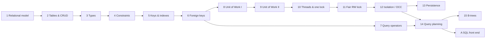

# Build Your Own Relational Database in Python

*A hands-on guide to how relational databases work, from a list of dicts to transactions, fair locking, crash recovery and a query planner, in pure Python 3.14 and its standard library.*

---

## About this book

This book builds **minidb**, a small but real relational database, one subsystem at a time. Each chapter adds a feature, or tears down a simplified version from an earlier chapter and rebuilds it properly, and explains *why* the simple version wasn't enough. By the end you will have written:

- a **CRUD** interface over in-memory tables with hidden rowids;
- **types** with normalization and validation, and **constraints** of every kind: NOT NULL, defaults, CHECK, primary keys, UNIQUE and foreign keys with cascades;
- **hash, sorted and B-tree indexes**;
- composable **query operators** (scan, filter, project, join, sort, aggregate) and a **cost-based query planner**;
- **transactions** built on the **Unit of Work** pattern, with an identity map, dirty checking and deferred constraints;
- a **fair readers–writer lock** that prevents starvation, and **serializable isolation** through optimistic concurrency control;
- **durability** through a write-ahead log and atomic snapshots, with **pluggable file formats** (JSON first);
- and, in an appendix, a **SQL front end**.

Every code listing was assembled into a working package chapter by chapter, and every interactive example was run against it, on both the regular and the free-threaded (`python3.14t`) builds of Python 3.14.

### Who it's for

You should be comfortable with Python: classes, dataclasses, generators, context managers and basic threading. You don't need any database theory; it's introduced as it's needed, with references to the original papers.

### How to read it

Read the chapters in order: each builds on the previous one's code. [Chapter 1](01-relational-model.md#14-how-to-read-the-code-in-this-book) explains the conventions for code listings. Each chapter ends with **questions and exercises**. Some check understanding, some extend minidb, and a few point to research papers. Diagrams are drawn with Mermaid (rendered by GitHub, GitLab, VS Code and most Markdown viewers) or included as SVG images.

## Contents

### Part I — Foundations

- **[Chapter 1 — What a Relational Database Is](01-relational-model.md)**
   [The relational model in one page](01-relational-model.md#11-the-relational-model-in-one-page) · [A database in 30 lines](01-relational-model.md#12-a-database-in-30-lines) · [The architecture we are heading for](01-relational-model.md#13-the-architecture-we-are-heading-for) · [How to read the code in this book](01-relational-model.md#14-how-to-read-the-code-in-this-book) · [Further reading](01-relational-model.md#15-further-reading)
- **[Chapter 2 — Tables and CRUD, Version 1](02-tables-and-crud.md)**
   [Errors first](02-tables-and-crud.md#21-errors-first) · [Rows and rowids](02-tables-and-crud.md#22-rows-and-rowids) · [The Table class](02-tables-and-crud.md#23-the-table-class) · [The Database façade](02-tables-and-crud.md#24-the-database-façade) · [Taking it for a spin](02-tables-and-crud.md#25-taking-it-for-a-spin) · [What we have, and what's missing](02-tables-and-crud.md#26-what-we-have-and-whats-missing)
- **[Chapter 3 — Types and Normalization](03-types-and-normalization.md)**
   [Domain errors](03-types-and-normalization.md#31-domain-errors) · [The Type base class](03-types-and-normalization.md#32-the-type-base-class) · [Column normalizers](03-types-and-normalization.md#33-column-normalizers) · [Columns and table schemas](03-types-and-normalization.md#34-columns-and-table-schemas) · [Tables with schemas](03-types-and-normalization.md#35-tables-with-schemas) · [Trying it out](03-types-and-normalization.md#36-trying-it-out) · [Normalization, the *other* meaning](03-types-and-normalization.md#37-normalization-the-other-meaning)

### Part II — Integrity

- **[Chapter 4 — Constraints I: NULL, Defaults and Checks](04-constraints.md)**
   [The constraint pipeline](04-constraints.md#41-the-constraint-pipeline) · [Three-valued logic](04-constraints.md#42-three-valued-logic) · [Columns with constraints](04-constraints.md#43-columns-with-constraints) · [Trying it out](04-constraints.md#44-trying-it-out) · [What constraints are *for*](04-constraints.md#45-what-constraints-are-for)
- **[Chapter 5 — Keys and Indexes](05-keys-and-indexes.md)**
   [Keys](05-keys-and-indexes.md#51-keys) · [A hash index](05-keys-and-indexes.md#52-a-hash-index) · [Declaring keys in the schema](05-keys-and-indexes.md#53-declaring-keys-in-the-schema) · [Table, rewritten around put and remove](05-keys-and-indexes.md#54-table-rewritten-around-put-and-remove) · [Database changes](05-keys-and-indexes.md#55-database-changes) · [Trying it out](05-keys-and-indexes.md#56-trying-it-out) · [How much faster?](05-keys-and-indexes.md#57-how-much-faster) · [What hash indexes can't do](05-keys-and-indexes.md#58-what-hash-indexes-cant-do)
- **[Chapter 6 — Referential Integrity](06-referential-integrity.md)**
   [Where foreign keys live](06-referential-integrity.md#61-where-foreign-keys-live) · [Checking in both directions needs indexes](06-referential-integrity.md#62-checking-in-both-directions-needs-indexes) · [The database orchestrates](06-referential-integrity.md#63-the-database-orchestrates) · [Trying it out](06-referential-integrity.md#64-trying-it-out) · [The limits of statement-at-a-time](06-referential-integrity.md#65-the-limits-of-statement-at-a-time)

### Part III — Querying

- **[Chapter 7 — Query Primitives](07-query-primitives.md)**
   [The iterator model](07-query-primitives.md#71-the-iterator-model) · [Rows with qualified names](07-query-primitives.md#72-rows-with-qualified-names) · [Operators](07-query-primitives.md#73-operators) · [Aggregation](07-query-primitives.md#74-aggregation) · [A query builder](07-query-primitives.md#75-a-query-builder) · [Trying it out](07-query-primitives.md#76-trying-it-out) · [What's still missing](07-query-primitives.md#77-whats-still-missing)

### Part IV — Transactions and Concurrency

- **[Chapter 8 — Unit of Work I: Changes, Commit and Undo](08-unit-of-work-i.md)**
   [Changes: writes as data](08-unit-of-work-i.md#81-changes-writes-as-data) · [The planning module](08-unit-of-work-i.md#82-the-planning-module) · [A slimmer Table](08-unit-of-work-i.md#83-a-slimmer-table) · [Database: plan, then apply](08-unit-of-work-i.md#84-database-plan-then-apply) · [The Unit of Work, version 1](08-unit-of-work-i.md#85-the-unit-of-work-version-1) · [Trying it out](08-unit-of-work-i.md#86-trying-it-out) · [What's wrong with version 1](08-unit-of-work-i.md#87-whats-wrong-with-version-1)
- **[Chapter 9 — Unit of Work II: Workspaces, Identity Map and Deferred Constraints](09-unit-of-work-ii.md)**
   [The table view](09-unit-of-work-ii.md#91-the-table-view) · [Planners with options](09-unit-of-work-ii.md#92-planners-with-options) · [The Unit of Work, version 2](09-unit-of-work-ii.md#93-the-unit-of-work-version-2) · [Trying it out](09-unit-of-work-ii.md#94-trying-it-out) · [Deferred constraints](09-unit-of-work-ii.md#95-deferred-constraints) · [Where we are](09-unit-of-work-ii.md#96-where-we-are)
- **[Chapter 10 — Concurrency I: Threads and One Big Lock](10-concurrency-i.md)**
   [Python threads in 2026](10-concurrency-i.md#101-python-threads-in-2026) · [Breaking minidb](10-concurrency-i.md#102-breaking-minidb) · [Two kinds of protection](10-concurrency-i.md#103-two-kinds-of-protection) · [One big lock](10-concurrency-i.md#104-one-big-lock) · [Checking the fix](10-concurrency-i.md#105-checking-the-fix) · [The price of one big lock](10-concurrency-i.md#106-the-price-of-one-big-lock)
- **[Chapter 11 — Readers–Writer Locks and Starvation](11-readers-writer-locks.md)**
   [Building blocks: monitors and condition variables](11-readers-writer-locks.md#111-building-blocks-monitors-and-condition-variables) · [The interface](11-readers-writer-locks.md#112-the-interface) · [Attempt 1: readers first](11-readers-writer-locks.md#113-attempt-1-readers-first) · [Attempt 2: writers first](11-readers-writer-locks.md#114-attempt-2-writers-first) · [The fix: one queue, served in order](11-readers-writer-locks.md#115-the-fix-one-queue-served-in-order) · [Watching starvation happen](11-readers-writer-locks.md#116-watching-starvation-happen) · [Plugging it into minidb](11-readers-writer-locks.md#117-plugging-it-into-minidb) · [Trying it out](11-readers-writer-locks.md#118-trying-it-out) · [What's left](11-readers-writer-locks.md#119-whats-left)
- **[Chapter 12 — Isolation: Optimistic Concurrency Control](12-isolation.md)**
   [What can go wrong: isolation anomalies](12-isolation.md#121-what-can-go-wrong-isolation-anomalies) · [The plan: read set, validation, write](12-isolation.md#122-the-plan-read-set-validation-write) · [Code](12-isolation.md#123-code) · [Trying it out](12-isolation.md#124-trying-it-out) · [Isolation in real systems](12-isolation.md#125-isolation-in-real-systems) · [Fairness has a price](12-isolation.md#126-fairness-has-a-price)

### Part V — Durability and Performance

- **[Chapter 13 — Persistence: Snapshots, a Write-Ahead Log and Pluggable Formats](13-persistence.md)**
   [Values on disk](13-persistence.md#131-values-on-disk) · [Formats](13-persistence.md#132-formats) · [Encoding the database](13-persistence.md#133-encoding-the-database) · [Writing files that survive crashes](13-persistence.md#134-writing-files-that-survive-crashes) · [The database side](13-persistence.md#135-the-database-side) · [Trying it out](13-persistence.md#136-trying-it-out) · [Real-world notes](13-persistence.md#137-real-world-notes)
- **[Chapter 14 — Query Planning](14-query-planning.md)**
   [Predicates the planner can read](14-query-planning.md#141-predicates-the-planner-can-read) · [An ordered index](14-query-planning.md#142-an-ordered-index) · [Estimating sizes](14-query-planning.md#143-estimating-sizes) · [The planner](14-query-planning.md#144-the-planner) · [Trying it out](14-query-planning.md#145-trying-it-out) · [Where real planners go further](14-query-planning.md#146-where-real-planners-go-further)
- **[Chapter 15 — Beyond Memory: B-Trees](15-b-trees.md)**
   [Why not a binary tree?](15-b-trees.md#151-why-not-a-binary-tree) · [The B+ tree](15-b-trees.md#152-the-b-tree) · [Implementation](15-b-trees.md#153-implementation) · [Trying it out](15-b-trees.md#154-trying-it-out) · [From memory to disk](15-b-trees.md#155-from-memory-to-disk) · [Where we've arrived](15-b-trees.md#156-where-weve-arrived)

### Appendices

- **[Appendix A — A SQL Front End](appendix-a-sql-parser.md)**
   [The language](appendix-a-sql-parser.md#a1-the-language) · [How it works](appendix-a-sql-parser.md#a2-how-it-works) · [Trying it out](appendix-a-sql-parser.md#a3-trying-it-out)
- **[Appendix B — Testing a Database](appendix-b-testing.md)**
   [An integrity checker](appendix-b-testing.md#b1-an-integrity-checker) · [Property-based and model-based tests](appendix-b-testing.md#b2-property-based-and-model-based-tests) · [Concurrency tests](appendix-b-testing.md#b3-concurrency-tests) · [Crash tests](appendix-b-testing.md#b4-crash-tests) · [The test module](appendix-b-testing.md#b5-the-test-module)
- **[Appendix C — The Complete Code](appendix-c-complete-code.md)**

### Back matter

- **[References](references.md)**: every paper and book cited, with links back to the chapters

---

*Start reading: [Chapter 1 — What a Relational Database Is →](01-relational-model.md)*
